# Twoja publiczna strona organizatora — przewodnik

*Ostatnia aktualizacja: 10 października 2026*

Ten przewodnik jest dla organizatorów zajęć: prowadzących kluby, pracownie, grupy przedszkolne czy sportowe. Dowiesz się z niego:

- czym jest Twoja publiczna strona,
- jak zmienić jej wygląd,
- skąd biorą się informacje, które na niej widać.

Nie potrzebujesz żadnej wiedzy technicznej.

---

## Spis treści

1. [Czym jest publiczna strona organizatora?](#1-czym-jest-publiczna-strona-organizatora)
2. [Co widzą rodzice i goście, a co widzisz Ty](#2-co-widzą-rodzice-i-goście-a-co-widzisz-ty)
3. [Jak zmienić wygląd strony](#3-jak-zmienić-wygląd-strony)
4. [Pięć układów strony — który wybrać?](#4-pięć-układów-strony--który-wybrać)
5. [Strona „Wszystkie terminy”](#5-strona-wszystkie-terminy)
6. [Co pojawia się na stronie automatycznie i skąd to dodać](#6-co-pojawia-się-na-stronie-automatycznie-i-skąd-to-dodać)
7. [Co będzie dostępne wkrótce](#7-co-będzie-dostępne-wkrótce)
8. [Najczęstsze pytania i problemy](#8-najczęstsze-pytania-i-problemy)

---

## 1. Czym jest publiczna strona organizatora?

Każda organizacja ma swoją własną stronę pod adresem:

**domena.pl/*nazwa-twojej-organizacji***

Na przykład: `domena.pl/organizacja-b-e2e`. Końcówka adresu to tak zwany *slug*, czyli krótka nazwa Twojej organizacji w adresie strony.

To Twoja wizytówka w internecie. Możesz wysłać ten link rodzicom w wiadomości, wkleić go w grupie na komunikatorze albo w opisie profilu w mediach społecznościowych.

**Co rodzic znajdzie na Twojej stronie?**

- Twoje **grupy**, na przykład „Maluchy” i „Starszaki”.
- **Najbliższe terminy zajęć** wraz z liczbą zapisanych osób.
- **Rzeczy do wymiany**, czyli to, co rodzice z Twoich grup chcą oddać, zamienić albo wypożyczyć.
- **Rzeczy potrzebne** na najbliższe zajęcia.

Gość nie musi się logować, żeby obejrzeć stronę. Gdy kliknie w termin, przejdzie do strony tego terminu. Tam może się zapisać albo zarezerwować rzecz.

💡 **Wskazówka**: przycisk **„Udostępnij”** na Twojej stronie pozwala szybko skopiować link albo wysłać go znajomym.

⚠️ **Ważne — prywatność**: na publicznej stronie nie widać imion ani nazwisk rodziców i dzieci. Pokazujemy tylko liczby, na przykład „zapisanych: 5”. Liczbę rodzin pokazujemy dopiero wtedy, gdy są co najmniej trzy. Pojawiają się tu wyłącznie grupy ustawione jako **publiczne**.

---

## 2. Co widzą rodzice i goście, a co widzisz Ty

### Widok gościa

Tak wygląda strona dla rodzica, który otworzył Twój link (przykład innej organizacji):

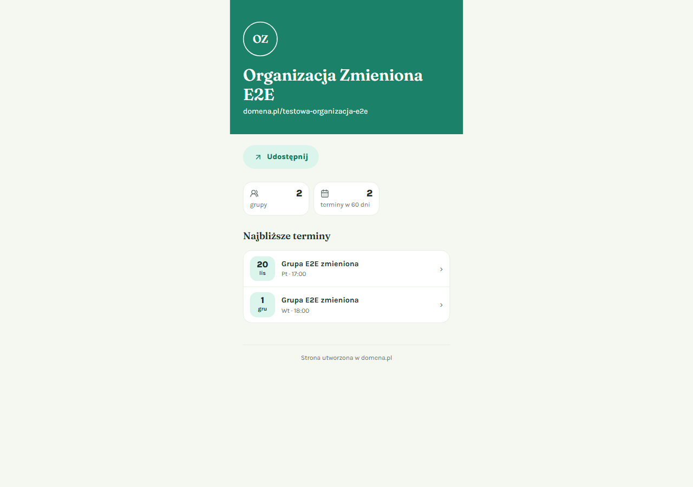

Gość widzi tylko te sekcje, w których coś jest. Jeśli na przykład nikt nie wystawił jeszcze rzeczy do wymiany, sekcja „Wymiana rzeczy” po prostu się nie pokaże.

### Twój widok (gdy jesteś zalogowany)

Gdy otworzysz własną stronę jako zalogowany właściciel, zobaczysz ją prawie tak samo jak goście. Są jednak dwie różnice:

1. W prawym górnym rogu pojawia się **ikona koła zębatego**, czyli przycisk **„Edytuj wygląd”**.
2. W miejscach, gdzie brakuje danych, widzisz **szare podpowiedzi** z dopiskiem *„Widzisz to tylko Ty.”*. Goście ich nie widzą.

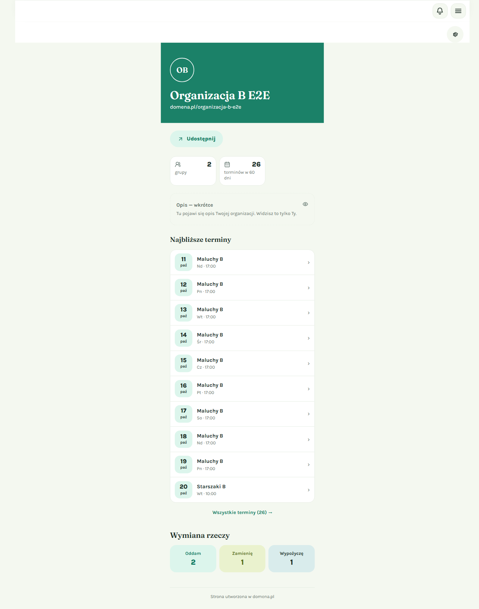

✅ **Co powinieneś zobaczyć**: nazwę organizacji, przycisk „Udostępnij”, statystyki (liczba grup i terminów), listę najbliższych terminów i kafelki „Wymiana rzeczy”.

---

## 3. Jak zmienić wygląd strony

Możesz wybrać **układ** strony (co jest na niej najważniejsze) oraz jej **kolory**. Zmiany widzisz na żywo, zanim je zapiszesz.

📝 **Czego potrzebujesz**:
- konta właściciela organizacji,
- bycia zalogowanym.

### Krok 1. Otwórz panel „Wygląd strony”

Wejdź na swoją stronę (`domena.pl/nazwa-twojej-organizacji`). Kliknij **ikonę koła zębatego** w prawym górnym rogu. To przycisk „Edytuj wygląd”.

Otworzy się panel **„Wygląd strony”** z dwiema zakładkami: **Układ** i **Kolory**.

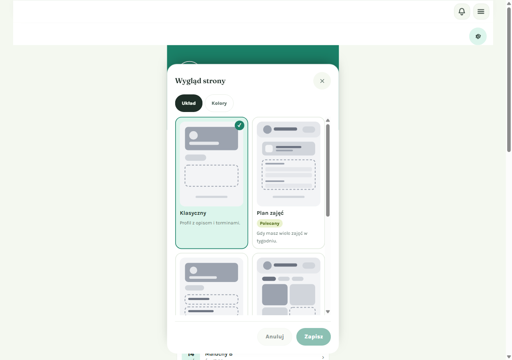

💡 **Wskazówka**: na telefonie panel wysuwa się od dołu ekranu. Działa dokładnie tak samo.

### Krok 2. Wybierz układ (zakładka „Układ”)

Kliknij kartę układu, który Ci się podoba. Aktualnie wybrany układ ma zielone tło i znaczek ✓.

Listę kart możesz przewijać w dół. Pod spodem są kolejne układy: **Grupy**, **Wymiana** i **Wizytówka**.

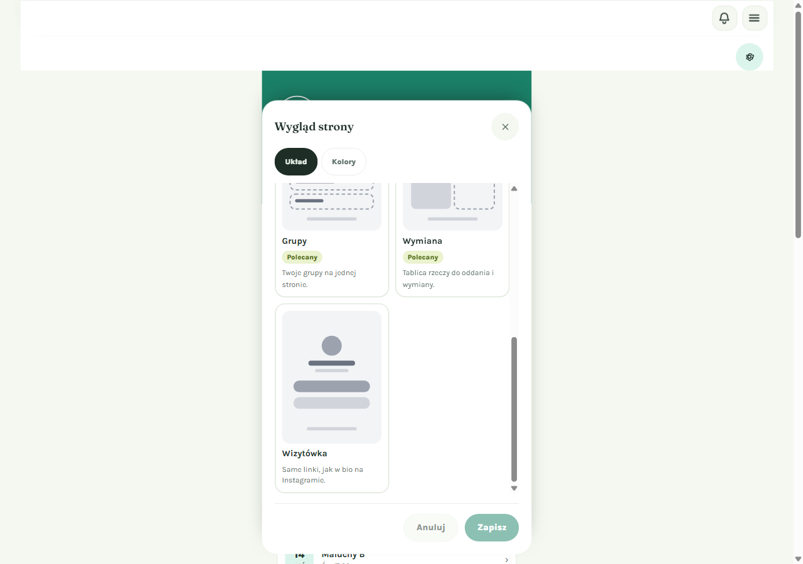

Przy niektórych kartach widać zieloną odznakę **„Polecany”**. Podpowiadamy w ten sposób, który układ najlepiej pasuje do Twoich danych. Więcej o tym w [rozdziale 4](#4-pięć-układów-strony--który-wybrać).

### Krok 3. Zobacz podgląd na żywo

Po kliknięciu karty strona w tle **od razu zmienia wygląd**. Na zdjęciu poniżej wybrano „Plan zajęć”: nagłówek strony za panelem zmienił się na wąski pasek z nazwą organizacji.

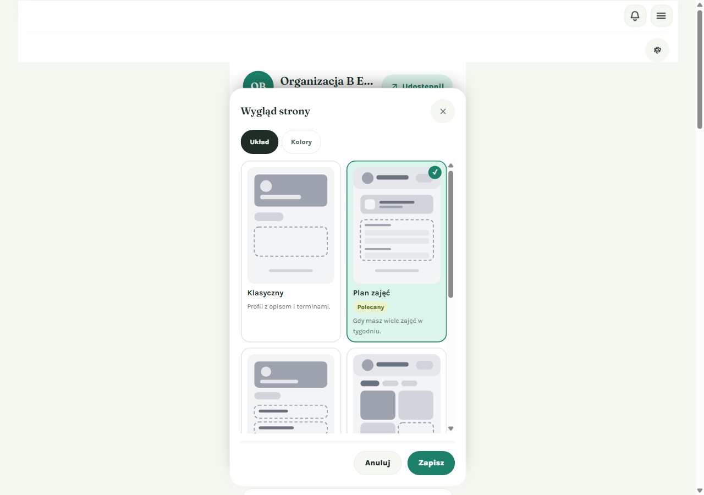

⚠️ **Ważne**: to tylko podgląd. Dopóki nie klikniesz **„Zapisz”**, goście nadal widzą stary wygląd.

### Krok 4. Wybierz kolory (zakładka „Kolory”)

Kliknij zakładkę **„Kolory”**. Wybierz jeden z gotowych zestawów, na przykład **Mięta**, **Ocean**, **Lawenda** albo **Malina**. Możesz też ustawić **Własny** zestaw.

W sekcji **„Podgląd”** zobaczysz, jak w nowych kolorach wyglądają karta terminu i karta rzeczy. Jeśli chcesz wrócić do kolorów startowych, kliknij **„Przywróć domyślne”**.

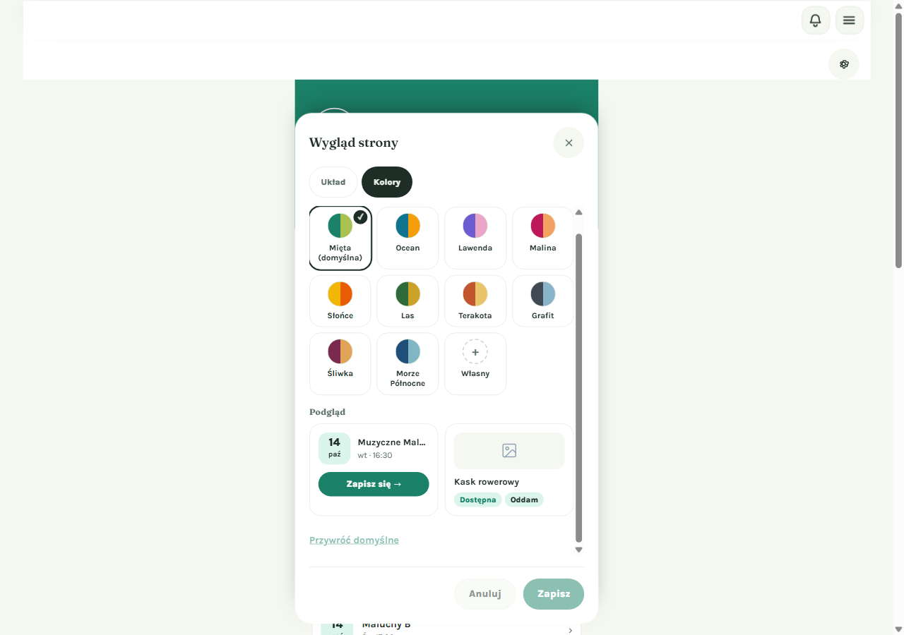

### Krok 5. Zapisz albo zrezygnuj

Na dole panelu masz dwa przyciski:

- **Zapisz** zapisuje zmiany. Panel się zamyka, a nowy wygląd od razu widzą wszyscy goście.
- **Anuluj** cofa zmiany do ostatnio zapisanego wyglądu.

Oba przyciski są nieaktywne (wyszarzone), dopóki niczego nie zmienisz.

Jeśli zamkniesz panel przyciskiem **✕** po zmianie układu lub kolorów, zapytamy: **„Odrzucić zmiany?”**.

- **Wróć do edycji**: wracasz do panelu, a Twoje wybory zostają.
- **Odrzuć**: zmiany przepadają, a strona wraca do zapisanego wyglądu.

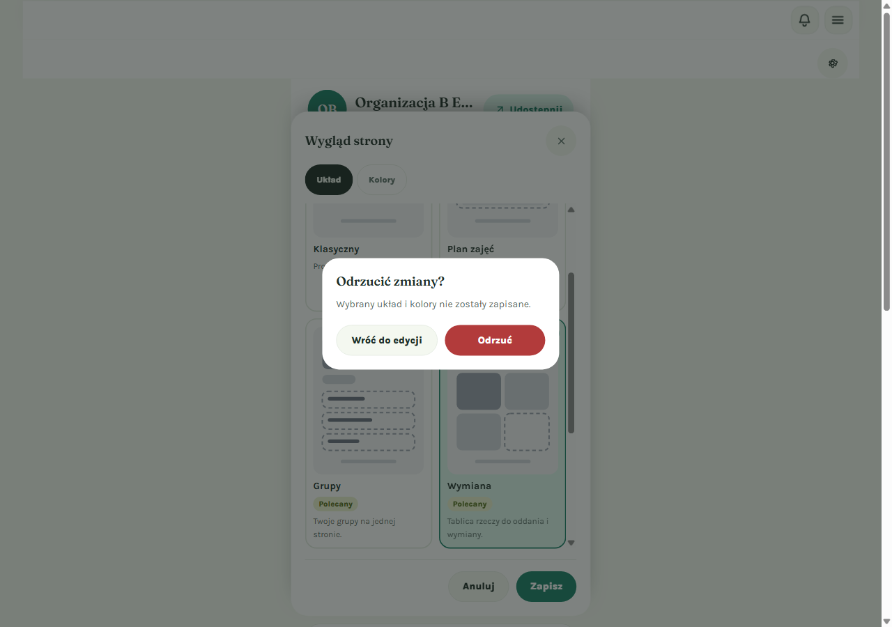

✅ **Co powinieneś zobaczyć po zapisaniu**: panel znika, a Twoja strona ma nowy układ i kolory.

---

## 4. Pięć układów strony — który wybrać?

Każdy układ pokazuje te same informacje, ale stawia na pierwszym planie co innego. Układ możesz zmieniać, kiedy chcesz. Nic nie tracisz, bo terminy, grupy i rzeczy zostają na miejscu.

### Podsumowanie

| Układ | Kiedy wybrać | Kiedy pojawia się odznaka „Polecany” |
|---|---|---|
| **Klasyczny** | Uniwersalny profil: statystyki, najbliższe terminy, wymiana. Dobry na start. | Nigdy (to układ domyślny) |
| **Plan zajęć** | Masz dużo zajęć w tygodniu i rodzice szukają konkretnego dnia i godziny. | Gdy w najbliższych **14 dniach** masz co najmniej **4 terminy** |
| **Grupy** | Prowadzisz kilka grup i chcesz pokazać je obok siebie. | Gdy masz co najmniej **2 publiczne grupy** |
| **Wymiana** | Najważniejsza jest wymiana rzeczy między rodzicami. | Gdy do wymiany jest co najmniej **4 rzeczy** |
| **Wizytówka** | Chcesz prostą stronę z kilkoma przyciskami, jak link w opisie profilu na Instagramie. | Gdy **nie masz jeszcze publicznych grup** (albo nie udało się wczytać danych) |

💡 **O odznace „Polecany”**:
- Sprawdzamy ją na podstawie Twoich prawdziwych danych w chwili otwarcia panelu.
- Może się pokazać przy kilku układach naraz.
- To tylko podpowiedź: możesz wybrać dowolny układ.
- Przez chwilę po otwarciu panelu, gdy dane jeszcze się wczytują, odznak nie ma. To normalne.

### Klasyczny

Duży kolorowy nagłówek z nazwą organizacji, przycisk „Udostępnij”, statystyki, lista **„Najbliższe terminy”** z linkiem „Wszystkie terminy” oraz kafelki **„Wymiana rzeczy”** (Oddam / Zamienię / Wypożyczę).

### Plan zajęć

Wąski nagłówek, wyróżniona karta **„Najbliższe zajęcia”** z przyciskiem **„Zobacz i zapisz się →”**, a pod nią pełny **„Plan zajęć”** pogrupowany po dniach.

- Jeśli masz co najmniej dwie grupy, nad planem pojawiają się przyciski filtrów: **Wszystkie**, a obok nich nazwy grup.
- Przycisk **„Pokaż kolejne terminy”** doczytuje dalsze daty.

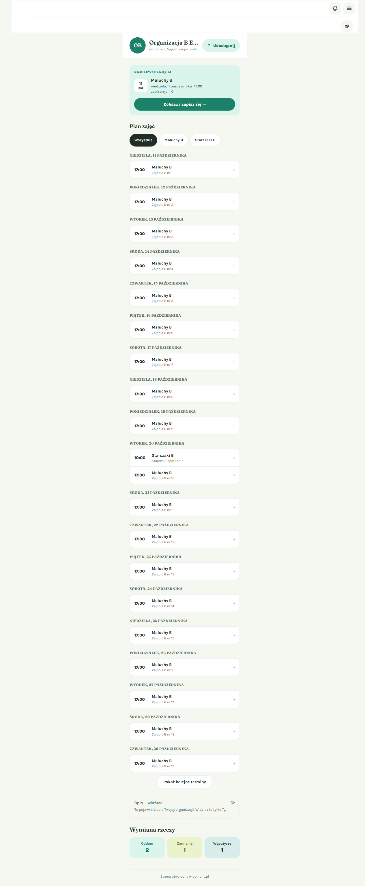

### Grupy

Sekcja **„Nasze grupy”** pokazuje kartę każdej grupy z liczbą zapisanych, liczbą terminów i datą następnych zajęć. Kliknięcie karty prowadzi do najbliższego terminu tej grupy.

Jeśli masz **tylko jedną** grupę, zobaczysz jedną dużą kartę **„Nasza grupa”** z obrazkiem pokazującym, ile miejsc jest zajętych, i przyciskiem „Zobacz zajęcia →”.

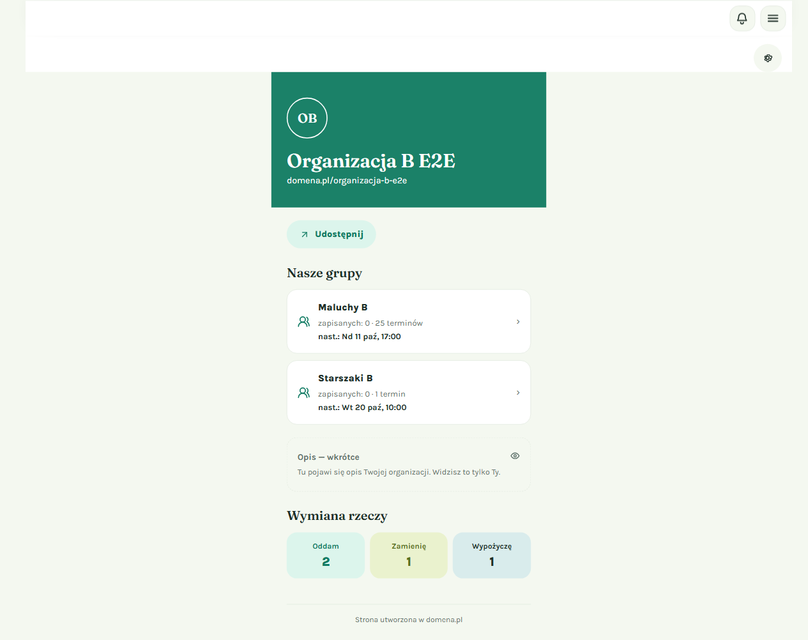

### Wymiana

Na górze są zakładki **Wszystko / Oddam / Zamienię / Wypożyczę** z liczbą rzeczy. Pod nimi tablica rzeczy ze zdjęciami, stanem (np. „Dobry”, „Nowy”) i datą odbioru.

Niżej znajdziesz:
- listę **„Potrzebne na najbliższe zajęcia”**,
- skrót **„Najbliższe spotkania”** z trzema najbliższymi datami.

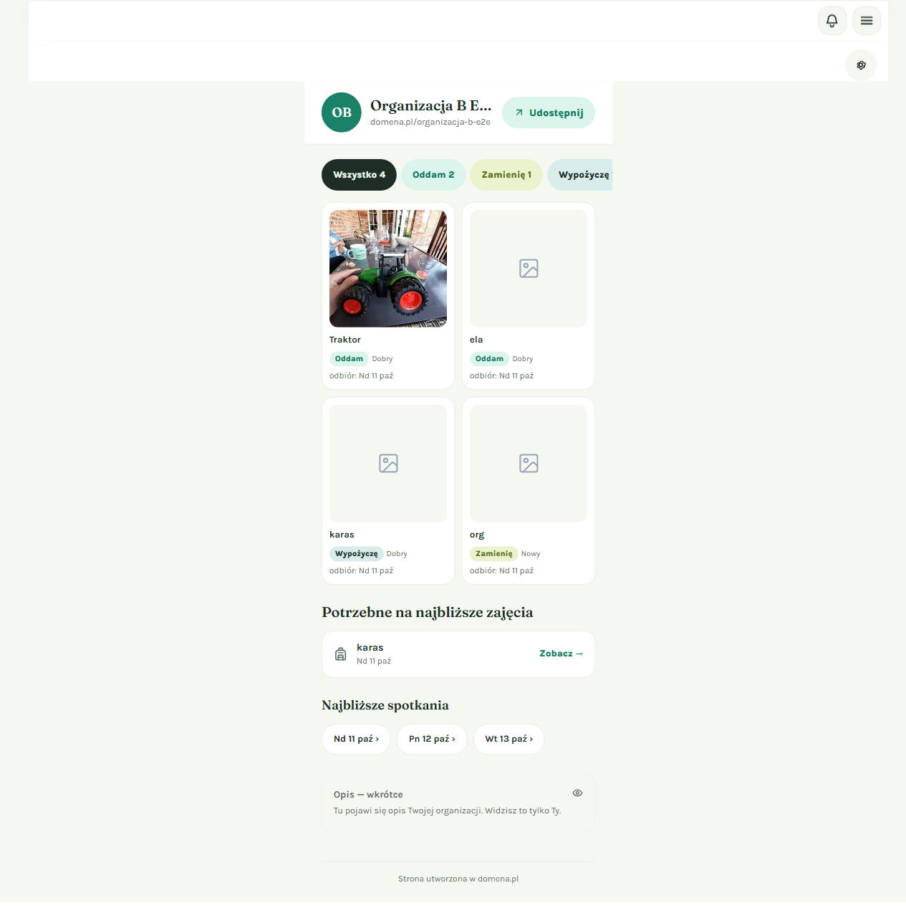

💡 **Wskazówka**: na wąskim ekranie zakładki mogą się nie zmieścić w jednym rzędzie. Wtedy przesuń je palcem w bok.

### Wizytówka

Prosta, wyśrodkowana strona z dużymi przyciskami:

- **„Najbliższe zajęcia”** z datą i godziną,
- **„Wszystkie terminy (liczba)”**,
- **„Wymiana rzeczy (liczba)”**,
- **„Udostępnij stronę”**.

Przyciski pokazują się tylko wtedy, gdy jest do czego prowadzić.

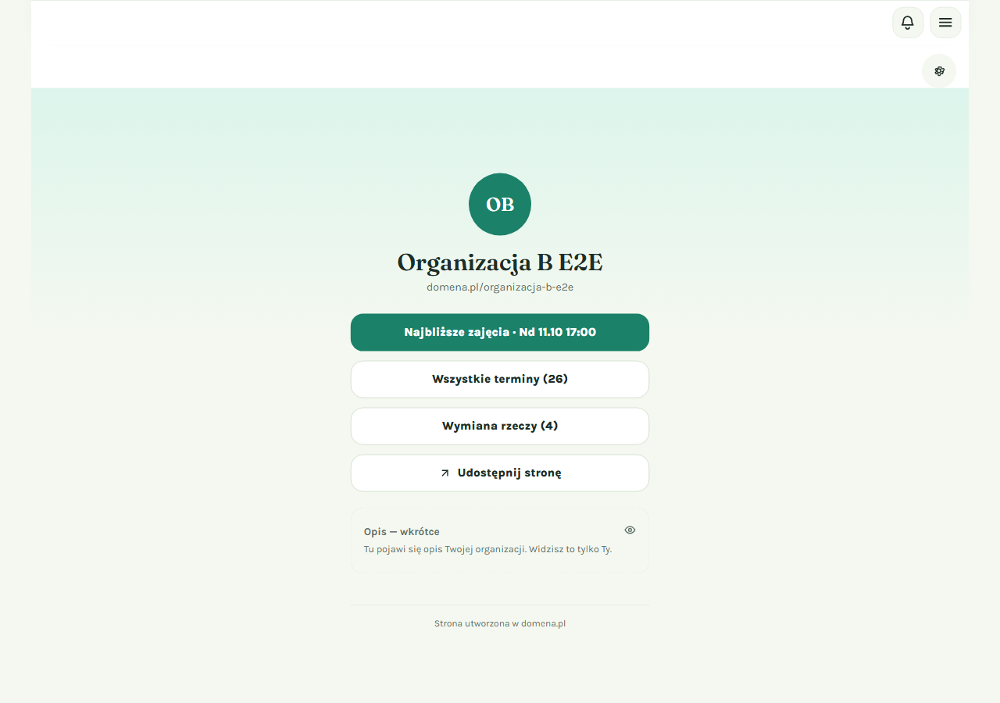

---

## 5. Strona „Wszystkie terminy”

Każda organizacja ma też stronę z **pełną listą nadchodzących zajęć**:

**domena.pl/*nazwa-twojej-organizacji*/terminy**

Rodzice trafiają tu przez link **„Wszystkie terminy”** na Twojej stronie. Możesz też wysłać ten adres bezpośrednio. Nazwa karty w przeglądarce to „Wszystkie terminy · *nazwa organizacji*”.

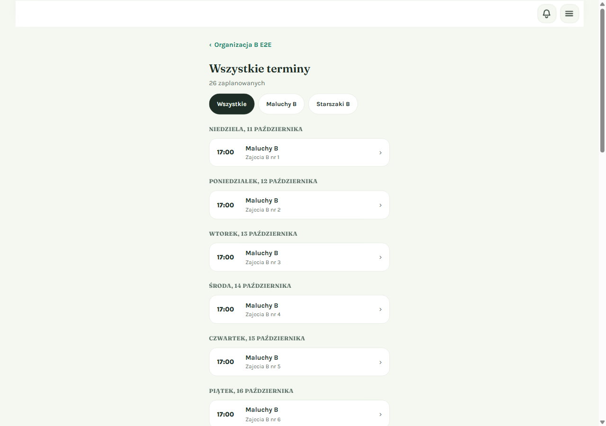

**Co tu jest:**

- **„‹ Nazwa organizacji”** u góry to link powrotny na stronę główną organizacji.
- **„26 zaplanowanych”** mówi, ile terminów jest łącznie.
- **Filtry grup** pojawiają się, gdy masz co najmniej dwie publiczne grupy.
- **Lista terminów** jest pogrupowana po dniach. Każdy wiersz pokazuje godzinę, nazwę grupy i opis. Kliknięcie prowadzi do strony terminu, gdzie można się zapisać.

### Jak przefiltrować terminy według grupy

1. **Kliknij nazwę grupy** w rzędzie filtrów, na przykład „Starszaki B”.

   Lista od razu pokazuje tylko zajęcia tej grupy, a licznik się aktualizuje.

   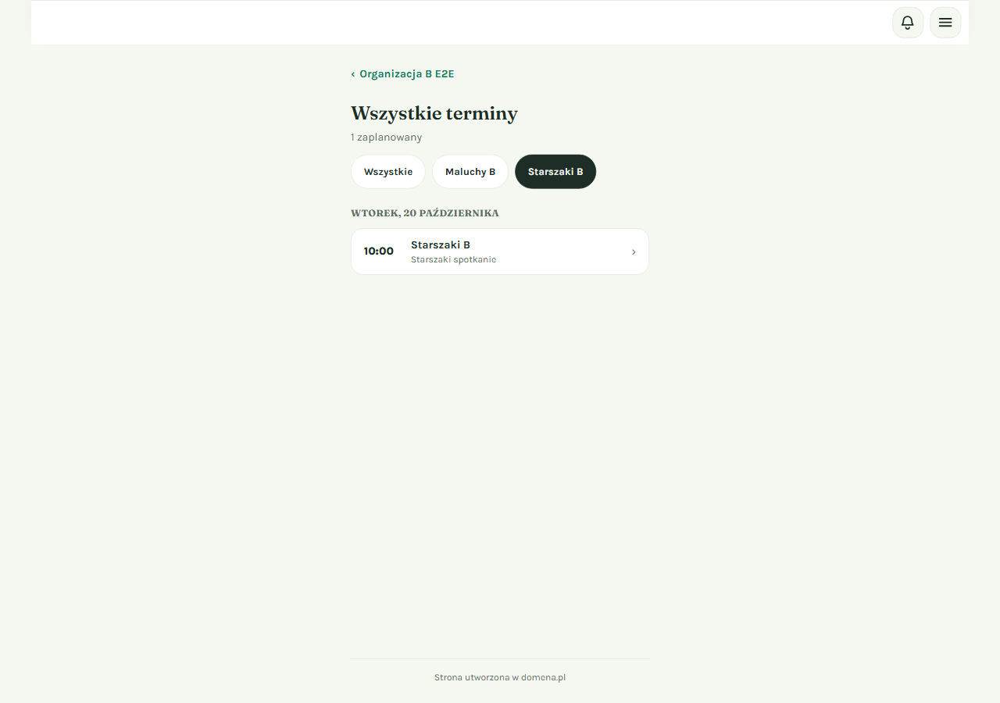

2. **Kliknij „Wszystkie”**, żeby wrócić do pełnej listy.

💡 **Wskazówka**: wybrany filtr zapisuje się w adresie strony. Możesz więc wysłać rodzicom link od razu ustawiony na jedną grupę.

### „Pokaż więcej”

Na początku widać około 20 terminów. Jeśli jest ich więcej, na dole listy pojawi się przycisk **„Pokaż więcej”**. Każde kliknięcie doczytuje kolejne terminy. Gdy wszystkie są już widoczne, przycisk znika.

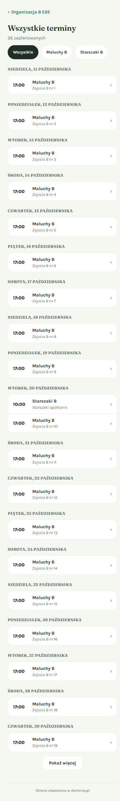

❌ **Gdy nie ma terminów**: strona pokaże komunikat **„Brak zaplanowanych zajęć”**. Jeśli był wybrany filtr grupy, pojawi się też przycisk **„Pokaż wszystkie grupy”**.

---

## 6. Co pojawia się na stronie automatycznie i skąd to dodać

Nie musisz niczego przepisywać ręcznie. Strona **sama zbiera dane** z Twojego panelu.

| Co widać na stronie | Skąd się bierze | Gdzie to dodać |
|---|---|---|
| **Grupy** | Twoje grupy ustawione jako **publiczne**, w których jesteś organizatorem | Panel → **Spotkania** (`/panel/spotkania`) |
| **Terminy zajęć** | Wszystkie przyszłe terminy publicznych grup | Panel → **Spotkania** (`/panel/spotkania`) |
| **Rzeczy do wymiany** | Rzeczy wystawione na najbliższy termin grupy przez Ciebie albo przez rodziców zapisanych na ten termin | Panel → **Moje rzeczy** (`/panel/rzeczy`) |
| **Potrzebne rzeczy** | Rzeczy, które dodałeś jako potrzebne do najbliższego terminu grupy | Panel → **Spotkania** (`/panel/spotkania`), przy terminie |

⚠️ **Ważne**:
- **Grupy prywatne** nigdy nie pojawiają się na publicznej stronie: ani one same, ani ich terminy, ani rzeczy. Jeśli grupa nie jest widoczna, sprawdź w panelu, czy jest ustawiona jako publiczna.
- Rzecz potrzebna, którą ktoś już zadeklarował, jest oznaczona jako **„Zapewnione”**. Nie pokazujemy, kto ją przyniesie.

### Puste miejsca — co widzisz Ty

Gdy w jakiejś sekcji nie ma jeszcze danych, w swoim widoku zobaczysz **szarą podpowiedź**. Ma ona tytuł, krótkie wyjaśnienie i link, który zabierze Cię prosto do odpowiedniego miejsca w panelu, na przykład **„Dodaj termin →”** albo **„Dodaj rzecz do wymiany →”**.

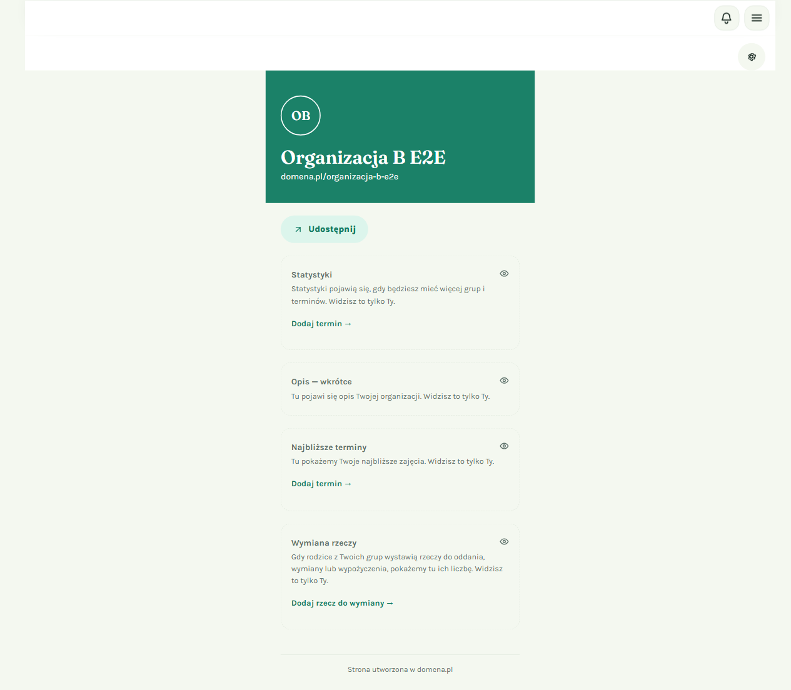

Każda podpowiedź kończy się zdaniem *„Widzisz to tylko Ty.”*. Goście jej nie zobaczą.

### Puste miejsca — co widzą goście

Goście nie widzą pustych sekcji. Jeśli w głównej części strony nie ma nic do pokazania, zobaczą przyjazny komunikat i zachętę do udostępnienia strony:

- **Klasyczny** i **Plan zajęć**: „Brak zaplanowanych zajęć”
- **Grupy**: „Brak grup do pokazania”
- **Wymiana**: „Na razie nic tu nie ma”, z rozwijanym wyjaśnieniem „Jak to działa?”

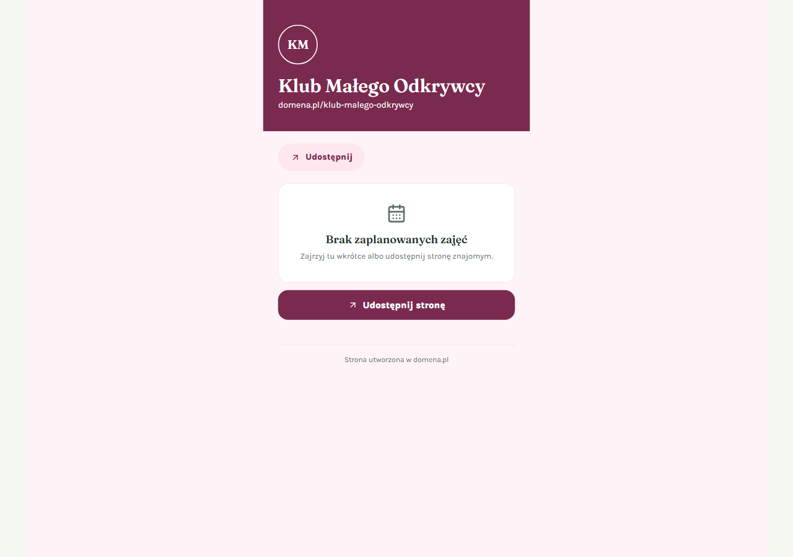

💡 **Wskazówka**: zanim wyślesz link rodzicom, dodaj w panelu przynajmniej jedną publiczną grupę i kilka terminów. Strona od razu będzie wyglądała pełniej.

---

## 7. Co będzie dostępne wkrótce

Na razie na publicznej stronie **nie da się jeszcze dodać**:

- **opisu organizacji**: w Twoim widoku to miejsce oznacza podpowiedź „Opis — wkrótce”,
- **zdjęć i galerii organizacji**,
- dodatkowych informacji, takich jak hasło przewodnie, lokalizacja czy własne linki.

Pracujemy nad tym. Gdy te funkcje będą gotowe, pojawią się w panelu „Wygląd strony” i zaktualizujemy ten przewodnik.

---

## 8. Najczęstsze pytania i problemy

**Nie widzę ikony koła zębatego.**
Upewnij się, że jesteś zalogowany na konto właściciela organizacji. Ikona jest widoczna tylko dla właściciela, a goście jej nie mają.

**Zapisałem nowy termin, ale nie widzę go na stronie.**
- Sprawdź, czy grupa jest **publiczna**.
- Sprawdź, czy termin jest **w przyszłości**.
- Odśwież stronę w przeglądarce.

**Lista „Najbliższe terminy” pokazuje mniej zajęć niż strona „Wszystkie terminy”.**
To normalne. Na stronie głównej pokazujemy najbliższe terminy z około 60 dni. Pełną listę, bez ograniczenia czasu, znajdziesz pod linkiem „Wszystkie terminy”.

**Dlaczego nie widać liczby rodzin w statystykach?**
Ze względu na prywatność liczbę rodzin pokazujemy dopiero od trzech rodzin.

**Rzeczy do wymiany się nie pokazują.**
Pokazujemy tylko rzeczy:
- dostępne,
- wystawione przez Ciebie albo przez rodziców zapisanych na **najbliższy** termin danej grupy.

Jeśli najbliższy termin się odbył, sprawdź, czy kolejny jest już dodany.

**Kliknąłem inny układ i strona się zmieniła. Czy goście to już widzą?**
Nie. Dopóki nie klikniesz **„Zapisz”**, to tylko podgląd widoczny dla Ciebie.

**Strona pokazuje komunikat „Nie udało się wczytać terminów.”**
To chwilowy problem z połączeniem. Kliknij **„Spróbuj ponownie”** albo odśwież stronę.

---

### Powiązane funkcje

- **Panel → Spotkania** (`/panel/spotkania`): dodawanie grup, terminów i rzeczy potrzebnych.
- **Panel → Moje rzeczy** (`/panel/rzeczy`): wystawianie rzeczy do oddania, zamiany lub wypożyczenia.
- **Strona terminu**: tu rodzice zapisują się na zajęcia i rezerwują rzeczy. Przy każdej rzeczy widać teraz miniaturkę zdjęcia, żeby łatwiej było ją rozpoznać.
