# Zdjęcia organizacji — logo, okładka i galeria

*Ostatnia aktualizacja: 11 października 2026*

## Spis treści

1. [Czym są zdjęcia organizacji?](#czym-są-zdjęcia-organizacji)
2. [Dla kogo jest ta funkcja?](#dla-kogo-jest-ta-funkcja)
3. [Zanim zaczniesz](#zanim-zaczniesz)
4. [Jak otworzyć zakładkę „Zdjęcia”](#jak-otworzyć-zakładkę-zdjęcia)
5. [Jak dodać logo](#jak-dodać-logo)
6. [Jak dodać okładkę](#jak-dodać-okładkę)
7. [Co oznacza „W weryfikacji”?](#co-oznacza-w-weryfikacji)
8. [Jak wymienić lub usunąć logo i okładkę](#jak-wymienić-lub-usunąć-logo-i-okładkę)
9. [Jak dodać zdjęcia do galerii](#jak-dodać-zdjęcia-do-galerii)
10. [Jak zmienić kolejność zdjęć w galerii](#jak-zmienić-kolejność-zdjęć-w-galerii)
11. [Jak usunąć zdjęcie z galerii](#jak-usunąć-zdjęcie-z-galerii)
12. [Co widzą odwiedzający?](#co-widzą-odwiedzający)
13. [Wskazówki](#wskazówki)
14. [Rozwiązywanie problemów](#rozwiązywanie-problemów)

---

## Czym są zdjęcia organizacji?

Twoja strona organizatora (np. `domena.pl/twoja-organizacja`) może pokazywać trzy rodzaje zdjęć:

- **Logo** — małe, okrągłe zdjęcie przy nazwie organizacji. Zastępuje inicjały (np. „OB”).
- **Okładka** — szerokie zdjęcie u góry strony, za nazwą i adresem. Zastępuje kolorowe tło.
- **Galeria** — do **3 zdjęć**, pokazanych w osobnej sekcji „Galeria” pod opisem organizacji.

Dzięki nim rodzice od razu rozpoznają, że trafili na właściwą stronę, a Twoja strona wygląda jak Twoja marka.

---

## Dla kogo jest ta funkcja?

Dla **właściciela organizacji**, czyli osoby, która założyła stronę organizatora. Tylko Ty możesz dodawać, wymieniać i usuwać zdjęcia swojej organizacji.

Przykłady użycia:

- przedszkole dodaje swoje logo i zdjęcie budynku jako okładkę,
- klub sportowy pokazuje w galerii zdjęcia z treningów,
- organizator zajęć wymienia okładkę na nowy sezon.

---

## Zanim zaczniesz

📝 **Czego potrzebujesz**:

- konta właściciela organizacji (musisz być zalogowany),
- zdjęć w formacie **JPG, PNG lub WebP**, każde **do 15 MB**.

💡 **Wskazówka**: na logo najlepiej sprawdza się kwadratowe zdjęcie z wyraźnym znakiem na środku — zostanie przycięte do koła. Na okładkę wybierz szerokie, poziome zdjęcie.

⚠️ **Ważne**: każde zdjęcie jest najpierw sprawdzane (moderacja). Odwiedzający zobaczą je dopiero po sprawdzeniu. Więcej w sekcji [Co oznacza „W weryfikacji”?](#co-oznacza-w-weryfikacji).

---

## Jak otworzyć zakładkę „Zdjęcia”

Wszystkimi zdjęciami zarządzasz w edytorze **„Wygląd strony”**, w zakładce **„Zdjęcia”**. Możesz się tam dostać na dwa sposoby.

### Sposób 1: przez kartę „Galeria” na Twojej stronie

1. **Otwórz swoją stronę organizatora.**

   Dopóki galeria jest pusta, pod opisem organizacji widzisz kartę **„Galeria”** z tekstem „Dodaj do 3 zdjęć — odwiedzający zobaczą je po sprawdzeniu. Widzisz to tylko Ty.”

   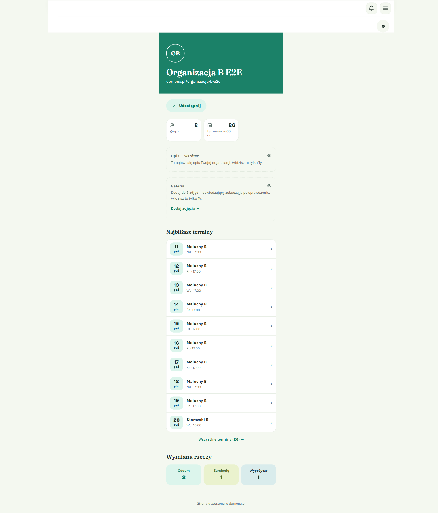

   💡 **Tip**: tę kartę widzisz tylko Ty. Odwiedzający nie widzą pustej galerii.

2. **Kliknij „Dodaj zdjęcia →”.**

   Otworzy się edytor „Wygląd strony” od razu na zakładce „Zdjęcia”. Działa to także wtedy, gdy edytor był już otwarty na innej zakładce.

### Sposób 2: przez przycisk z kołem zębatym

1. **Kliknij przycisk z kołem zębatym** (opis „Edytuj wygląd”) w prawym górnym rogu swojej strony.

   Edytor otworzy się na zakładce „Układ”.

   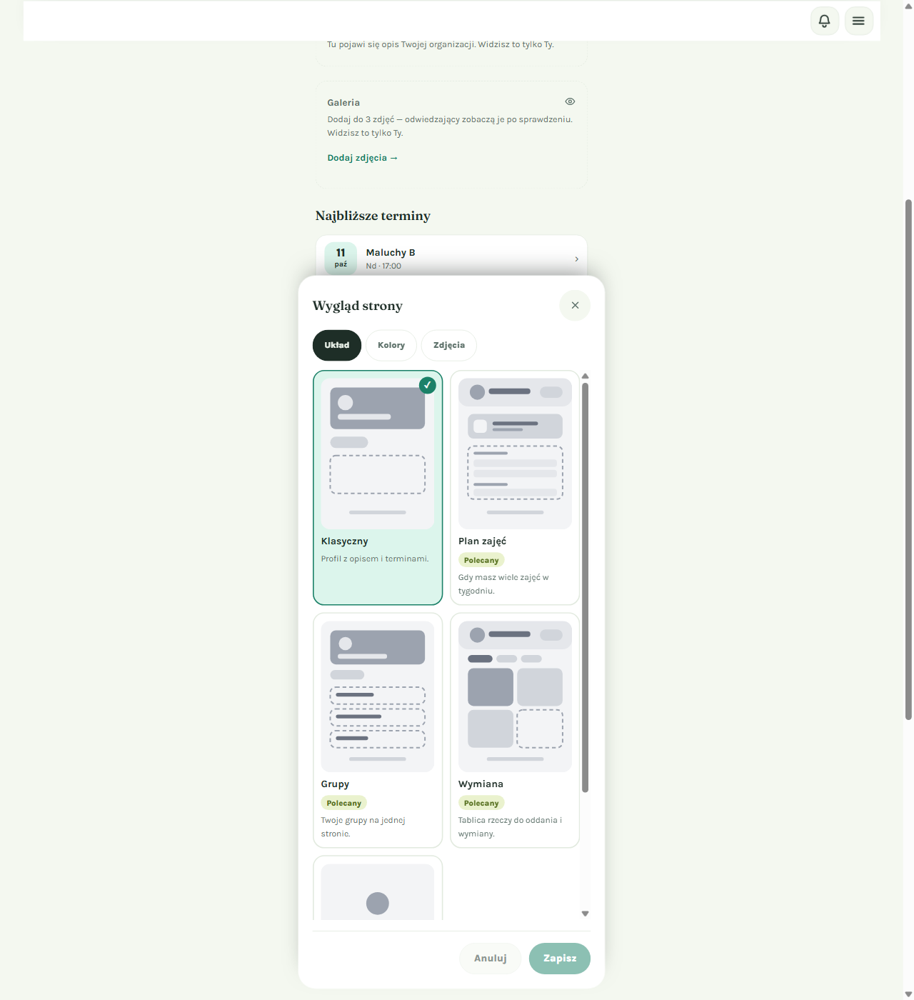

2. **Kliknij zakładkę „Zdjęcia”** (trzeci przycisk obok „Układ” i „Kolory”).

✅ **Co powinieneś zobaczyć**: zakładkę „Zdjęcia” z trzema sekcjami — **Logo**, **Okładka** i **Galeria** — oraz napisem „Zdjęcia zapisują się od razu.”

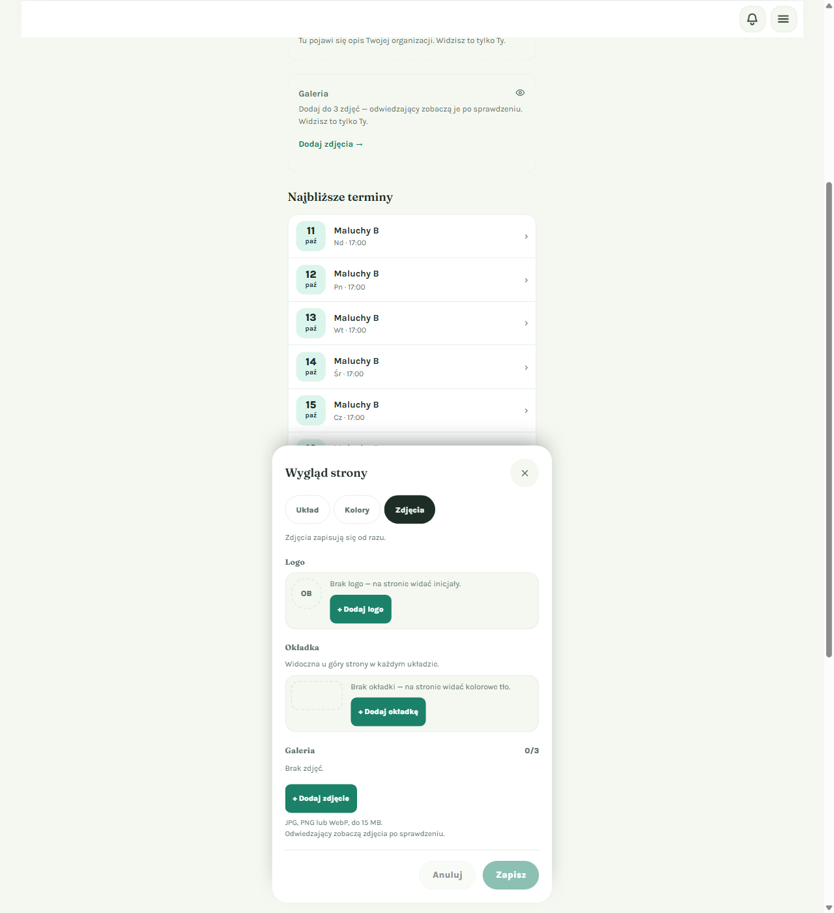

⚠️ **Ważne — zdjęcia zapisują się od razu.** Nie musisz klikać „Zapisz” na dole edytora. Przyciski „Zapisz” i „Anuluj” dotyczą tylko zmian w zakładkach „Układ” i „Kolory”. Kliknięcie „Anuluj” na dole **nie cofa** dodanych zdjęć.

---

## Jak dodać logo

Logo pojawi się w kółku obok nazwy organizacji, w miejscu inicjałów.

1. **W sekcji „Logo” kliknij „+ Dodaj logo”.**

   Dopóki nie masz logo, widzisz napis „Brak logo — na stronie widać inicjały.”

2. **Wybierz zdjęcie z komputera lub telefonu.**

   Podczas wysyłania zobaczysz napis **„Wysyłanie…”**. Poczekaj chwilę — przyciski sekcji są wtedy nieaktywne.

3. **Gotowe — zdjęcie czeka na sprawdzenie.**

   ✅ **Co powinieneś zobaczyć**: miniaturkę logo, etykietę **„W weryfikacji”** i napis „Odwiedzający zobaczą je po sprawdzeniu.” Obok są przyciski **„Zmień logo”** i **„Anuluj”**.

   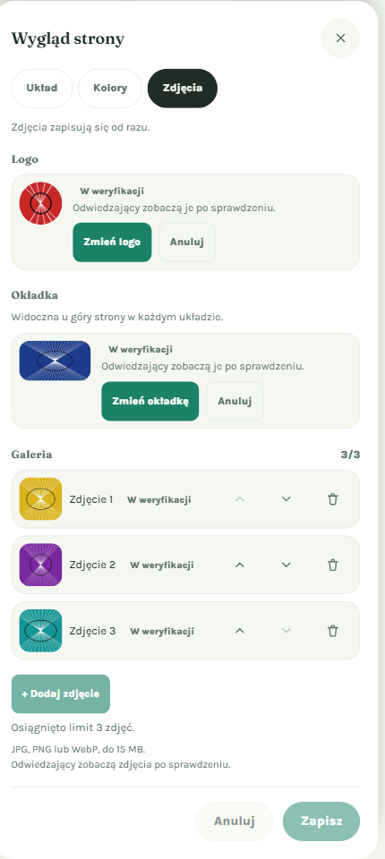

---

## Jak dodać okładkę

Okładka to szerokie zdjęcie **u góry strony, w każdym układzie** (Klasyczny, Plan zajęć, Grupy, Wymiana i pozostałe). Nazwa organizacji i adres strony są wyświetlane na okładce jasnym tekstem na przyciemnionym tle, żeby zawsze były czytelne.

1. **W sekcji „Okładka” kliknij „+ Dodaj okładkę”.**

   Bez okładki widzisz napis „Brak okładki — na stronie widać kolorowe tło.”

2. **Wybierz szerokie, poziome zdjęcie.**

3. **Sprawdź status.** Tak jak przy logo, okładka dostaje etykietę **„W weryfikacji”** i przyciski **„Zmień okładkę”** oraz **„Anuluj”** (zobacz zrzut ekranu powyżej).

💡 **Tip**: ważne elementy zdjęcia (np. twarze, napisy) umieść w górnej części kadru — na dole okładki pojawia się nazwa organizacji.

---

## Co oznacza „W weryfikacji”?

Każde nowe zdjęcie jest automatycznie sprawdzane, czy nadaje się do pokazania publicznie. Zwykle trwa to krótko, ale czasem zdjęcie czeka na ręczne sprawdzenie przez administratora.

| Co widzisz w zakładce „Zdjęcia” | Co to znaczy | Co widzą odwiedzający |
|---|---|---|
| **W weryfikacji** | Zdjęcie czeka na sprawdzenie. | Jeszcze nic — widzą to, co było wcześniej (inicjały, kolorowe tło albo poprzednie zatwierdzone zdjęcie). |
| **Na stronie** | Zdjęcie zostało zatwierdzone. | Widzą to zdjęcie. |
| **Odrzucone** (zdjęcie wyszarzone) | Moderacja nie zgodziła się na to zdjęcie. Pojawia się napis „Odrzucone przez moderację — dodaj inne zdjęcie.” | Nie widzą go. |

✅ **Co dzieje się po zatwierdzeniu**: gdy zakładka „Zdjęcia” jest otwarta, status odświeża się sam mniej więcej co 10 sekund. Po zatwierdzeniu etykieta „W weryfikacji” znika, przy logo i okładce pojawia się napis **„Na stronie”**, a Twoja strona za edytorem od razu pokazuje nowe zdjęcie. Nie musisz niczego odświeżać.

💡 **Tip**: dopóki zdjęcie jest „W weryfikacji”, Twoja strona wygląda dokładnie tak jak przedtem — również dla Ciebie. Poniżej strona właściciela w czasie, gdy logo, okładka i galeria czekają na sprawdzenie: nadal widać inicjały „OB”, kolorowe tło i kartę „Galeria”.

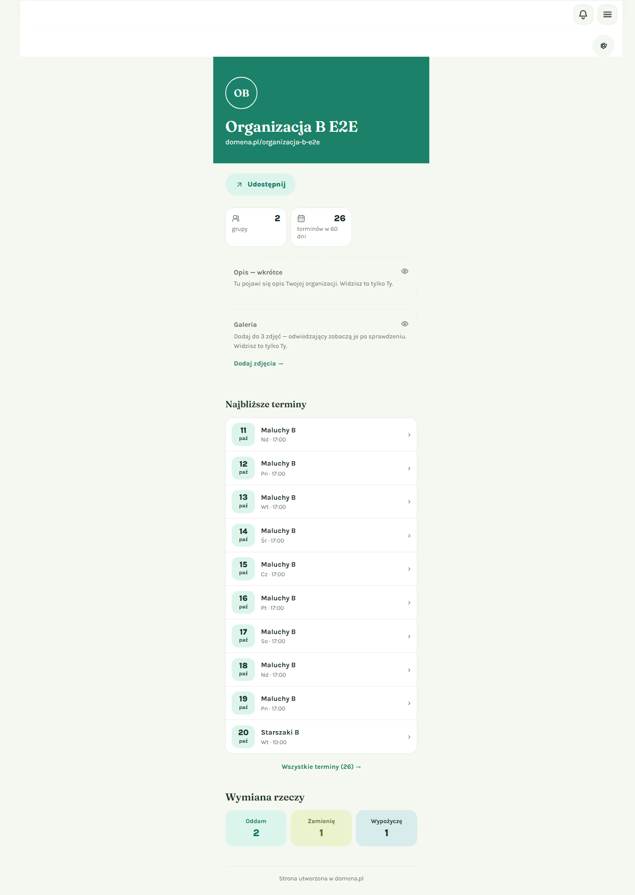

---

## Jak wymienić lub usunąć logo i okładkę

Logo i okładka działają tak samo. Poniżej opis dla logo; przy okładce przyciski mają w nazwie „okładkę”.

### Wymiana zatwierdzonego zdjęcia

1. **Kliknij „Zmień logo”** i wybierz nowe zdjęcie.

2. **Zobaczysz dwa wiersze:**
   - u góry obecne zdjęcie z napisem **„Na stronie teraz”** i przyciskiem „Usuń ze strony”,
   - pod nim nowe zdjęcie z etykietą **„Nowe”**, „W weryfikacji” i napisem „Zastąpi obecne po sprawdzeniu.”

✅ **Dobra wiadomość**: Twoja strona nie zostanie pusta. Dopóki nowe zdjęcie jest sprawdzane, odwiedzający widzą stare. Gdy nowe zostanie zatwierdzone, automatycznie zastąpi stare.

### Co robią poszczególne przyciski

| Przycisk | Kiedy go widzisz | Co robi |
|---|---|---|
| **+ Dodaj logo** | Brak logo albo logo zostało odrzucone | Wybierasz nowe zdjęcie. |
| **Zmień logo** / **Zmień** | Jest już zdjęcie | Wybierasz inne zdjęcie. Jeśli poprzednie czekało na sprawdzenie lub zostało odrzucone, nowe zajmie jego miejsce. |
| **Anuluj** | Przy zdjęciu „W weryfikacji” | Wycofuje zdjęcie, zanim zostanie sprawdzone. |
| **Usuń** / **Usuń ze strony** | Przy zdjęciu „Na stronie” lub „Odrzucone” | Usuwa zdjęcie. |

⚠️ **Uwaga**: usuwanie działa **od razu, bez dodatkowego pytania**. Jeśli usuniesz zatwierdzone logo, na stronie znów pojawią się inicjały (a po usunięciu okładki — kolorowe tło). Starsze, wcześniej używane zdjęcia **nie wracają**.

---

## Jak dodać zdjęcia do galerii

Galeria może mieć **najwyżej 3 zdjęcia**. Licznik obok nagłówka „Galeria” (np. **2/3**) pokazuje, ile już dodałeś.

1. **W sekcji „Galeria” kliknij „+ Dodaj zdjęcie”.**

   Pod przyciskiem widzisz przypomnienie: „JPG, PNG lub WebP, do 15 MB.” oraz „Odwiedzający zobaczą zdjęcia po sprawdzeniu.”

2. **Wybierz jedno zdjęcie.** Zdjęcia dodajesz po jednym.

3. **Powtórz, jeśli chcesz dodać kolejne** (maksymalnie do trzech).

✅ **Co powinieneś zobaczyć**: nowy wiersz „Zdjęcie 1”, „Zdjęcie 2”… z etykietą „W weryfikacji”. Gdy dodasz trzecie zdjęcie, licznik pokaże **3/3**, przycisk „+ Dodaj zdjęcie” stanie się nieaktywny, a pod nim pojawi się napis **„Osiągnięto limit 3 zdjęć.”**

💡 **Tip**: odrzucone zdjęcia **nie liczą się** do limitu. Jeśli jedno zdjęcie zostanie odrzucone, możesz od razu dodać inne. Odrzucone zdjęcia są wyświetlane osobno, pod kreską, i możesz je usunąć ikoną kosza.

---

## Jak zmienić kolejność zdjęć w galerii

Kolejność w edytorze to kolejność, w jakiej odwiedzający zobaczą zdjęcia na stronie.

1. **Znajdź zdjęcie, które chcesz przesunąć.**

2. **Kliknij strzałkę ˄ (w górę) lub ˅ (w dół)** po prawej stronie wiersza.

   Strzałka w górę jest nieaktywna przy pierwszym zdjęciu, a strzałka w dół — przy ostatnim.

✅ **Co powinieneś zobaczyć**: zdjęcia od razu zamieniają się miejscami. Na przykład po przesunięciu żółtego „Zdjęcia 1” w dół, fioletowe zdjęcie jest teraz pierwsze:

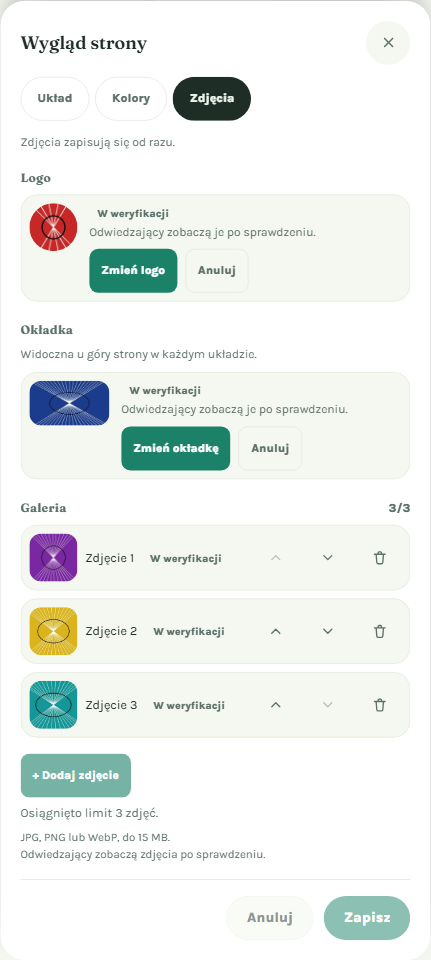

Zmiana zapisuje się od razu — nie musisz klikać „Zapisz”.

---

## Jak usunąć zdjęcie z galerii

1. **Kliknij ikonę kosza** w wierszu zdjęcia, które chcesz usunąć.

✅ **Co powinieneś zobaczyć**: zdjęcie znika, pozostałe są ponumerowane od nowa, a licznik się zmniejsza (np. z 3/3 na **2/3**). Przycisk „+ Dodaj zdjęcie” znów jest aktywny.

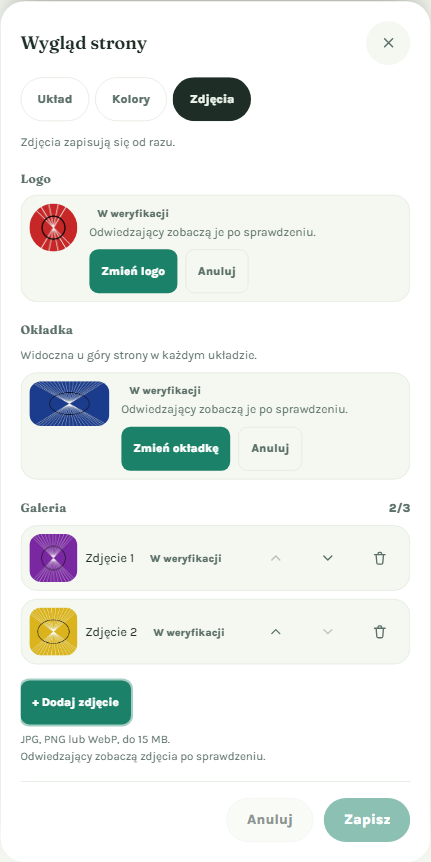

⚠️ **Uwaga**: usunięcie działa od razu, bez dodatkowego pytania.

Gdy usuniesz wszystkie zdjęcia, zakładka wraca do stanu początkowego: „Brak zdjęć.” i licznik **0/3**.

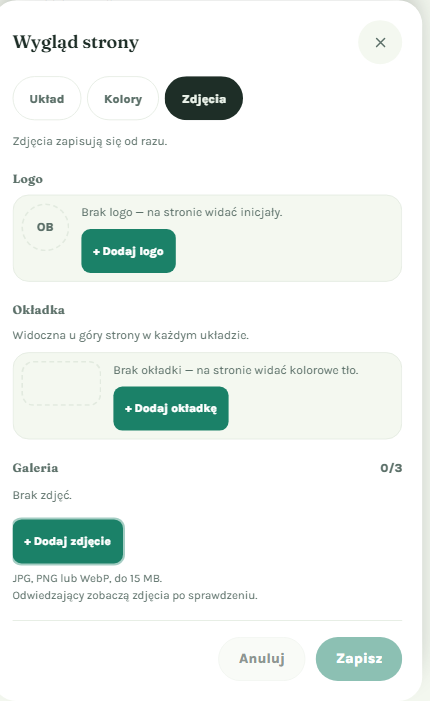

---

## Co widzą odwiedzający?

Odwiedzający (np. rodzice) widzą **tylko zatwierdzone** zdjęcia:

- **Logo** — w kółku obok nazwy organizacji, zamiast inicjałów.
- **Okładka** — u góry strony, w każdym układzie, z nazwą i adresem na przyciemnionym pasku.
- **Galeria** — sekcja „Galeria” pod opisem organizacji (a nad listą najbliższych terminów):
  - 3 zdjęcia — trzy kwadraty w jednym rzędzie,
  - 2 zdjęcia — dwa kwadraty obok siebie,
  - 1 zdjęcie — jedno duże zdjęcie na całą szerokość.

Jeśli nie masz jeszcze zatwierdzonych zdjęć, odwiedzający widzą stronę jak dotychczas: inicjały, kolorowe tło i **brak** sekcji „Galeria”. Na przykład tak:

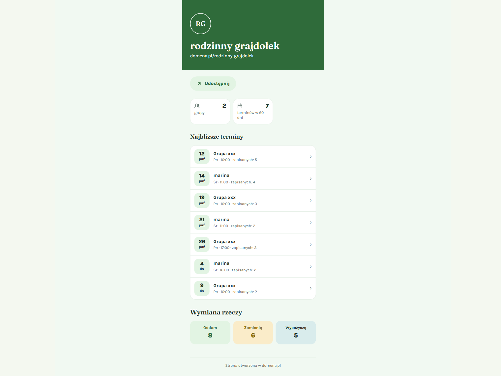

💡 **Tip**: zdjęcia „W weryfikacji” i „Odrzucone” nigdy nie pojawiają się na stronie — ani dla odwiedzających, ani dla Ciebie. Ich stan sprawdzisz tylko w zakładce „Zdjęcia”.

---

## Wskazówki

- 💡 **Zostaw zakładkę „Zdjęcia” otwartą** po dodaniu zdjęć — status odświeża się sam i od razu zobaczysz, kiedy zdjęcie trafi na stronę.
- 💡 **Wymieniaj zdjęcia bez obaw** — stare logo lub okładka zostają na stronie, dopóki nowe nie zostanie zatwierdzone.
- 💡 **Wybierz najlepsze zdjęcie na pierwsze miejsce** w galerii — przy jednym zdjęciu jest ono pokazywane w dużym formacie.
- ❌ **Nie dodawaj tego samego zdjęcia dwa razy** w tym samym miejscu — system tego nie przyjmie (zobacz niżej).
- ❌ **Nie dodawaj zdjęć dzieci bez zgody rodziców** ani treści, które mogą zostać odrzucone przez moderację.

---

## Rozwiązywanie problemów

Komunikaty o błędach pojawiają się na czerwono, pod sekcją, której dotyczą.

### „To zdjęcie jest już w galerii.”

Próbujesz dodać do galerii zdjęcie, które już tam jest (również takie, które czeka na sprawdzenie lub zostało odrzucone).

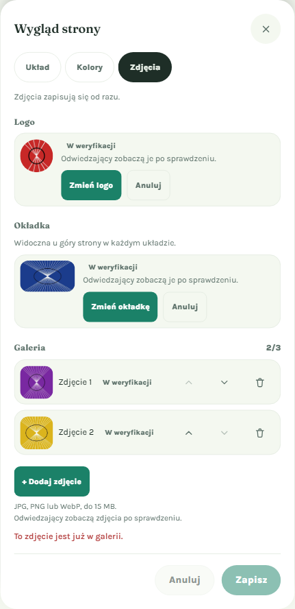

**Co zrobić**: wybierz inne zdjęcie.

Podobne komunikaty dla logo i okładki:

- **„To zdjęcie jest już dodane jako logo.”**
- **„To zdjęcie jest już dodane jako okładka.”**

💡 Jeśli zdjęcie zostało **odrzucone**, nie możesz go wysłać ponownie, dopóki jest na liście. Nawet po usunięciu lepiej wybrać inne zdjęcie — to samo zostanie najpewniej odrzucone ponownie.

### „Galeria może mieć najwyżej 3 zdjęcia.” / „Osiągnięto limit 3 zdjęć.”

Galeria jest pełna (3/3).

**Co zrobić**: usuń jedno ze zdjęć ikoną kosza, a potem dodaj nowe.

### „Nieobsługiwany plik — dodaj zdjęcie JPG, PNG lub WebP”

Wybrany plik nie jest zdjęciem w obsługiwanym formacie (np. to PDF albo zdjęcie HEIC z iPhone'a).

**Co zrobić**: zapisz zdjęcie jako JPG lub PNG i spróbuj ponownie. Na iPhonie możesz w ustawieniach aparatu wybrać format „Najbardziej zgodny”.

### „Zdjęcie jest za duże (maks. 15 MB)”

**Co zrobić**: zmniejsz zdjęcie (np. wyślij je sobie przez komunikator albo użyj opcji „zmniejsz rozmiar” w telefonie) i spróbuj ponownie.

### „Nie udało się wysłać zdjęcia. Spróbuj ponownie.”

Coś poszło nie tak podczas wysyłania — najczęściej chwilowy problem z połączeniem.

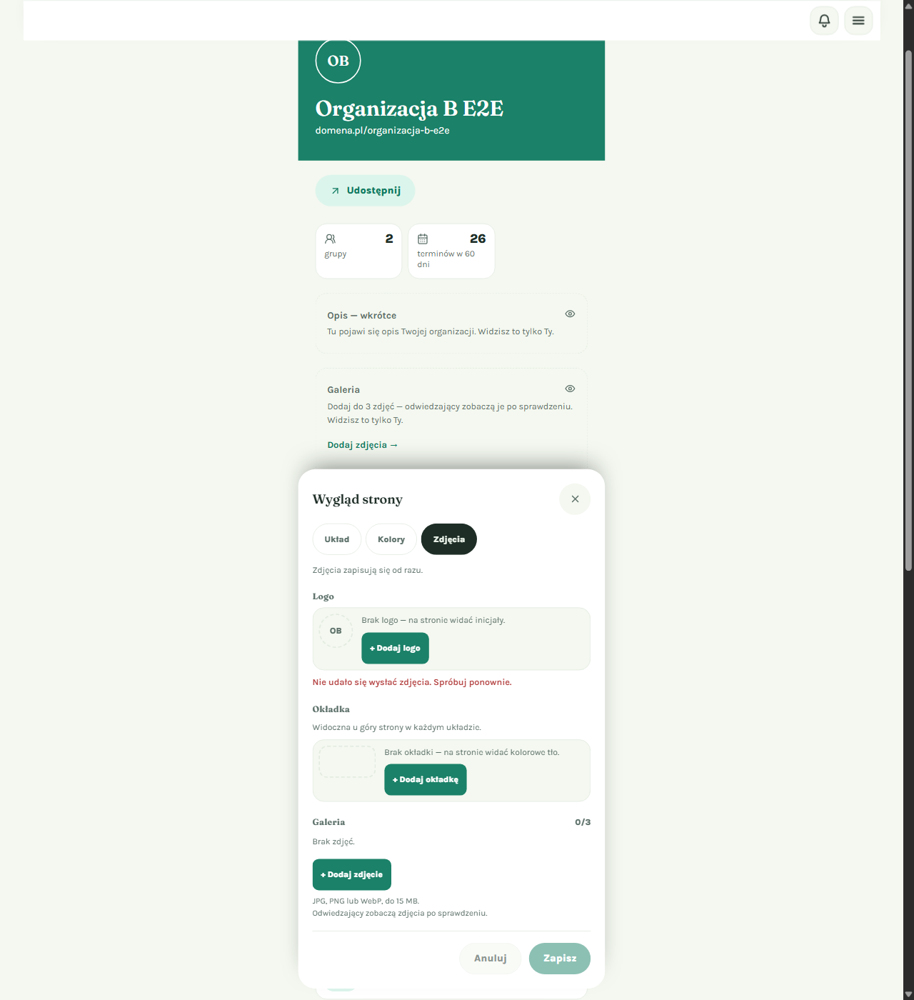

**Co zrobić**: sprawdź połączenie z internetem i spróbuj ponownie za chwilę. Podobne komunikaty mogą pojawić się przy usuwaniu („Nie udało się usunąć zdjęcia. Spróbuj ponownie.”) i przesuwaniu zdjęć („Nie udało się zmienić kolejności. Spróbuj ponownie.”).

### „Dodawanie zdjęć jest chwilowo niedostępne”

Dodawanie zdjęć jest tymczasowo wyłączone po naszej stronie.

**Co zrobić**: spróbuj ponownie później. Twoje dotychczasowe ustawienia strony się nie zmieniają.

### „Kolejność się zmieniła. Odśwież i spróbuj ponownie.”

Galeria zmieniła się w międzyczasie (np. masz otwartą stronę w dwóch kartach przeglądarki).

**Co zrobić**: odśwież stronę i ustaw kolejność jeszcze raz.

### Dodałem zdjęcie, ale nie widzę go na stronie

To normalne — zdjęcie jest **„W weryfikacji”**. Pojawi się na stronie automatycznie po zatwierdzeniu. Jeśli czeka długo, mogło trafić do ręcznego sprawdzenia przez administratora.

### Moje zdjęcie ma status „Odrzucone”

Moderacja uznała, że zdjęcie nie powinno być publicznie widoczne. Dodaj inne zdjęcie przyciskiem „+ Dodaj logo” / „+ Dodaj okładkę” / „+ Dodaj zdjęcie”, a odrzucone usuń przyciskiem „Usuń” lub ikoną kosza.

### Kliknąłem „Anuluj” na dole edytora, a zdjęcia zostały

Tak ma być. Zdjęcia zapisują się od razu, a przyciski „Zapisz” i „Anuluj” na dole dotyczą tylko układu i kolorów. Żeby usunąć zdjęcie, użyj przycisku „Anuluj”/„Usuń” przy samym zdjęciu albo ikony kosza.

---

## Powiązane funkcje

- **Układ strony** (zakładka „Układ”) — wybór wyglądu strony organizatora. Okładka jest widoczna w każdym układzie.
- **Kolory** (zakładka „Kolory”) — kolor tła, które widać, gdy nie masz okładki.
- **Opis organizacji** — sekcja wyświetlana bezpośrednio nad galerią.
