# Przekazania rzeczy: kiedy, gdzie i czy się udało

*Przewodnik dla rodziców · ostatnia aktualizacja: 13 października 2026*

## Spis treści

1. [Co nowego?](#co-nowego)
2. [Po wzięciu rzeczy: okienko „Wzięte!”](#1-po-wzięciu-rzeczy-okienko-wzięte)
3. [Dodawanie przekazania do kalendarza](#2-dodawanie-przekazania-do-kalendarza)
4. [Strona rzeczy: kiedy i gdzie odebrać lub przynieść](#3-strona-rzeczy-kiedy-i-gdzie-odebrać-lub-przynieść)
5. [Zamiana: okienko „Zamiana zaakceptowana”](#4-zamiana-okienko-zamiana-zaakceptowana)
6. [Powiadomienia z datą i godziną](#5-powiadomienia-z-datą-i-godziną)
7. [Pytanie po zajęciach: „Czy przekazanie doszło do skutku?”](#6-pytanie-po-zajęciach-czy-przekazanie-doszło-do-skutku)
8. [Ustawienia: gdzie szukać powiadomień](#7-ustawienia-gdzie-szukać-powiadomień)
9. [Najczęstsze pytania i problemy](#najczęstsze-pytania-i-problemy)

---

## Co nowego?

Rzeczy przekazujecie sobie na zajęciach. Żeby nikt nie zapomniał zabrać rzeczy z domu, aplikacja teraz:

- ✅ **od razu pokazuje dzień, godzinę i grupę** spotkania, na którym odbierasz albo przynosisz rzecz,
- ✅ pozwala **dodać to spotkanie do Twojego kalendarza** (Google, Apple, Outlook) z przypomnieniami,
- ✅ wysyła **powiadomienia z datą i godziną**,
- ✅ **po zajęciach pyta**, czy przekazanie się udało, i nie gubi tego pytania, jeśli odpowiesz „Później”.

**Dla kogo?** Dla każdego rodzica, który bierze, oddaje albo wymienia rzeczy w swojej grupie zajęciowej.

📝 **Co jest potrzebne**: musisz być zalogowany lub zalogowana i należeć do grupy, na której terminie odbywa się przekazanie.

---

## 1. Po wzięciu rzeczy: okienko „Wzięte!”

Gdy na stronie terminu klikniesz **„Wezmę”** przy czyjejś rzeczy, pojawi się okienko z podsumowaniem. Od razu widać, kiedy i gdzie ją odbierasz.

**Krok po kroku:**

1. **Otwórz stronę terminu zajęć** i znajdź rzecz, którą chcesz wziąć.
2. **Kliknij „Wezmę”.**
3. **Przeczytaj okienko „Wzięte!”.** Znajdziesz w nim:
   - nazwę rzeczy,
   - **dzień tygodnia, datę i godzinę** odbioru (np. „śr 14.10 o 16:30”),
   - **nazwę grupy**, na której zajęciach odbierzesz rzecz (np. „Muzyczne Maluchy A2”).

   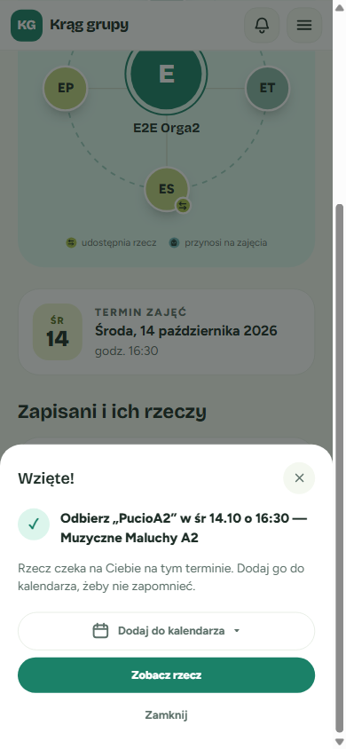

4. **Wybierz, co dalej.** Masz trzy przyciski:
   - **„Dodaj do kalendarza”**: zapisuje odbiór w Twoim kalendarzu (szczegóły w następnym rozdziale).
   - **„Zobacz rzecz”**: otwiera stronę rzeczy, na której zawsze sprawdzisz godzinę i grupę odbioru.
   - **„Zamknij”** (albo ✕ w rogu): wraca na stronę terminu.

✅ **Co powinno się stać**: rzecz jest zarezerwowana dla Ciebie. Osoba, która ją oddaje, dostaje powiadomienie z tą samą datą i godziną.

💡 **Wskazówka**: najlepiej od razu kliknij „Dodaj do kalendarza”. Telefon sam przypomni Ci o odbiorze.

---

## 2. Dodawanie przekazania do kalendarza

Przycisk **„Dodaj do kalendarza”** znajdziesz w trzech miejscach:

- w okienku „Wzięte!”,
- w okienku „Zamiana zaakceptowana”,
- na stronie rzeczy (tylko jeśli bierzesz udział w przekazaniu).

**Krok po kroku:**

1. **Kliknij „Dodaj do kalendarza”.** Rozwinie się krótkie menu z dwiema opcjami.

   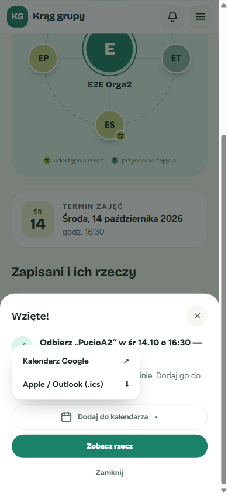

2. **Wybierz swój kalendarz:**
   - **„Kalendarz Google”**: otworzy się nowa karta z gotowym wydarzeniem w Kalendarzu Google. Wystarczy kliknąć „Zapisz”.
   - **„Apple / Outlook (.ics)”**: telefon lub komputer pobierze mały plik kalendarza. Otwórz go, a kalendarz Apple, Outlook lub inny zaproponuje dodanie wydarzenia.

3. **Sprawdź wydarzenie w kalendarzu.** Będzie miało:
   - tytuł **„Odbiór: …”** (gdy bierzesz rzecz), **„Przekazanie: …”** (gdy oddajesz) albo **„Zamiana: … ↔ …”** (przy zamianie),
   - godzinę rozpoczęcia zajęć (wydarzenie trwa 1 godzinę),
   - nazwę grupy jako miejsce,
   - link do strony terminu w opisie.

✅ **Co powinno się stać**: wydarzenie widać w Twoim kalendarzu w dniu zajęć.

💡 **Przypomnienia**: plik dla Apple / Outlook ma od razu ustawione dwa przypomnienia, **dzień wcześniej** i **2 godziny przed** zajęciami. W Kalendarzu Google przypomnienia ustawia się według Twoich własnych ustawień Google.

💡 **Wskazówka**: menu zamkniesz klawiszem Esc albo kliknięciem obok. Samo okienko „Wzięte!” zostanie wtedy otwarte.

---

## 3. Strona rzeczy: kiedy i gdzie odebrać lub przynieść

Datę odbioru możesz sprawdzić w każdej chwili na stronie rzeczy. Pomaga to szczególnie wtedy, gdy zamknąłeś lub zamknęłaś już okienko „Wzięte!”.

**Jeśli bierzesz rzecz** (rezerwacja jest dla Ciebie), zobaczysz godzinę, grupę i przycisk kalendarza:

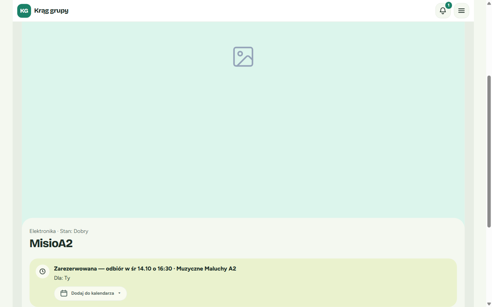

**Jeśli oddajesz rzecz** (to Twoja rzecz), zobaczysz to samo. Dodatkowo widać, dla kogo rzecz jest zarezerwowana:

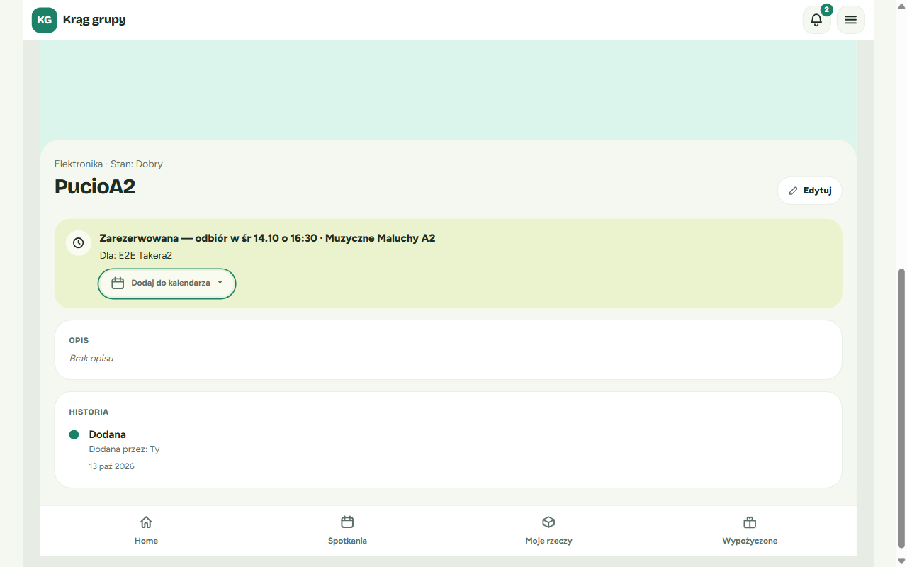

**Inni rodzice**, którzy nie biorą udziału w przekazaniu, widzą tylko ogólną informację o rezerwacji z samą datą. Nie widzą godziny, grupy ani przycisku kalendarza:

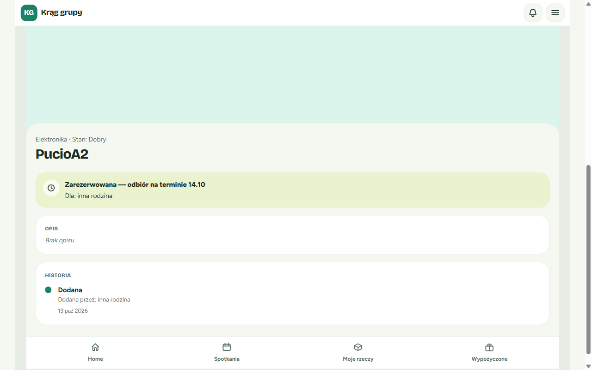

⚠️ **Ważne**: szczegóły przekazania widzą tylko dwie osoby: ta, która oddaje, i ta, która bierze. To chroni Twoją prywatność.

Kliknięcie „Dodaj do kalendarza” na stronie rzeczy otwiera to samo menu co w okienku „Wzięte!”:

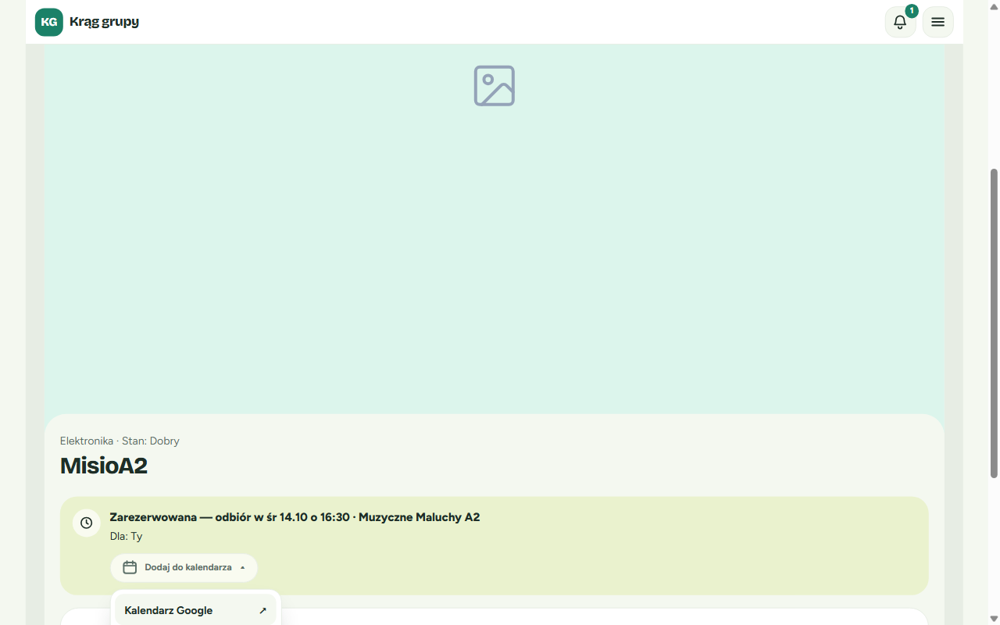

---

## 4. Zamiana: okienko „Zamiana zaakceptowana”

Jeśli ktoś zaproponował zamianę za Twoją rzecz, aplikacja Ci o tym powie. Okienko „Propozycja zamiany” może pojawić się na dowolnej stronie.

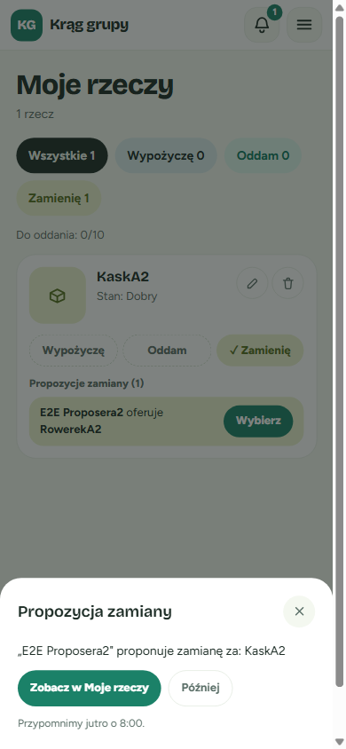

**Jak zaakceptować zamianę:**

1. **Kliknij „Zobacz w Moje rzeczy”** (albo sam lub sama wejdź w zakładkę **Moje rzeczy**).
2. **Przy swojej rzeczy znajdź „Propozycje zamiany”** i przy wybranej ofercie kliknij **„Wybierz”**.
3. **Przeczytaj okienko „Zamiana zaakceptowana”.** Znajdziesz w nim:
   - obie rzeczy, np. **„KaskA2” ↔ „RowerekA2”**,
   - **dzień, datę i godzinę** zajęć,
   - **nazwę grupy**,
   - przypomnienie: „Przynieś „KaskA2” i odbierz „RowerekA2” na tym terminie.”

   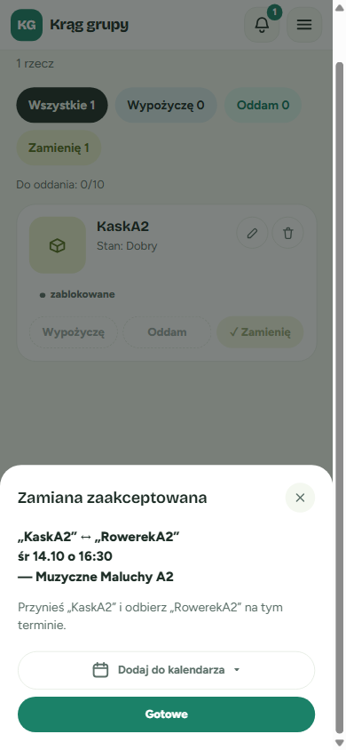

4. **Kliknij „Dodaj do kalendarza”**, żeby zapisać wymianę (tytuł wydarzenia: „Zamiana: … ↔ …”).
5. **Kliknij „Gotowe”.**

✅ **Co powinno się stać**: zamiana jest uzgodniona. Druga osoba dostaje powiadomienie, że jej propozycja została zaakceptowana, z tą samą datą i godziną.

📝 **Gdy było kilka ofert**: w okienku zobaczysz też zdanie „Pozostałe propozycje zostały odrzucone.”

💡 **Brak daty w okienku?** Rzadko aplikacja nie może od razu pobrać szczegółów terminu. Okienko pokaże wtedy tylko obie rzeczy, bez daty i bez przycisku kalendarza. Zamiana i tak jest zaakceptowana. Datę sprawdzisz na stronie terminu albo w powiadomieniach.

⚠️ **Za późno na akceptację**: zamiany nie da się zaakceptować, jeśli zajęcia już się rozpoczęły. Pojawi się wtedy komunikat „Termin już się odbył”.

---

## 5. Powiadomienia z datą i godziną

Powiadomienia znajdziesz pod **dzwonkiem** w prawym górnym rogu ekranu. Liczba na dzwonku pokazuje, ile masz nieprzeczytanych.

Wszystkie powiadomienia o przekazaniach mają teraz dzień, godzinę i grupę:

| Kto dostaje | Przykład treści |
|---|---|
| Osoba, która **oddaje** rzecz | „E2E Takera2” weźmie „PucioA2” — **przynieś w śr 14.10 o 16:30** — Muzyczne Maluchy A2 |
| Osoba, która **bierze** rzecz | Zarezerwowano „PucioA2” — **odbierz w śr 14.10 o 16:30** — Muzyczne Maluchy A2 |
| Osoba, której **zamianę zaakceptowano** | Twoja propozycja zamiany za „KaskA2” została zaakceptowana — **wymiana w śr 14.10 o 16:30** — Muzyczne Maluchy A2 |

**Tak to wygląda u osoby oddającej rzecz:**

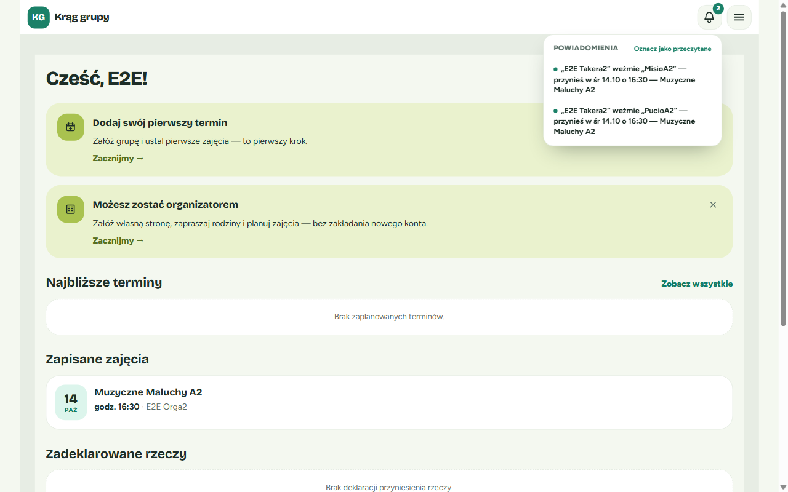

**A tak u osoby, której zaakceptowano zamianę:**

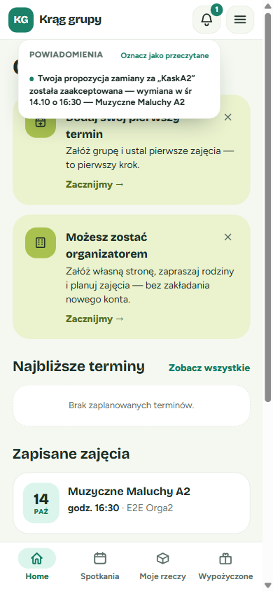

💡 **Wskazówka**: kliknij **„Oznacz jako przeczytane”**, żeby wyzerować licznik na dzwonku.

---

## 6. Pytanie po zajęciach: „Czy przekazanie doszło do skutku?”

Mniej więcej **2 godziny po rozpoczęciu zajęć** aplikacja zapyta Cię, czy przekazanie się udało. Pytanie pojawi się na **dowolnej stronie** aplikacji, na której wtedy jesteś: na stronie głównej, na stronie rzeczy, na stronie terminu albo w Moich rzeczach.

**Przy oddaniu lub wzięciu rzeczy** okienko nazywa się **„Potwierdź przekazanie”**:

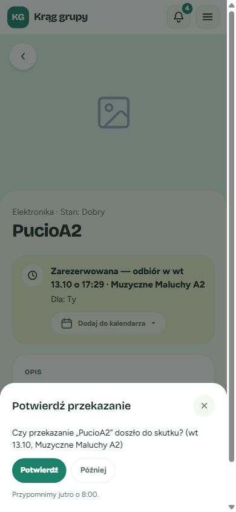

**Przy zamianie** okienko nazywa się **„Potwierdź zamianę”**:

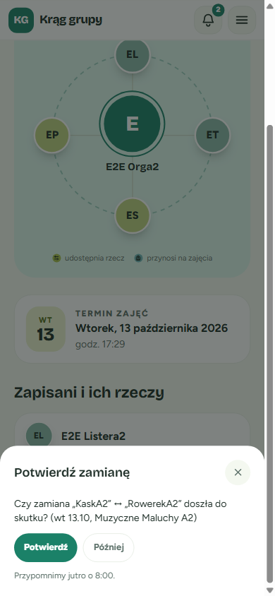

W treści pytania jest nazwa rzeczy (albo obu rzeczy przy zamianie), dzień zajęć i nazwa grupy. Od razu wiesz, o które przekazanie chodzi.

### Masz dwie możliwości

**„Potwierdź”**: wybierz, jeśli rzecz faktycznie zmieniła właściciela.

1. Kliknij **„Potwierdź”**.
2. Na dole ekranu pojawi się krótki komunikat **„Potwierdzono”**.
3. Jeśli czeka na Ciebie kolejna sprawa (np. inna propozycja zamiany), od razu zobaczysz następne okienko.

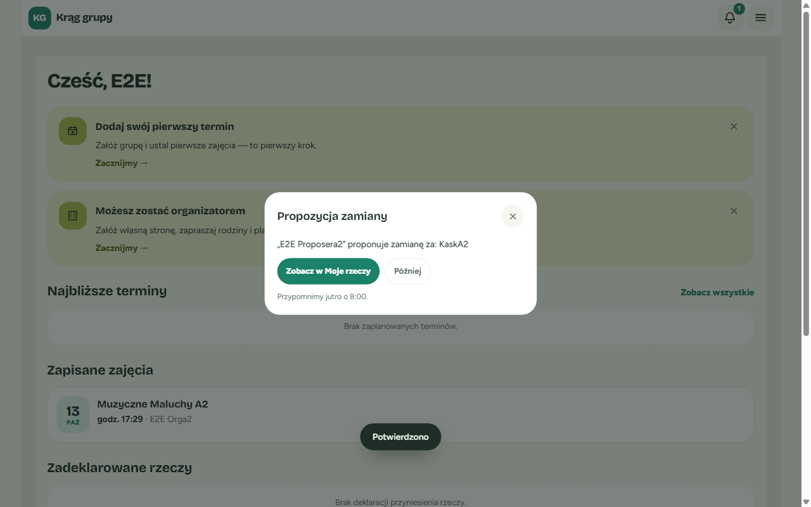

**„Później”**: wybierz, jeśli nie możesz teraz odpowiedzieć (np. jeszcze nie wiesz, czy rzecz dotarła).

- Okienko zniknie, a aplikacja **przypomni Ci jutro o 8:00**. Pod przyciskami widać napis „Przypomnimy jutro o 8:00.”
- Jeśli klikniesz „Później” między północą a 8:00 rano, przypomnienie przyjdzie **dziś o 8:00**.
- Tak samo działa zamknięcie okienka krzyżykiem ✕, klawiszem Esc albo kliknięciem obok.

Po kliknięciu „Później” możesz dalej spokojnie korzystać z aplikacji:

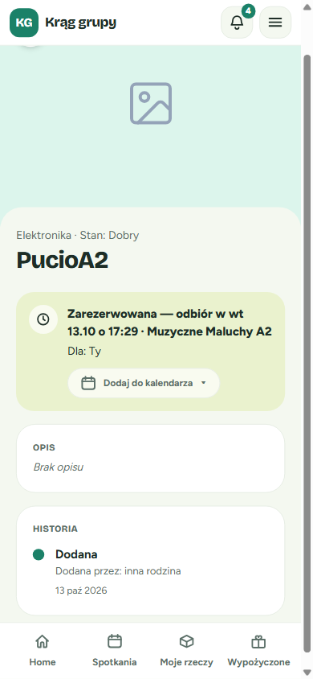

✅ **Powiadomienie zostaje**: pytanie nadal czeka pod dzwonkiem jako nieprzeczytane. Nic nie przepadnie.

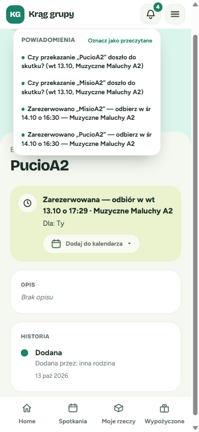

⚠️ **Uwaga**: jeśli klikniesz takie pytanie pod dzwonkiem albo użyjesz „Oznacz jako przeczytane”, okienko z pytaniem już nie wróci. Jeśli chcesz potwierdzić później, używaj przycisku **„Później”**.

📝 **Dobrze wiedzieć**:

- Przypomnienie „Później” jest zapisywane na **tym urządzeniu**. Na innym telefonie lub komputerze pytanie może pojawić się wcześniej.
- Jeśli masz otwarte inne okienko (np. „Wzięte!” albo edycję strony organizatora), pytanie **poczeka**, aż je zamkniesz. Dwa okienka nigdy nie nakładają się na siebie.
- Nowe pytanie pokaże się po odświeżeniu strony, po powrocie do karty aplikacji albo po kliknięciu dzwonka.

---

## 7. Ustawienia: gdzie szukać powiadomień

W **Ustawieniach** nie ma już przełączników „Powiadomienia e-mail” i „Powiadomienia SMS”. Aplikacja na razie nie wysyła e-maili ani SMS-ów, więc te przełączniki niczego nie zmieniały.

Teraz w Ustawieniach zobaczysz:

- **Prywatność** (np. „Widoczny profil publiczny”),
- **Konto** (przycisk „Wyloguj się”),
- informację: **„Powiadomienia dostajesz w aplikacji (dzwonek u góry ekranu).”**

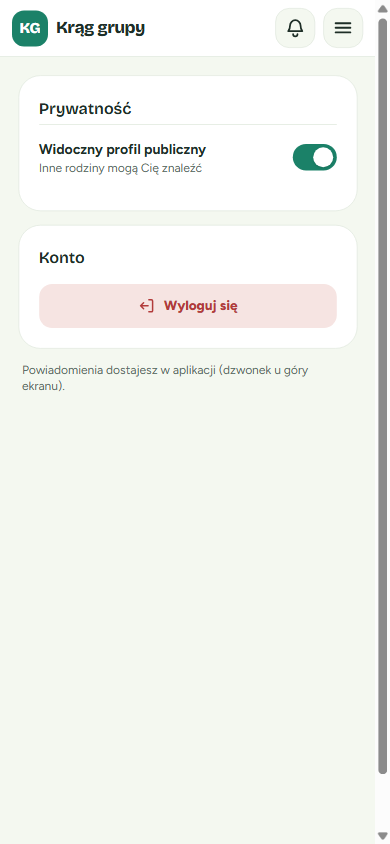

💡 **Wskazówka**: żeby nie przegapić przekazania, korzystaj z dzwonka i dodawaj terminy do swojego kalendarza.

---

## Najczęstsze pytania i problemy

**Zamknąłem/zamknęłam okienko „Wzięte!” i nie dodałem/dodałam terminu do kalendarza. Co teraz?**
Otwórz stronę tej rzeczy. Pod informacją „Zarezerwowana — odbiór w …” jest przycisk „Dodaj do kalendarza”.

**Na stronie rzeczy nie widzę godziny ani przycisku kalendarza.**
Są widoczne tylko dla osoby oddającej i osoby biorącej rzecz. Sprawdź, czy jesteś zalogowany lub zalogowana na właściwe konto. Przycisk pojawia się dopiero wtedy, gdy rzecz jest zarezerwowana na konkretny termin.

**Kliknąłem/kliknęłam „Apple / Outlook (.ics)” i nic się nie stało.**
Plik mógł trafić do folderu „Pobrane”. Otwórz go stamtąd. Na iPhonie zwykle pojawia się od razu propozycja „Dodaj do kalendarza”.

**Godzina w kalendarzu jest przesunięta.**
Wydarzenie jest zapisane w czasie polskim. Sprawdź, czy Twój kalendarz ma ustawioną strefę czasową Polski.

**Pytanie „Czy przekazanie doszło do skutku?” nie pojawiło się po zajęciach.**
Pytanie przychodzi ok. 2 godziny po rozpoczęciu zajęć. Odśwież stronę albo kliknij dzwonek. Jeśli wcześniej kliknąłeś lub kliknęłaś „Później”, poczekaj do 8:00 rano.

**Przekazanie nie doszło do skutku. Co mam kliknąć?**
Na razie okienko ma tylko „Potwierdź” i „Później”. Jeśli przekazanie się nie udało, kliknij „Później” i umów się z drugim rodzicem. Osobny przycisk „Nie doszło” planujemy w kolejnej wersji aplikacji.

**Chcę dostawać przypomnienia e-mailem.**
Na razie powiadomienia są dostępne tylko w aplikacji (dzwonek). Przypomnienia na telefon ustawisz, dodając przekazanie do swojego kalendarza.

---

## Powiązane funkcje

- **Strona terminu**: lista rodzin i rzeczy na danych zajęciach, przycisk „Wezmę”.
- **Moje rzeczy**: Twoje rzeczy, oferty zamiany i ich akceptacja.
- **Dzwonek powiadomień**: wszystkie informacje o Twoich przekazaniach w jednym miejscu.
