# Zakładanie grupy i miejsca spotkań — przewodnik

*Ostatnia aktualizacja: 20 października 2026*

Ten przewodnik pokazuje, jak w kilku krokach założyć własną grupę, zapisać miejsca, w których się spotykacie, i ustawić liczbę miejsc na zajęciach. Na końcu zobaczysz, co widzą osoby, którym wyślesz link do terminu.

Nie musisz zakładać organizacji ani znać się na technice — wystarczy, że masz konto i jesteś zalogowany.

---

## Spis treści

1. [Co nowego?](#co-nowego)
2. [Zakładanie grupy](#1-zakładanie-grupy)
3. [Moje miejsca](#2-moje-miejsca)
4. [Miejsce i liczba miejsc w terminie](#3-miejsce-i-liczba-miejsc-w-terminie)
5. [Co widzą goście na stronie terminu](#4-co-widzą-goście-na-stronie-terminu)
6. [Wyszukiwarka adresów Google](#5-wyszukiwarka-adresów-google)
7. [Najczęstsze pytania i problemy](#najczęstsze-pytania-i-problemy)

---

## Co nowego?

- **Każdy zalogowany użytkownik może założyć grupę.** Wystarczą dwa krótkie kroki: nazwa grupy, a potem pierwszy termin.
- **Miejsca spotkań zapisujesz raz i wybierasz z listy.** Nie musisz za każdym razem wpisywać adresu.
- **Możesz podać, ile jest miejsc na zajęciach.** Goście widzą, ile osób jest już zapisanych.

**Dla kogo?** Dla każdego, kto prowadzi zajęcia lub spotkania — rodziców organizujących zabawy dla dzieci, trenerów, prowadzących koła zainteresowań.

---

## 1. Zakładanie grupy

Grupa to Twoje stałe spotkania, np. „Joga w parku” albo „Nutki dla starszaków”. W grupie dodajesz kolejne terminy, a goście się na nie zapisują.

📝 **Co będzie potrzebne:**
- konto i zalogowanie,
- nazwa grupy,
- data i godzina pierwszego spotkania.

### Krok 1 — otwórz okno „Załóż grupę”

Masz trzy sposoby:

- na stronie głównej panelu kliknij **„Zacznijmy →”** przy podpowiedzi „Załóż grupę”,
- w zakładce **Spotkania** kliknij **„+ Załóż grupę”** (gdy masz już grupy, ten przycisk nazywa się **„+ Dodaj grupę”**),
- otwórz menu konta (ikona trzech kresek w prawym górnym rogu) i wybierz **„Załóż grupę”**.

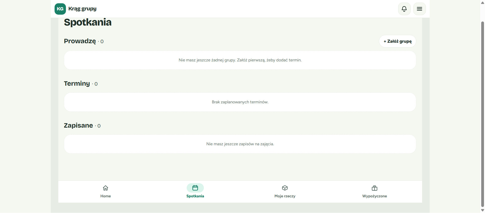

### Krok 2 — nazwij grupę i wybierz widoczność

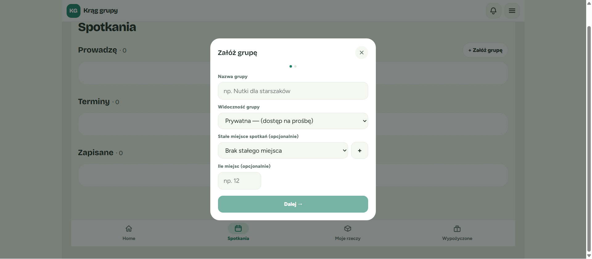

1. **Nazwa grupy** — wpisz nazwę, po której goście rozpoznają zajęcia, np. „Joga w parku”.
2. **Widoczność grupy** — wybierz jedną z opcji:
   - **Prywatna — (dostęp z kodem)** — to ustawienie domyślne. Osoby z linkiem muszą się zalogować i wpisać kod dostępu, który od Ciebie dostaną.
   - **Publiczna** — każdy, kto dostanie link, zobaczy szczegóły terminu bez logowania.

💡 **Wskazówka:** Widoczność możesz zmienić w każdej chwili w oknie **„Edytuj grupę”**.

3. **Stałe miejsce spotkań (opcjonalnie)** — jeśli zwykle spotykacie się w tym samym miejscu, wybierz je z listy. Gdy lista jest pusta, kliknij przycisk **„+”** obok i dodaj nowe miejsce:
   - **Nazwa miejsca** — np. „Sala nr 2”,
   - **Adres** — np. „ul. Szkolna 5, 60-001 Poznań” (pole wymagane),
   - **Notatka** — np. „I piętro, drzwi po lewej” (opcjonalnie).

   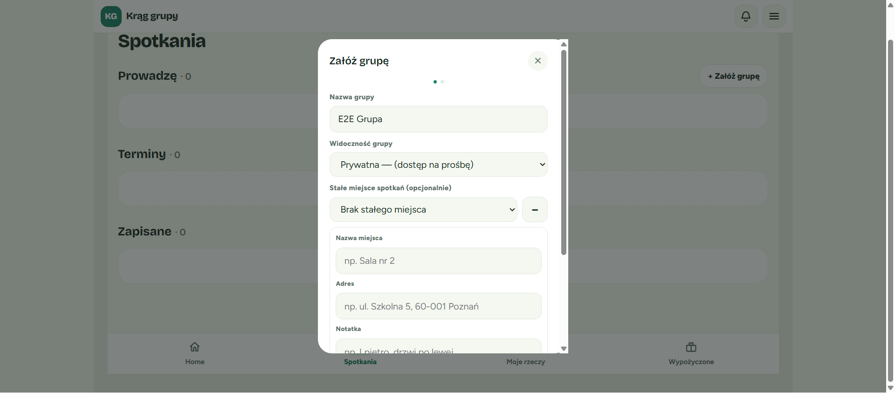

   Po zapisaniu miejsce od razu pojawi się na liście jako wybrane, a pod listą zobaczysz jego adres.

   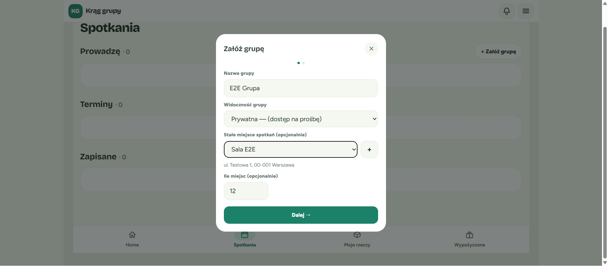

4. **Ile miejsc (opcjonalnie)** — wpisz, ile osób zwykle mieści się na zajęciach, np. 12. Możesz wpisać liczbę od **1 do 10000** albo zostawić pole puste.

   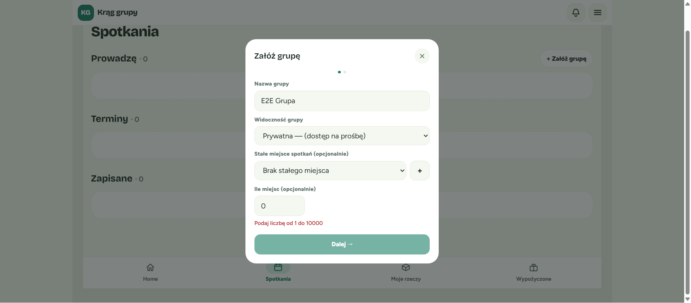

   ⚠️ Jeśli wpiszesz np. 0 lub literę, zobaczysz komunikat **„Podaj liczbę od 1 do 10000”**, a przycisk „Dalej” będzie nieaktywny, dopóki tego nie poprawisz.

5. Kliknij **„Dalej →”**.

### Krok 3 — dodaj pierwszy termin

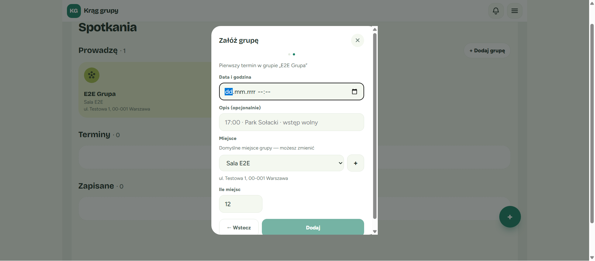

1. **Data i godzina** — wybierz dzień i godzinę spotkania.
2. **Opis (opcjonalnie)** — krótka informacja dla gości, np. „Zabierz matę i wodę”.
3. **Miejsce** i **Ile miejsc** — są już wypełnione tym, co ustawiłeś dla grupy (zobaczysz podpis „Domyślne miejsce grupy — możesz zmienić”). Możesz je zmienić tylko dla tego terminu.
4. Kliknij **„Dodaj”**.

💡 **Wskazówka:** Chcesz poprawić nazwę grupy? Kliknij **„← Wstecz”** — wpisane dane zostaną zachowane.

💡 Jeśli zamkniesz okno na drugim kroku, grupa i tak zostanie zapisana. Termin dodasz później w zakładce Spotkania.

### Krok 4 — gotowe!

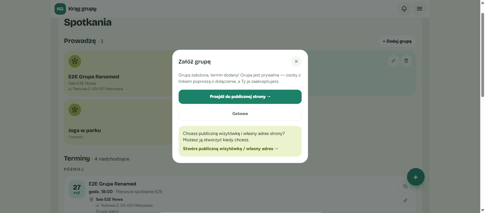

✅ **Co powinieneś zobaczyć:** komunikat „Grupa założona, termin dodany!”. Dla grupy prywatnej znajdziesz w nim też informację: „Grupa jest prywatna — dołączą tylko osoby, którym podasz kod dostępu.” Dla grupy publicznej przeczytasz: „Tę stronę zobaczy każdy, kto dostanie link — bez logowania.”

Na tym ekranie możesz:

- **„Przejdź do publicznej strony →”** — otwiera stronę terminu, którą możesz wysłać znajomym (skopiuj adres z paska przeglądarki),
- **„Gotowe”** — zamyka okno; zobaczysz potwierdzenie „Grupa założona — dodano pierwszy termin”,
- **„Stwórz publiczną wizytówkę / własny adres →”** — *opcjonalnie*. Wizytówka organizacji to strona z Twoją nazwą i własnym adresem internetowym. Do prowadzenia grupy nie jest potrzebna i możesz ją założyć kiedy chcesz.

Nowa grupa i termin pojawią się w zakładce **Spotkania**, razem z miejscem i liczbą miejsc.

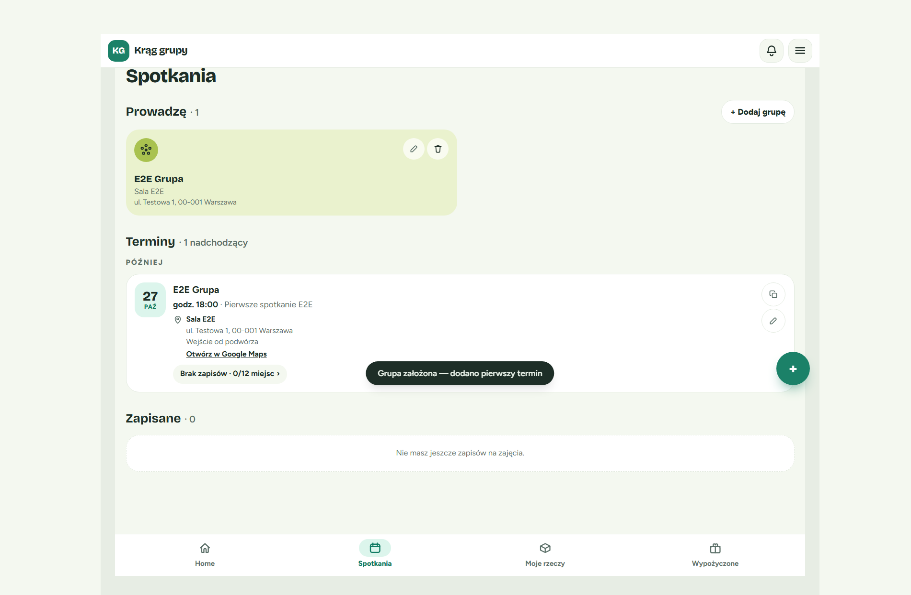

💡 **Wskazówka:** Link do terminu możesz w każdej chwili skopiować przyciskiem **„Kopiuj link do terminu”** przy terminie w zakładce Spotkania.

---

## 2. Moje miejsca

„Moje miejsca” to Twoja lista zapisanych miejsc spotkań. Dzięki niej adres wpisujesz tylko raz, a potem wybierasz go z listy przy grupie lub terminie.

### Gdzie to znaleźć?

Kliknij ikonę menu (trzy kreski) w prawym górnym rogu i wybierz **„Moje miejsca”** (pozycja zaraz pod „Ustawienia”).

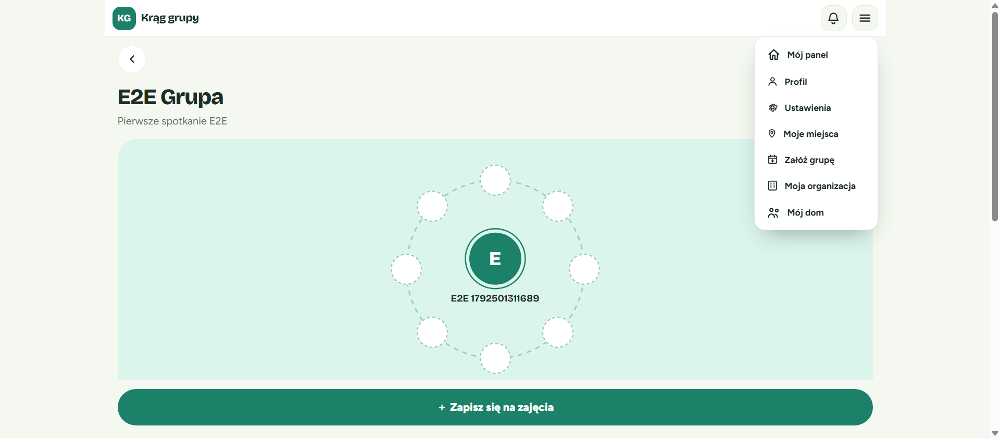

⚠️ Zmiana nazwy, notatki, adresu i usuwanie miejsc są możliwe **tylko** na stronie „Moje miejsca”. W oknach grup i terminów możesz jedynie wybrać miejsce lub dodać nowe przyciskiem „+”.

### Dodawanie miejsca

1. Kliknij **„+ Dodaj miejsce”**.
2. Wpisz **nazwę**, **adres** i — jeśli chcesz — **notatkę** (np. „Wejście od podwórza”).
3. Zapisz. Miejsce pojawi się na liście.

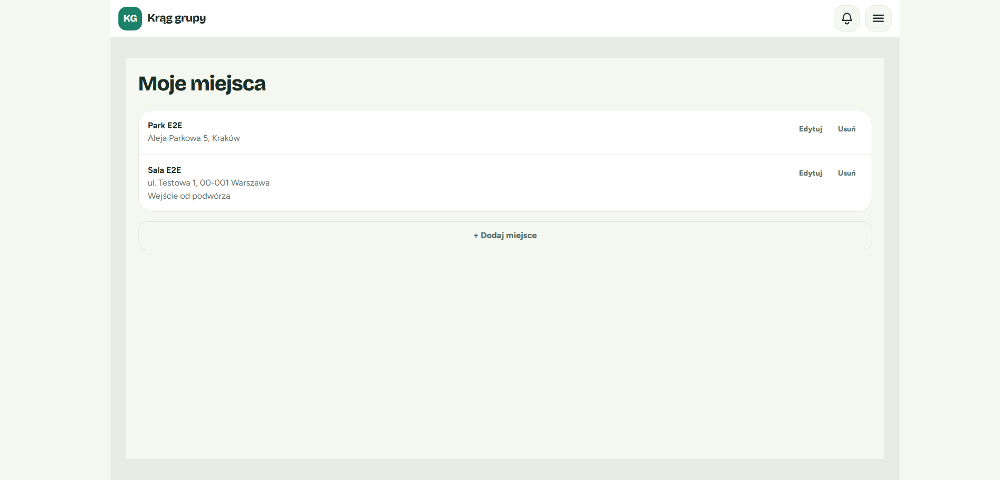

### Edycja miejsca

1. Kliknij **„Edytuj”** przy wybranym miejscu.
2. Zmień nazwę, adres lub notatkę.
3. Zapisz zmiany.

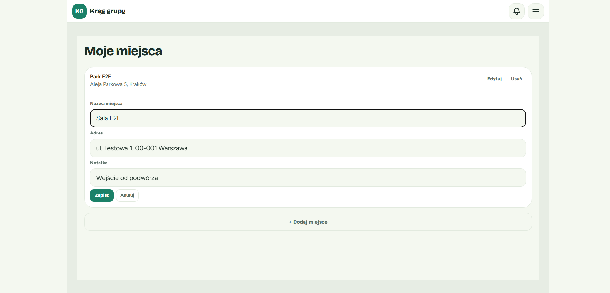

✅ Nowa nazwa od razu pojawi się wszędzie tam, gdzie to miejsce jest używane — w grupach i terminach, także na stronie, którą widzą goście.

### Usuwanie miejsca

1. Kliknij **„Usuń”** przy miejscu.
2. Potwierdź, klikając **„Usuń miejsce”** (lub zrezygnuj przyciskiem **„Anuluj”**).

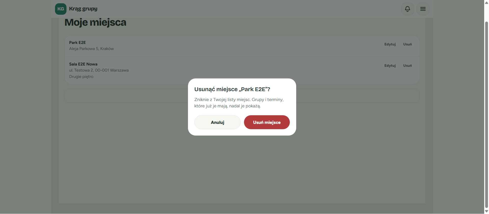

**Co się dzieje z grupami i terminami?** Nic złego. Miejsce znika tylko z Twojej listy:

- terminy, które już miały to miejsce, nadal je pokazują — także gościom,
- w oknie edycji grupy lub terminu to miejsce będzie widoczne z dopiskiem **„(usunięte)”**,
- możesz dalej zapisywać grupę i dodawać terminy z tym miejscem, ale nie wybierzesz go już do innych grup ani terminów.

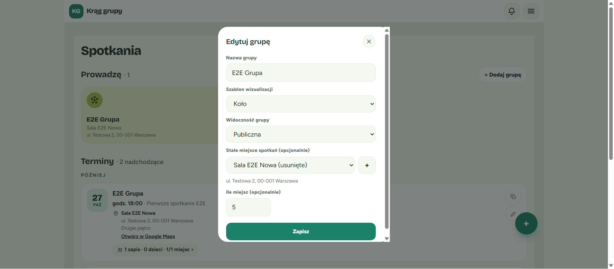

---

## 3. Miejsce i liczba miejsc w terminie

### Domyślne ustawienia grupy

W oknie **„Edytuj grupę”** (ikona ołówka na kafelku grupy) ustawisz **Stałe miejsce spotkań** i **Ile miejsc**. Te wartości są automatycznie wpisywane do każdego **nowego** terminu tej grupy.

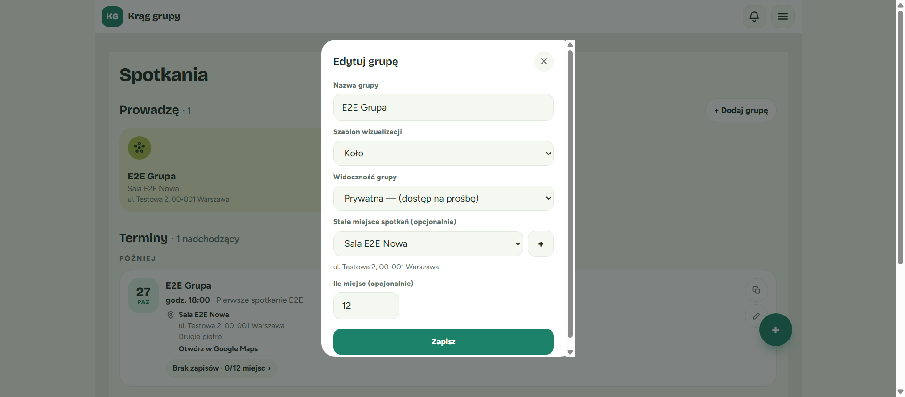

💡 Zmiana ustawień grupy **nie zmienia** terminów, które już istnieją. Każdy termin ma własną kopię miejsca i liczby miejsc.

### Dodawanie terminu

Kliknij **„+ Dodaj termin”** w zakładce Spotkania. Po wybraniu grupy pola **Miejsce** i **Ile miejsc** wypełnią się same, z podpisem „Domyślne miejsce grupy — możesz zmienić”.

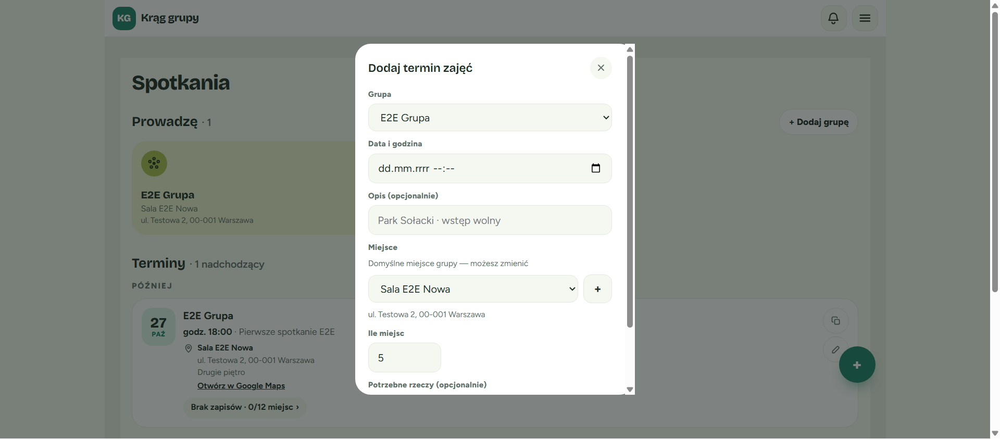

### Zmiana w jednym terminie

Kliknij ikonę ołówka przy terminie (**„Edytuj termin”**). Pola **Miejsce** i **Ile miejsc** znajdziesz pod opisem. Zmień je i kliknij **„Zapisz”**.

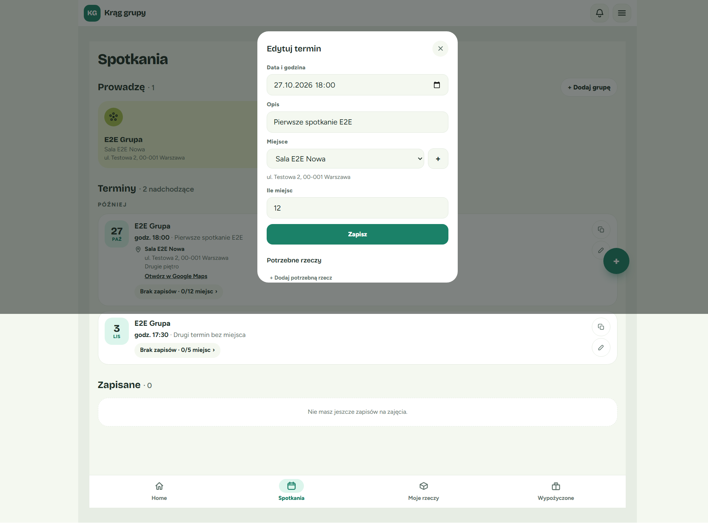

### Czyszczenie

- Aby termin (lub grupa) nie miał miejsca, wybierz z listy **„Brak miejsca”** (w grupie: **„Brak stałego miejsca”**).
- Aby nie podawać liczby miejsc, wyczyść pole **„Ile miejsc”**.
- Kliknij **„Zapisz”**.

📝 Pole **„Ile miejsc”** przyjmuje liczbę od **1 do 10000**. Inna wartość pokaże komunikat „Podaj liczbę od 1 do 10000”.

Przy terminie w panelu zobaczysz liczbę zapisanych i dostępnych miejsc, np. „0/12 miejsc”.

---

## 4. Co widzą goście na stronie terminu

Gdy wyślesz komuś link do terminu, zobaczy on stronę z datą, a pod nią blok **MIEJSCE**:

- nazwę miejsca, adres i notatkę,
- link **„Otwórz w Google Maps ↗”** — otwiera mapę w nowej karcie,
- informację **„Zapisanych X z Y”**, np. „Zapisanych 0 z 12” (jeśli podałeś liczbę miejsc).

Gdy wszystkie miejsca są zajęte, pojawia się komunikat **„Brak wolnych miejsc”**.

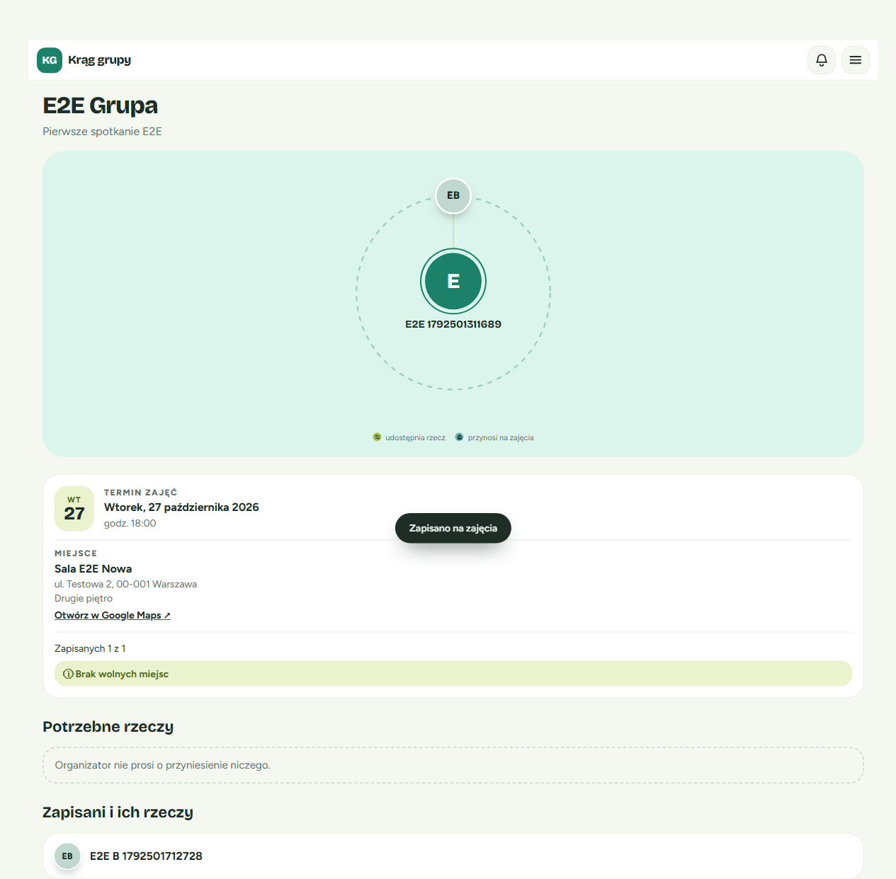

⚠️ **Ważne:** liczba miejsc ma charakter informacyjny. Nawet przy komunikacie „Brak wolnych miejsc” goście **nadal mogą się zapisać** przyciskiem „+ Zapisz się na zajęcia”. Ty decydujesz, co zrobić z dodatkowymi osobami.

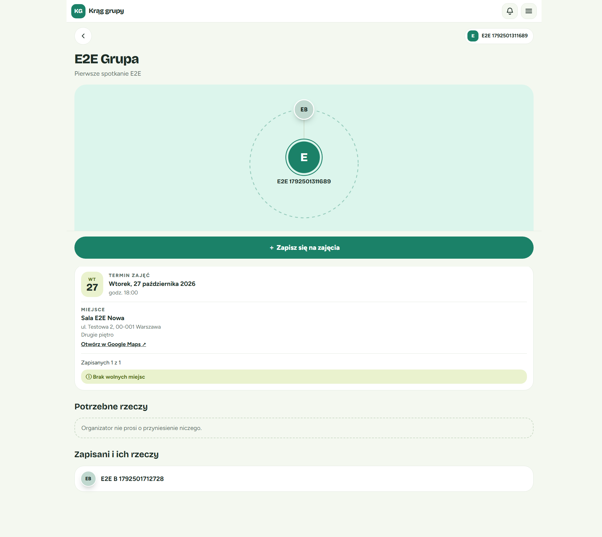

### Grupa prywatna

Jeśli grupa jest **prywatna**, osoba niezalogowana nie zobaczy szczegółów terminu ani miejsca — tylko informację, że grupa jest prywatna, i zaproszenie do zalogowania się. Po zalogowaniu może dołączyć, wpisując kod dostępu od organizatora.

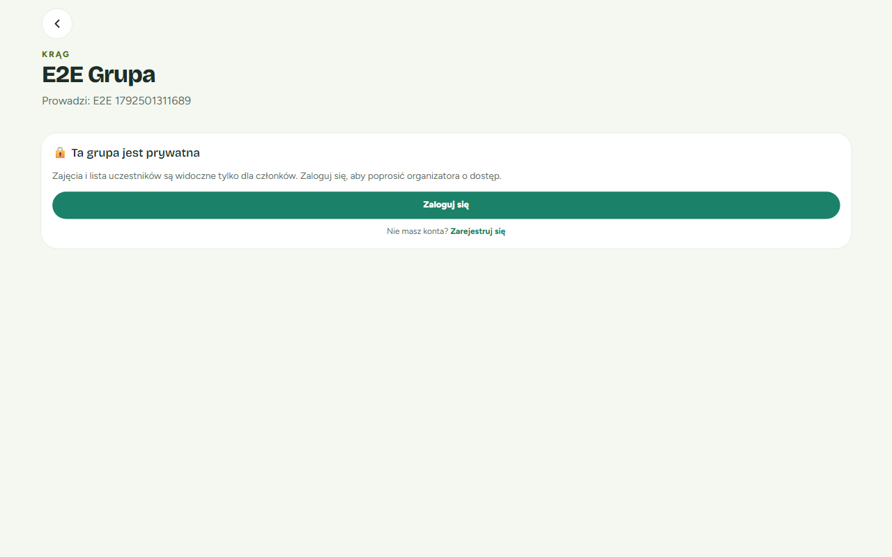

💡 Chcesz, żeby każdy z linkiem widział termin i miejsce bez logowania? W oknie **„Edytuj grupę”** zmień widoczność na **„Publiczna”**.

---

## 5. Wyszukiwarka adresów Google

Gdy dodajesz miejsce, możesz zobaczyć jeden z dwóch widoków:

- **Z wyszukiwarką Google** — zaczynasz wpisywać nazwę lub adres i wybierasz podpowiedź z listy. Ta opcja pojawia się, gdy administrator serwisu ją włączy.
- **Bez wyszukiwarki** (tak jak na zrzutach w tym przewodniku) — wpisujesz nazwę i adres ręcznie. Wszystko działa tak samo, także link do Google Maps na stronie terminu.

---

## Najczęstsze pytania i problemy

**Przycisk „Dalej →” jest szary i nie da się go kliknąć.**
Wpisz nazwę grupy. Sprawdź też, czy w polu „Ile miejsc” jest liczba od 1 do 10000 albo czy jest ono puste.

**Przy dodawaniu miejsca widzę komunikat „Podaj adres”.**
Adres jest wymagany. Wpisz przynajmniej ulicę i miasto.

**Znajomy otworzył link i widzi „Ta grupa jest prywatna”.**
To normalne dla grupy prywatnej. Podaj znajomemu kod dostępu — po zalogowaniu wpisze go i dołączy do grupy. Możesz też zmienić grupę na publiczną w oknie „Edytuj grupę”.

**Usunąłem miejsce, a nadal widzę je przy terminach.**
Tak ma być. Usunięcie miejsca nie zmienia istniejących terminów — goście nadal wiedzą, dokąd przyjść.

**Zmieniłem miejsce grupy, ale stare terminy mają dawne miejsce.**
Ustawienia grupy dotyczą tylko nowych terminów. Stare terminy zmienisz w oknie „Edytuj termin”.

**Nie mogę edytować miejsca w oknie grupy.**
Edycja i usuwanie miejsc są dostępne tylko w menu konta → **„Moje miejsca”**.

**Czy muszę zakładać organizację?**
Nie. Grupę prowadzisz bez organizacji. Wizytówka organizacji jest opcjonalna — daje tylko publiczną stronę z Twoją nazwą i własnym adresem.
