# Dołączanie do grupy prywatnej kodem dostępu — przewodnik

*Ostatnia aktualizacja: 21 października 2026*

## TL;DR

- Każda grupa prywatna ma **6-cyfrowy kod dostępu**. Organizator widzi go na ekranie końcowym „Załóż grupę” i w karcie **„Kod dostępu”** w szczegółach grupy.
- Najprościej wysłać uczestnikom **„Kopiuj link z kodem”**: po otwarciu linku kod wpisze się i wyśle sam, także po zalogowaniu lub założeniu konta.
- Uczestnik może też wpisać kod ręcznie przyciskiem **„Mam kod dostępu”**. Potem od razu widzi termin i może się zapisać.
- **„Wygeneruj nowy kod”** unieważnia stary kod. Nikogo nie usuwa z grupy.
- Prośby o dostęp („Poproś o dostęp”) już nie istnieją. Do grupy prywatnej dołącza się tylko kodem.

## Open Questions / Risks

- Jeśli sesja logowania wygasła, zanim ktoś otworzy link z kodem, kod może się „zgubić” i trzeba go wpisać ręcznie (opisane w [Znanych ograniczeniach](#znane-ograniczenia)). Poprawka jest planowana.
- Organizator nie widzi osoby, która dołączyła kodem, dopóki nie zapisze się ona na termin. Przewodnik opisuje to jako ograniczenie, ale organizatorzy mogą o to pytać.

---

Ten przewodnik jest dla dwóch grup osób:

- **organizatorów**, którzy prowadzą grupę prywatną i chcą zaprosić do niej uczestników,
- **uczestników**, którzy dostali od organizatora kod albo link i chcą dołączyć.

Grupa prywatna to grupa, której terminy i listę uczestników widzą tylko jej członkowie. Żeby zostać członkiem, wystarczy wpisać kod od organizatora — nie trzeba czekać na jego zgodę.

---

## Spis treści

1. [Co nowego?](#co-nowego)
2. [Dla organizatora: gdzie znaleźć kod](#1-dla-organizatora-gdzie-znaleźć-kod)
3. [Dla organizatora: jak udostępnić kod](#2-dla-organizatora-jak-udostępnić-kod)
4. [Dla organizatora: nowy kod](#3-dla-organizatora-nowy-kod)
5. [Dla uczestnika: dołączanie przez link](#4-dla-uczestnika-dołączanie-przez-link)
6. [Dla uczestnika: wpisywanie kodu ręcznie](#5-dla-uczestnika-wpisywanie-kodu-ręcznie)
7. [Dla uczestnika: zapis na termin](#6-dla-uczestnika-zapis-na-termin)
8. [Komunikaty i co z nimi zrobić](#komunikaty-i-co-z-nimi-zrobić)
9. [Najczęstsze pytania](#najczęstsze-pytania)
10. [Znane ograniczenia](#znane-ograniczenia)

---

## Co nowego?

- **Kod dostępu zamiast próśb o dostęp.** Wcześniej uczestnik prosił o dostęp, a organizator musiał go zaakceptować. Teraz uczestnik wpisuje kod i od razu jest w grupie.
- **Link z kodem.** Organizator może wysłać jeden link — uczestnik klika go, loguje się i od razu widzi termin.
- **Nowy kod jednym kliknięciem.** Jeśli kod trafił do niewłaściwych osób, organizator może go zmienić.

---

## 1. Dla organizatora: gdzie znaleźć kod

Kod jest tylko w grupach **prywatnych**. Widzi go wyłącznie organizator grupy. Grupy publiczne kodu nie mają — ich terminy może zobaczyć każdy, kto ma link.

📝 **Co będzie potrzebne:**
- konto organizatora i zalogowanie,
- grupa z widocznością **„Prywatna — (dostęp z kodem)”**.

💡 **Wskazówka:** Widoczność wybierasz przy zakładaniu grupy albo później w oknie **„Edytuj grupę”** (ikona ołówka przy grupie w zakładce Spotkania). Zwróć uwagę na to pole: jeśli masz już stronę organizacji, nowa grupa domyślnie jest **„Publiczna”**.

### Miejsce 1 — zaraz po założeniu grupy

Gdy kończysz zakładanie grupy prywatnej w oknie **„Załóż grupę”**, na ekranie końcowym zobaczysz komunikat:

> „Grupa założona, termin dodany! Grupa jest prywatna — dołączą tylko osoby, którym podasz kod dostępu.”

Pod nim jest karta **„Kod dostępu”** z Twoim kodem.

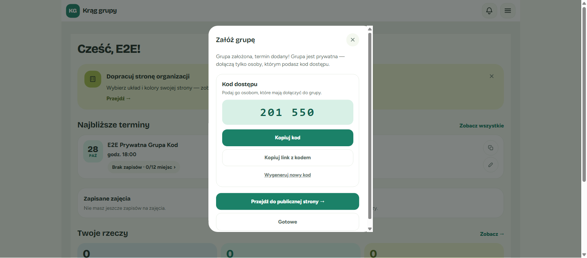

### Miejsce 2 — w szczegółach grupy

Kod możesz sprawdzić w każdej chwili:

1. **Otwórz zakładkę „Spotkania”** w dolnym menu panelu.
2. **Kliknij „Szczegóły ›”** na kafelku wybranej grupy.

   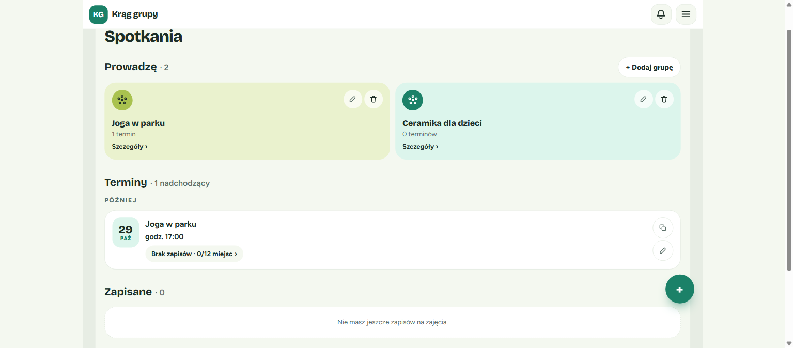

3. **Znajdź kartę „Kod dostępu”** pod informacjami o grupie. W polu „Widoczność” zobaczysz „Prywatna (dostęp z kodem)”.

   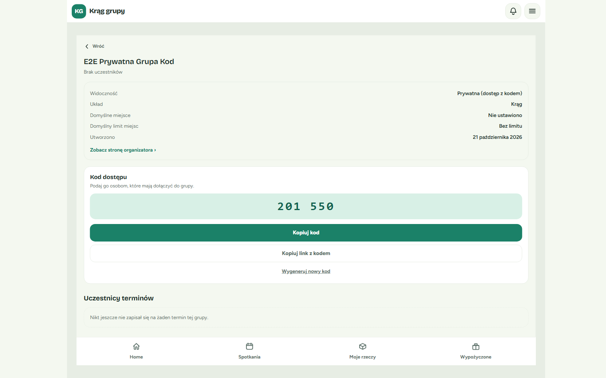

✅ **Co powinieneś zobaczyć:** duży, 6-cyfrowy kod (np. „201 550”) i przyciski **„Kopiuj kod”**, **„Kopiuj link z kodem”** oraz **„Wygeneruj nowy kod”**.

---

## 2. Dla organizatora: jak udostępnić kod

W karcie „Kod dostępu” masz dwa sposoby na przekazanie kodu.

### „Kopiuj link z kodem” — najwygodniej dla uczestników

Kopiuje link do **najbliższego nadchodzącego terminu** grupy, który ma już w sobie kod. Wklej go np. w wiadomość na Messengerze, WhatsAppie albo w e-mail.

Uczestnik, który kliknie link:
- zaloguje się (albo założy konto),
- a kod wpisze się i wyśle **automatycznie** — nie musi go przepisywać.

Po skopiowaniu zobaczysz krótki komunikat „Skopiowano link”.

### „Kopiuj kod” — gdy chcesz podać same cyfry

Kopiuje sam kod, np. `201550`. Przydaje się, gdy podajesz kod ustnie, na kartce albo w wiadomości obok zwykłego linku do terminu. Uczestnik wpisze go wtedy sam (zobacz [punkt 5](#5-dla-uczestnika-wpisywanie-kodu-ręcznie)). Po skopiowaniu zobaczysz komunikat „Skopiowano kod”.

### Gdy grupa nie ma nadchodzącego terminu

Link z kodem zawsze prowadzi do konkretnego terminu. Jeśli w grupie nie ma żadnego nadchodzącego terminu, przycisku **„Kopiuj link z kodem”** nie ma — zostaje tylko **„Kopiuj kod”**.

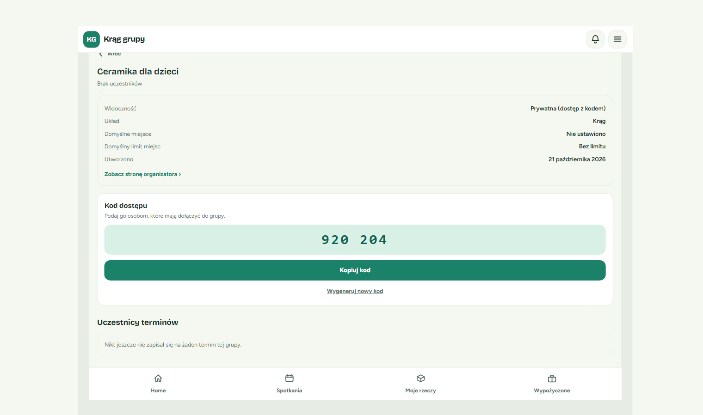

💡 **Wskazówka:** Dodaj termin w zakładce Spotkania (**„+ Dodaj termin”**), a przycisk „Kopiuj link z kodem” pojawi się w karcie.

⚠️ **Uwaga:** Ikona kopiowania przy terminie w zakładce Spotkania (**„Kopiuj link do terminu”**) kopiuje link **bez kodu**. Jeśli chcesz, żeby uczestnik dołączył jednym kliknięciem, używaj **„Kopiuj link z kodem”** z karty „Kod dostępu”.

---

## 3. Dla organizatora: nowy kod

Nowy kod przydaje się, gdy stary trafił do osób, które nie powinny dołączyć — np. ktoś przesłał go dalej albo opublikował.

**Kroki:**

1. **Kliknij „Wygeneruj nowy kod”** w karcie „Kod dostępu”.
2. **Potwierdź w okienku „Wygenerować nowy kod?”**, klikając **„Wygeneruj nowy kod”**. Jeśli się rozmyślisz, kliknij **„Anuluj”** — kod się nie zmieni.

   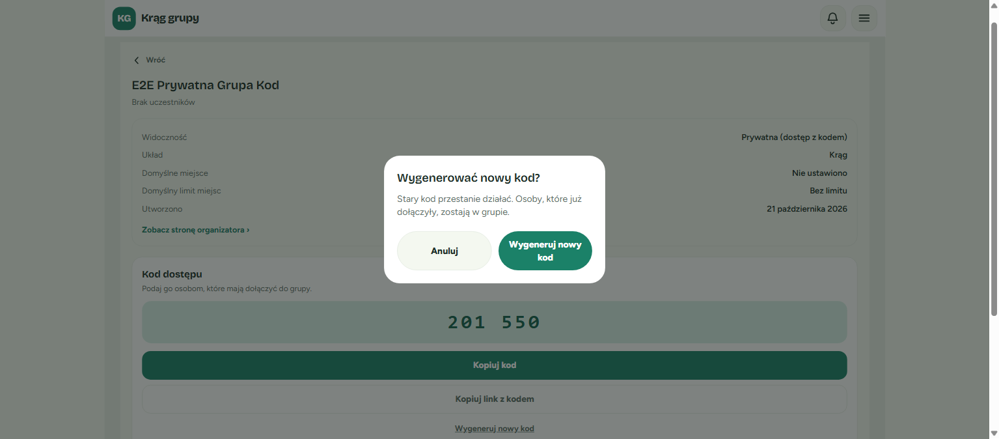

3. **Gotowe.** W karcie pojawi się nowy kod i komunikat „Wygenerowano nowy kod”.

   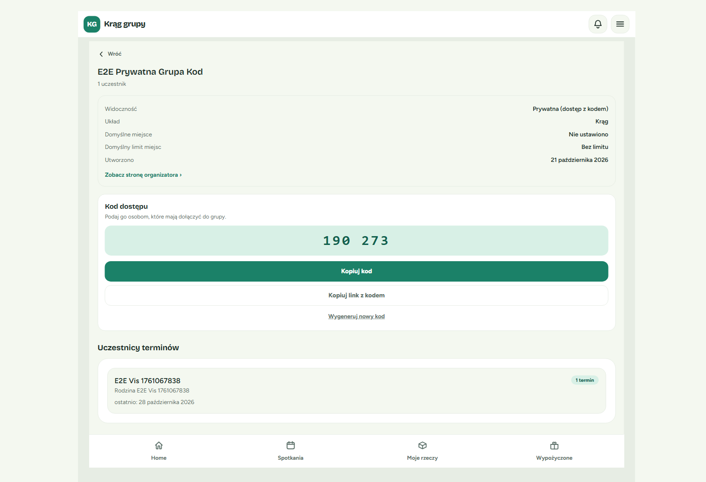

Co się dzieje po zmianie kodu:

- ❌ **Stary kod przestaje działać** — także w linkach, które już wysłałeś. Kto spróbuje go użyć, zobaczy „Nieprawidłowy kod dostępu — sprawdź i spróbuj ponownie”.
- ✅ **Osoby, które już dołączyły, zostają w grupie.** Nie muszą nic robić.
- 📝 **Nowy kod lub nowy link wyślij osobom, które jeszcze nie dołączyły.**

---

## 4. Dla uczestnika: dołączanie przez link

Dostałeś od organizatora link do zajęć? To najprostsza droga.

**Kroki:**

1. **Kliknij link od organizatora.**

   Jeśli nie jesteś zalogowany, zobaczysz informację „Ta grupa jest prywatna” i tekst „Masz kod? Zaloguj się, żeby go użyć.”

   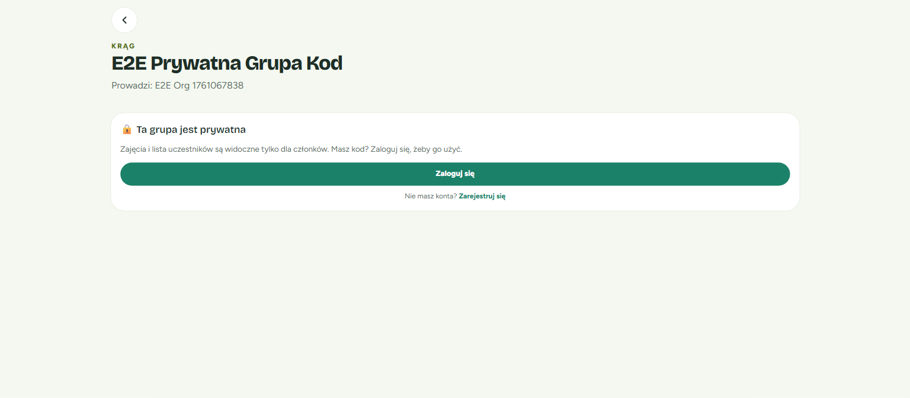

2. **Kliknij „Zaloguj się”** — albo **„Zarejestruj się”**, jeśli nie masz jeszcze konta.

3. **Zaloguj się lub załóż konto** jak zwykle.

4. **Gotowe!** Wrócisz na stronę zajęć, a kod wyśle się sam. Zobaczysz krótki komunikat „Dołączono do grupy” i stronę terminu z przyciskiem **„＋ Zapisz się na zajęcia”**.

   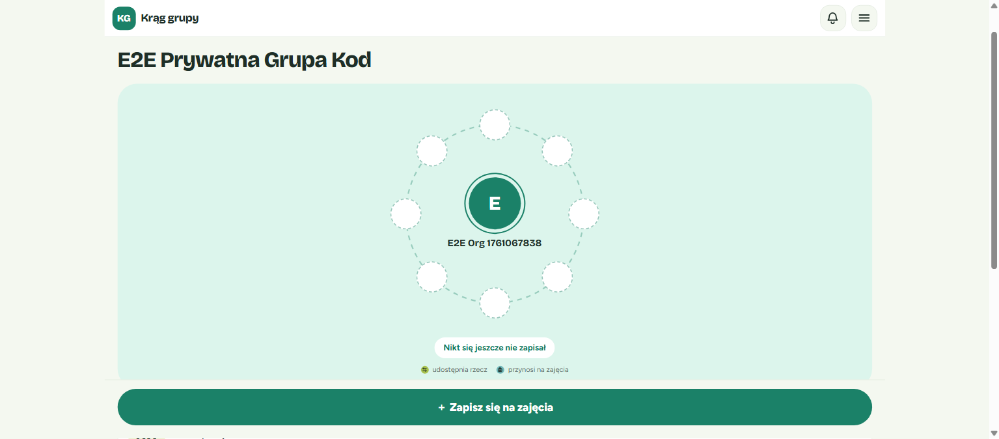

💡 **Wskazówka:** Jeśli jesteś już zalogowany, po kliknięciu linku od razu trafisz na stronę terminu — bez żadnych dodatkowych kroków.

💡 Jeśli jesteś już członkiem grupy i ponownie otworzysz ten sam link, po prostu zobaczysz termin. Nic złego się nie stanie.

---

## 5. Dla uczestnika: wpisywanie kodu ręcznie

Jeśli dostałeś sam kod (np. „201 550”) i zwykły link do zajęć, wpisz kod samodzielnie.

**Kroki:**

1. **Otwórz link do zajęć.** Jeśli nie jesteś zalogowany, zobaczysz „Zaloguj się, aby wpisać kod dostępu.” Kliknij **„Zaloguj się”** (lub **„Zarejestruj się”**).

   

2. **Kliknij „Mam kod dostępu”.** Po zalogowaniu zobaczysz informację „Wpisz kod dostępu od organizatora, aby dołączyć.” i ten przycisk.

   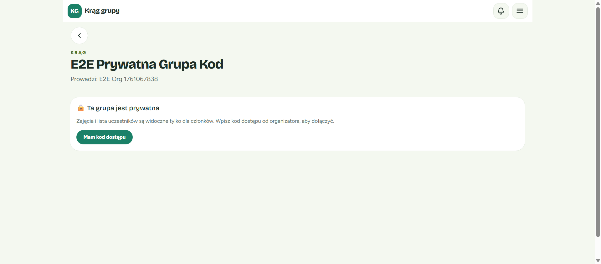

3. **Wpisz kod w okienku „Wpisz kod dostępu”.** Kod ma 6 cyfr, np. `123456`. Możesz też wkleić go ze spacją lub kreską („123 456”, „123-456”) — zadziała tak samo.

   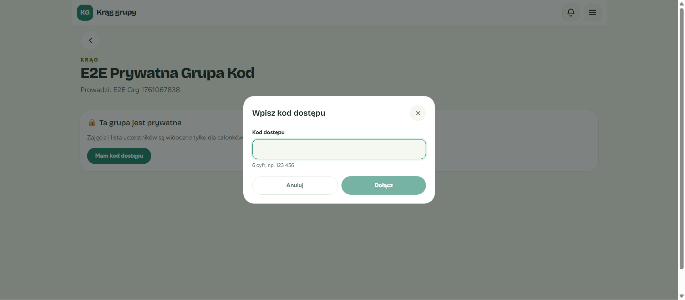

4. **Kliknij „Dołącz”** (albo naciśnij Enter).

✅ **Co powinieneś zobaczyć:** komunikat „Dołączono do grupy” i stronę terminu.

---

## 6. Dla uczestnika: zapis na termin

Dołączenie do grupy to nie to samo, co zapis na zajęcia. Po dołączeniu zapisz się na termin, żeby organizator wiedział, że przyjdziesz.

1. Na stronie terminu kliknij **„＋ Zapisz się na zajęcia”**.
2. Potwierdź, klikając **„Zapisz się”**.

✅ **Co powinieneś zobaczyć:** Twoje inicjały w kręgu uczestników, a niżej liczba zapisanych (np. „Zapisanych 1 z 12”).

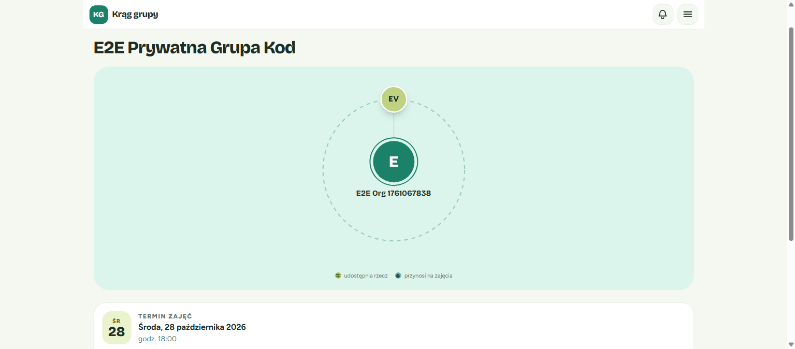

---

## Komunikaty i co z nimi zrobić

### „Nieprawidłowy kod dostępu — sprawdź i spróbuj ponownie”

**Co to znaczy:** kod nie pasuje do tej grupy.

**Co zrobić:**
- sprawdź, czy nie pomyliłeś cyfr, i spróbuj jeszcze raz,
- upewnij się, że kod jest do **tej** grupy,
- jeśli kod na pewno jest dobry, organizator mógł w międzyczasie **wygenerować nowy kod** — poproś go o aktualny kod lub link.

### „Za dużo prób wpisania kodu — spróbuj ponownie za N min”

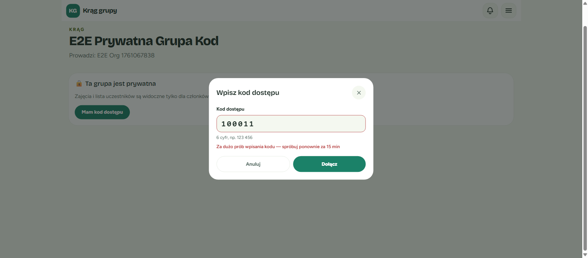

**Co to znaczy:** w krótkim czasie wpisano zbyt wiele błędnych kodów. To zabezpieczenie przed zgadywaniem kodu. Wpisywanie kodu jest chwilowo wstrzymane — nawet poprawny kod nie zadziała, dopóki blokada nie minie.

**Co zrobić:**
- odczekaj tyle minut, ile podaje komunikat (zwykle do 15 min),
- w tym czasie poproś organizatora o potwierdzenie kodu albo o link z kodem,
- potem wpisz kod ponownie.

💡 Blokadę mogą wywołać także błędne próby innych osób w tej samej grupie. Jeśli zobaczysz ten komunikat, choć niczego nie zgadywałeś, po prostu odczekaj i spróbuj później.

### „Kod ma 6 cyfr”

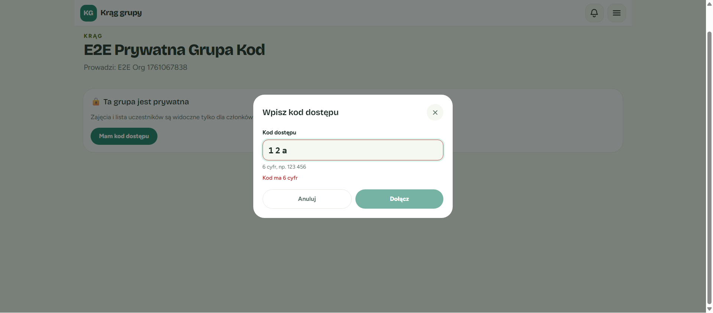

**Co to znaczy:** wpisany tekst nie jest kodem — ma za mało lub za dużo cyfr albo zawiera litery. Przycisk „Dołącz” jest wtedy nieaktywny.

**Co zrobić:** popraw kod tak, żeby miał dokładnie 6 cyfr. Spacje i kreski możesz zostawić.

---

## Najczęstsze pytania

**Czy muszę się zalogować, żeby dołączyć?**
Tak. Do grupy prywatnej dołącza konkretna osoba, więc potrzebne jest konto. Jeśli go nie masz, kliknij „Zarejestruj się” — kod z linku zostanie zapamiętany i wyśle się po rejestracji.

**Zgubiłem kod. Co teraz?**
Poproś organizatora grupy. Kod widzi tylko on — znajdzie go w karcie „Kod dostępu” w szczegółach grupy.

**Czy wygenerowanie nowego kodu usuwa uczestników z grupy?**
Nie. Osoby, które już dołączyły, zostają w grupie. Nowy kod jest potrzebny tylko tym, którzy jeszcze nie dołączyli.

**Gdzie jest przycisk „Poproś o dostęp”?**
Już go nie ma. Prośby o dostęp do grup prywatnych zostały zastąpione kodem dostępu. Organizator nie musi już niczego akceptować — podaje kod, a uczestnicy dołączają sami.

**Czy mogę udostępnić kod dalej?**
Każdy, kto zna kod, może dołączyć do grupy. Przekazuj go więc tylko osobom, które organizator chce zaprosić. Jeśli kod trafi tam, gdzie nie powinien, organizator może wygenerować nowy.

**Czy kod się sam zmienia?**
Nie. Kod zmienia się tylko wtedy, gdy organizator kliknie „Wygeneruj nowy kod”.

---

## Znane ograniczenia

**Organizator nie widzi nowego członka od razu.**
Lista „Uczestnicy terminów” w szczegółach grupy pokazuje tylko osoby zapisane na terminy. Kto dołączył kodem, ale jeszcze nie zapisał się na żaden termin, nie pojawi się na tej liście. Zobaczysz go, gdy zapisze się na zajęcia.

**„Kopiuj link do terminu” nie zawiera kodu.**
Ikona kopiowania przy terminie w zakładce Spotkania kopiuje zwykły link. Osoba spoza grupy będzie musiała wpisać kod ręcznie. Żeby wysłać link, który od razu wpisuje kod, użyj **„Kopiuj link z kodem”** w karcie „Kod dostępu”.

**Po wygaśnięciu logowania kod z linku może przepaść.**
Jeśli ktoś był kiedyś zalogowany, ale jego sesja już wygasła, po kliknięciu linku z kodem trafi od razu na stronę logowania. Po ponownym zalogowaniu kod może się nie wpisać sam. Wtedy wystarczy kliknąć **„Mam kod dostępu”** i wpisać 6 cyfr ręcznie (kod widać na końcu linku, po `#code=`).
