# Wiadomości — przewodnik dla użytkownika

*Ostatnia aktualizacja: 22 października 2026*

## W skrócie

- **Wiadomości** pozwalają rozmawiać w aplikacji bez wymieniania się telefonem czy e-mailem.
- Są trzy rodzaje rozmów:
  - **Rzecz**: zapytaj właściciela o rzecz, która Cię interesuje.
  - **Grupa**: wspólny czat organizatora i członków **prywatnej** grupy.
  - **Termin**: czat organizatora i osób zapisanych na konkretne spotkanie.
- Wszystkie rozmowy znajdziesz pod ikoną **💬** w górnym pasku, obok dzwonka. Zielona liczba na ikonie mówi, ile masz nieprzeczytanych wiadomości.
- Wiadomość ma najwyżej **1000 znaków**. **Enter** dodaje nową linię, a wysyłasz przyciskiem **„Wyślij”**.
- Nowe wiadomości pojawiają się same, w ciągu kilku sekund. Nie musisz odświeżać strony.
- Wiadomości nie da się edytować ani usunąć. Nie dostaniesz też e-maila o nowej wiadomości, zobaczysz tylko licznik przy 💬.

---

## Spis treści

1. [Gdzie są wiadomości](#1-gdzie-są-wiadomości)
2. [Jak zapytać o rzecz](#2-jak-zapytać-o-rzecz)
3. [Czat grupy (prywatne grupy)](#3-czat-grupy-prywatne-grupy)
4. [Czat terminu](#4-czat-terminu)
5. [Pisanie wiadomości](#5-pisanie-wiadomości)
6. [Kiedy czat jest tylko do odczytu](#6-kiedy-czat-jest-tylko-do-odczytu)
7. [Komunikaty o błędach](#7-komunikaty-o-błędach)
8. [Najczęstsze pytania (FAQ)](#8-najczęstsze-pytania-faq)

📝 **Czego potrzebujesz**: konta w aplikacji i zalogowania się. Osoby zapisane na spotkanie bez konta (goście) nie mogą korzystać z wiadomości.

---

## 1. Gdzie są wiadomości

### Ikona 💬 w górnym pasku

W górnym pasku, tuż obok dzwonka z powiadomieniami, jest ikona **💬**. To Twoja skrzynka wiadomości.

- **Zielona liczba** na ikonie pokazuje, ile wiadomości od innych osób jeszcze nie przeczytałeś.
- Gdy nieprzeczytanych jest więcej niż 9, zobaczysz **„9+”**.
- Gdy wszystko jest przeczytane, liczby nie ma.
- Licznik odświeża się sam mniej więcej co 20 sekund.

💡 **Wskazówka**: Wiadomości nie trafiają do dzwonka 🔔. Dzwonek zostaje dla innych powiadomień, a rozmowy są tylko pod 💬.

### Skrzynka „Wiadomości”

Dotknij ikony **💬**. Otworzy się strona **„Wiadomości”**, czyli lista wszystkich Twoich rozmów. Na górze są te, w których ostatnio coś się działo.

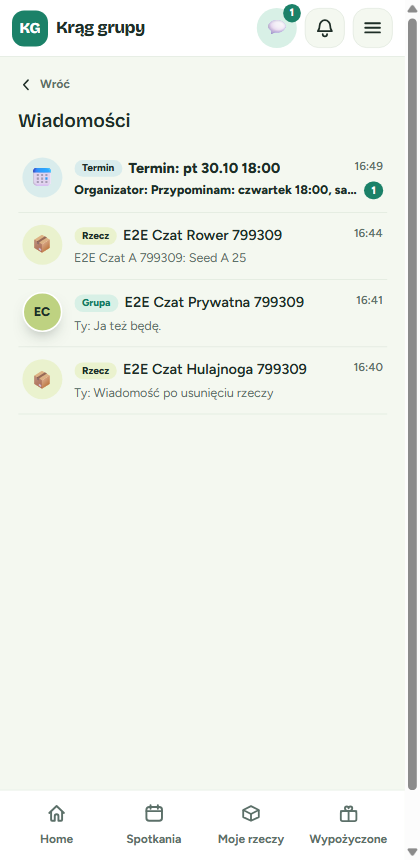

Każdy wiersz ma kolorową etykietę, która mówi, czego dotyczy rozmowa:

| Etykieta | Co to za rozmowa | Ikonka po lewej |
|----------|------------------|-----------------|
| **Rzecz** | Pytanie o konkretną rzecz | 📦 |
| **Grupa** | Czat całej prywatnej grupy | Inicjały grupy |
| **Termin** | Czat jednego spotkania, np. „Termin: pt 30.10 18:00” | 📅 |

Pod nazwą rozmowy widać początek ostatniej wiadomości i to, kto ją napisał:

- **„Ty:”** to Twoja wiadomość;
- **„Organizator:”** to wiadomość od organizatora grupy;
- w innych przypadkach widać imię lub nazwę nadawcy.

Po prawej jest godzina albo dzień ostatniej wiadomości, np. „12:41”, „wczoraj”, „pon” albo „12.10”.

✅ **Rozmowa z nieprzeczytanymi wiadomościami** ma **pogrubioną** nazwę i zielone kółko z ich liczbą. Gdy ją otworzysz, licznik zniknie.

💡 **Wskazówka**: Rozmowa pojawia się w skrzynce dopiero wtedy, gdy ktoś napisze w niej pierwszą wiadomość.

**Pusta skrzynka?** Zobaczysz napis: „Nie masz jeszcze rozmów. Zapytaj o rzecz na jej stronie albo napisz na czacie swojej grupy lub terminu.” Kolejne rozdziały pokazują, jak zacząć rozmowę.

---

## 2. Jak zapytać o rzecz

Gdy widzisz u kogoś rzecz, która Cię interesuje, możesz napisać do jej właściciela. Zapytasz na przykład, czy jest jeszcze dostępna, w jakim jest stanie albo kiedy można ją odebrać.

**Kroki**:

1. **Otwórz stronę rzeczy**

   Wejdź na stronę rzeczy innej osoby. Pod kartą ze statusem (np. „Dostępna”) zobaczysz przycisk **„💬 Zapytaj o rzecz”**.

   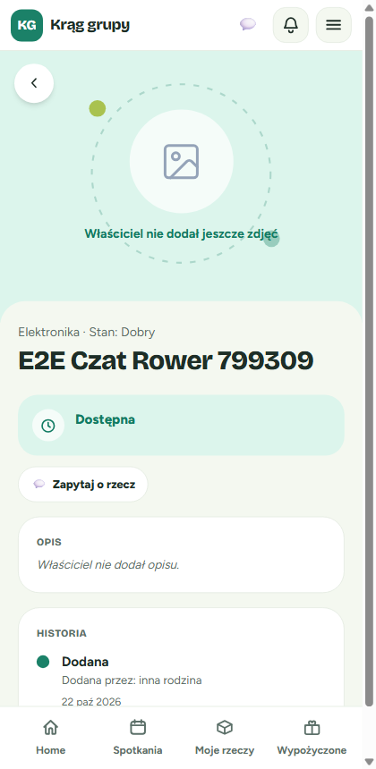

2. **Dotknij „Zapytaj o rzecz”**

   Otworzy się rozmowa z właścicielem. Na górze widać:
   - nazwę rzeczy;
   - linię „Rozmowa z: *imię właściciela*”;
   - link **„zobacz rzecz”**, który zabiera z powrotem na stronę rzeczy.

3. **Napisz pytanie i dotknij „Wyślij”**

   Np. „Dzień dobry, czy rower jest jeszcze dostępny?”. Twoja wiadomość pojawi się po prawej stronie, na zielonym tle. Odpowiedzi właściciela pojawiają się po lewej.

   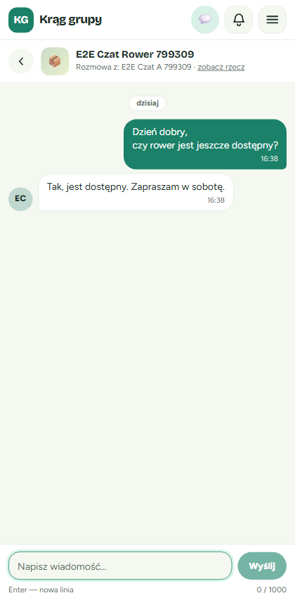

✅ **Co dzieje się u właściciela**: przy jego ikonie 💬 pojawia się licznik, a w skrzynce widzi pogrubiony wiersz z etykietą **„Rzecz”** i Twoim pytaniem. Może odpowiedzieć od razu.

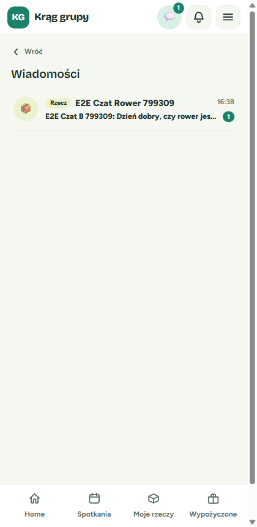

💡 **Wskazówka**: Gdy zapytasz o tę samą rzecz drugi raz, wrócisz do tej samej rozmowy. Nowa się nie tworzy.

### Na swoich rzeczach nie ma przycisku

Na stronie **własnej** rzeczy przycisk „Zapytaj o rzecz” się nie pokazuje. Nie da się zapytać samego siebie. Zamiast niego widzisz przycisk „Edytuj”.

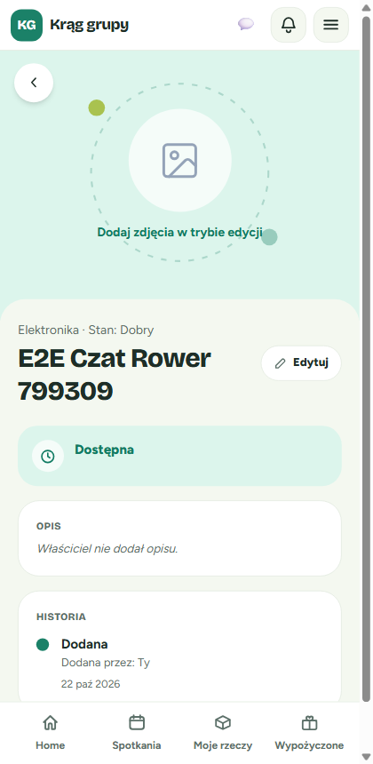

### Co, jeśli rzecz została usunięta?

- **Rozmowa już trwa:** zostaje w skrzynce. Przy nazwie rzeczy pojawia się dopisek **„(usunięte)”**, a link „zobacz rzecz” znika, bo strony rzeczy już nie ma. Nadal możecie do siebie pisać.
- **Rozmowy jeszcze nie było:** na stronie usuniętej rzeczy nie ma przycisku „Zapytaj o rzecz”, więc nowej rozmowy nie zaczniesz.

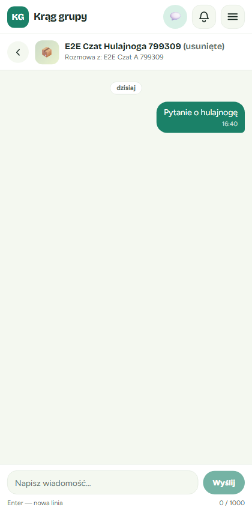

### Co, jeśli rzecz zmieniła właściciela?

Jeśli rzecz została komuś oddana lub wymieniona, „Zapytaj o rzecz” otworzy **nową** rozmowę z jej nowym właścicielem. Stara rozmowa z poprzednim właścicielem zostaje w Twojej skrzynce i nadal działa. W skrzynce zobaczysz wtedy dwie rozmowy o tej samej nazwie.

💡 **Rzecz jest akurat pożyczona?** Twoje pytanie i tak trafi do jej stałego właściciela, a nie do osoby, która ją pożyczyła.

---

## 3. Czat grupy (prywatne grupy)

Czat grupy to wspólna rozmowa całej **prywatnej** grupy, np. „W sobotę zbiórka o 10:00”. Każdy, kto w nim pisze, trafia do wszystkich naraz.

### Kto widzi czat grupy?

- **organizator** grupy;
- wszyscy **członkowie** grupy.

Nikt spoza grupy go nie widzi. Gdy ktoś dołączy później, zobaczy też wcześniejsze wiadomości. Gdy ktoś odejdzie z grupy, traci dostęp do czatu.

⚠️ Czat grupy jest tylko w grupach **prywatnych**, czyli takich, do których dołącza się kodem. Publiczne grupy nie mają czatu grupy, ale mają czaty terminów (rozdział 4).

### Gdzie go znaleźć?

**Na stronie terminu (członkowie i organizator)**

Otwórz stronę dowolnego spotkania swojej prywatnej grupy. Pod kartą z datą jest przycisk **„👥 Czat grupy”**.

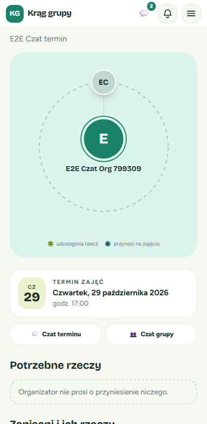

**W szczegółach grupy (organizator)**

Jako organizator otwórz szczegóły swojej prywatnej grupy. Nad kartą „Kod dostępu” jest karta **„Czat grupy”** z opisem „Napisz do wszystkich członków grupy.” i przyciskiem **„💬 Otwórz czat grupy”**.

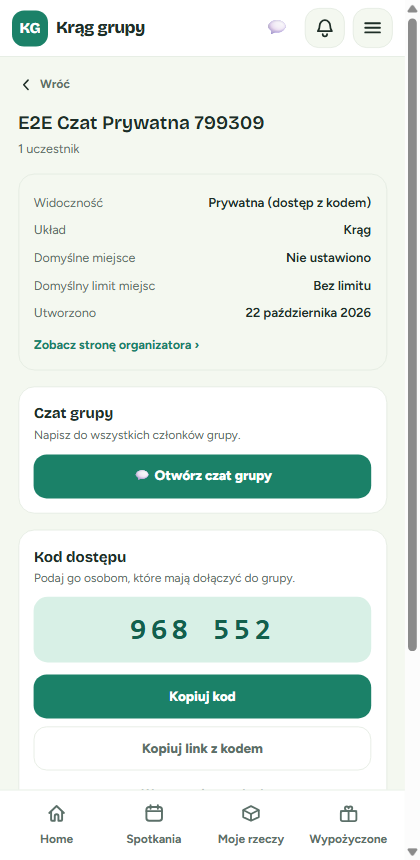

### Jak wygląda czat grupy?

- Na górze jest nazwa grupy z dopiskiem **„· czat grupy”** i liczba uczestników, np. „3 uczestników”.
- Nad wiadomościami innych osób widać ich imię i inicjały.
- Wiadomości organizatora mają zieloną etykietę **„Organizator”**, więc łatwo je odróżnić.
- Twoje wiadomości są po prawej, bez podpisu.

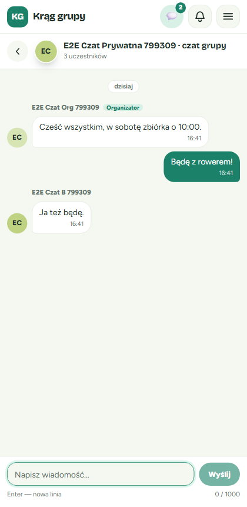

---

## 4. Czat terminu

Czat terminu dotyczy **jednego konkretnego spotkania**. Przydaje się, żeby ustalić szczegóły, np. kto co przynosi, albo dać znać o spóźnieniu.

### Kto widzi czat terminu?

- **organizator** grupy;
- osoby **zapisane** na ten termin.

Jeśli wypiszesz się z terminu, stracisz dostęp do jego czatu. Czat terminu działa w grupach prywatnych i publicznych. Zostaje otwarty także po spotkaniu.

### Gdzie go znaleźć?

**Na stronie terminu**

Gdy jesteś zapisany na spotkanie albo je organizujesz, na stronie terminu zobaczysz przycisk **„💬 Czat terminu”** (zobacz zrzut ekranu w rozdziale 3).

| Kim jesteś | Co widzisz na stronie terminu |
|------------|-------------------------------|
| Organizator, grupa prywatna | „Czat terminu” i „Czat grupy” |
| Członek zapisany na termin, grupa prywatna | „Czat terminu” i „Czat grupy” |
| Członek niezapisany na termin, grupa prywatna | Tylko „Czat grupy” |
| Organizator lub osoba zapisana, grupa publiczna | Tylko „Czat terminu” |
| Osoba, która się wypisała, ktoś spoza grupy, niezalogowany gość | Żadnego przycisku |

**Na liście zapisanych (organizator)**

Organizator może też otworzyć listę osób zapisanych na termin („Zapisani”). Na karcie terminu jest przycisk **„💬 Napisz do uczestników”**, który otwiera czat tego terminu.

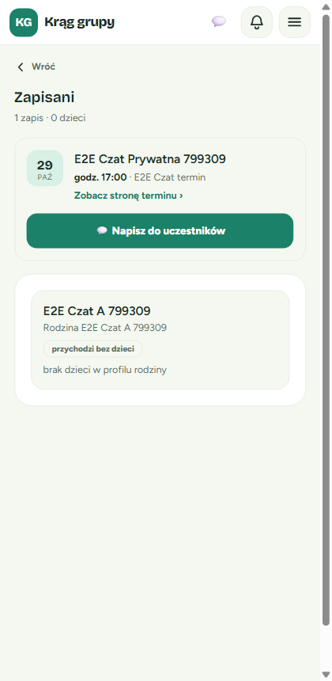

✅ **Co zobaczysz**: rozmowę z nazwą grupy i dopiskiem **„· czat terminu”** oraz liczbą uczestników. W skrzynce taki czat ma etykietę **„Termin”** i nazwę z datą, np. „Termin: pt 30.10 18:00”.

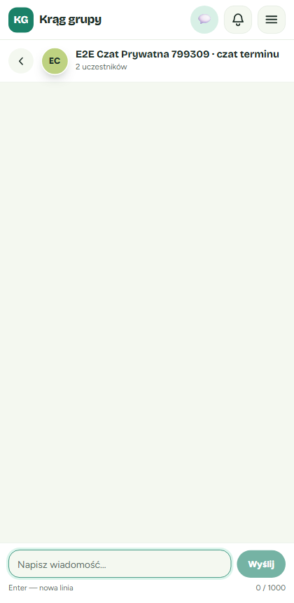

---

## 5. Pisanie wiadomości

Pole do pisania wygląda tak samo we wszystkich rozmowach: o rzecz, w grupie i w terminie. Jest zawsze na dole ekranu.

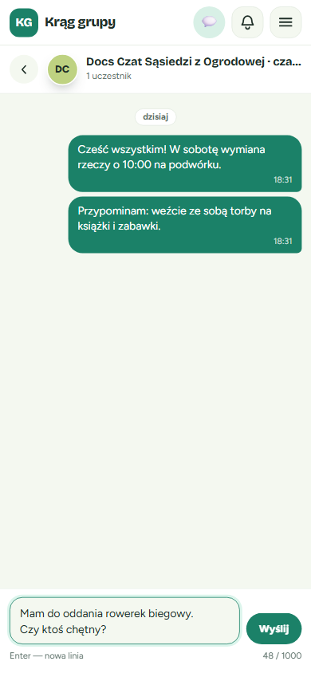

### Limit 1000 znaków

- Pod polem, po prawej, jest **licznik**, np. „48 / 1000”. Pokazuje, ile znaków już wpisałeś.
- Jedna wiadomość może mieć najwyżej **1000 znaków**. Po dojściu do limitu pole nie przyjmie więcej tekstu.
- Dłuższą myśl podziel na dwie wiadomości.

### Enter to nowa linia, a wysyłasz przyciskiem „Wyślij”

- **Enter** przenosi do nowej linii. Podpowiedź „Enter — nowa linia” jest pod polem.
- Wiadomość wysyłasz, dotykając zielonego przycisku **„Wyślij”**.
- Przycisk jest wyszarzony, gdy pole jest puste albo zawiera same spacje.

✅ **Po wysłaniu**: wiadomość pojawia się po prawej stronie z godziną, a pole jest znowu puste i gotowe na kolejną.

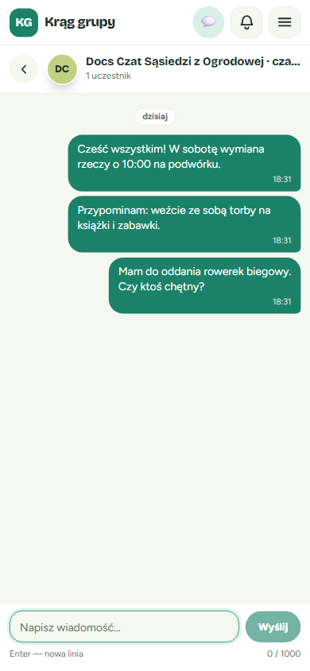

### Nowe wiadomości pojawiają się same

Nie musisz odświeżać strony. Odpowiedzi innych osób pojawiają się w otwartej rozmowie same, zwykle **w ciągu kilku sekund**. Gdy otworzysz rozmowę, jej wiadomości liczą się jako przeczytane, a licznik przy 💬 maleje.

💡 **Wskazówka**: Nad wiadomościami z danego dnia jest znacznik dnia, np. „dzisiaj”, „wczoraj” albo „poniedziałek, 20 października”. Pod każdą wiadomością jest godzina wysłania.

### Starsze wiadomości: „Wcześniejsze wiadomości”

Po otwarciu długiej rozmowy widzisz najnowsze wiadomości. Aby zobaczyć starsze:

1. Przewiń rozmowę do góry.
2. Dotknij przycisku **„Wcześniejsze wiadomości”**. Gdy dojdziesz do samej góry, starsze wiadomości mogą też wczytać się same.

Starsze wiadomości dopiszą się nad tymi, które czytasz. Ekran nie przeskoczy w inne miejsce.

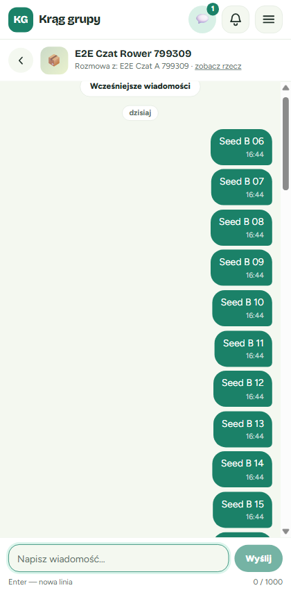

---

## 6. Kiedy czat jest tylko do odczytu

Czasem czat grupy albo terminu przestaje przyjmować nowe wiadomości. Wtedy **nadal możesz czytać** całą rozmowę, ale na dole zamiast pola do pisania jest szary pasek z wyjaśnieniem. Rozmowa zostaje też w skrzynce.

### Grupa została usunięta

- Pod nazwą czatu jest napis **„Grupa usunięta”**.
- Na dole widać pasek **„Grupa usunięta — czat jest tylko do odczytu”**.
- Dotyczy to czatu grupy i czatów wszystkich jej terminów.

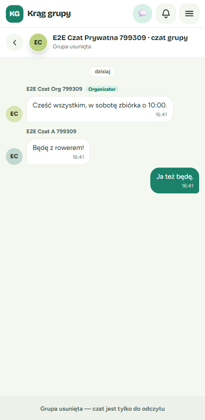

### Grupa stała się publiczna

- Pod nazwą czatu jest napis **„Grupa publiczna”**.
- Na dole widać pasek **„Grupa jest publiczna — czat jest tylko do odczytu”**.
- Dotyczy to tylko **czatu grupy**. Czaty terminów działają dalej normalnie.
- Przycisk „Czat grupy” znika ze strony terminu i ze szczegółów grupy. Starą rozmowę otworzysz ze skrzynki 💬.
- Jeśli organizator zmieni grupę z powrotem na **prywatną**, znowu można pisać.

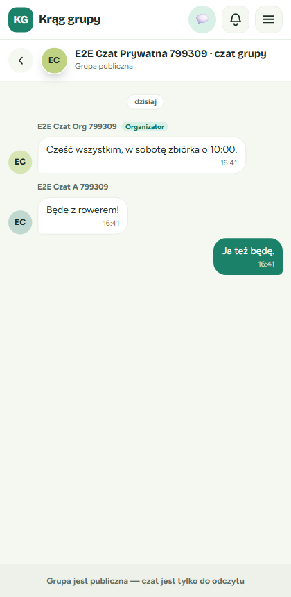

💡 **Wskazówka**: Gdy grupa jest jednocześnie usunięta i publiczna, zobaczysz komunikat o usunięciu.

---

## 7. Komunikaty o błędach

Gdy wiadomość nie da się wysłać, pod polem pojawia się czerwony komunikat. **Twój tekst zostaje w polu**, więc możesz go poprawić albo wysłać ponownie, bez przepisywania.

### „Za dużo wiadomości — spróbuj ponownie za chwilę.”

Wysłałeś bardzo dużo wiadomości w krótkim czasie, ponad 30 w ciągu minuty. To zabezpieczenie przed spamem.

**Co zrobić**: odczekaj minutę i dotknij „Wyślij” jeszcze raz.

Podobny komunikat, **„Za dużo nowych rozmów — spróbuj ponownie za … min”**, pojawi się, gdy w ciągu godziny zaczniesz bardzo wiele nowych rozmów o rzeczach (ponad 20). Do rozmów, które już masz, możesz w tym czasie normalnie wracać.

### Wiadomość odrzucona przez moderację

Wiadomości są automatycznie sprawdzane pod kątem zasad społeczności, np. obraźliwych słów. Gdy wiadomość ich nie spełnia, zobaczysz:

**„Wiadomość narusza zasady społeczności. Zmień ją i spróbuj ponownie.”**

**Co zrobić**: zmień treść wiadomości i wyślij ją ponownie. Odrzucona wiadomość nie trafia do rozmowy, więc nikt jej nie zobaczy.

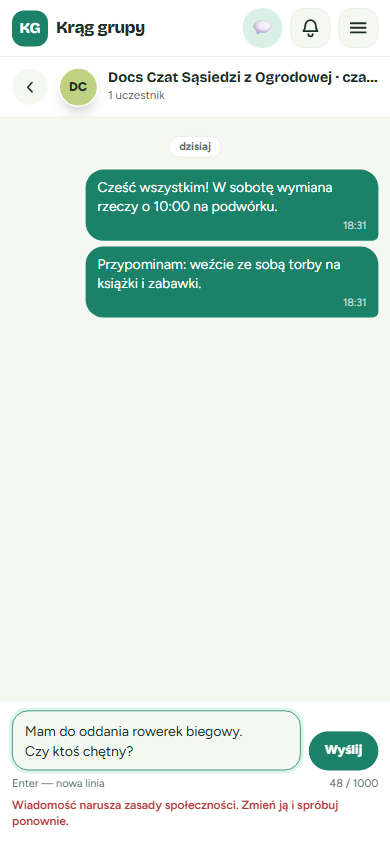

### „Nie masz dostępu do tej rozmowy.”

Ten komunikat zobaczysz, gdy otworzysz rozmowę, w której nie uczestniczysz. Na przykład:

- ktoś przesłał Ci link do cudzej rozmowy;
- wypisałeś się z terminu i próbujesz otworzyć jego czat;
- nie należysz już do grupy.

**Co zrobić**: dotknij **„Wróć do wiadomości”**, aby wrócić do swojej skrzynki.

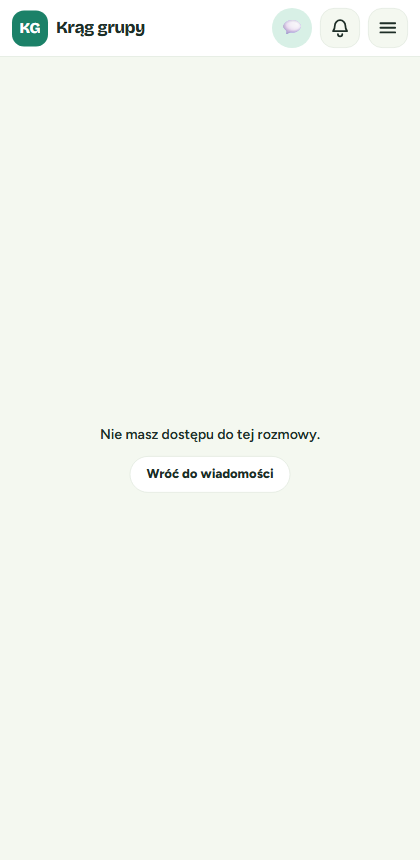

### Inne komunikaty

| Komunikat | Co oznacza | Co zrobić |
|-----------|------------|-----------|
| „Nie znaleziono rozmowy.” | Link jest błędny albo rozmowa nie istnieje | Wróć do skrzynki przyciskiem „Wróć do wiadomości” |
| „Nie udało się wysłać — spróbuj ponownie” | Chwilowy problem z połączeniem | Sprawdź internet i dotknij „Wyślij” jeszcze raz |
| „Nie udało się otworzyć rozmowy — spróbuj ponownie” | Rozmowy nie udało się otworzyć | Spróbuj jeszcze raz za chwilę |
| „Nie udało się wczytać wiadomości” | Lista się nie wczytała | Dotknij „Spróbuj ponownie” |
| „Grupa usunięta — czat jest tylko do odczytu” / „Grupa jest publiczna — czat jest tylko do odczytu” | Czat jest zablokowany do pisania | Zobacz rozdział 6 |

---

## 8. Najczęstsze pytania (FAQ)

**Kto widzi moje wiadomości?**
Tylko osoby, które biorą udział w danej rozmowie:
- **rozmowa o rzeczy:** tylko Ty i właściciel rzeczy;
- **czat grupy:** organizator i wszyscy obecni członkowie prywatnej grupy, także ci, którzy dołączą później;
- **czat terminu:** organizator i wszystkie osoby zapisane na ten termin.

Osoby spoza rozmowy, w tym niezalogowani goście, nie widzą wiadomości.

**Czy mogę usunąć lub poprawić wysłaną wiadomość?**
Nie, ta funkcja nie jest dostępna. Wysłanej wiadomości nie da się edytować ani usunąć, więc przeczytaj ją przed dotknięciem „Wyślij”.

**Czy dostanę e-mail o nowej wiadomości?**
Nie. Aplikacja nie wysyła e-maili ani powiadomień push o wiadomościach. Nowe wiadomości zobaczysz tylko jako licznik przy ikonie 💬 w górnym pasku.

**Dlaczego nowa wiadomość nie trafiła do dzwonka 🔔?**
Tak ma być. Wiadomości mają swoją ikonę 💬, a dzwonek zostaje dla innych powiadomień.

**Dołączyłem do grupy i licznik pokazuje „9+”. Co się stało?**
Jako nowy członek widzisz całą wcześniejszą historię czatu grupy, więc wszystkie stare wiadomości liczą się jako nieprzeczytane. Otwórz czat grupy, a licznik się wyzeruje.

**Nie widzę przycisku „Czat grupy”.**
Sprawdź, czy:
- jesteś zalogowany;
- należysz do grupy;
- grupa jest **prywatna**. Grupy publiczne nie mają czatu grupy.

**Nie widzę przycisku „Czat terminu”.**
Przycisk widzą tylko organizator i osoby zapisane na termin. Jeśli się wypisałeś, przycisk znika.

**Czy mogę wysłać zdjęcie lub plik?**
Nie, w wiadomościach można wysyłać tylko tekst.

**Czy druga osoba wie, że przeczytałem jej wiadomość?**
Nie. Aplikacja nie pokazuje innym, czy przeczytałeś ich wiadomość.

**Czy mogę wyciszyć rozmowę albo z niej wyjść?**
Nie. Rozmowa grupy lub terminu znika z Twojej skrzynki dopiero wtedy, gdy przestajesz należeć do grupy albo wypisujesz się z terminu.
