# Kategorie rzeczy oraz Oddam / Zamienię / Wersja robocza: przewodnik

*Ostatnia aktualizacja: 28.10.2026*

## TL;DR
- Każda rzecz ma teraz **kategorię** z drzewa znanego z Vinted (np. Kobiety › Ubrania › Sukienki › Sukienki midi). Wybierasz ją z listy albo wyszukujesz.
- Dodawanie rzeczy kończysz jednym z trzech przycisków: **Oddam**, **Zamienię** albo **Wersja robocza**.
- Możesz mieć najwyżej **10 rzeczy do oddania** naraz.
- Zdjęcia czekające na sprawdzenie nie blokują już wystawienia rzeczy.
- Organizator wpisuje potrzebne rzeczy na termin samą nazwą. Administrator zarządza drzewem kategorii w panelu.

## Key Decisions
- Kategorię wybierasz zawsze z **najniższego poziomu** drzewa (np. „Sukienki midi”, a nie „Sukienki”), bo tylko wtedy inni łatwo znajdą Twoją rzecz.
- Przyciski na końcu formularza od razu decydują, czy rzecz jest widoczna dla innych. Nie trzeba już osobno wchodzić do „Moje rzeczy”.
- Klawisz Enter w formularzu niczego nie zapisuje. Zawsze klikasz jeden z trzech przycisków.

## Open Questions / Risks
- Etykietę „Aktywna” / „Wersja robocza” widać tylko na stronie **edycji** rzeczy. Na liście „Moje rzeczy” stan rozpoznasz po zaznaczonym przycisku Oddam lub Zamienię.
- Na stronie edycji jest też osobny panel „Dostępna”. Mówi on, czy rzecz jest u Ciebie, czy np. zarezerwowana, i nie jest tym samym co „Aktywna”.
- Część napisów w panelu administratora jest po angielsku (np. „Categories”, „Products”, „Cancel” w oknie potwierdzenia).
- Rzecz wystawiona przed sprawdzeniem zdjęć pojawia się w terminach na razie **bez zdjęcia**. Zdjęcia pokażą się innym po ich zatwierdzeniu.

---

## Spis treści
1. [Dodawanie rzeczy](#1-dodawanie-rzeczy)
2. [Edycja rzeczy i „Moje rzeczy”](#2-edycja-rzeczy-i-moje-rzeczy)
3. [Rzeczy potrzebne na termin (dla organizatorów)](#3-rzeczy-potrzebne-na-termin-dla-organizatorów)
4. [Zarządzanie kategoriami (dla administratorów)](#4-zarządzanie-kategoriami-dla-administratorów)
5. [Rozwiązywanie problemów](#5-rozwiązywanie-problemów)

---

## 1. Dodawanie rzeczy

Dodaj rzecz, którą chcesz komuś oddać albo na coś zamienić. Możesz też zapisać ją na później jako wersję roboczą.

📝 **Co będzie potrzebne**: konto w aplikacji, nazwa rzeczy i (opcjonalnie) zdjęcia.

**Jak zacząć**: kliknij okrągły przycisk **+** na dole ekranu, a potem kafelek **Rzecz**.

### Krok 1. Wypełnij nazwę i stan

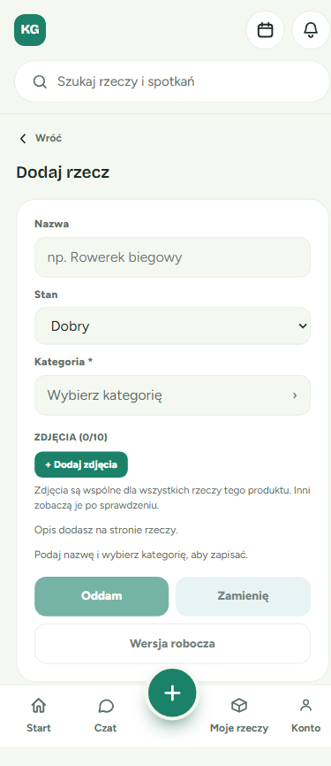

- **Nazwa**: krótko i konkretnie, np. „Sukienka w kwiaty, rozmiar M”.
- **Stan**: wybierz z listy, np. „Dobry” albo „Jak nowy”.

💡 **Wskazówka**: dopóki nie podasz nazwy i nie wybierzesz kategorii, przyciski na dole są wyszarzone, a nad nimi widać podpowiedź **„Podaj nazwę i wybierz kategorię, aby zapisać.”**

### Krok 2. Wybierz kategorię

Kliknij pole **Kategoria \*** („Wybierz kategorię ›”). Otworzy się okno **„Wybierz kategorię”**. Możesz w nim przeglądać kategorie albo je wyszukać.

**Przeglądanie poziomami**

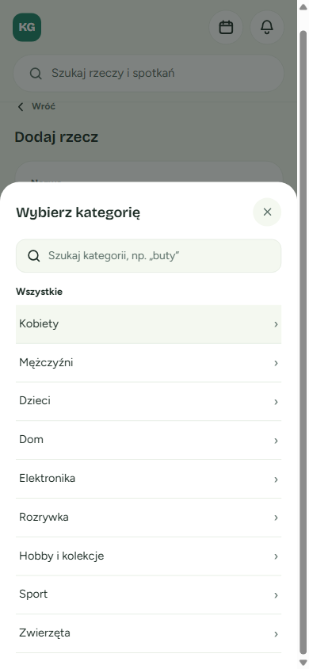

1. Kliknij kategorię główną, np. **Kobiety**, a potem kolejne poziomy, np. **Ubrania**.
2. Kategorie oznaczone strzałką **›** mają w środku kolejne poziomy. Kliknięcie otwiera je, ale ich nie wybiera.
3. Kategoria z najniższego poziomu, oznaczona napisem „wybierz”, od razu zostaje wybrana i okno się zamyka.

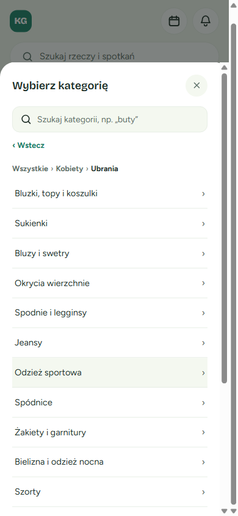

- **„‹ Wstecz”** cofa o jeden poziom.
- Ścieżka u góry („Wszystkie › Kobiety › Ubrania”) pozwala wrócić od razu na dowolny wcześniejszy poziom. Wystarczy kliknąć jej element.

**Wyszukiwanie**

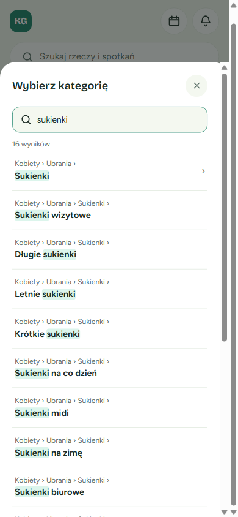

1. Wpisz fragment nazwy w polu wyszukiwania, np. „sukienki”.
2. Każdy wynik pokazuje **pełną ścieżkę**, więc wiesz, gdzie leży dana kategoria (np. „Kobiety › Ubrania › Sukienki › Sukienki midi”).
3. Polskie znaki są opcjonalne: wpisanie „ksiazki” znajdzie „Książki”.
4. Wynik ze strzałką **›** otwiera ten poziom, żebyś mógł/mogła wybrać coś dokładniejszego.

💡 **Wskazówka**: przy bardzo ogólnym słowie (np. „inne”) zobaczysz komunikat „Pokazano 50 z … — zawęź wyszukiwanie”. Dopisz wtedy kolejne słowo.

💡 Klawisz **Esc** czyści wyszukiwanie. Drugie naciśnięcie zamyka okno.

✅ **Co powinieneś/powinnaś zobaczyć**: w polu Kategoria pojawia się ścieżka i pogrubiona nazwa wybranej kategorii.

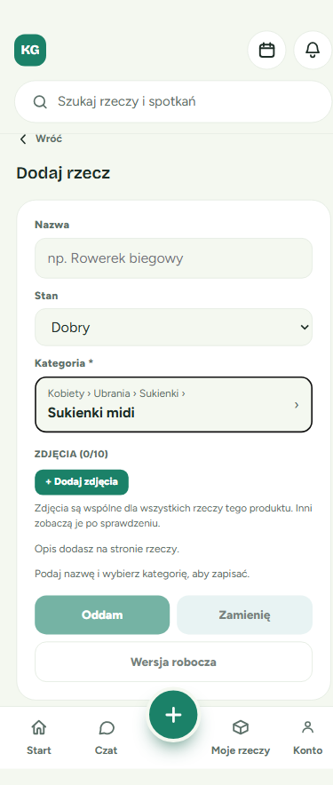

⚠️ Wybrać można tylko kategorię z **najniższego poziomu**. Jeśli nie widzisz napisu „wybierz”, zejdź poziom niżej. Gdy nic nie pasuje, poszukaj kategorii „Inne …” w danej grupie.

### Krok 3. Dodaj zdjęcia (opcjonalnie)

Kliknij **„+ Dodaj zdjęcia”** (do 10). Inni zobaczą je po sprawdzeniu przez nas. Opis rzeczy dodasz później, na jej stronie.

### Krok 4. Wybierz, co dalej z rzeczą

Na końcu formularza są trzy przyciski:

| Przycisk | Co oznacza |
|---|---|
| **Oddam** | Chcesz rzecz komuś podarować. Od razu będzie widoczna dla innych w terminach Twoich grup. |
| **Zamienię** | Chcesz ją wymienić na coś innego. Od razu będzie widoczna dla innych. |
| **Wersja robocza** | Rzecz zostaje tylko u Ciebie i nikt jej nie widzi. Wystawisz ją później w „Moje rzeczy”. |

✅ Po kliknięciu przejdziesz na stronę nowej rzeczy.

### Gdy masz już 10 rzeczy do oddania

Możesz mieć naraz najwyżej **10 rzeczy z opcją „Oddam”**. Jeśli spróbujesz dodać jedenastą, zobaczysz komunikat:

> „Możesz mieć maksymalnie 10 rzeczy do oddania. Wybierz „Zamienię” albo zapisz wersję roboczą.”

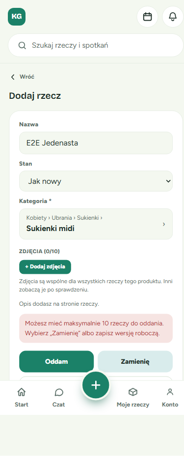

**Co zrobić?** Nic nie tracisz, bo formularz zachowuje wszystko, co wpisałeś/wpisałaś. Masz trzy możliwości:
- kliknij **Zamienię**, albo
- kliknij **Wersja robocza** i wystaw rzecz później, albo
- w „Moje rzeczy” zdejmij „Oddam” z innej rzeczy i wróć do formularza.

---

## 2. Edycja rzeczy i „Moje rzeczy”

### Jak zmienić „Oddam” / „Zamienię” albo ukryć rzecz

Wejdź w **Moje rzeczy** (dolne menu). Pod każdą rzeczą są dwa przyciski.

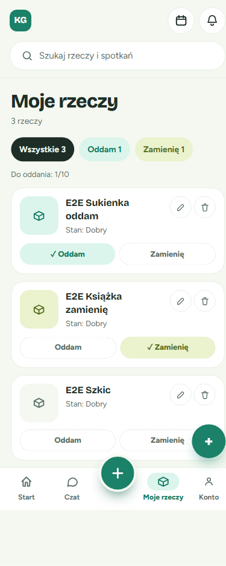

- Kliknij **Oddam** albo **Zamienię**, żeby wystawić rzecz w tym trybie. Zaznaczony przycisk ma znaczek ✓.
- Kliknij **zaznaczony** przycisk (np. „✓ Zamienię”), żeby go odznaczyć. Rzecz wraca wtedy do wersji roboczej i znika z oferty.
- Rzecz bez zaznaczonego przycisku to wersja robocza (na zrzucie: „E2E Szkic”).

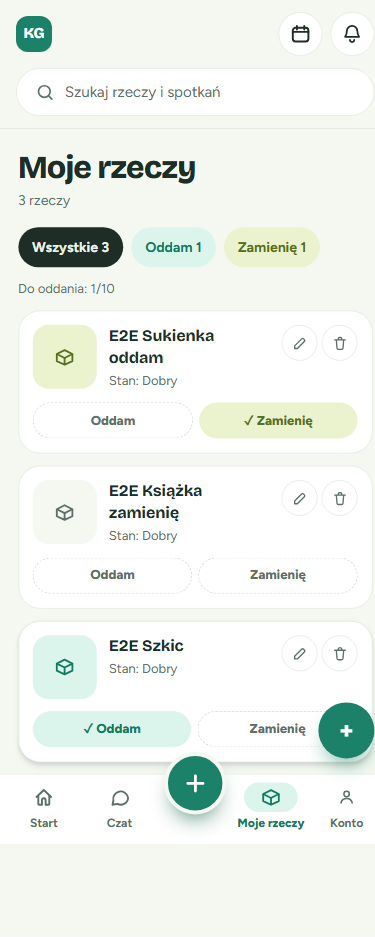

Nad listą widać licznik **„Do oddania: X/10”**. Przy 10/10 przycisk Oddam przy pozostałych rzeczach jest nieaktywny, a obok pojawia się podpowiedź „Zdejmij „Oddam” z innej rzeczy.”

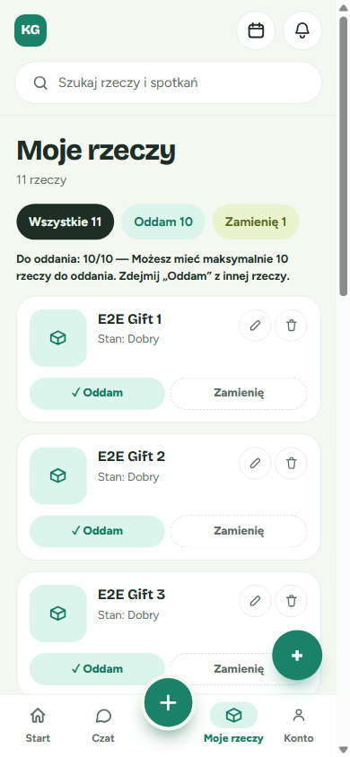

✅ **Nowość**: zdjęcia oczekujące na sprawdzenie **nie blokują** już przycisków Oddam / Zamienię. Przy rzeczy nadal może być widoczny znaczek „Zdjęcia w moderacji”, ale możesz ją wystawić od razu.

### Jak zmienić kategorię rzeczy

1. W „Moje rzeczy” kliknij ikonę **ołówka** przy rzeczy.
2. Na stronie **Edycja rzeczy**, w sekcji „Nazwa i kategoria”, kliknij ołówek („Edytuj nazwę i kategorię”).
3. Kliknij pole **Kategoria** i wybierz nową kategorię dokładnie tak jak przy dodawaniu. Okno otworzy się na poziomie obecnej kategorii.
4. Kliknij **Zapisz**. Do tego czasu nic się nie zmienia, a **Anuluj** porzuca zmianę.

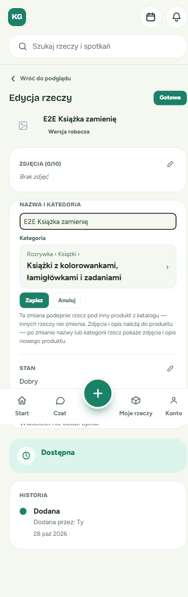

### Etykieta „Aktywna” / „Wersja robocza”

Pod nazwą rzeczy na stronie edycji widać jej stan:
- **Aktywna**: rzecz jest wystawiona (Oddam lub Zamienię), więc inni ją widzą.
- **Wersja robocza**: rzecz widzisz tylko Ty.

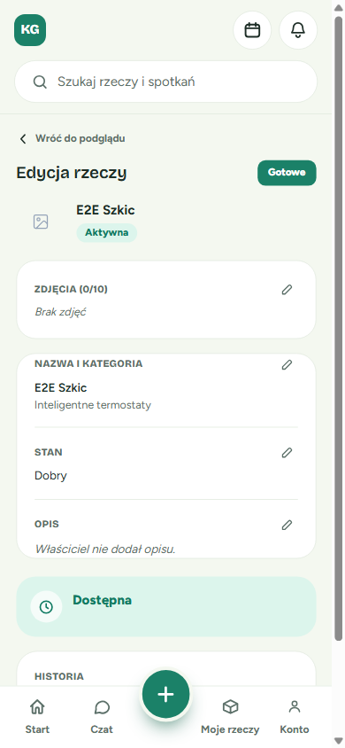

💡 Gdy oddasz albo zamienisz rzecz, u nowego właściciela trafia ona jako **wersja robocza**. Sam/sama zdecyduje, czy wystawić ją dalej.

---

## 3. Rzeczy potrzebne na termin (dla organizatorów)

Jako organizator możesz zapisać, czego brakuje na spotkaniu, np. termosu albo koca. Uczestnicy zobaczą listę i mogą zgłosić „Ja to przyniosę”.

### Jak dodać potrzebne rzeczy

1. Kliknij **+** na dole ekranu, potem **Termin spotkania**.
2. Wypełnij dane terminu i przewiń do sekcji **Potrzebne rzeczy (opcjonalnie)**.
3. Wpisz **Nazwę** (np. „Termos”) i, jeśli chcesz, **Doprecyzowanie** (np. „najlepiej 1 l”). Kategorii nie trzeba już wybierać.
4. Kliknij **Dodaj rzecz**. Powtórz dla kolejnych rzeczy.
5. Kliknij **Dodaj termin**.

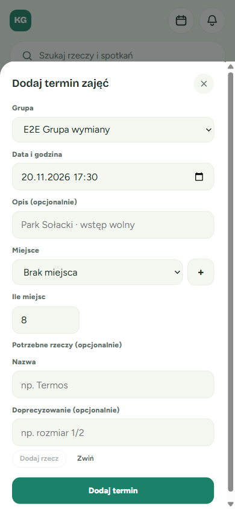

✅ **Co powinieneś/powinnaś zobaczyć**: na stronie terminu lista „Potrzebne rzeczy”, np. „Koc piknikowy · Termos — najlepiej 1 l”.

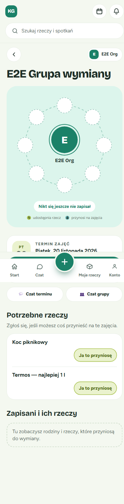

### Nazwy są sprawdzane

Lista potrzebnych rzeczy jest widoczna publicznie, dlatego nazwy i opisy **nie mogą zawierać danych kontaktowych** (numeru telefonu, e-maila, linków, komunikatorów).

Jeśli któraś nazwa zostanie odrzucona, **termin i tak zostanie dodany** razem z poprawnymi rzeczami. Zobaczysz jeden komunikat, np.:

> „Termin dodany, ale nie dodano rzeczy: Termos zadzwoń 600 700 800 — Nazwa i opis nie mogą zawierać danych kontaktowych…”

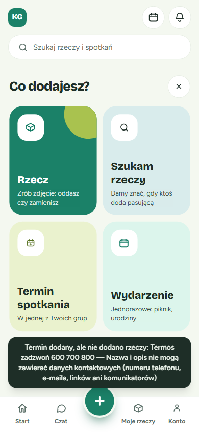

**Co zrobić?** Wejdź w termin (Spotkania → **Edytuj termin**) i dodaj tę rzecz ponownie, tym razem bez danych kontaktowych. Tam możesz też zmieniać nazwy już dodanych rzeczy.

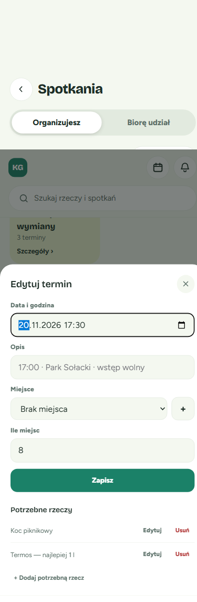

---

## 4. Zarządzanie kategoriami (dla administratorów)

Drzewo kategorii znajdziesz w panelu administratora, w menu **Categories**.

### Przeglądanie i filtrowanie drzewa

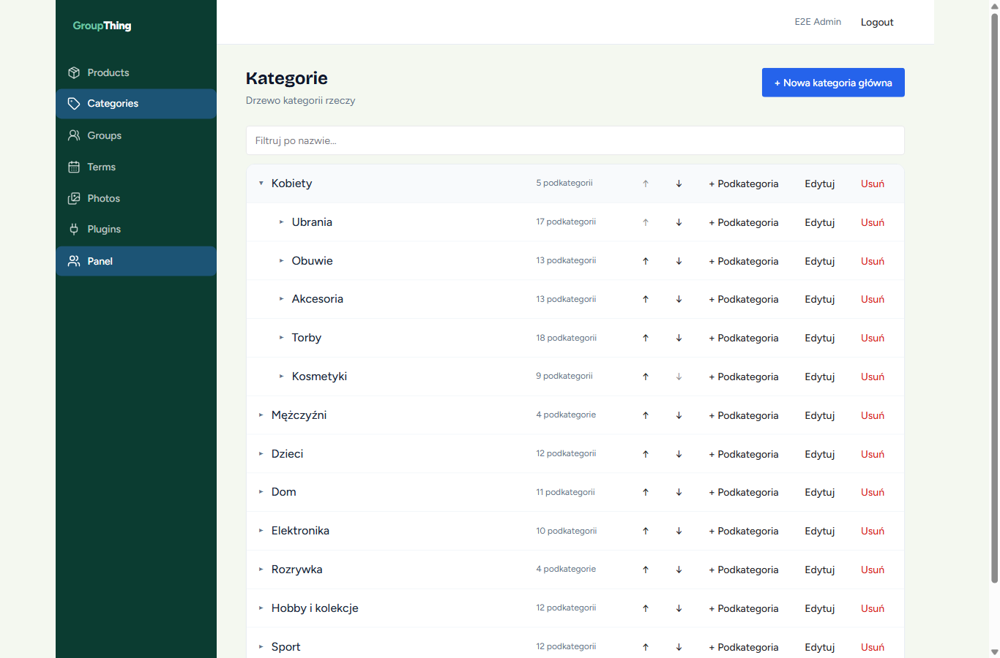

- Kliknij nazwę ze strzałką **▸**, żeby rozwinąć jej podkategorie. Strzałka **▾** oznacza, że gałąź jest rozwinięta.
- Obok nazwy widać liczbę podkategorii albo, przy najniższym poziomie, liczbę przypisanych rzeczy.
- Wpisz nazwę w polu **„Filtruj po nazwie…”**, a gałęzie z pasującymi kategoriami rozwiną się same.

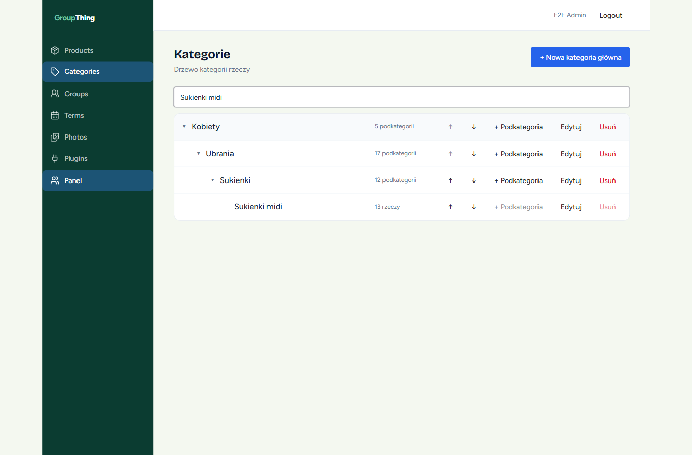

### Zmiana kolejności

Strzałki **↑** i **↓** przesuwają kategorię o jedno miejsce **w obrębie tego samego poziomu** (wśród „rodzeństwa”). Pierwsza pozycja nie ma aktywnej strzałki ↑, a ostatnia ↓.

### Dodawanie kategorii

- **„+ Nowa kategoria główna”** (u góry strony) dodaje kategorię na najwyższym poziomie.
- **„+ Podkategoria”** przy wierszu dodaje kategorię pod tym wierszem. Kategoria nadrzędna jest już wybrana.

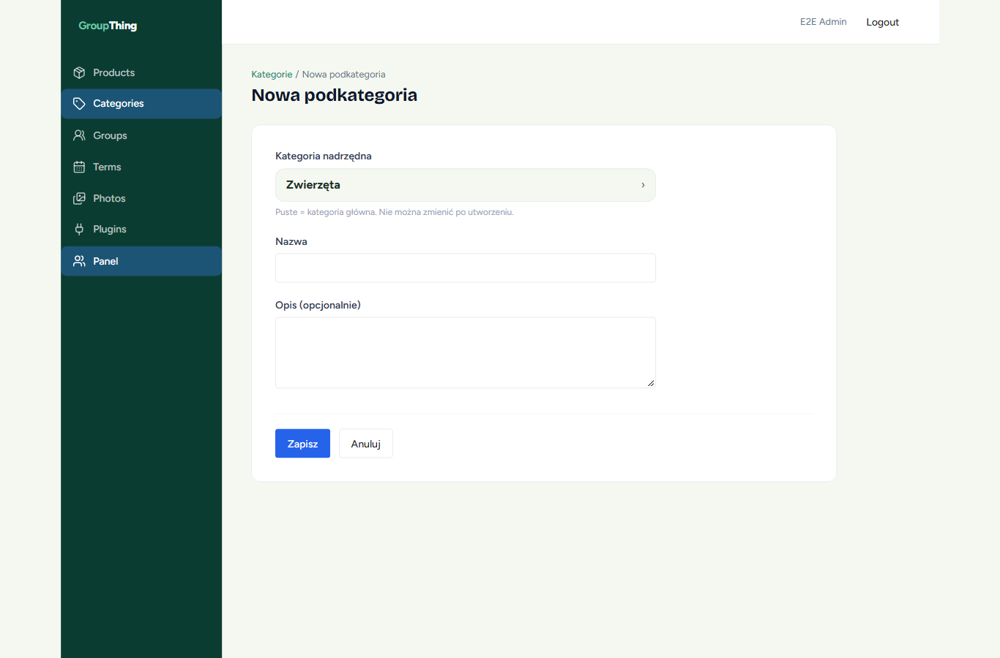

W polu **Kategoria nadrzędna** możesz wybrać **dowolny** poziom, także pośredni, przyciskiem „Wybierz „…””. Opcja **„Kategoria główna (brak)”** tworzy kategorię najwyższego poziomu.

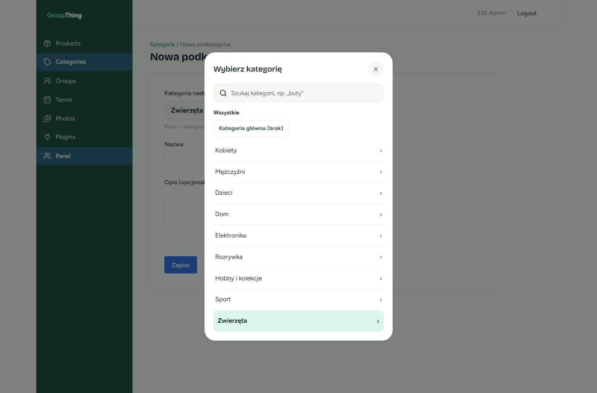

⚠️ Kategorii nadrzędnej **nie można zmienić po utworzeniu**. Nie da się przenieść kategorii pod innego „rodzica”. W razie pomyłki usuń kategorię i utwórz ją od nowa.

⚠️ Na jednym poziomie nazwy muszą być różne. Przy powtórzeniu zobaczysz: „Kategoria o tej nazwie już istnieje na tym poziomie”.

⚠️ Nie można dodać podkategorii do kategorii, która ma już przypisane rzeczy. Przycisk „+ Podkategoria” jest wtedy nieaktywny.

### Zmiana nazwy

Kliknij **Edytuj**, zmień nazwę lub opis i zapisz. Kategoria nadrzędna jest wtedy pokazana tylko do odczytu.

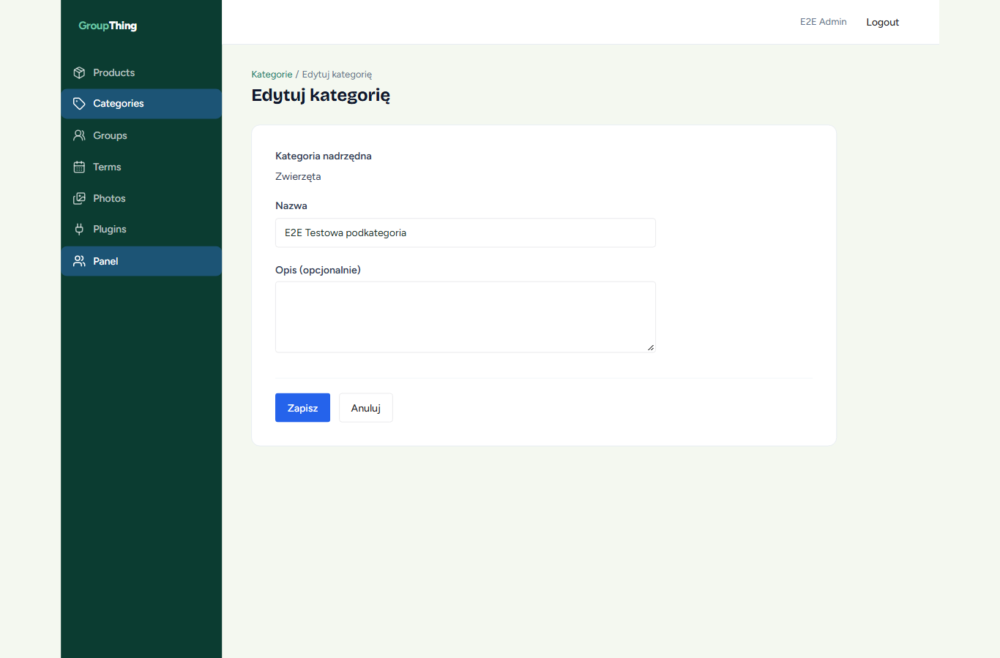

### Usuwanie

Kliknij **Usuń** i potwierdź. Usunięcie się nie uda, jeśli:
- kategoria ma podkategorie. Komunikat: „Nie można usunąć „…”: kategoria ma podkategorie.” Najpierw usuń podkategorie.
- do kategorii są przypisane rzeczy. Komunikat: „Nie można usunąć „…”: kategoria ma przypisane rzeczy.” Przycisk Usuń jest wtedy zwykle nieaktywny.

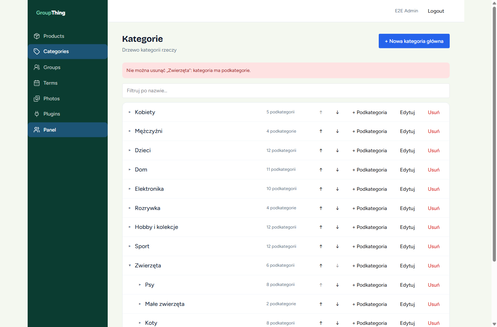

### Kategorie w produktach

- W formularzu produktu (**Products** → dodaj lub edytuj) kategorię wybierasz tym samym oknem co użytkownicy. Działa ono tylko na najniższym poziomie, a kliknięcie poziomu ze strzałką **›** otwiera go.

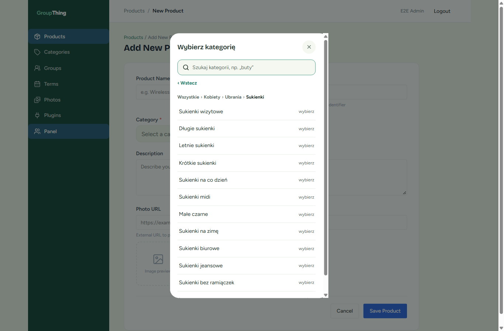

- Na liście produktów filtr kategorii zawiera **tylko kategorie z najniższego poziomu**, opisane pełną ścieżką. Kolumna kategorii też pokazuje pełną ścieżkę.

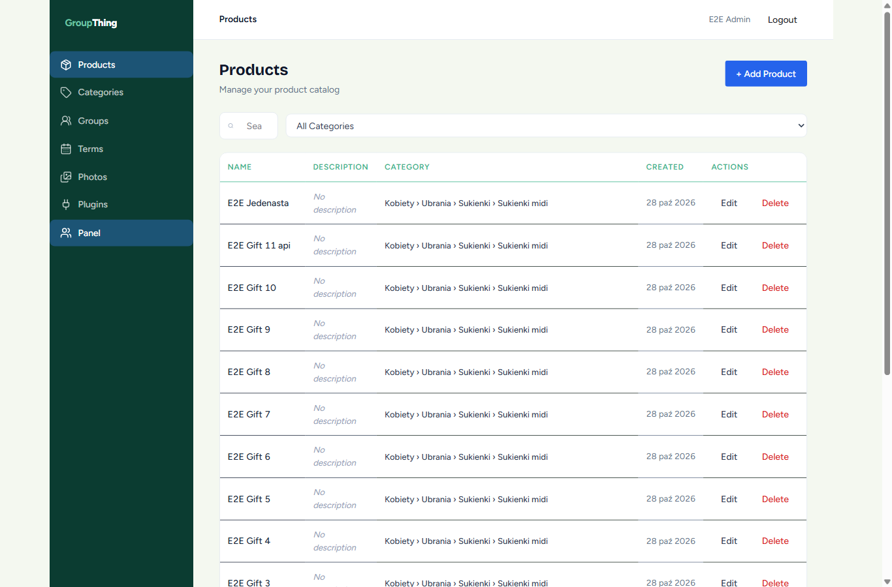

---

## 5. Rozwiązywanie problemów

| Problem | Rozwiązanie |
|---|---|
| Przyciski Oddam / Zamienię / Wersja robocza są wyszarzone | Uzupełnij nazwę i wybierz kategorię z najniższego poziomu. |
| Nie mogę wybrać kategorii, tylko wchodzę głębiej | To kategoria z podkategoriami (strzałka ›). Zejdź niżej albo wybierz „Inne …”. |
| Nie mogę znaleźć kategorii | Wpisz krótszy fragment nazwy. Polskie znaki są opcjonalne. |
| „Możesz mieć maksymalnie 10 rzeczy do oddania…” | Wybierz Zamienię lub Wersja robocza albo zdejmij „Oddam” z innej rzeczy w „Moje rzeczy”. |
| Nacisnąłem/nacisnęłam Enter i nic się nie stało | To celowe. Zapisz rzecz jednym z trzech przycisków. |
| Moja rzecz jest w terminie, ale bez zdjęcia | Zdjęcie czeka na sprawdzenie i pojawi się po zatwierdzeniu. |
| Potrzebna rzecz nie została dodana do terminu | Usuń z nazwy lub opisu dane kontaktowe i dodaj ją w „Edytuj termin”. |
| Nie mogę usunąć kategorii (administrator) | Najpierw usuń jej podkategorie. Kategorii z przypisanymi rzeczami nie da się usunąć. |
