# Jak dodać wydarzenie — przewodnik

## TL;DR
- Przewodnik dla użytkowników: jak utworzyć jednorazowe wydarzenie („+” → kafel **Wydarzenie**), co wpisać w każde pole, jak wygląda zapis i co robić, gdy coś pójdzie nie tak.
- Wszystkie zrzuty ekranu pochodzą z testów aplikacji (E2E) w widoku telefonu; nie wykonano nowych zrzutów.
- W tej wersji wydarzenia można tylko **tworzyć** — zapisane wydarzenia nie są jeszcze nigdzie wyświetlane.

## Key Decisions
- Ponownie użyto 14 zrzutów z `verification/screenshots/` (formularz w ramce wtyczki wygląda tak samo jak po poprawce C1; poprawka zmieniła tylko nazwę pola w komunikacji z serwerem). Makiety (`mockup-*.png`) celowo pominięto.
- Na zrzutach widać testowe nazwy z dopiskiem „E2E” (np. „Piknik testowy E2E”) — w tekście użyto naturalnych przykładów.
- Brak osobnego zrzutu podglądu banera (z przyciskami „Zmień”/„Usuń”) — opisano go słownie.

## Open Questions / Risks
- Zrzut błędu wysyłania banera pokazuje przyczynę „Dodawanie zdjęć jest chwilowo niedostępne” (tak było w środowisku testowym); u użytkownika druga linia może brzmieć inaczej albo jej nie być.

---

*Ostatnia aktualizacja: 28 października 2026 · dotyczy pierwszej wersji wydarzeń*

## Spis treści

1. [Czym jest wydarzenie?](#czym-jest-wydarzenie)
2. [Jak otworzyć formularz](#jak-otworzyć-formularz)
3. [Wypełnianie formularza](#wypełnianie-formularza)
4. [Wybór lub dodanie miejsca](#wybór-lub-dodanie-miejsca)
5. [Zapisywanie i potwierdzenie](#zapisywanie-i-potwierdzenie)
6. [Gdy coś pójdzie nie tak](#gdy-coś-pójdzie-nie-tak)
7. [Najczęstsze pytania](#najczęstsze-pytania)

---

## Czym jest wydarzenie?

Wydarzenie to **jednorazowe spotkanie**, które sam planujesz — na przykład piknik w parku, urodziny dziecka albo wspólny spacer. Podajesz nazwę, dzień i godzinę, a jeśli chcesz, także miejsce, opis i obrazek (baner).

**Dla kogo?** Dla każdego zalogowanego użytkownika, który chce zaplanować jedno konkretne spotkanie.

⚠️ **Ważne — to pierwsza wersja.** Wydarzenie możesz utworzyć i zapisać, ale **na razie nie zobaczysz go na żadnej liście w aplikacji** — ani Ty, ani inni. Nie da się też jeszcze wydarzenia edytować, usunąć ani zapisać się na nie. Te możliwości pojawią się w kolejnych wersjach.

📝 **Czego potrzebujesz:**
- konta w aplikacji i bycia zalogowanym,
- nazwy wydarzenia oraz daty i godziny rozpoczęcia (reszta jest opcjonalna).

---

## Jak otworzyć formularz

1. **Stuknij zielony przycisk „+”** na dole ekranu.

   Otworzy się ekran **„Co dodajesz?”** z czterema kafelkami.

2. **Wybierz kafel „Wydarzenie”** (opis: „Jednorazowe: piknik, urodziny”).

   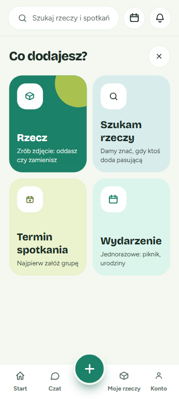

   ✅ **Co powinieneś zobaczyć:** ekran **„Nowe wydarzenie”** z krótkim wstępem i pustym formularzem.

   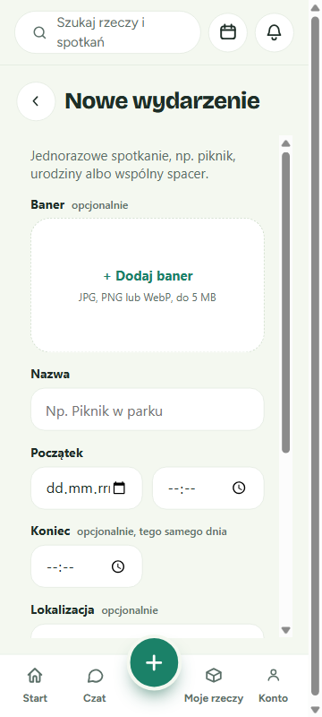

💡 **Wskazówka:** Strzałka w lewo obok tytułu „Nowe wydarzenie” zabiera z powrotem do ekranu „Co dodajesz?”. Formularz można przewijać w dół, aby zobaczyć wszystkie pola.

---

## Wypełnianie formularza

Pola są ułożone od góry do dołu w tej kolejności. **Wymagane są tylko Nazwa i Początek** — pozostałe pola mają dopisek „opcjonalnie”.

### Baner (opcjonalnie)

Baner to obrazek, dzięki któremu wydarzenie łatwiej rozpoznać.

- Stuknij **„+ Dodaj baner”** i wybierz zdjęcie z telefonu lub komputera.
- Dozwolone są zdjęcia **JPG, PNG lub WebP, do 5 MB**.
- Po wybraniu zobaczysz podgląd obrazka i dwa przyciski: **„Zmień”** (wybierz inne zdjęcie) oraz **„Usuń”** (zrezygnuj z banera).

❌ Jeśli plik jest za duży, pojawi się komunikat **„Baner jest za duży (maks. 5 MB)”**. Jeśli to nie jest zdjęcie w obsługiwanym formacie (np. GIF), zobaczysz **„Nieobsługiwany plik — dodaj zdjęcie JPG, PNG lub WebP”**. Wybierz wtedy inne zdjęcie albo usuń baner.

### Nazwa

Wpisz krótką nazwę, np. **„Piknik w parku”** albo **„Urodziny Zosi”**. Nazwa musi mieć **od 3 do 120 znaków**.

### Początek

Wybierz **datę** (lewe pole) i **godzinę** (prawe pole), np. 15.11.2026, 14:00.

- Początek nie może być w przeszłości.
- Początek może być najwyżej **2 lata** od dziś.

### Koniec (opcjonalnie, tego samego dnia)

Jeśli wiesz, kiedy wydarzenie się skończy, wpisz **godzinę końca**, np. 18:00. Koniec zawsze przypada **tego samego dnia co początek**, więc podajesz tylko godzinę.

- Koniec musi być później niż początek.
- Najpóźniejszy możliwy koniec to **23:59** (wydarzenie nie może przejść na następny dzień).

### Lokalizacja (opcjonalnie)

Stuknij **„Wybierz lub dodaj miejsce”**, aby wskazać, gdzie się spotykacie. Szczegóły w sekcji [Wybór lub dodanie miejsca](#wybór-lub-dodanie-miejsca).

### Opis (opcjonalnie)

Napisz, co planujecie i co warto zabrać, np. *„Weźcie koce, coś do jedzenia i dobry humor. Grill!”*. Opis może mieć **do 2000 znaków** — licznik pod polem (np. „50 / 2000”) pokazuje, ile już wpisałeś.

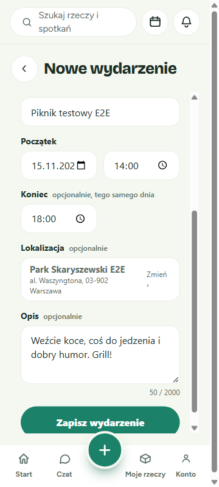

### Gdy przycisk „Zapisz wydarzenie” jest wyblakły

Dopóki brakuje nazwy albo daty i godziny początku, przycisk **„Zapisz wydarzenie”** jest jaśniejszy, a pod nim widać podpowiedź: *„Uzupełnij nazwę oraz datę i godzinę początku, aby zapisać.”*

Jeśli mimo to go stukniesz, nic nie zostanie zapisane — za to formularz **pokaże na czerwono wszystkie pola do poprawienia**.

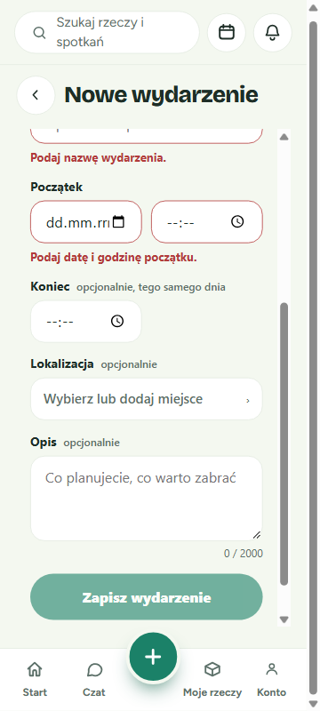

### Komunikaty o błędach przy polach

Gdy wyjdziesz z pola z błędną wartością, pole zrobi się czerwone, a pod nim pojawi się wyjaśnienie:

| Komunikat | Co zrobić |
|---|---|
| Podaj nazwę wydarzenia. | Wpisz nazwę. |
| Nazwa musi mieć od 3 do 120 znaków. | Wydłuż lub skróć nazwę. |
| Podaj datę i godzinę początku. | Uzupełnij oba pola początku. |
| Początek nie może być w przeszłości. | Wybierz późniejszą datę lub godzinę. |
| Początek może być najwyżej 2 lata od dziś. | Wybierz bliższą datę. |
| Koniec musi być później niż początek. | Popraw godzinę końca albo zostaw pole puste. |
| Opis może mieć najwyżej 2000 znaków. | Skróć opis. |

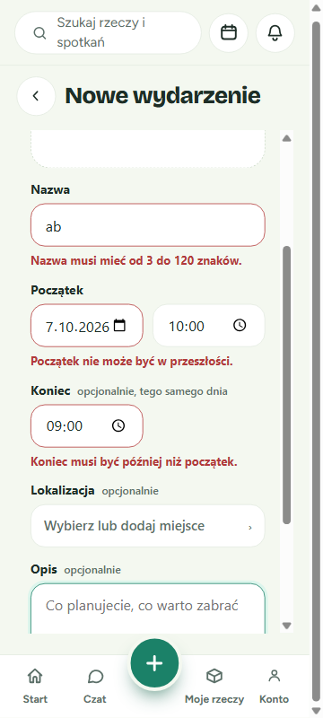

---

## Wybór lub dodanie miejsca

Po stuknięciu pola **Lokalizacja** od dołu wysunie się okno **„Lokalizacja”**.

### Wybór zapisanego miejsca

Jeśli masz już zapisane miejsca, zobaczysz je na liście (nazwa i adres). **Stuknij miejsce**, aby je wybrać — okno się zamknie, a wybrane miejsce pojawi się w formularzu z opcją **„Zmień”**.

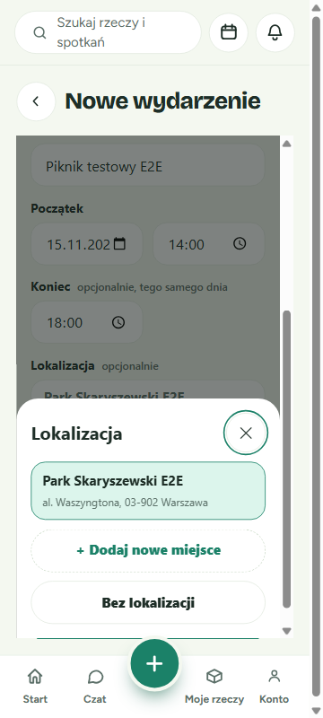

### Dodanie nowego miejsca

Jeśli lista jest pusta albo nie ma na niej potrzebnego miejsca:

1. **Stuknij „+ Dodaj nowe miejsce”.**

   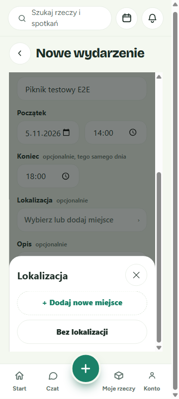

2. **Wpisz nazwę i adres**, np. *Park Skaryszewski*, *al. Waszyngtona, 03-902 Warszawa*.

3. **Stuknij „Dodaj miejsce”.** Nowe miejsce zostanie zapisane, wybrane w formularzu, a okno się zamknie.

   Jeśli zostawisz puste pole, zobaczysz *„Podaj nazwę miejsca.”* albo *„Podaj adres miejsca.”*

   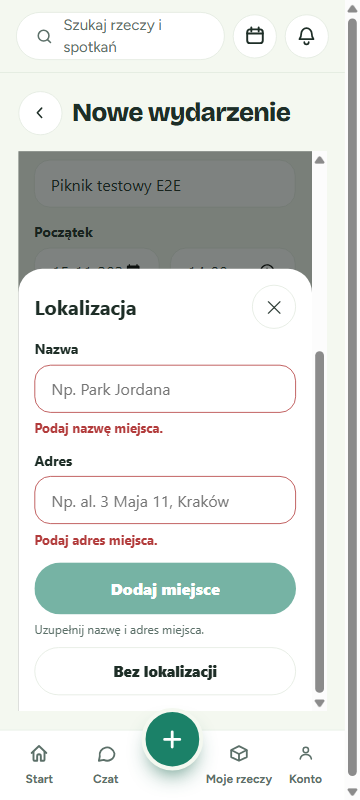

💡 **Wskazówki:**
- Dodane tutaj miejsce zapisuje się na Twoim koncie — przy kolejnym wydarzeniu znajdziesz je od razu na liście.
- **„Bez lokalizacji”** usuwa wybrane miejsce z wydarzenia.
- Okno zamkniesz krzyżykiem ✕ w prawym górnym rogu (na komputerze także klawiszem Esc).

---

## Zapisywanie i potwierdzenie

1. **Przewiń na dół i stuknij „Zapisz wydarzenie”.**

   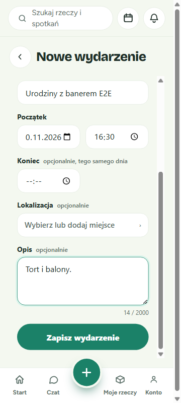

2. **Poczekaj chwilę.** Zobaczysz postęp: najpierw zapisywanie wydarzenia, a jeśli dodałeś baner — także jego wysyłanie. **Nie zamykaj wtedy strony.**

   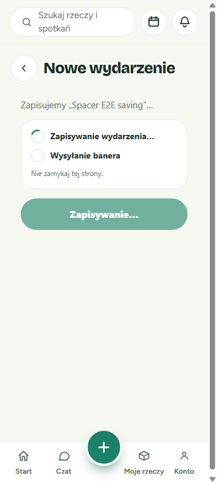

3. **Gotowe!** Pojawi się zielona karta **„Wydarzenie zapisane”** z nazwą, dniem i godzinami (np. „niedziela, 15 listopada · 14:00–18:00”) oraz miejscem, jeśli je wybrałeś.

   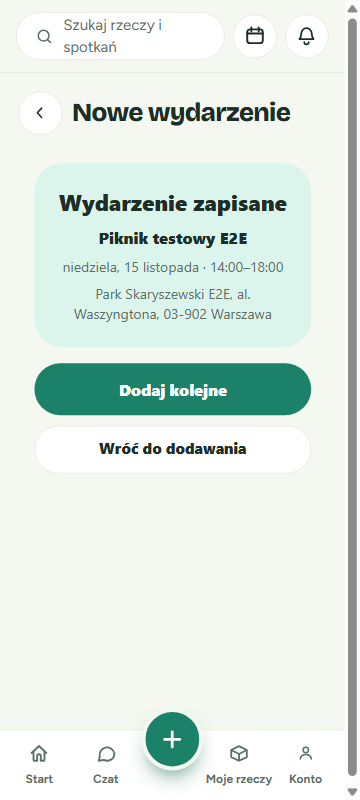

   Masz dwie możliwości:
   - **„Dodaj kolejne”** — otwiera pusty formularz, aby od razu utworzyć następne wydarzenie.
   - **„Wróć do dodawania”** — wraca do ekranu „Co dodajesz?”. Na dole ekranu na chwilę pojawi się komunikat, np. **„Wydarzenie „Piknik w parku” zapisane”**.

   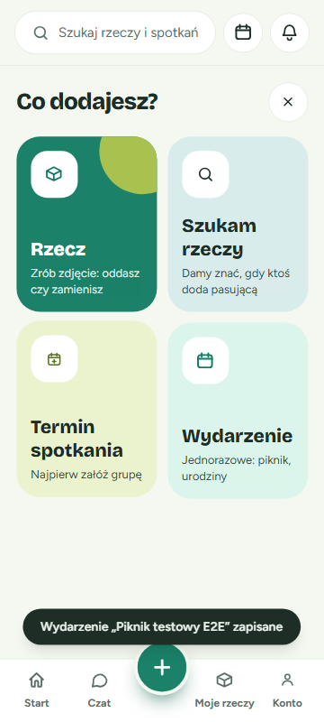

---

## Gdy coś pójdzie nie tak

### Nie udało się wysłać banera

Czasem samo wydarzenie zapisze się poprawnie, ale obrazek nie dotrze. Zobaczysz wtedy kartę „Wydarzenie zapisane” i czerwony komunikat **„Nie udało się wysłać banera. Wydarzenie jest zapisane bez banera.”** — czasem z dodatkową linijką wyjaśniającą przyczynę.

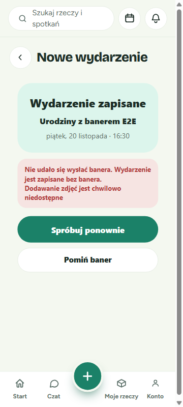

✅ **Twoje wydarzenie jest bezpieczne** — nie musisz go tworzyć od nowa. Wybierz:
- **„Spróbuj ponownie”** — wyśle ten sam baner jeszcze raz.
- **„Pomiń baner”** — zostawi wydarzenie bez obrazka i przejdzie do potwierdzenia.

### „Nie udało się potwierdzić zapisu — wydarzenie mogło zostać zapisane”

Ten komunikat oznacza, że połączenie zawiodło w trakcie zapisu i aplikacja **nie wie na pewno**, czy wydarzenie trafiło na serwer. Formularz zostaje wypełniony.

⚠️ **Odczekaj chwilę przed ponowną próbą.** Jeśli od razu stukniesz „Zapisz wydarzenie” jeszcze raz, możesz utworzyć **dwa takie same wydarzenia**. Sprawdź połączenie z internetem, odczekaj chwilę i dopiero wtedy spróbuj ponownie.

### Inne komunikaty przy zapisie

| Komunikat | Co oznacza i co zrobić |
|---|---|
| Nie udało się zapisać wydarzenia. Spróbuj ponownie. | Chwilowy problem — spróbuj jeszcze raz. |
| Wybrane miejsce jest niedostępne — wybierz inne. | Miejsce zostało usunięte. Wybierz inne albo „Bez lokalizacji”. |
| Sesja wygasła — zaloguj się ponownie. | Zaloguj się jeszcze raz i powtórz. |
| Nazwa (lub opis) wydarzenia narusza zasady społeczności… | Zmień treść nazwy lub opisu i zapisz ponownie. |

### „Plugin wydarzeń jest niedostępny”

Jeśli zamiast formularza widzisz napis **„Plugin wydarzeń jest niedostępny — Dodawanie wydarzeń jest chwilowo wyłączone. Spróbuj później.”**, to tworzenie wydarzeń jest w tej chwili wyłączone po stronie aplikacji. Nic nie zepsułeś.

Stuknij **„Wróć do dodawania”** i spróbuj później.

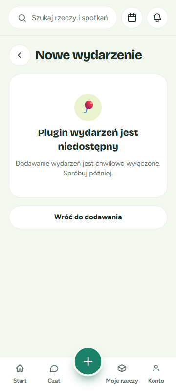

---

## Najczęstsze pytania

**Gdzie zobaczę zapisane wydarzenie?**
Na razie nigdzie. To pierwsza wersja — wydarzenia można tylko tworzyć. Lista i szczegóły wydarzeń pojawią się w kolejnej wersji aplikacji.

**Czy mogę edytować albo usunąć wydarzenie?**
Jeszcze nie. Sprawdź dokładnie dane przed stuknięciem „Zapisz wydarzenie”.

**Czy inni mogą zapisać się na moje wydarzenie?**
Jeszcze nie — zapisy na wydarzenia są planowane na później.

**Czy wydarzenie może trwać do następnego dnia?**
Nie. Koniec musi przypadać tego samego dnia co początek (najpóźniej 23:59). Jeśli nie znasz godziny końca, po prostu zostaw to pole puste.

**Dlaczego nie mogę wybrać godziny, która już minęła?**
Wydarzenie musi zaczynać się teraz albo w przyszłości (najdalej za 2 lata).

**Jakie zdjęcie nadaje się na baner?**
Plik JPG, PNG lub WebP o rozmiarze do 5 MB. Najlepiej poziome zdjęcie, np. z poprzedniego spotkania lub miejsca.

**Kto zobaczy mój baner?**
Baner jest zapisywany jako publiczny obrazek. Nie dodawaj zdjęć, których nie chcesz pokazywać innym (np. z danymi osobowymi czy dokumentami).

**Co się stanie z miejscem, które dodałem w formularzu?**
Zostaje zapisane na Twoim koncie i możesz go użyć ponownie przy kolejnych wydarzeniach.

**Stuknąłem „Zapisz” i zobaczyłem „Nie udało się potwierdzić zapisu…”. Co teraz?**
Odczekaj chwilę, sprawdź internet i dopiero wtedy spróbuj ponownie — inaczej możesz utworzyć dwa identyczne wydarzenia.
