# Strona wydarzenia – przewodnik dla organizatorów i uczestników

*Ostatnia aktualizacja: 30 października 2026*

## TL;DR
- Każde wydarzenie ma własną, publiczną stronę. Link możesz wysłać każdemu przyciskiem **Kopiuj link**.
- Osoba bez konta zapisuje się, podając tylko imię. Konto może założyć od razu potem, na tej samej stronie.
- Zalogowani zapisują się jednym kliknięciem i dostają dostęp do **Czatu wydarzenia**, który pojawia się też w **Wiadomościach**.
- **Wypisz się** usuwa Cię z listy i zabiera dostęp do czatu. Organizator może usunąć wydarzenie tylko wtedy, gdy nikt nie jest zapisany.
- Wydarzenia, na które się zapisałeś(-aś), znajdziesz w **Spotkania → „Biorę udział”**.

---

## Spis treści

1. [Czym jest strona wydarzenia?](#czym-jest-strona-wydarzenia)
2. [Dla kogo?](#dla-kogo)
3. [Organizator: tworzenie wydarzenia](#organizator-tworzenie-wydarzenia)
4. [Udostępnianie linku](#udostępnianie-linku)
5. [Co widzą odwiedzający](#co-widzą-odwiedzający)
6. [Zapis jako gość (bez konta)](#zapis-jako-gość-bez-konta)
7. [Zapis, gdy masz konto](#zapis-gdy-masz-konto)
8. [Czat wydarzenia](#czat-wydarzenia)
9. [Wypisywanie się](#wypisywanie-się)
10. [Widok organizatora: Edytuj i Usuń](#widok-organizatora-edytuj-i-usuń)
11. [Zakończone wydarzenia](#zakończone-wydarzenia)
12. [Gdzie znaleźć wydarzenia, na które się zapisałeś(-aś)](#gdzie-znaleźć-wydarzenia-na-które-się-zapisałeś-aś)
13. [Rozwiązywanie problemów](#rozwiązywanie-problemów)

---

## Czym jest strona wydarzenia?

To strona, na której jest wszystko o Twoim wydarzeniu, np. pikniku wymiany ubranek albo kiermaszu zabawek:

- nazwa, termin i (jeśli je podano) miejsce z linkiem do Google Maps,
- opis od organizatora,
- lista **„Zapisani i ich rzeczy”**, czyli kto przyjdzie i co oferuje do oddania lub wymiany,
- przycisk zapisu oraz czat dla uczestników.

Strona jest **publiczna**. Każdy, kto ma link, może ją obejrzeć, nawet bez konta w aplikacji.

## Dla kogo?

| Kim jesteś | Co możesz zrobić |
|---|---|
| **Organizator** | Tworzysz wydarzenie, udostępniasz link, rozmawiasz z uczestnikami na czacie, edytujesz lub usuwasz wydarzenie. |
| **Osoba bez konta** | Oglądasz stronę, zapisujesz się podając samo imię i możesz od razu założyć konto. |
| **Zalogowany uczestnik** | Zapisujesz się jednym kliknięciem, piszesz na czacie wydarzenia i w razie potrzeby się wypisujesz. |

---

## Organizator: tworzenie wydarzenia

Wydarzenie zakładasz po to, żeby zebrać chętnych w jednym miejscu i dać im wspólny czat.

📝 **Co będzie potrzebne**:
- konto w aplikacji (musisz być zalogowany/-a),
- nazwa i termin wydarzenia.

**Kroki**:

1. **Otwórz formularz „Nowe wydarzenie”**

   Kliknij zielony przycisk **＋** na dolnym pasku i wybierz kafelek **Wydarzenie**.

   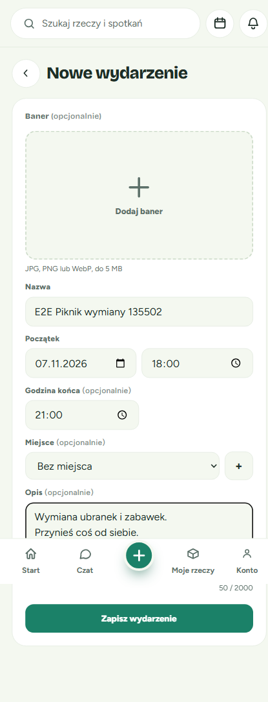

2. **Uzupełnij pola**

   - **Nazwa**, np. „Piknik wymiany ubranek na Mokotowie”.
   - **Początek**: data i godzina. Termin nie może być w przeszłości.
   - **Godzina końca** (opcjonalnie), np. 21:00.
   - **Miejsce** (opcjonalnie): wybierz z listy albo dodaj nowe przyciskiem **+**.
   - **Opis** (opcjonalnie), np. „Przynieś coś od siebie”.
   - **Baner** (opcjonalnie): zdjęcie JPG, PNG lub WebP do 5 MB.

3. **Kliknij „Zapisz wydarzenie”**

   ✅ **Co zobaczysz**: od razu trafisz na stronę swojego wydarzenia. Na dole na chwilę pojawi się komunikat „Wydarzenie „…” zapisane”.

   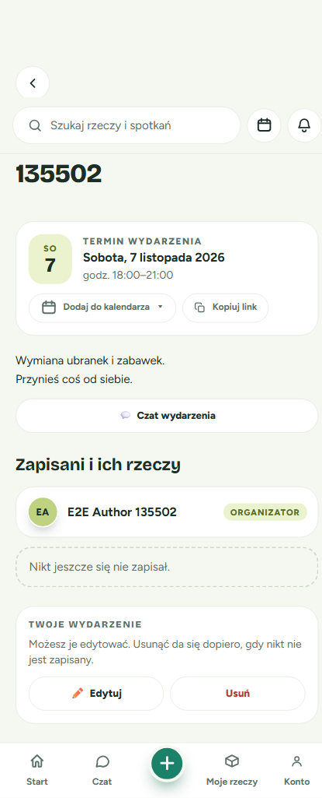

💡 **Wskazówka**: na liście zapisanych zawsze widzisz siebie na pierwszym miejscu, z oznaczeniem **ORGANIZATOR**. Dopóki nikt się nie zapisze, pod spodem widnieje napis „Nikt jeszcze się nie zapisał.”

**Co dalej**: udostępnij link (następna sekcja).

---

## Udostępnianie linku

Uczestnicy trafiają na wydarzenie przez link. Najłatwiej go skopiować prosto ze strony.

1. Na karcie **Termin wydarzenia** kliknij **Kopiuj link**.
2. Pojawi się komunikat **„Skopiowano link”**.
3. Wklej link w wiadomości, na grupie rodziców czy w mediach społecznościowych.

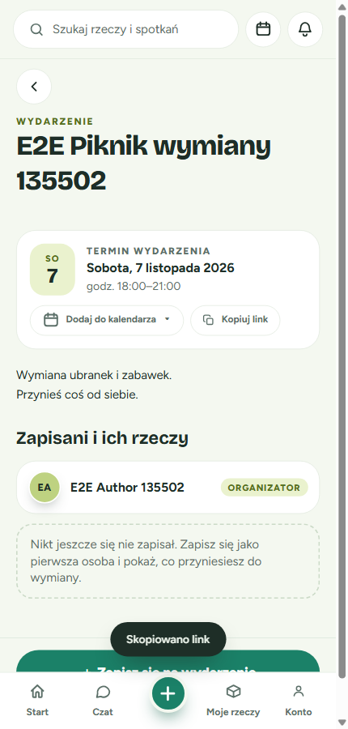

💡 **Wskazówka**: link wklejony w komunikatorze pokazuje podgląd z nazwą wydarzenia, terminem i miejscem (oraz banerem, jeśli go dodano).

💡 **Wskazówka**: przycisk **Dodaj do kalendarza** obok pozwala Tobie i uczestnikom zapisać termin we własnym kalendarzu.

⚠️ **Ważne**: starsze linki w formacie `/events/…` już nie działają. Zawsze kopiuj link przyciskiem **Kopiuj link**.

---

## Co widzą odwiedzający

Osoba, która otworzy link, zobaczy od góry:

1. nazwę wydarzenia z napisem **WYDARZENIE**,
2. kartę z terminem (i miejscem, jeśli je podano),
3. opis,
4. listę **„Zapisani i ich rzeczy”**,
5. na dole duży przycisk **＋ Zapisz się na wydarzenie**.

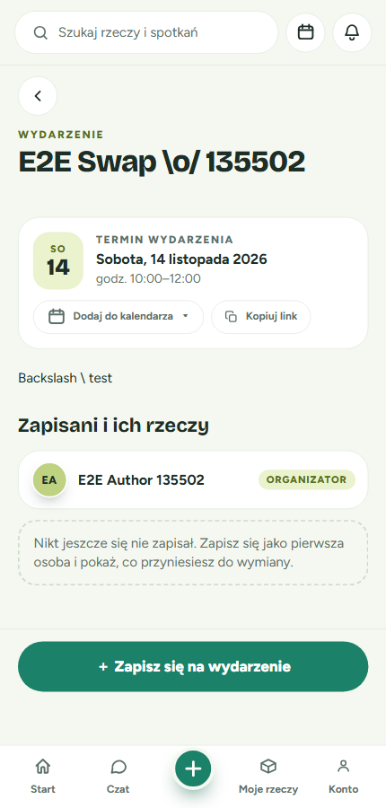

Jeśli podano miejsce, na karcie widać jego nazwę, adres, uwagi (np. „Przy fontannie”) i link **Otwórz w Google Maps ↗**, który otwiera mapę w nowej karcie.

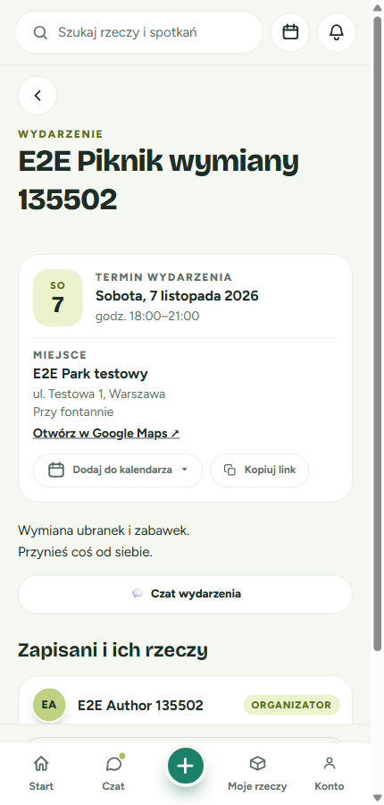

**Rzeczy uczestników**: przy każdej osobie na liście mogą się pojawić rzeczy, które oferuje: zdjęcie, nazwa i dopisek **„Weź na stałe”** (do oddania) lub **„Zamiana”**. Widać pierwsze trzy, a resztę rozwiniesz przyciskiem **„Pokaż wszystkie”**. Kliknięcie rzeczy otwiera jej stronę.

💡 Odwiedzający bez konta **nie widzi** przycisku czatu. Czat jest tylko dla organizatora i zapisanych osób z kontem.

---

## Zapis jako gość (bez konta)

Nie musisz zakładać konta, żeby się zapisać. Wystarczy imię.

**Kroki**:

1. **Kliknij „＋ Zapisz się na wydarzenie”** na dole strony.

   Otworzy się okienko z nazwą i terminem wydarzenia.

   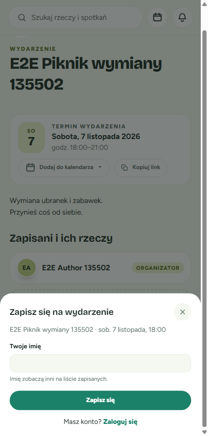

2. **Wpisz swoje imię** w polu **Twoje imię**, np. „Ania”.

   Imię zobaczą inni na liście zapisanych.

   ⚠️ Jeśli zostawisz pole puste, pojawi się czerwony komunikat **„Podaj swoje imię.”**

   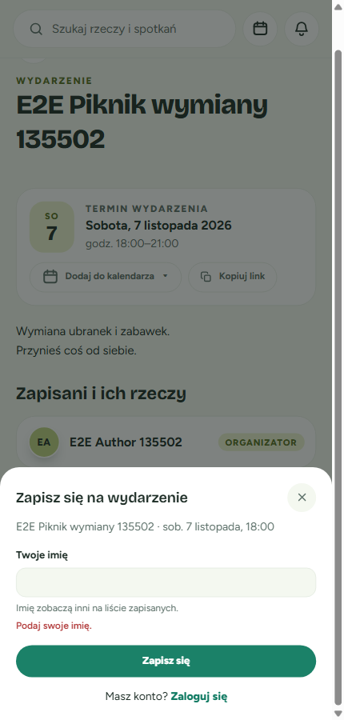

3. **Kliknij „Zapisz się”** (albo naciśnij Enter).

   ✅ **Co zobaczysz**: Twoje imię pojawi się na liście zapisanych, a pod listą karta **„Zapisano Cię jako gościa ✓”**.

   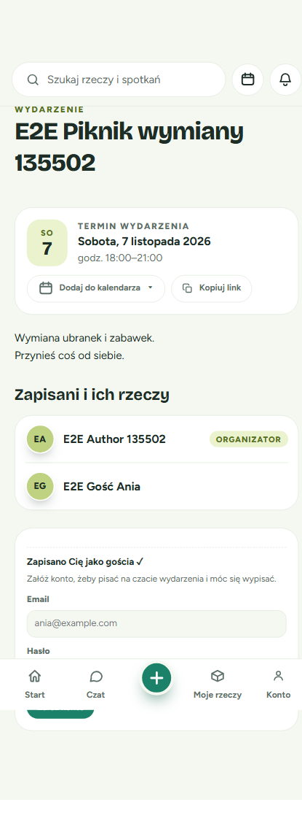

💡 **Masz już konto?** W okienku zapisu kliknij **„Zaloguj się”**. Po zalogowaniu wrócisz na tę samą stronę wydarzenia.

### Opcjonalnie: załóż konto od razu

Jako gość jesteś na liście, ale **nie możesz pisać na czacie ani się wypisać**. Żeby to odblokować, załóż konto na tej samej stronie:

1. W karcie **„Zapisano Cię jako gościa ✓”** wpisz **Email** i **Hasło**.
2. Kliknij **„Załóż konto”**.

✅ **Co zobaczysz**: przy Twoim imieniu pojawi się oznaczenie **To Ty**, pojawi się przycisk **Czat wydarzenia**, a na dole przycisk **Wypisz się**. Twój zapis zostaje, nie musisz zapisywać się ponownie.

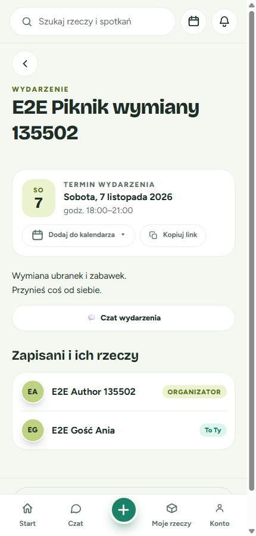

⚠️ **Ważne**: kartę zakładania konta widać przez pewien czas po zapisie (około godziny) na tym samym urządzeniu i w tej samej przeglądarce. Jeśli chcesz mieć dostęp do czatu, załóż konto od razu.

---

## Zapis, gdy masz konto

Jeśli jesteś zalogowany/-a, zapis to jedno kliknięcie.

1. Otwórz stronę wydarzenia i kliknij **„＋ Zapisz się na wydarzenie”**.

   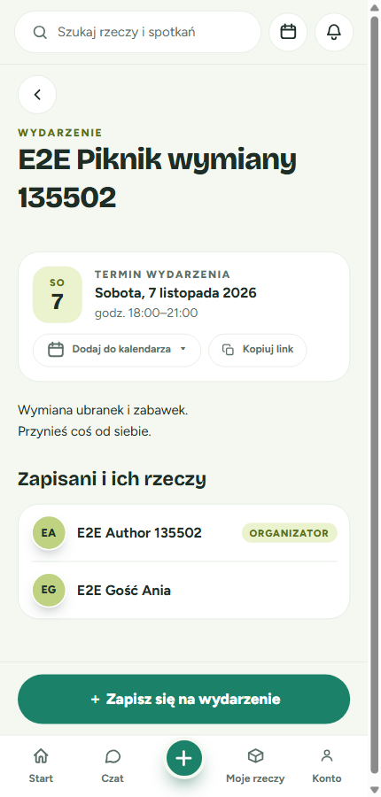

2. ✅ **Co zobaczysz**: komunikat **„Zapisano na wydarzenie”**, Twoje nazwisko na liście z oznaczeniem **To Ty** oraz przycisk **Czat wydarzenia**.

   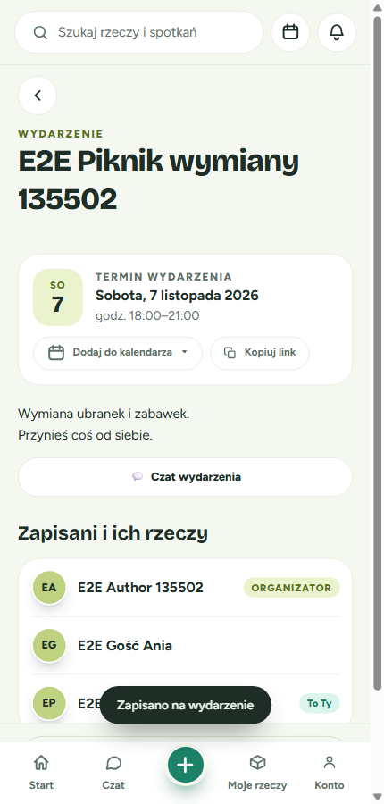

💡 Do listy przy Twoim nazwisku trafią rzeczy, które oferujesz w aplikacji do oddania lub wymiany. Dzięki temu inni wiedzą, co przyniesiesz.

---

## Czat wydarzenia

Czat wydarzenia to wspólna rozmowa organizatora ze wszystkimi zapisanymi osobami z kontem. Przyda się do ustaleń w stylu „kto przynosi stolik?”.

**Kto ma dostęp**: organizator oraz zalogowani uczestnicy, którzy są zapisani. Goście bez konta nie mają dostępu.

**Jak otworzyć**:

1. Na stronie wydarzenia kliknij **💬 Czat wydarzenia**.
2. Otworzy się rozmowa z tytułem **„[nazwa wydarzenia] · czat wydarzenia”** i liczbą uczestników.
3. Napisz wiadomość i kliknij **Wyślij**.

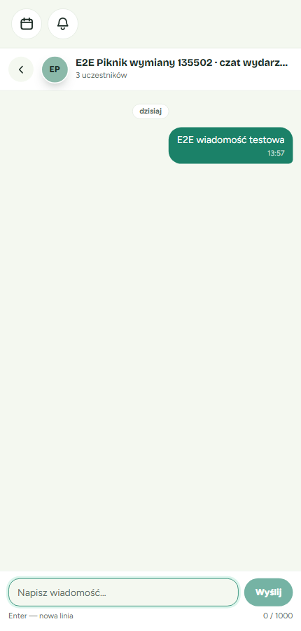

**Gdzie jeszcze go znajdziesz**: w **Wiadomościach** (ikona **Czat** na dolnym pasku). Rozmowa ma ikonę 🎉 i oznaczenie **Wydarzenie**. Nowe wiadomości liczą się do nieprzeczytanych, tak jak w innych rozmowach.

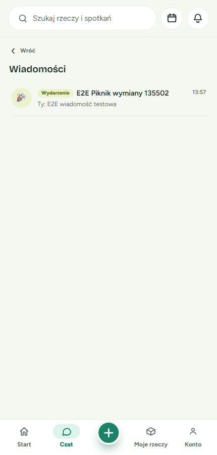

---

## Wypisywanie się

Zmieniły Ci się plany? Możesz się wypisać (jeśli masz konto).

1. Na dole strony wydarzenia kliknij **Wypisz się**.
2. Pojawi się pytanie **„Wypisać się z wydarzenia?”** z informacją: *„Znikniesz z listy zapisanych i stracisz dostęp do czatu wydarzenia.”*
3. Kliknij **Wypisz się**, żeby potwierdzić, albo **Anuluj**, żeby zostać.

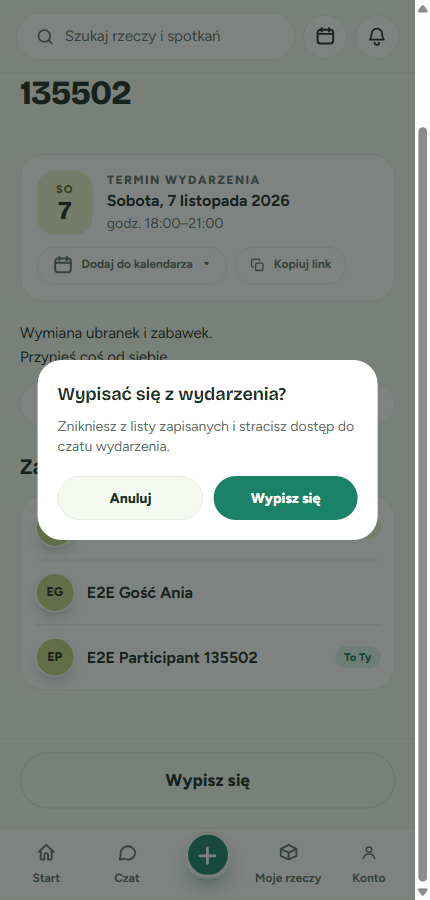

✅ **Co zobaczysz**: komunikat **„Wypisano z wydarzenia”**, a na dole znowu przycisk **＋ Zapisz się na wydarzenie**.

**Co to oznacza dla czatu**:
- czat wydarzenia znika z Twojej listy **Wiadomości**,
- jeśli spróbujesz go otworzyć (np. ze starego linku), zobaczysz komunikat **„Nie masz dostępu do tej rozmowy.”**

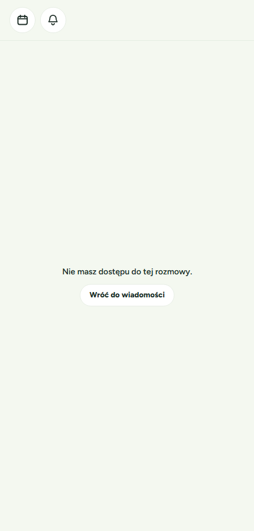

💡 Możesz zapisać się ponownie w każdej chwili przed końcem wydarzenia. Wtedy dostęp do czatu wróci.

⚠️ Goście bez konta nie mogą się wypisać, a organizator na razie nie może usunąć wpisu gościa z listy. Jeśli chcesz mieć możliwość wypisania się, załóż konto od razu po zapisie (patrz [Zapis jako gość](#opcjonalnie-załóż-konto-od-razu)).

---

## Widok organizatora: Edytuj i Usuń

Jako organizator widzisz pod listą zapisanych kartę **TWOJE WYDARZENIE** z dwoma przyciskami. Na dole strony nie ma przycisku zapisu, bo organizator nie zapisuje się na własne wydarzenie.

- **✏️ Edytuj**: otwiera formularz, w którym zmienisz nazwę, termin, miejsce, opis lub baner.
- **Usuń**: usuwa wydarzenie razem z jego czatem.

**Dlaczego „Usuń” jest czasem wyszarzony?**

Gdy ktoś jest już zapisany, usunięcie wydarzenia jest zablokowane, żeby nikt nie został bez informacji. Pod przyciskami zobaczysz wtedy, ile osób się zapisało, np. *„Nie można usunąć — zapisała się już 1 osoba.”*

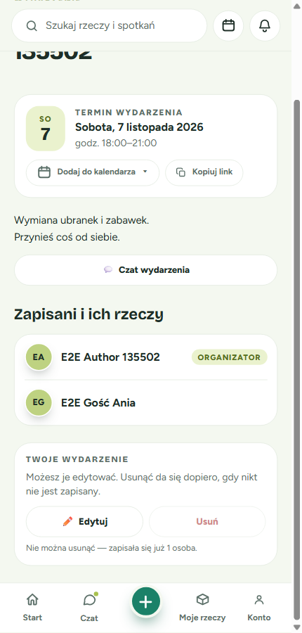

💡 **Co zrobić, jeśli wydarzenie się nie odbędzie?** Napisz o tym na **Czacie wydarzenia** i dopisz informację w opisie przyciskiem **Edytuj** (możesz też zmienić termin). Przycisk **Usuń** zadziała dopiero wtedy, gdy wszyscy zalogowani uczestnicy się wypiszą. Jeśli zapisał się gość bez konta, wydarzenia na razie nie da się usunąć, bo goście nie mogą się wypisać.

---

## Zakończone wydarzenia

Po zakończeniu wydarzenia (po godzinie końca, a gdy jej nie podano, po godzinie rozpoczęcia):

- strona dalej jest dostępna, razem z listą zapisanych i czatem,
- na dole zamiast przycisku zapisu widnieje nieaktywny napis **„Wydarzenie się zakończyło”**,
- nie da się już zapisać ani wypisać.

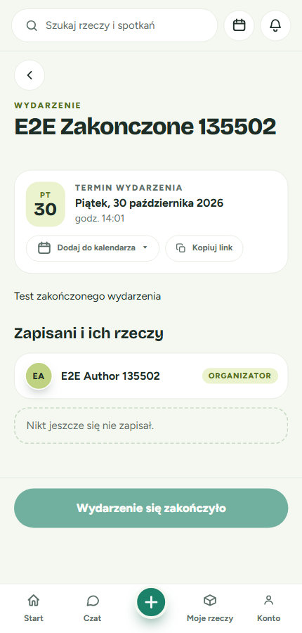

---

## Gdzie znaleźć wydarzenia, na które się zapisałeś(-aś)

1. Otwórz **Spotkania** (ikona kalendarza u góry ekranu).
2. Wybierz zakładkę **„Biorę udział”**.
3. Wydarzenia mają oznaczenie **Wydarzenie**, datę i godzinę. Kliknij, żeby otworzyć stronę wydarzenia.

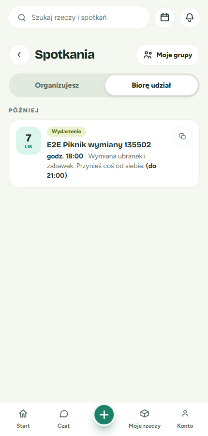

💡 Jeśli nie zapisałeś(-aś) się jeszcze na nic, zobaczysz napis „Nie masz jeszcze żadnych zapisów.”

💡 Organizator znajdzie swoje wydarzenia w zakładce **„Organizujesz”**.

---

## Rozwiązywanie problemów

**Nie widzę przycisku „Czat wydarzenia”.**
Czat jest dostępny tylko dla organizatora i zapisanych osób z kontem. Zaloguj się albo załóż konto i zapisz się na wydarzenie.

**Po kliknięciu „Zapisz się” pojawia się „Podaj swoje imię.”**
Pole z imieniem jest puste. Wpisz imię i spróbuj ponownie.

**Nie mogę się zapisać, a na dole widzę „Wydarzenie się zakończyło”.**
Wydarzenie już się odbyło. Zapisy są zamknięte.

**Jestem organizatorem i nie mogę się zapisać.**
Tak ma być: organizator zawsze jest na liście z oznaczeniem **ORGANIZATOR**, więc nie musi się zapisywać.

**Przycisk „Usuń” nie działa.**
Na wydarzenie ktoś jest zapisany. Informacja pod przyciskiem mówi, ile osób. Usunięcie będzie możliwe, gdy lista zapisanych będzie pusta.

**Stary link do wydarzenia pokazuje błąd.**
Linki w starym formacie (`/events/…`) już nie działają. Poproś organizatora o nowy link (przycisk **Kopiuj link**).

**Zapisałem/-am się jako gość i nie widzę już karty zakładania konta.**
Karta jest widoczna tylko przez pewien czas po zapisie i tylko w tej samej przeglądarce. Twój zapis jako gość nadal jest na liście. Jeśli chcesz pisać na czacie, załóż konto w aplikacji i zapisz się jako zalogowany użytkownik. Wcześniejszy wpis gościa zostanie wtedy na liście jako osobna pozycja: gość nie może się wypisać, a organizator na razie nie może go usunąć.

**Czat wydarzenia zniknął z moich Wiadomości.**
Prawdopodobnie zostałeś(-aś) wypisany(-a) z wydarzenia. Zapisz się ponownie, żeby odzyskać dostęp.
