# Rzeczy, rezerwacje na wydarzeniach i podgląd zapisanych — przewodnik

*Ostatnia aktualizacja: 31 października 2026*

## TL;DR

- Każda osoba i każdy organizator ma swoją stronę z rzeczami (`/<organizacja>/items`) z najbliższą okazją do odbioru.
- Na stronie wydarzenia i terminu widzisz zapisanych i ich 3 najnowsze rzeczy, a „Pokaż więcej” prowadzi do reszty.
- Na wydarzeniu możesz zarezerwować rzecz przyciskiem **Weź** (rzeczy do oddania) albo **Zamienię** (zamiany). Możesz to zrobić do chwili rozpoczęcia wydarzenia.
- Do rezerwacji potrzebujesz konta i zapisu na wydarzenie. Napisać do właściciela możesz zawsze, jeśli masz konto.
- Autor może usunąć wydarzenie z otwartymi rezerwacjami tylko przed jego startem. Rezerwacje zostaną wtedy anulowane, a obie strony dostaną powiadomienie.

---

## Spis treści

1. [Co nowego?](#co-nowego)
2. [Przeglądanie rzeczy osoby lub organizatora](#1-przeglądanie-rzeczy-osoby-lub-organizatora)
3. [„Zapisani i ich rzeczy” na wydarzeniu i terminie](#2-zapisani-i-ich-rzeczy-na-wydarzeniu-i-terminie)
4. [Rezerwacja rzeczy na wydarzeniu](#3-rezerwacja-rzeczy-na-wydarzeniu)
5. [Dla autora wydarzenia: usuwanie wydarzenia z rezerwacjami](#4-dla-autora-wydarzenia-usuwanie-wydarzenia-z-rezerwacjami)
6. [Dla organizatora: „Ostatnio dodane rzeczy”](#5-dla-organizatora-ostatnio-dodane-rzeczy)
7. [Najczęstsze pytania i problemy](#najczęstsze-pytania-i-problemy)

---

## Co nowego?

Do tej pory rzeczy uczestników wydarzenia można było tylko oglądać. Teraz:

- **każdy** (także bez konta) może obejrzeć rzeczy danej osoby lub organizatora i sprawdzić, gdzie i kiedy można je odebrać;
- **zapisani uczestnicy** mogą rezerwować rzeczy na wydarzeniach tak samo jak na terminach kręgów;
- **właściciel** rzeczy dostaje powiadomienia o rezerwacjach, a po rozpoczęciu wydarzenia przypomnienie, żeby potwierdzić przekazanie.

**Dla kogo?** Dla wszystkich, którzy oddają lub wymieniają rzeczy, przychodzą na wydarzenia albo je organizują.

---

## 1. Przeglądanie rzeczy osoby lub organizatora

Strona z rzeczami pokazuje wszystko, co ktoś ma teraz do oddania lub zamiany, i podpowiada, kiedy najbliżej możesz to odebrać.

### Jak tam trafić

Masz kilka dróg:

- **Z wydarzenia lub terminu:** kliknij **„Pokaż więcej (N)”** pod rzeczami danej osoby (zobacz [rozdział 2](#2-zapisani-i-ich-rzeczy-na-wydarzeniu-i-terminie)).
- **Ze strony rzeczy:** kliknij **„Zobacz wszystkie rzeczy (N)”** przy nazwie właściciela.
- **Ze strony organizatora:** kliknij **„Zobacz więcej”** w sekcji „Ostatnio dodane rzeczy”.
- **Bezpośrednio:** wpisz adres strony organizatora i dopisz na końcu `/items`, np. `twojadomena.pl/moja-gielda/items`.

💡 **Wskazówka**: link do tej strony możesz wysłać znajomym. Działa także dla osób bez konta.

### Co widzisz na stronie

1. **Nagłówek z nazwą i liczbą rzeczy**, np. „Rzeczy: Giełda Sąsiedzka” i „23 rzeczy do oddania lub zamiany”.

2. **Najbliższa okazja do odbioru.** To najbliższe publiczne wydarzenie lub termin, na którym ta osoba będzie. Przycisk **„Zobacz wydarzenie i zapisz się”** (albo „Zobacz termin i zapisz się”) prowadzi prosto do zapisów.

   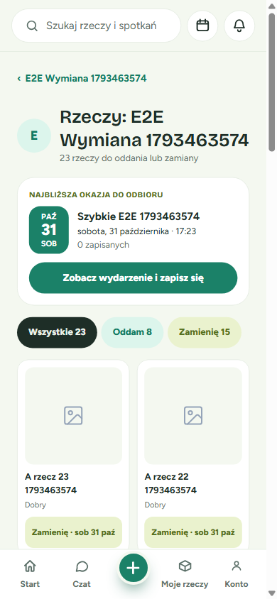

3. **Filtry**: **Wszystkie**, **Oddam** i **Zamienię**. Liczba przy każdym z nich mówi, ile jest takich rzeczy.

4. **Kafelki rzeczy.** Pod nazwą widać stan rzeczy i etykietę, np. „Zamienię · sob 31 paź”, czyli rzecz do zamiany z odbiorem na najbliższym spotkaniu. Kliknij kafelek, żeby otworzyć rzecz.

5. **„Pokaż więcej”** na dole strony doczytuje kolejne rzeczy.

✅ **Co powinno się stać**: po kliknięciu kafelka otwiera się strona rzeczy, na której od razu widać, na jakim spotkaniu możesz ją odebrać.

### Gdy ktoś nie ma zaplanowanych spotkań

Jeśli dana osoba nie wybiera się teraz na żadne publiczne wydarzenie ani termin, zobaczysz komunikat:

> „… nie ma teraz zaplanowanych spotkań. Napisz w sprawie konkretnej rzeczy — umówicie się na czacie.”

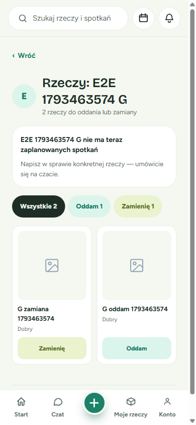

Rzeczy nadal możesz przeglądać. Otwórz tę, która Cię interesuje, i kliknij **„Napisz do właściciela”**. Na czacie ustalicie, gdzie i kiedy się spotkać.

---

## 2. „Zapisani i ich rzeczy” na wydarzeniu i terminie

Na stronie każdego wydarzenia i terminu jest sekcja **„Zapisani i ich rzeczy”**. Przy każdej osobie widać jej **3 najnowsze rzeczy**, więc od razu wiesz, co nowego przyniesie.

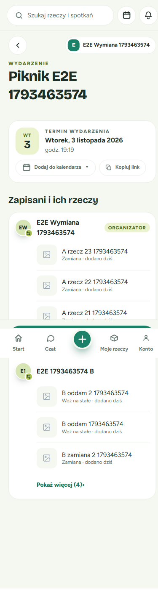

Przy każdej rzeczy zobaczysz:

- **nazwę** — kliknij ją, żeby otworzyć rzecz (już z tym wydarzeniem jako miejscem odbioru);
- **rodzaj** — „Weź na stałe” (do oddania) albo „Zamiana”;
- **kiedy została dodana**, np. „dodano dziś”, „dodano wczoraj”.

Jeśli ktoś ma więcej rzeczy, pod listą pojawi się **„Pokaż więcej (N)”**. Prowadzi on do strony ze wszystkimi rzeczami tej osoby (zobacz [rozdział 1](#1-przeglądanie-rzeczy-osoby-lub-organizatora)).

### Na stronie terminu kręgu

Na terminie przy każdej rzeczy są dodatkowo przyciski **„Weź na stałe”** albo **„Zamień”**. Dzięki nim zarezerwujesz rzecz bez wychodzenia ze strony terminu.

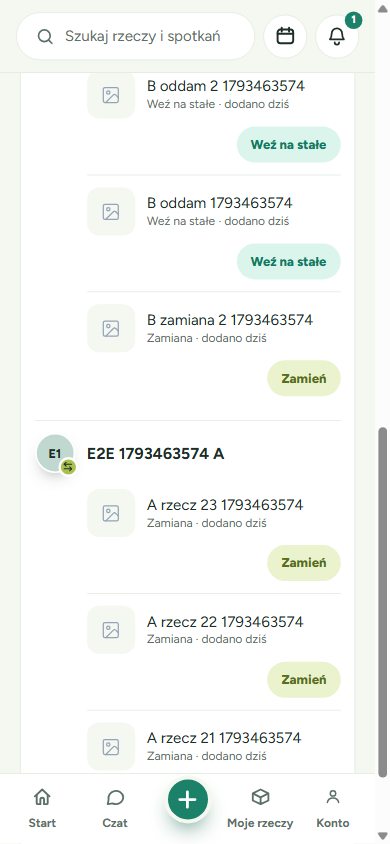

---

## 3. Rezerwacja rzeczy na wydarzeniu

Rezerwacja oznacza, że rzecz czeka na Ciebie i odbierzesz ją na wydarzeniu. Inni nie mogą jej już zarezerwować.

📝 **Czego potrzebujesz**:

- konta w aplikacji (musisz być zalogowany);
- zapisu na wydarzenie, na którym odbierzesz rzecz;
- przy zamianie: co najmniej jednej swojej rzeczy wystawionej do zamiany.

⚠️ **Ważne**: rezerwować można tylko **do chwili rozpoczęcia wydarzenia**.

### Jak wziąć rzecz do oddania („Weź”)

1. **Otwórz rzecz** z listy na stronie wydarzenia albo ze strony rzeczy właściciela.

   Na górze karty zobaczysz, gdzie odbierzesz rzecz, np. „Odbiór na: Piknik sąsiedzki · wt 3 lis, 19:19”.

   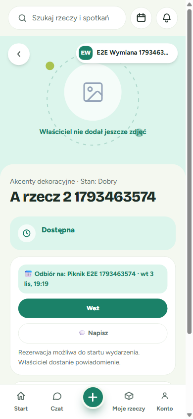

2. **Kliknij „Weź”.**

   Pojawi się potwierdzenie **„Wzięte!”** z nazwą wydarzenia i datą odbioru.

   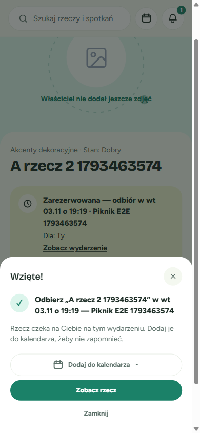

   💡 **Wskazówka**: kliknij **„Dodaj do kalendarza”**, żeby nie zapomnieć o odbiorze.

3. **Gotowe.** Na stronie rzeczy widać teraz status **„Zarezerwowana — odbiór w …”** i dopisek „Dla: Ty”. Link „Zobacz wydarzenie” przenosi na stronę wydarzenia.

   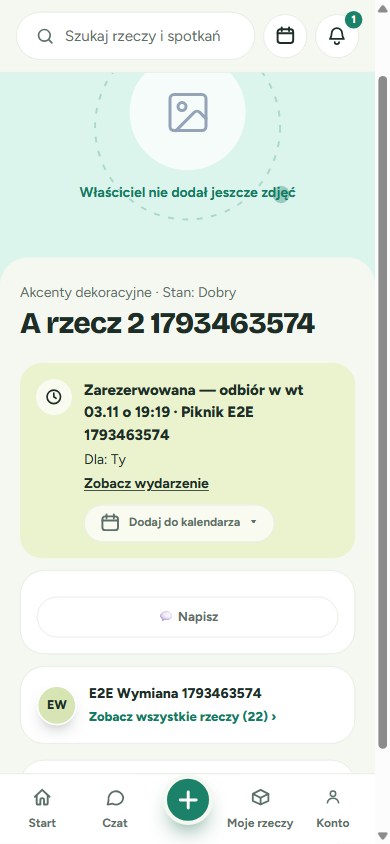

✅ **Co powinno się stać**: właściciel dostanie powiadomienie, że zarezerwowałeś jego rzecz.

### Jak zaproponować zamianę („Zamienię”)

Jeśli rzecz jest wystawiona do zamiany, zamiast „Weź” zobaczysz przycisk **„Zamienię”**.

1. **Kliknij „Zamienię”.**

   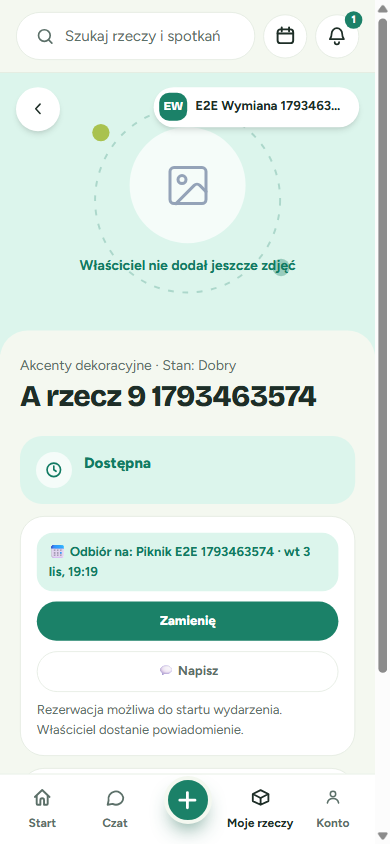

2. **Wybierz swoją rzecz.** W oknie „Co proponujesz w zamian?” widać Twoje rzeczy wystawione do zamiany. Zaznacz jedną z nich.

   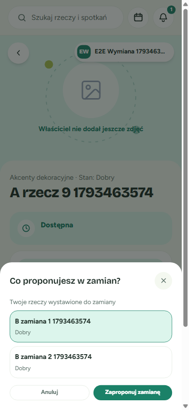

3. **Kliknij „Zaproponuj zamianę”.**

✅ **Co powinno się stać**: właściciel dostanie powiadomienie z propozycją i może ją przyjąć w zakładce **Moje rzeczy**. Jeśli ją przyjmie, obie rzeczy będą zarezerwowane, a wymiany dokonacie na wydarzeniu.

Tak wygląda propozycja zamiany u właściciela rzeczy:

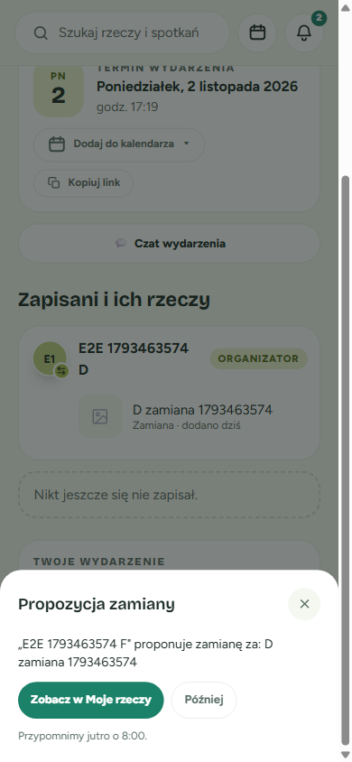

💡 **Wskazówka**: jeśli nie masz jeszcze żadnej rzeczy do zamiany, najpierw dodaj ją przyciskiem **+** na dole ekranu i oznacz jako „Zamiana”.

### Jak napisać do właściciela („Napisz”)

Przycisk **„Napisz”** otwiera czat z właścicielem w sprawie tej konkretnej rzeczy. Przydaje się, gdy:

- chcesz o coś dopytać przed rezerwacją;
- nie możesz przyjść na wydarzenie i chcecie umówić się inaczej;
- właściciel nie ma zaplanowanych spotkań.

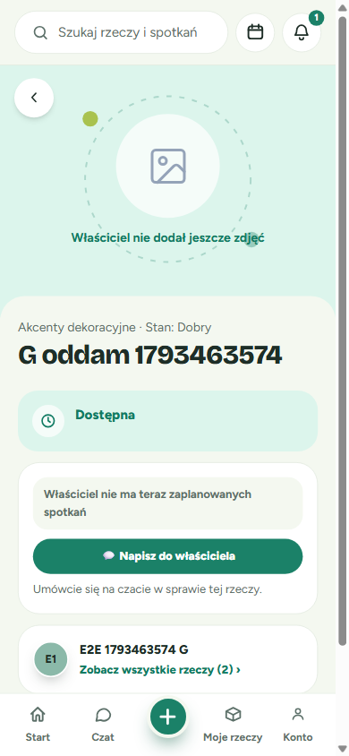

### Co jeśli nie jesteś zapisany na wydarzenie?

Zobaczysz komunikat: „Żeby zarezerwować tę rzecz, zapisz się na wydarzenie — tam ją odbierzesz.”

1. Kliknij **„Zapisz się na wydarzenie”**. Przejdziesz na stronę wydarzenia.
2. Zapisz się.
3. Wróć do rzeczy. Teraz zobaczysz przycisk **„Weź”** albo **„Zamienię”**.

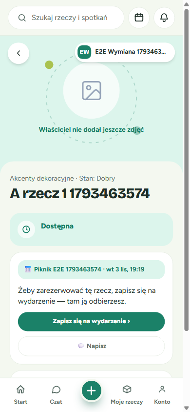

Przycisk **„Napisz”** działa także wtedy, gdy nie jesteś zapisany.

### Co jeśli nie masz konta?

Rzeczy możesz oglądać bez logowania. Gdy jednak klikniesz **„Weź”**, **„Zamienię”** albo **„Napisz”**, pojawi się okno **„Załóż konto, żeby zarezerwować”**.

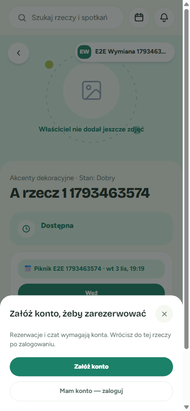

- **„Załóż konto”** — jeśli jesteś tu pierwszy raz;
- **„Mam konto — zaloguj”** — jeśli już masz konto.

✅ Po zalogowaniu wrócisz do tej samej rzeczy. Potem zapisz się na wydarzenie (jeśli jeszcze nie jesteś zapisany) i zarezerwuj rzecz.

⚠️ **Zapisałeś się na wydarzenie jako gość, bez konta?** Po założeniu konta wejdź jeszcze raz na stronę wydarzenia i połącz swój zapis z kontem. Dopiero wtedy możesz rezerwować.

### Co jeśli wydarzenie już się rozpoczęło?

Wtedy nie da się już zarezerwować rzeczy na tym wydarzeniu. Zobaczysz komunikat „… wydarzenie już się rozpoczęło”.

Jeśli właściciel ma kolejne spotkanie, aplikacja je podpowie. Kliknij **„Przejdź do wydarzenia”** (lub „Przejdź do nowego terminu”), żeby zarezerwować rzecz na następnym spotkaniu. Możesz też po prostu napisać do właściciela.

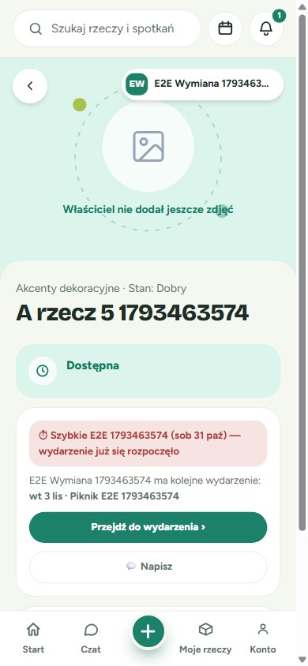

### Twoja własna rzecz

Na stronie swojej rzeczy nie zobaczysz przycisków rezerwacji. Zamiast nich jest informacja, kto ją widzi, np. „To Twoja rzecz — widoczna dla uczestników …”. Możesz ją edytować przyciskiem **„Edytuj”**.

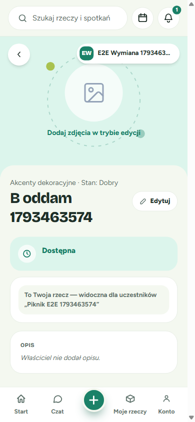

### Po rozpoczęciu wydarzenia: potwierdź przekazanie

Kiedy wydarzenie się rozpocznie, dostaniesz **przypomnienie** (powiadomienie pod ikoną dzwonka) z pytaniem, czy rzecz została przekazana. Przypomnienie dostają obie strony: osoba, która oddaje, i osoba, która odbiera.

- **Przekazanie się udało?** Potwierdź je. Rzecz zmieni właściciela.
- **Nie doszło do spotkania?** Anuluj rezerwację. Rzecz wróci do właściciela i znów będzie dostępna.

⚠️ Potwierdzić albo anulować przekazanie możesz dopiero **od chwili rozpoczęcia** wydarzenia. Przed startem rezerwacja po prostu czeka.

💡 **Dobrze wiedzieć**: jeśli wypiszesz się z wydarzenia, Twoje rezerwacje **nie znikną same**. Napisz do właściciela i ustalcie, co dalej, albo anuluj rezerwację po rozpoczęciu wydarzenia.

---

## 4. Dla autora wydarzenia: usuwanie wydarzenia z rezerwacjami

Jeśli ktoś zarezerwował rzeczy na Twoim wydarzeniu, usuwanie działa nieco inaczej.

### Zasady w skrócie

| Sytuacja | Czy możesz usunąć? |
|---|---|
| Ktoś jest zapisany na wydarzenie | ❌ Nie. Usunąć da się dopiero, gdy nikt nie jest zapisany. |
| Nikt nie jest zapisany, są otwarte rezerwacje, wydarzenie **jeszcze się nie rozpoczęło** | ✅ Tak. Rezerwacje zostaną anulowane. |
| Nikt nie jest zapisany, są otwarte rezerwacje, wydarzenie **już się rozpoczęło** | ❌ Nie. Najpierw trzeba potwierdzić lub anulować przekazania. |
| Brak zapisanych i brak rezerwacji | ✅ Tak, jak dotychczas. |

### Jak usunąć wydarzenie przed jego startem

1. Na stronie wydarzenia, w sekcji **„Twoje wydarzenie”**, kliknij **„Usuń”**.

2. Przeczytaj okno potwierdzenia. Zobaczysz w nim, ile rezerwacji zostanie anulowanych, np. „Na tym wydarzeniu są 2 otwarte rezerwacje (w tym 1 zamiana)”.

   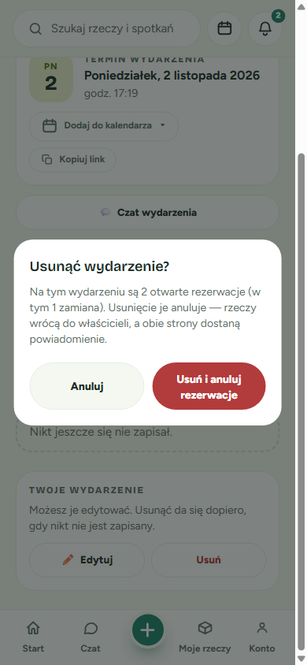

3. Kliknij **„Usuń i anuluj rezerwacje”**.

✅ **Co się stanie**:

- wydarzenie zniknie;
- wszystkie rezerwacje i zamiany z tego wydarzenia zostaną anulowane;
- rzeczy wrócą do właścicieli i znów będą dostępne;
- obie strony każdej rezerwacji dostaną powiadomienie o anulowaniu.

Kliknij **„Anuluj”**, jeśli się rozmyślisz. Nic się wtedy nie zmieni.

### Gdy wydarzenie już się rozpoczęło

Przycisk **„Usuń”** jest wtedy nieaktywny. Pod nim pojawi się podpowiedź: „Nie można usunąć — wydarzenie się rozpoczęło i ma otwarte rezerwacje”.

To zabezpieczenie dla uczestników, którzy mogli już przekazać sobie rzeczy. Poproś ich o potwierdzenie albo anulowanie przekazań. Gdy wszystkie rezerwacje zostaną zamknięte, wydarzenie da się usunąć.

---

## 5. Dla organizatora: „Ostatnio dodane rzeczy”

Jeśli Twoja strona organizatora ma układ **Giełda**, pojawiła się na niej nowa sekcja **„Ostatnio dodane rzeczy”**. Znajdziesz ją pod listą rzeczy giełdy.

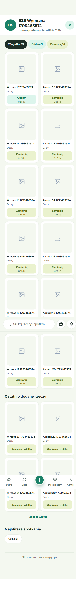

- Sekcja pokazuje **4 najnowsze** Twoje rzeczy.
- Na każdej karcie widać rodzaj (Oddam/Zamienię) i datę najbliższego spotkania, na którym można ją odebrać.
- **„Zobacz więcej”** prowadzi do strony ze wszystkimi Twoimi rzeczami ([rozdział 1](#1-przeglądanie-rzeczy-osoby-lub-organizatora)).

Nie musisz nic ustawiać, bo sekcja wypełnia się sama. Jeśli nie masz jeszcze żadnych wystawionych rzeczy, w trybie edycji strony zobaczysz pusty szablon tej sekcji, a odwiedzający jej nie zobaczą.

💡 **Wskazówka**: chcesz, żeby odwiedzający widzieli świeże oferty? Dodawaj rzeczy regularnie. Najnowsze trafiają na początek listy.

---

## Najczęstsze pytania i problemy

**Nie widzę przycisku „Weź” ani „Zamienię”.**
Sprawdź po kolei:

- czy jesteś zalogowany;
- czy jesteś zapisany na to wydarzenie;
- czy wydarzenie jeszcze się nie rozpoczęło;
- czy rzecz nie jest już zarezerwowana przez kogoś innego.

Jeśli wszystko się zgadza, a przycisków nadal nie ma, kliknij **„Napisz”** i zapytaj właściciela.

**Kliknąłem „Zamienię”, ale lista moich rzeczy jest pusta.**
Nie masz żadnej rzeczy wystawionej do zamiany. Dodaj rzecz i oznacz ją jako „Zamiana”.

**Właściciel nie ma zaplanowanych spotkań. Co teraz?**
Kliknij **„Napisz do właściciela”** i umówcie się na czacie.

**Wypisałem się z wydarzenia. Czy moja rezerwacja przepadła?**
Nie, rezerwacja zostaje. Napisz do właściciela albo anuluj rezerwację po rozpoczęciu wydarzenia.

**Wydarzenie, na którym miałem odebrać rzecz, zostało usunięte.**
Dostaniesz powiadomienie o anulowaniu rezerwacji. Rzecz wróciła do właściciela i możesz ją zarezerwować ponownie na innym spotkaniu.

**Dostałem przypomnienie o potwierdzeniu, ale aplikacja mówi, że wydarzenie „jeszcze się nie rozpoczęło”.**
Autor prawdopodobnie przesunął godzinę rozpoczęcia na później. Potwierdź przekazanie po nowej godzinie startu.

**Nie mogę usunąć swojego wydarzenia.**

- Jeśli ktoś jest zapisany, poczekaj, aż się wypisze.
- Jeśli wydarzenie już się rozpoczęło i są otwarte rezerwacje, poproś uczestników o potwierdzenie lub anulowanie przekazań.

---

## Powiązane funkcje

- **Moje rzeczy** (dolne menu) — tu sprawdzisz swoje rezerwacje i przyjmiesz propozycje zamian.
- **Powiadomienia** (ikona dzwonka) — informacje o rezerwacjach, zamianach, przypomnienia i anulowania.
- **Strona wydarzenia** — zapisy, czat wydarzenia i lista zapisanych z ich rzeczami.
