# Rezerwowanie rzeczy, lokalizacja i widoczność — przewodnik

*Ostatnia aktualizacja: 2 listopada 2026 · dotyczy wersji z gałęzi `feat/product-page-reservations`*

## TL;DR

- **Wszystko załatwisz na stronie rzeczy.** Masz tam trzy przyciski: „Odbiorę osobiście", „Wybieram termin" i „Napisz o przedmiocie". Na tej samej stronie potem potwierdzasz przekazanie, anulujesz rezerwację albo przyjmujesz lub odrzucasz zamianę.
- **Ustaw w „Moje rzeczy", gdzie są Twoje rzeczy.** Twój pełny adres widzisz tylko Ty. Inni zalogowani widzą samą nazwę miejsca, np. „Dom – Mokotów", a niezalogowani nie widzą nic. Bez ustawionego miejsca nikt nie zarezerwuje Twojej rzeczy do odbioru osobistego.
- **Każda wystawiona rzecz może być „Publiczna" albo „Prywatna".** Prywatną widzą tylko osoby z Twoich prywatnych grup. Widoczność wybierzesz dopiero wtedy, gdy ustawisz, czy chcesz rzecz oddać, czy się zamienić.
- **Na kafelkach od razu widać, o co chodzi.** Etykieta „Chcę oddać" albo „Chcę się zamienić" mówi, czego chce właściciel. Etykieta „Zarezerwowana · przez …" mówi, że ktoś już zarezerwował rzecz. Na stronie organizatora liczniki pokazują, ile rzeczy jest do oddania, ile do zamiany, a ile jest zarezerwowanych.

## Najważniejsze ustalenia (Key Decisions)

- **Odbiór osobisty działa bez terminu.** Rezerwację potwierdzacie od razu, gdy przekażecie sobie rzecz. Nie trzeba czekać na żadne spotkanie.
- **W aplikacji nie podajemy adresu.** Po rezerwacji odbioru osobistego od razu otwiera się czat z właścicielem. Tam ustalacie dokładne miejsce i godzinę.
- **Imię osoby, która zarezerwowała rzecz, widzą tylko zalogowani.** Niezalogowani widzą samo „Zarezerwowana".
- **Rzecz z czekającą propozycją zamiany jest zablokowana.** Nikt inny jej nie zarezerwuje, dopóki właściciel nie przyjmie albo nie odrzuci propozycji.
- **Na stronie organizatora** liczniki „Chcę oddać" i „Chcę się zamienić" liczą tylko rzeczy, które są jeszcze wolne. Zarezerwowane mają osobny licznik. **Na stronie „Rzeczy: …"** właściciela liczniki obejmują też rzeczy zarezerwowane.

## Otwarte pytania (Open Questions)

- **Gramatyka nazw organizacji.** Gdy właściciel występuje pod nazwą organizacji, np. „Wymianki u Ani", przyciski czytają się nienaturalnie, np. „Rezerwuję i piszę do Wymianki u Ani". Do decyzji: czy w takich miejscach pokazywać imię osoby?
- **Zamiana przez stronę rzeczy.** W „Moje rzeczy" przy zamianie widać „Anuluj wymianę", a na stronie rzeczy przyciski „Przyjmij zamianę" i „Odrzuć". Warto zdecydować, czy chcemy, żeby obie drogi zostały.

## Ryzyka (Risks)

- **Ustawienie „Prywatna" nie wraca samo.** Znika, gdy rzecz przestanie być wystawiona, czyli gdy usuniesz tryb albo wymiana się zakończy. Gdy wystawisz rzecz ponownie, wraca do ustawienia „Publiczna". Trzeba to ustawić jeszcze raz.
- **Rzecz prywatna bez prywatnej grupy widzi tylko jej właściciel.** Ostrzega przed tym tylko krótka podpowiedź pod przełącznikiem.
- **Lista „Gdzie jeszcze można odebrać" ma najwyżej 5 pozycji.** Pokazujemy tylko 5 najbliższych terminów i wydarzeń.
- **Zrzuty ekranu zrobiono na danych testowych.** Nazwy osób, miejsc i rzeczy są zmyślone.

---

## Spis treści

1. [Co nowego?](#co-nowego)
2. [Krok 1: Ustaw, gdzie są Twoje rzeczy](#krok-1-ustaw-gdzie-są-twoje-rzeczy)
3. [Krok 2: Wybierz widoczność rzeczy — Publiczna czy Prywatna](#krok-2-wybierz-widoczność-rzeczy--publiczna-czy-prywatna)
4. [Strona rzeczy — jak zarezerwować](#strona-rzeczy--jak-zarezerwować)
5. [Po rezerwacji — potwierdzanie i anulowanie](#po-rezerwacji--potwierdzanie-i-anulowanie)
6. [Zamiana — proponowanie, przyjmowanie i odrzucanie](#zamiana--proponowanie-przyjmowanie-i-odrzucanie)
7. [Kafelki i liczniki na listach](#kafelki-i-liczniki-na-listach)
8. [Kto co widzi — ściągawka](#kto-co-widzi--ściągawka)
9. [Rozwiązywanie problemów](#rozwiązywanie-problemów)

---

## Co nowego?

Strona rzeczy to teraz jedno miejsce, w którym rezerwujesz rzecz i potem domykasz całą sprawę. Nie musisz już szukać przycisku „Biorę" na stronie terminu.

**Dla kogo?**

- **Dla osób, które oddają lub wymieniają rzeczy.** Ustawiasz, gdzie są Twoje rzeczy i kto je widzi, a potem potwierdzasz przekazanie.
- **Dla osób, które szukają rzeczy.** Rezerwujesz do odbioru osobistego albo na wspólny termin i od razu piszesz do właściciela.
- **Dla organizatorów.** Na swojej stronie widzisz, ile rzeczy czeka na nowy dom, a ile jest już zarezerwowanych.

---

## Krok 1: Ustaw, gdzie są Twoje rzeczy

Inni mogą zarezerwować Twoją rzecz „osobiście" tylko wtedy, gdy wiedzą, w jakiej okolicy ją odbiorą. Wystarczy, że ustawisz to raz.

📝 **Czego potrzebujesz:** konta w aplikacji i przynajmniej jednego zapisanego miejsca. Nowe miejsce dodasz przyciskiem „+".

**Kroki:**

1. **Otwórz „Moje rzeczy"**

   Stuknij „Moje rzeczy" na dolnym pasku.

2. **Wybierz miejsce w polu „📍 Gdzie są moje rzeczy?"**

   Wybierz miejsce z listy, np. „Dom – Mokotów". Jeśli nie ma go na liście, stuknij „+" i je dodaj.

   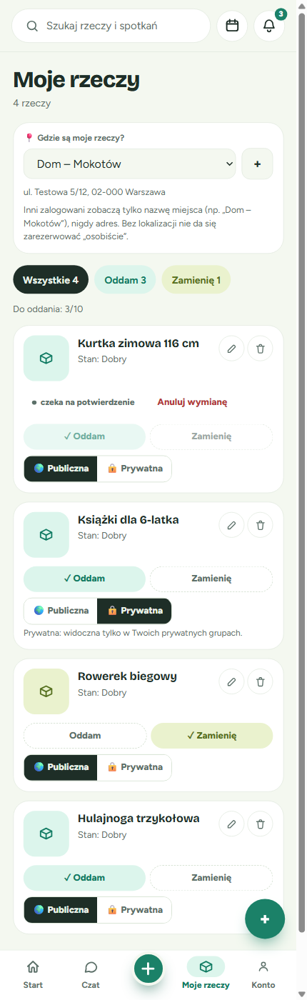

   ✅ **Co zobaczysz:** pod listą pojawi się pełny adres. Widzisz go tylko Ty. Niżej jest przypomnienie: „Inni zalogowani zobaczą tylko nazwę miejsca (np. „Dom – Mokotów"), nigdy adres. Bez lokalizacji nie da się zarezerwować „osobiście"."

💡 **Wskazówka:** nazwij miejsce ogólnie, np. „Dom – Mokotów" albo „Praca – centrum". Inni zobaczą tylko tę nazwę, więc nie wpisuj w niej adresu.

⚠️ **Ważne:** jeśli nie ustawisz miejsca, inni zobaczą przy przycisku „Odbiorę osobiście" komunikat, że nie ustawiłeś(-aś) jeszcze miejsca odbioru. Wciąż będą mogli napisać do Ciebie na czacie.

**Jak to wygląda na stronie Twojej rzeczy?** Widzisz tam ramkę „Lokalizacja przedmiotu (widzisz tylko Ty)" z nazwą miejsca i adresem. Link „Zmień w „Moje rzeczy"" prowadzi prosto do ustawień. Przykład znajdziesz w następnym kroku.

---

## Krok 2: Wybierz widoczność rzeczy — Publiczna czy Prywatna

Czasem chcesz, żeby rzecz zobaczyli tylko znajomi, np. rodzice z przedszkolnej grupy, a nie wszyscy w aplikacji.

| Ustawienie | Kto widzi rzecz |
|---|---|
| 🌍 **Publiczna** (domyślnie) | Wszyscy: na stronie organizatora, na terminach, na wydarzeniach i w wyszukiwaniu |
| 🔒 **Prywatna** | Tylko osoby z Twoich **prywatnych** grup. Rzecz nie pojawia się na publicznych stronach ani na wydarzeniach |

**Kroki:**

1. **Najpierw ustaw tryb**

   W „Moje rzeczy" przy każdej rzeczy masz przyciski „Oddam" i „Zamienię". Dopóki żadnego nie wybierzesz, zamiast przełącznika zobaczysz: „Ustaw tryb, żeby wybrać widoczność."

2. **Wybierz „🌍 Publiczna" albo „🔒 Prywatna"**

   Przełącznik pojawi się pod przyciskami trybu, jak na zrzucie z kroku 1. Gdy wybierzesz „Prywatna", pod spodem pojawi się: „Prywatna: widoczna tylko w Twoich prywatnych grupach."

3. **Sprawdź na stronie rzeczy**

   Na stronie prywatnej rzeczy zobaczysz etykietę „🔒 Prywatny" i zdanie „Prywatna — widzą ją tylko osoby z Twoich prywatnych grup."

   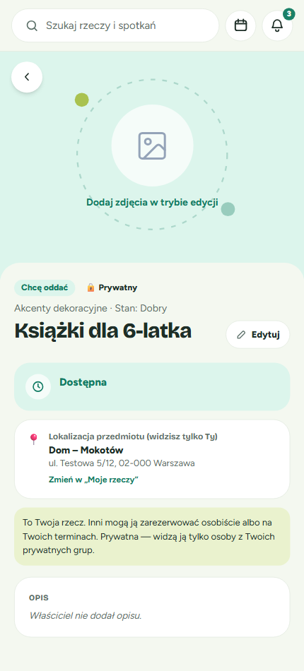

✅ **Co zobaczą inni:** osoba spoza Twoich prywatnych grup, która otworzy link do prywatnej rzeczy, zobaczy tylko „Nie znaleziono tej rzeczy.".

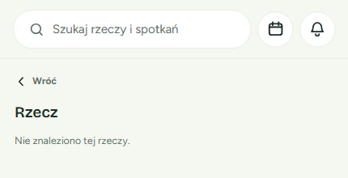

⚠️ **Pamiętaj:**

- Jeśli nie należysz do żadnej prywatnej grupy, rzecz prywatną zobaczysz tylko Ty.
- Gdy usuniesz tryb albo wymiana się zakończy, ustawienie „Prywatna" przepada. Przy ponownym wystawieniu rzecz znów jest „Publiczna".
- Rzeczy prywatnej nie da się zarezerwować na wydarzeniu ani na terminie publicznej grupy.

---

## Strona rzeczy — jak zarezerwować

Gdy otworzysz cudzą rzecz, zobaczysz na jej stronie:

- **etykietę** „Chcę oddać" albo „Chcę się zamienić";
- **„📍 Lokalizację przedmiotu"**, czyli samą nazwę miejsca z dopiskiem „Dokładny adres ustalicie na czacie.";
- **„Gdzie jeszcze można odebrać"**, czyli terminy i wydarzenia, na których bywa właściciel: dzień, nazwę, miejsce i godzinę;
- **„Jak chcesz odebrać?"** z trzema przyciskami.

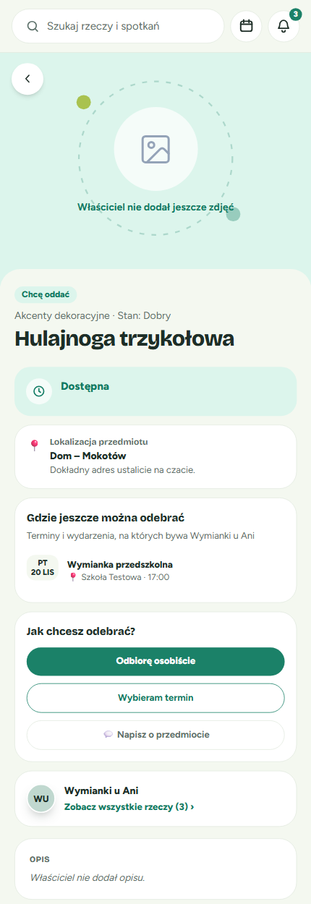

### Który przycisk wybrać?

| Przycisk | Kiedy go użyć |
|---|---|
| **Odbiorę osobiście** | Chcesz się umówić z właścicielem bez czekania na termin |
| **Wybieram termin** | Ty i właściciel jesteście zapisani na ten sam termin lub to samo wydarzenie i tam odbierzesz rzecz |
| **💬 Napisz o przedmiocie** | Chcesz najpierw o coś zapytać, np. o rozmiar albo stan rzeczy |

💡 **Wskazówka:** szary przycisk z podpowiedzią pod spodem oznacza, że teraz ta opcja jest niedostępna. Na przykład „Wybieram termin" jest wyłączony, gdy nie jesteście razem zapisani na żaden termin. Podpowiedź brzmi wtedy: „Nie macie wspólnego terminu ani wydarzenia, na które jesteś zapisany(-a)."

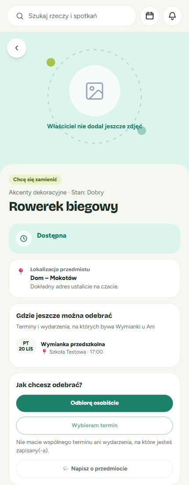

### Jak zarezerwować do odbioru osobistego

1. **Stuknij „Odbiorę osobiście"**

   Otworzy się okienko „Odbiór osobisty". Zobaczysz w nim nazwę miejsca i informację, że dokładny adres i godzinę ustalicie na czacie.

   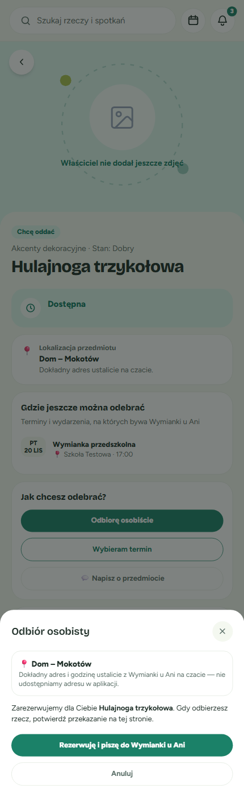

2. **Stuknij „Rezerwuję i piszę do …"**

   Rezerwacja zostanie zapisana i od razu otworzy się czat z właścicielem o tej rzeczy.

   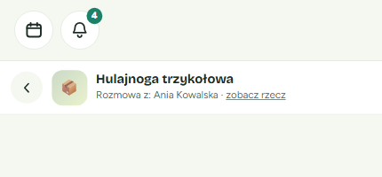

3. **Umówcie się na czacie**

   Napisz, kiedy i gdzie możesz odebrać rzecz, np. „Cześć! Mogę podjechać jutro po 17:00, pasuje?".

✅ **Co zobaczysz:** gdy wrócisz na stronę rzeczy, będzie oznaczona jako „Zarezerwowana · przez Ciebie".

⚠️ Jeśli czat z jakiegoś powodu się nie otworzy, rezerwacja i tak jest zapisana. Napiszesz później przyciskiem „💬 Napisz o przedmiocie".

### Jak zarezerwować na wspólny termin

1. **Stuknij „Wybieram termin"**

   Otworzy się okienko „Wybierz termin odbioru" z terminami i wydarzeniami, na które jesteście zapisani razem z właścicielem.

2. **Zaznacz termin i stuknij „Rezerwuję na ten termin"**

   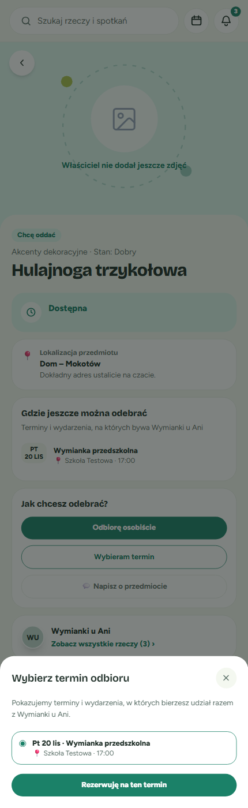

✅ **Co zobaczysz:** potwierdzenie rezerwacji. Rzecz odbierzesz na wybranym spotkaniu.

💡 Jeśli właściciel chce się zamienić, zamiast „Rezerwuję na ten termin" zobaczysz przycisk „Dalej: wybierz rzecz na zamianę". Więcej o tym w części o zamianie.

### A jeśli nie masz konta?

Niezalogowany zobaczy rzecz, jej etykietę i listę „Gdzie jeszcze można odebrać", ale bez lokalizacji. Zamiast przycisków rezerwacji pojawi się „Chcesz tę rzecz? Zaloguj się, żeby zarezerwować lub napisać do właściciela." z przyciskami „Zaloguj się" i „Załóż konto".

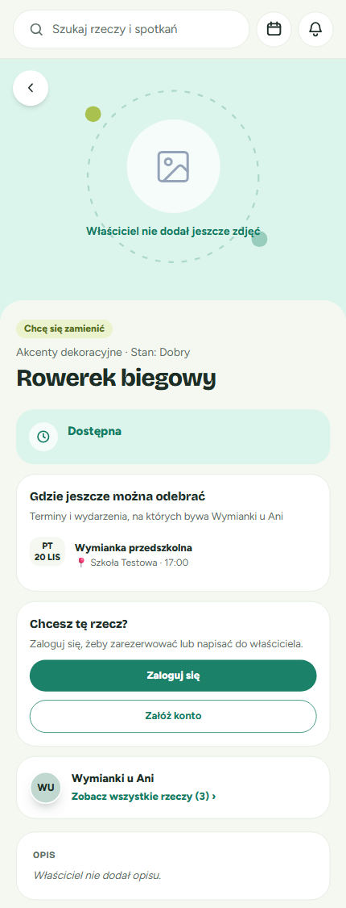

---

## Po rezerwacji — potwierdzanie i anulowanie

Wszystko, co dzieje się po rezerwacji, załatwiasz na tej samej stronie rzeczy. Trafisz na nią też z powiadomienia.

### Jeśli to Ty odbierasz rzecz

Zobaczysz etykietę „Zarezerwowana · przez Ciebie" i informację „Odbiór osobisty — szczegóły ustalają … na czacie."

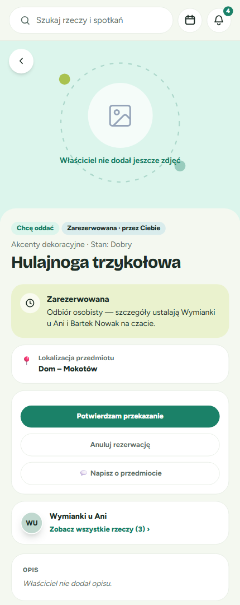

- **„Potwierdzam przekazanie"**: stuknij, gdy masz już rzecz u siebie. Wymiana się zakończy.
- **„Anuluj rezerwację"**: stuknij, jeśli jednak rezygnujesz.
- **„💬 Napisz o przedmiocie"**: wraca do czatu z właścicielem.

### Jeśli to Ty oddajesz rzecz

Widzisz, kto zarezerwował rzecz, np. „Zarezerwowana · przez Bartek Nowak". Pod przyciskiem „Anuluj rezerwację" jest podpowiedź: „Przekazanie potwierdza Bartek Nowak, gdy odbierze rzecz."

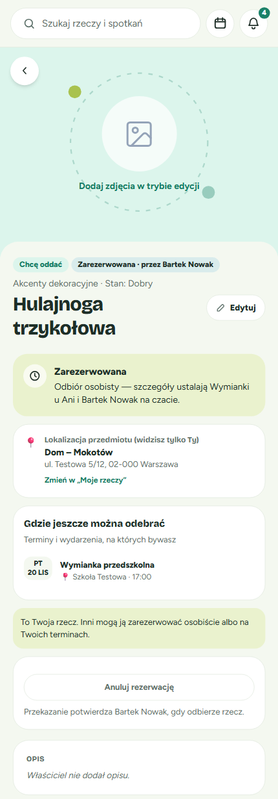

💡 Przy oddawaniu za darmo przekazanie potwierdza osoba, która **odbiera** rzecz. Ty nie musisz nic klikać.

### Anulowanie rezerwacji

1. Stuknij **„Anuluj rezerwację"**.
2. Pojawi się pytanie „Anulować rezerwację?" z wyjaśnieniem „Rzecz znów będzie dostępna dla innych."
3. Stuknij **„Tak, anuluj"**, żeby anulować, albo **„Anuluj"**, żeby się wycofać.

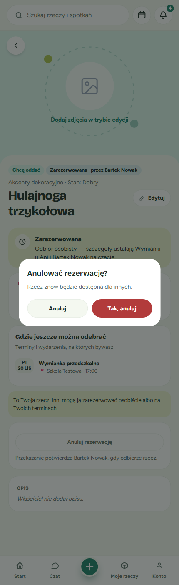

✅ **Co zobaczysz:** rzecz wróci do stanu „Dostępna" i inni znów będą mogli ją zarezerwować.

### Rezerwacja na termin

Jeśli zarezerwowałeś(-aś) rzecz na termin, przyciski potwierdzenia pojawią się dopiero po tym terminie. Do tego czasu zobaczysz podpowiedź „Potwierdzicie po terminie."

### Co widzą inni?

Inni zalogowani widzą „Zarezerwowana · przez …" i komunikat „Ta rzecz jest zarezerwowana.". Ich przyciski rezerwacji są wyłączone, a pod nimi jest podpowiedź: „Ktoś już zarezerwował tę rzecz. Jeśli rezerwacja zostanie anulowana, znów będzie dostępna." Napisać do właściciela mogą nadal.

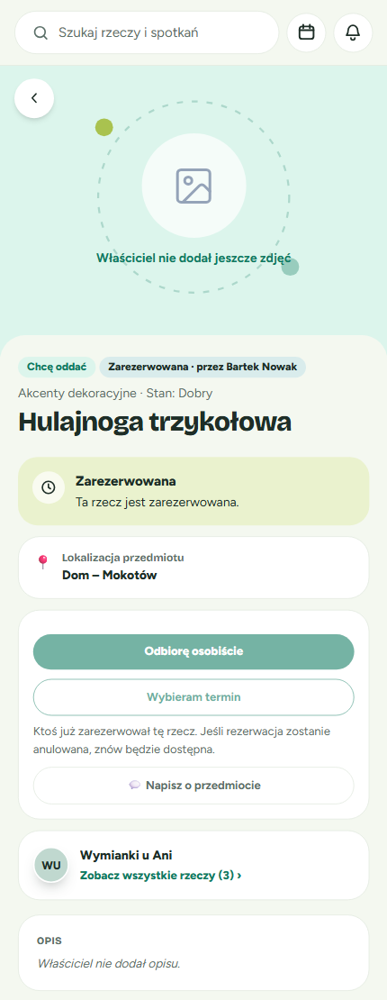

---

## Zamiana — proponowanie, przyjmowanie i odrzucanie

Gdy rzecz ma etykietę „Chcę się zamienić", właściciel czeka na propozycję zamiany na inną rzecz.

📝 **Czego potrzebujesz:** w „Moje rzeczy" przynajmniej jedna Twoja rzecz musi mieć zaznaczone „Zamienię". Inaczej zobaczysz komunikat: „Nie masz żadnej rzeczy oznaczonej „zamienię". Oznacz rzecz w „Moje rzeczy", aby móc zaproponować zamianę."

### Jak zaproponować zamianę

1. **Na stronie rzeczy wybierz „Odbiorę osobiście" albo „Wybieram termin"**

   W okienku odbioru osobistego zobaczysz: „Zaproponujesz zamianę za … Gdy … ją przyjmie i się wymienicie, potwierdźcie to na tej stronie."

2. **Przejdź dalej i wybierz rzecz, którą oferujesz**

   Pojawi się okienko „Co proponujesz w zamian?". Zaznacz swoją rzecz i stuknij **„Zaproponuj zamianę"**.

   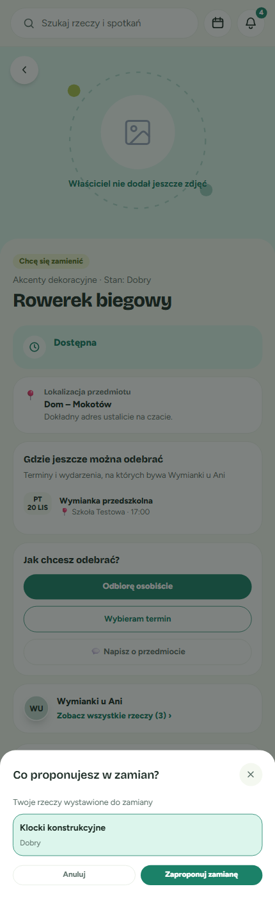

3. **Poczekaj na odpowiedź**

   Na stronie rzeczy zobaczysz „Czekasz na odpowiedź … Możesz napisać na czacie."

   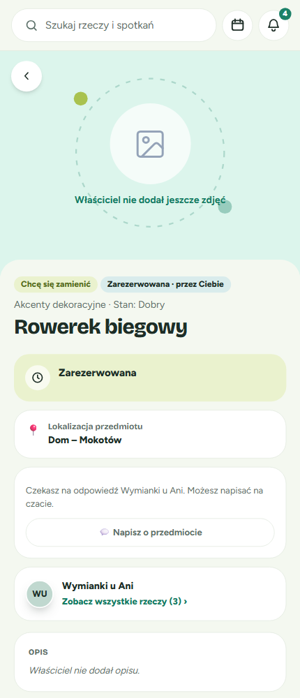

⚠️ Dopóki właściciel nie odpowie, rzecz jest zablokowana i nikt inny nie może jej zarezerwować.

### Jak przyjąć albo odrzucić zamianę (właściciel)

1. **Zobaczysz powiadomienie**

   Pojawi się okienko „Propozycja zamiany" z informacją, kto i za którą rzecz proponuje zamianę. Możesz od razu przejść do „Moje rzeczy" albo stuknąć „Później".

   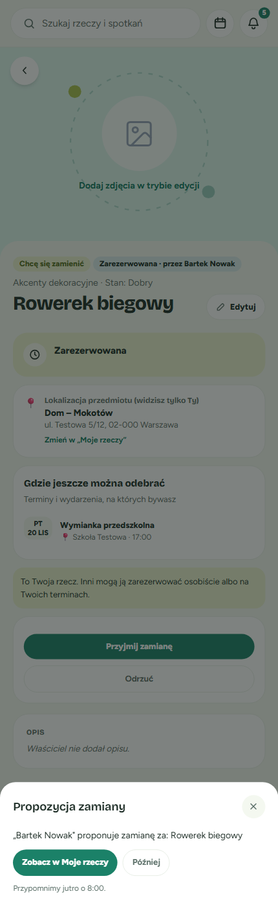

2. **Na stronie rzeczy wybierz odpowiedź**

   - **„Przyjmij zamianę"**: zamiana zostaje zaakceptowana. Szczegóły ustalacie na czacie, a po wymianie potwierdzacie ją na stronie rzeczy.
   - **„Odrzuć"**: rzecz wraca do stanu „Dostępna".

   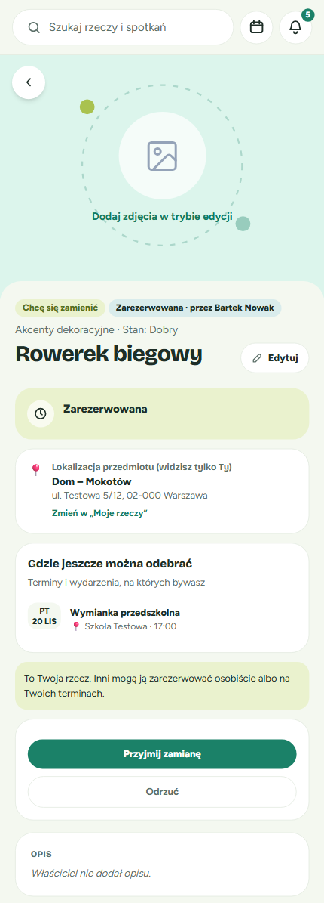

✅ **Po przyjęciu zamiany na odbiór osobisty** zobaczysz komunikat: „Zamiana przyjęta — odbiór osobisty, ustalcie szczegóły na czacie." Gdy się wymienicie, każde z Was może stuknąć „Potwierdzam przekazanie".

---

## Kafelki i liczniki na listach

### Etykiety na kafelkach

Każdy kafelek rzeczy to teraz jeden link. Stuknij w dowolne miejsce kafelka, a otworzy się strona rzeczy.

| Etykieta | Co oznacza |
|---|---|
| **Chcę oddać** (zielona) | Właściciel oddaje rzecz za darmo |
| **Chcę się zamienić** (oliwkowa) | Właściciel chce się zamienić na inną rzecz |
| **Zarezerwowana · przez Bartek Nowak** | Ktoś już ją zarezerwował. Imię widzą tylko zalogowani |
| **Zarezerwowana · przez Ciebie** | To Ty ją zarezerwowałeś(-aś) |
| **Zarezerwowana** (bez imienia) | Tak widzi to osoba niezalogowana |

Zarezerwowane rzeczy zostają na listach, dopóki przekazanie nie zostanie potwierdzone. Jeśli rezerwację ktoś anuluje, etykieta „Zarezerwowana" znika.

**Na stronie terminu** w sekcji „Zapisani i ich rzeczy" widać rzeczy uczestników z tymi samymi etykietami. Nie ma tu już przycisków rezerwacji. Rezerwujesz na stronie rzeczy.

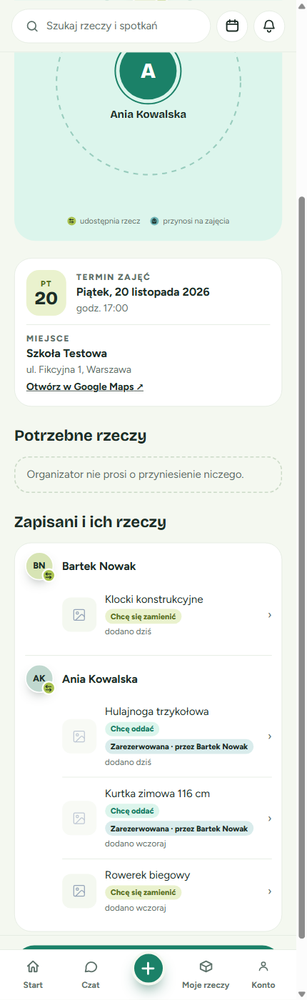

### Liczniki na stronie organizatora

Na stronie organizatora są trzy kafelki z licznikami: **„Chcę oddać"**, **„Chcę się zamienić"** i **„Zarezerwowane"**. Pod nimi są zakładki: „Wszystkie", „Chcę oddać", „Chcę się zamienić" i „Zarezerwowane".

- „Chcę oddać" i „Chcę się zamienić" liczą tylko rzeczy, które są jeszcze **wolne**.
- „Zarezerwowane" liczy rzeczy, które ktoś już zarezerwował.
- Liczba przy każdej zakładce zgadza się z liczbą rzeczy, które zakładka pokazuje.

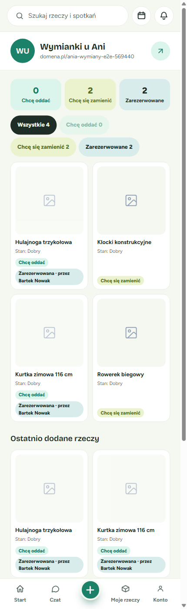

### Strona „Rzeczy: …" właściciela

Pod linkiem „Zobacz wszystkie rzeczy" znajdziesz listę rzeczy jednej osoby lub organizacji. Na górze jest najbliższa okazja do odbioru, a niżej zakładki „Wszystkie", „Chcę oddać" i „Chcę się zamienić". Tutaj liczniki obejmują **także** rzeczy zarezerwowane. Rzeczy prywatne się tu nie pojawiają.

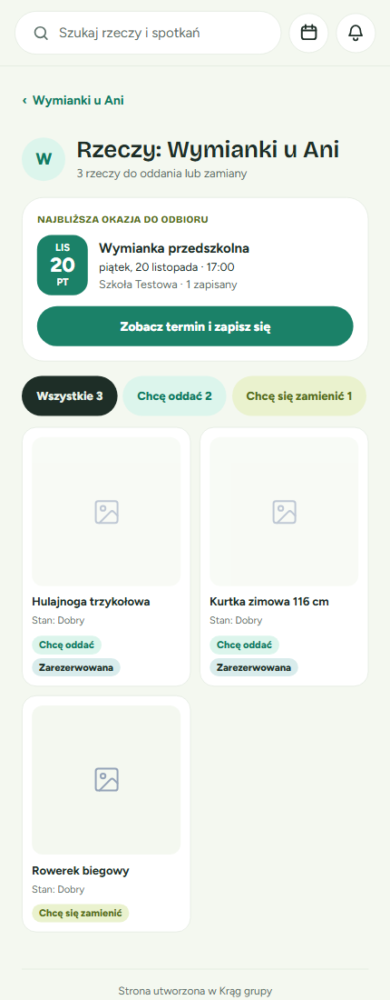

---

## Kto co widzi — ściągawka

| Informacja | Właściciel | Inny zalogowany | Niezalogowany |
|---|---|---|---|
| Nazwa miejsca („Dom – Mokotów") | ✅ | ✅ | ❌ |
| Pełny adres | ✅ (z dopiskiem „widzisz tylko Ty") | ❌ (ustalacie na czacie) | ❌ |
| Kto zarezerwował rzecz | ✅ | ✅ | ❌ (tylko „Zarezerwowana") |
| Rzecz „Prywatna" | ✅ | tylko osoby z Twoich prywatnych grup | ❌ |
| Lista „Gdzie jeszcze można odebrać" | ✅ | ✅ | ✅ |

---

## Rozwiązywanie problemów

**„Odbiorę osobiście" jest szary, a pod nim widać „… nie ustawił(a) jeszcze miejsca odbioru".**
Właściciel nie ustawił miejsca w „Moje rzeczy". Napisz do niego na czacie przyciskiem „💬 Napisz o przedmiocie".

**„Wybieram termin" jest szary.**
Nie jesteście razem zapisani na żaden nadchodzący termin ani wydarzenie. Zapisz się na termin z listy „Gdzie jeszcze można odebrać" albo wybierz odbiór osobisty.

**Nie widzę przełącznika „Publiczna / Prywatna".**
Najpierw wybierz przy rzeczy „Oddam" albo „Zamienię". Przełącznik pojawia się dopiero wtedy.

**Znajomy pisze, że widzi „Nie znaleziono tej rzeczy.".**
Rzecz jest ustawiona jako „Prywatna", a znajomy nie należy do żadnej z Twoich prywatnych grup. Przełącz rzecz na „Publiczna" albo dodaj znajomego do prywatnej grupy.

**Nie mogę zaproponować zamiany, przycisk „Zaproponuj zamianę" jest wyłączony.**
Nie masz żadnej rzeczy oznaczonej „Zamienię". Oznacz ją w „Moje rzeczy" i spróbuj ponownie.

**Pojawia się komunikat „Ktoś już zaproponował zamianę za tę rzecz" albo „Ta rzecz jest już zajęta".**
Ktoś był szybszy. Poczekaj, aż właściciel odpowie albo rezerwacja zostanie anulowana. Rzecz znów będzie dostępna.

**Nie widzę przycisku „Potwierdzam przekazanie".**
- Przy rezerwacji na termin przycisk pojawi się dopiero po terminie.
- Przy oddawaniu za darmo przekazanie potwierdza osoba, która odbiera rzecz, a nie właściciel.

---

## Zobacz też

- **„Moje rzeczy"**: dodawanie rzeczy oraz ustawianie trybu „Oddam" i „Zamienię".
- **Czat**: rozmowy o rzeczach. Rozmowa o rzeczy zostaje dostępna także po rezerwacji.
- **Strona terminu**: zapisy na spotkania i lista „Zapisani i ich rzeczy".
