# Lokalizacja rzeczy i miejsca — przewodnik

*Ostatnia aktualizacja: 4 listopada 2026*

## TL;DR
- Każda rzecz ma teraz swoją **lokalizację** (miejscowość). Bez niej nie zapiszesz nowej rzeczy ani nie wystawisz rzeczy otrzymanej od kogoś.
- Miejsce dodajesz, wpisując **nazwę miejscowości albo kod pocztowy**. Dokładny **adres** jest opcjonalny i przydaje się głównie przy terminach i wydarzeniach.
- Inni widzą przy Twojej rzeczy **tylko miejscowość**. Adres widzisz wyłącznie Ty.
- Przycisk **„+”** obok wyboru miejsca otwiera formularz nowego miejsca. Potem wracasz do formularza, a wpisane dane i zdjęcia zostają na swoim miejscu.

---

## Spis treści
1. [Co się zmieniło?](#co-się-zmieniło)
2. [Dodawanie miejsca](#dodawanie-miejsca)
3. [Dodawanie rzeczy z lokalizacją](#dodawanie-rzeczy-z-lokalizacją)
4. [Zmiana lokalizacji rzeczy](#zmiana-lokalizacji-rzeczy)
5. [Co widzą inni, a co Ty](#co-widzą-inni-a-co-ty)
6. [Moje miejsca: lista, edycja, usuwanie](#moje-miejsca-lista-edycja-usuwanie)
7. [Miejsca w terminach, wydarzeniach i grupach](#miejsca-w-terminach-wydarzeniach-i-grupach)
8. [Najczęstsze pytania i problemy](#najczęstsze-pytania-i-problemy)

---

## Co się zmieniło?

Osoba, która chce Twoją rzecz, zwykle najpierw pyta, gdzie ta rzecz jest. Dlatego każda rzecz ma teraz miejsce, które sam(a) wybierasz. Działa to jak w ogłoszeniach drobnych: inni widzą miejscowość (np. „Kęty”), ale nie Twój adres.

**Dla kogo?** Dla każdego, kto dodaje rzeczy, organizuje terminy lub wydarzenia albo prowadzi grupę.

---

## Dodawanie miejsca

Miejsce to miejscowość, opcjonalnie z dokładnym adresem. Raz zapisane, możesz wybierać przy rzeczach, terminach, wydarzeniach i grupach.

**Gdzie to znajdę?** Wejdź w **Konto → Lokalizacja (Moje miejsca)** i kliknij **„+ Dodaj miejsce”**. Możesz też kliknąć **„+”** obok pola wyboru miejsca w dowolnym formularzu.

### Krok 1: Znajdź swoją miejscowość

Formularz ma dwa pola. Pole **Adres** pozostaje nieaktywne, dopóki nie wybierzesz miejscowości.

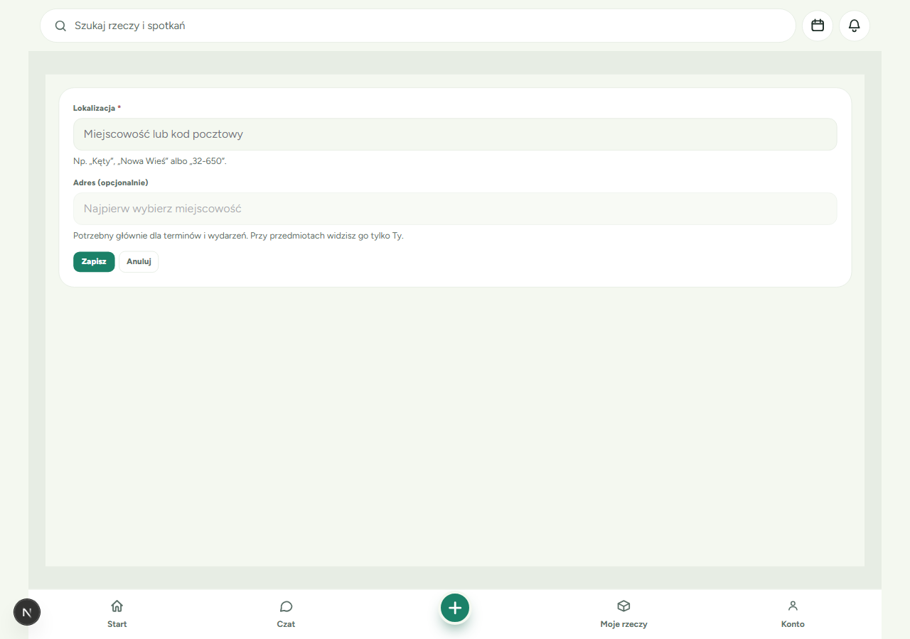

W polu **Lokalizacja** zacznij wpisywać **nazwę miejscowości**, np. „Kęty”. Polskie znaki nie są wymagane: wpisanie „kety” też znajdzie Kęty.

Wiele miejscowości w Polsce ma tę samą nazwę, np. „Nowa Wieś”. Każda podpowiedź ma więc pod nazwą krótki opis:

- **gm.** to gmina,
- **pow.** to powiat,
- na końcu jest **województwo**,
- dopisek **„· miasto”** oznacza miasto. Miasta są na liście przed wsiami.

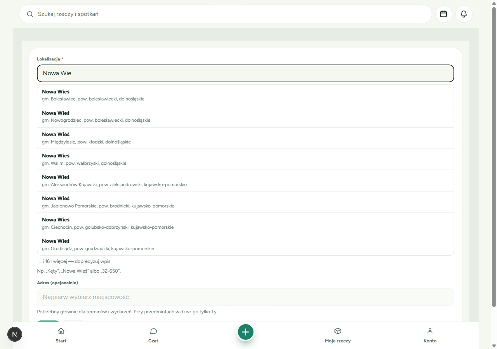

💡 **Wskazówka**: Przy bardzo popularnej nazwie pod listą pojawi się np. „… i 161 więcej — doprecyzuj wpis”. Wpisz wtedy dłuższą nazwę albo kod pocztowy.

### Krok 2 (opcjonalnie): Szukaj po kodzie pocztowym

Nie wiesz, w jakiej gminie jest Twoja wieś? Wpisz **kod pocztowy**, np. „32-650” albo „32650”. Zobaczysz wszystkie miejscowości z tym kodem.

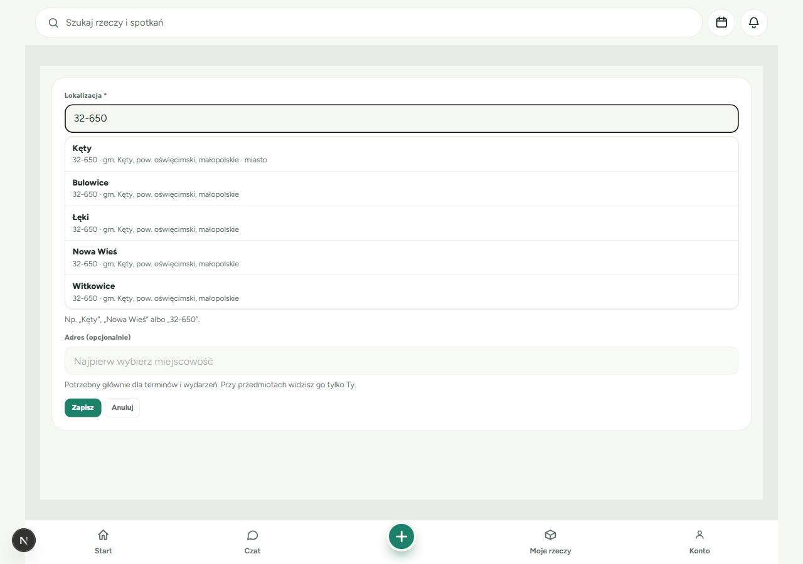

### Krok 3: Wybierz miejscowość z listy

Kliknij właściwą podpowiedź albo wybierz ją strzałkami i zatwierdź klawiszem Enter. Wybrana miejscowość pojawi się na zielonym tle. Jeśli to nie ta, kliknij **„zmień”**.

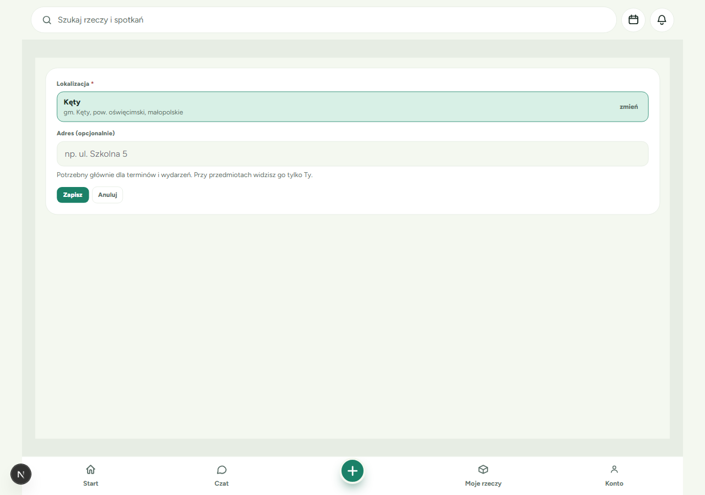

⚠️ **Ważne**: Miejscowość musisz **wybrać z listy**. Sam wpisany tekst nie wystarczy. Zobaczysz wtedy komunikat **„Wybierz miejscowość z listy”**.

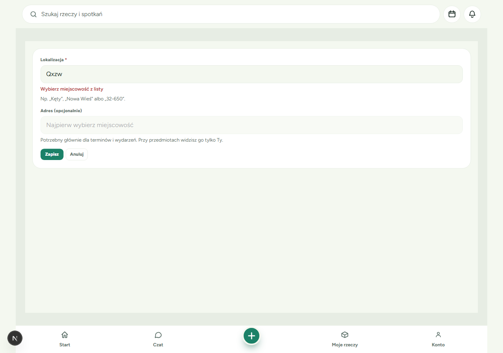

### Krok 4 (opcjonalnie): Dodaj adres

Po wybraniu miejscowości możesz wpisać ulicę i numer w polu **„Adres (opcjonalnie)”**. Mogą pojawić się podpowiedzi adresów z tej miejscowości.

**Kiedy dodać adres?**
- ✅ **Terminy i wydarzenia**: uczestnicy muszą wiedzieć, dokąd dokładnie przyjść.
- ✅ **Stałe miejsce spotkań grupy**.
- ➖ **Rzeczy**: zwykle wystarczy sama miejscowość. Adres i tak widzisz przy rzeczy tylko Ty.

**Kto widzi adres?**
- Przy **rzeczach** widzisz go **tylko Ty**. Inni widzą samą miejscowość.
- Przy **terminach i wydarzeniach** adres jest **publiczny**, bo goście muszą wiedzieć, gdzie się spotykacie.

💡 **Wskazówka**: Gdy zmienisz miejscowość, wpisany adres się wyczyści. Dzięki temu adres nie zostanie przypisany do złej miejscowości.

### Krok 5: Zapisz

Kliknij **„Zapisz”**. Pojawi się komunikat **„Dodano miejsce „Kęty””**.

- Jeśli formularz miejsca otworzył się z innego formularza (przyciskiem „+”), wrócisz do tamtego formularza, a nowe miejsce będzie już wybrane.
- **„Anuluj”** też Cię tam zabierze, bez żadnych zmian.

---

## Dodawanie rzeczy z lokalizacją

Każda nowa rzecz musi mieć lokalizację. Dzięki temu osoby zainteresowane od razu wiedzą, skąd mogą ją odebrać.

**Czego potrzebujesz**:
- 📝 przynajmniej jednego zapisanego miejsca (możesz je dodać w trakcie, przyciskiem „+”).

### Krok 1: Wypełnij formularz rzeczy

Kliknij zielony **„+”** na dolnym pasku i wybierz dodanie rzeczy. Dodaj zdjęcia, nazwę, kategorię i opis, tak jak dotychczas.

Pod opisem jest nowe pole **„Lokalizacja *”** (gwiazdka oznacza pole obowiązkowe). Jeśli masz już miejsca, aplikacja zwykle sama podpowie to, którego użyłeś(-aś) ostatnio.

### Krok 2: Nie masz jeszcze miejsca? Kliknij „+”

Jeśli nie masz zapisanych miejsc, pole pokaże **„Nie masz jeszcze miejsc”**. Przyciski **„Oddam”** i **„Zamienię”** pozostaną nieaktywne, a pod polem pojawi się podpowiedź **„Podaj nazwę, wybierz kategorię i lokalizację, aby zapisać.”**

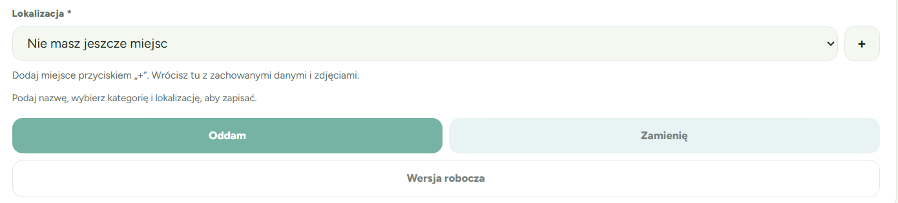

Kliknij przycisk **„+”** obok pola i dodaj miejsce zgodnie z opisem w sekcji [Dodawanie miejsca](#dodawanie-miejsca).

### Krok 3: Wróć do formularza

Po kliknięciu **„Zapisz”** wrócisz do formularza rzeczy. Zobaczysz, że:
- **zdjęcia, nazwa, kategoria i opis są na swoim miejscu**,
- nowe miejsce jest **już wybrane**,
- na dole widać komunikat „Dodano miejsce „Kęty””.

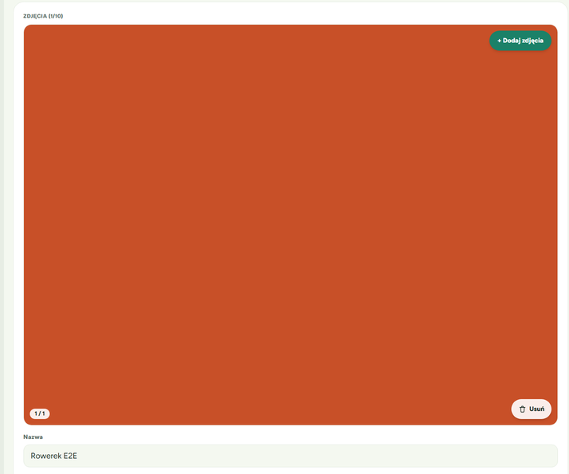

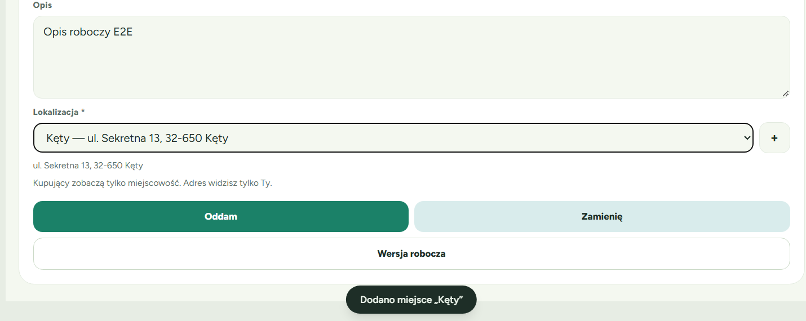

✅ **Co powinieneś(-aś) zobaczyć**: Przyciski **„Oddam”** i **„Zamienię”** są aktywne. Pod polem jest przypomnienie: „Kupujący zobaczą tylko miejscowość. Adres widzisz tylko Ty.”

### Krok 4: Zapisz rzecz

Kliknij **„Oddam”**, **„Zamienię”** albo **„Wersja robocza”**.

💡 **Wskazówka**: Jeśli wyjdziesz z formularza, zanim zapiszesz rzecz, wpisane dane zostaną zachowane. Gdy otworzysz go ponownie, dokończysz od miejsca, w którym przerwałeś(-aś).

---

## Zmiana lokalizacji rzeczy

Lokalizację możesz zmienić w każdej chwili, np. po przeprowadzce albo gdy rzecz leży u kogoś z rodziny.

### Jak zmienić lokalizację

1. Na stronie swojej rzeczy kliknij **„Zmień lokalizację”** (w ramce „Lokalizacja przedmiotu”) albo **„Edytuj”**.
2. W polu **„Lokalizacja *”** wybierz inne miejsce. Możesz też kliknąć **„+”** i dodać nowe. Po powrocie Twoje zmiany w formularzu nadal będą widoczne.

   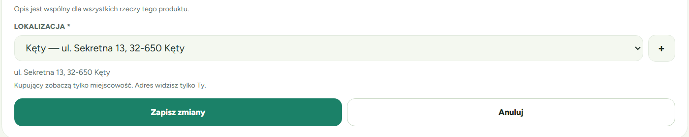

3. Kliknij **„Zapisz zmiany”**. Wrócisz tam, skąd otworzyłeś(-aś) edycję.

### Komunikat „Ustaw lokalizację, aby wystawić przedmiot.”

Ten czerwony komunikat zobaczysz w edycji rzeczy, która **nie ma lokalizacji**. Najczęściej dzieje się tak, gdy:
- **otrzymałeś(-aś) rzecz** od kogoś w prezencie lub w zamianie. Lokalizacja poprzedniego właściciela nie przechodzi na Ciebie, więc musisz ustawić własną;
- **usunąłeś(-aś) miejsce**, które było przypisane do tej rzeczy.

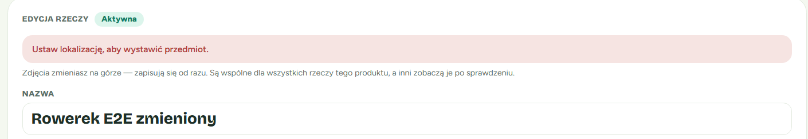

Wybierz miejsce z listy (albo dodaj nowe przyciskiem „+”) i zapisz. Jeśli spróbujesz zapisać bez miejsca, zobaczysz **„Wybierz lokalizację”** i nic się nie zapisze.

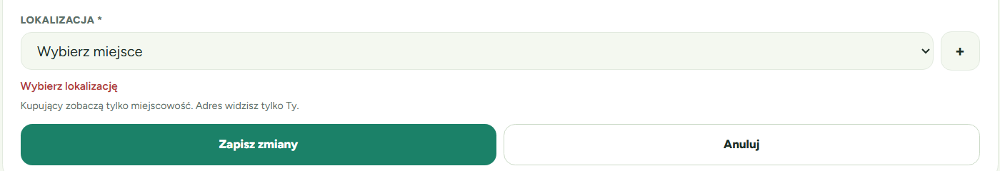

⚠️ **Ważne**: Rzeczy otrzymanej od kogoś **nie wystawisz** (jako „Oddam” lub „Zamienię”), dopóki nie ustawisz jej lokalizacji.

---

## Co widzą inni, a co Ty

Na stronie każdej rzeczy jest ramka **„Lokalizacja przedmiotu”**.

### Ty (właściciel)

Widzisz:
- miejscowość z gminą, powiatem i województwem,
- link **„Otwórz w Mapach”**,
- swój adres w szarym polu **„Widoczne tylko dla Ciebie”**,
- link **„Zmień lokalizację”**.

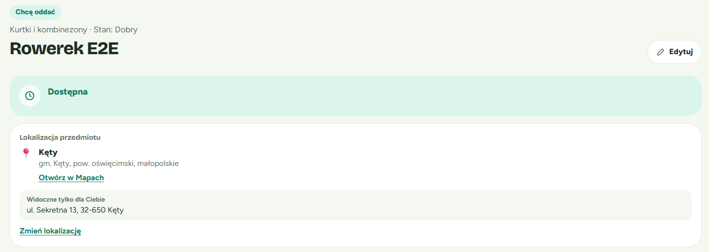

### Inni zalogowani użytkownicy

Widzą **tylko miejscowość** z opisem i link do map. Widzą też informację, czy możliwy jest **odbiór osobisty**.

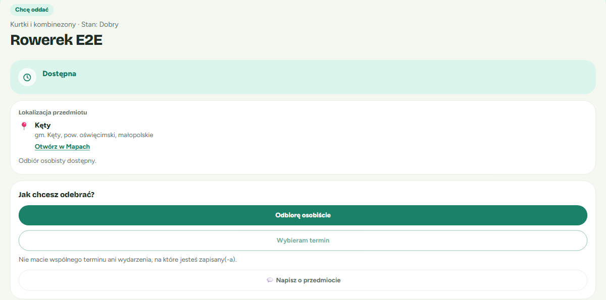

### Osoby niezalogowane

Też widzą **tylko miejscowość**, a pod nią zachętę do zalogowania się.

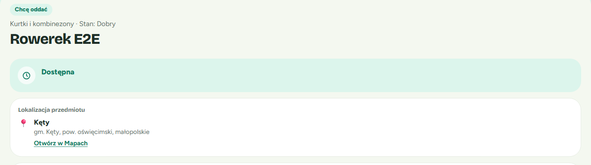

✅ **Twój adres nigdy nie pojawia się przy rzeczy dla innych osób.** Jest jeden wyjątek: jeśli to samo miejsce ustawisz jako miejsce **terminu lub wydarzenia**, jego adres będzie widoczny w informacjach o tym terminie lub wydarzeniu. Terminy i wydarzenia są publiczne.

---

## Moje miejsca: lista, edycja, usuwanie

**Gdzie to znajdę?** **Konto → Lokalizacja (Moje miejsca)**.

### Lista miejsc

Każdy wiersz pokazuje:
- **pogrubioną nazwę miejscowości**,
- pod nią adres i województwo, a jeśli miejsce nie ma adresu: gminę, powiat i województwo.

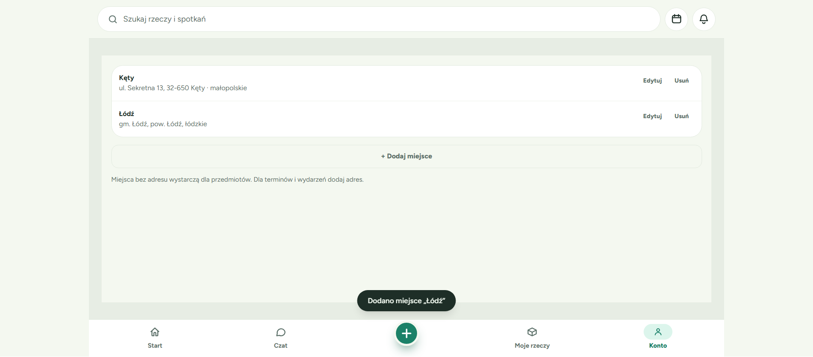

💡 **Wskazówka**: Miejsca bez adresu wystarczą dla rzeczy. Dla terminów i wydarzeń dodaj adres.

### Edycja miejsca

Kliknij **„Edytuj”** przy miejscu. Otworzy się ten sam formularz co przy dodawaniu. Możesz zmienić miejscowość, adres albo usunąć adres. Kliknij **„Zapisz”**.

⚠️ Zmiana miejsca dotyczy **wszystkich** rzeczy, terminów i wydarzeń, które z niego korzystają.

### Usuwanie miejsca

1. Kliknij **„Usuń”** przy miejscu.
2. Potwierdź, klikając **„Usuń miejsce”**. Możesz też kliknąć **„Anuluj”**.

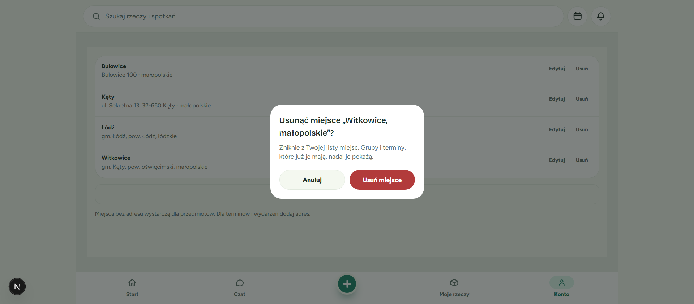

**Co się stanie z rzeczami z tego miejsca?**
- Rzeczy **pozostaną wystawione**. Inni nadal będą widzieć przy nich tę samą miejscowość.
- **Odbiór osobisty przestanie być dostępny**, dopóki nie ustawisz nowej lokalizacji.
- Na stronie rzeczy zobaczysz dopisek **„(usunięte)”** i informację **„Odbiór osobisty niedostępny — ustaw lokalizację”**. Kliknij link, aby wybrać nowe miejsce.

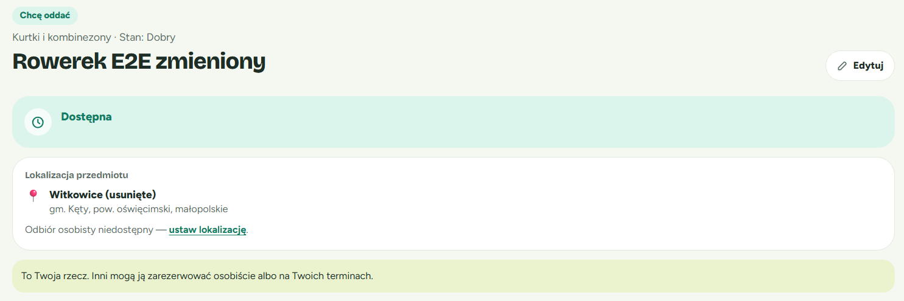

Grupy i terminy, które już korzystały z usuniętego miejsca, nadal je pokażą.

---

## Miejsca w terminach, wydarzeniach i grupach

Wybór miejsca działa wszędzie tak samo: rozwijana lista Twoich miejsc i przycisk **„+”** obok niej. Po dodaniu nowego miejsca wracasz do formularza z zachowanymi danymi, a nowe miejsce jest już wybrane.

### Termin

W formularzu terminu wybierz **„Miejsce”**. Pod listą zobaczysz adres wybranego miejsca.

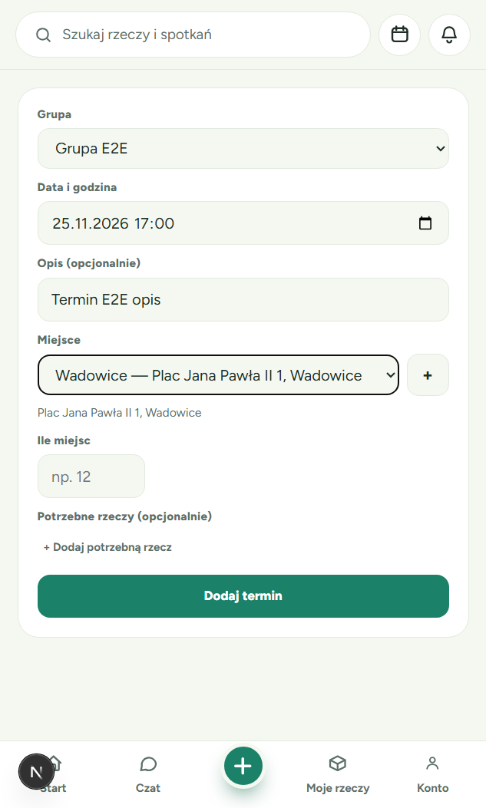

💡 To działa także w kreatorze pierwszego terminu: po dodaniu miejsca kreator otworzy się ponownie z Twoimi danymi.

### Wydarzenie

W formularzu wydarzenia pole **„Miejsce (opcjonalnie)”** działa tak samo.

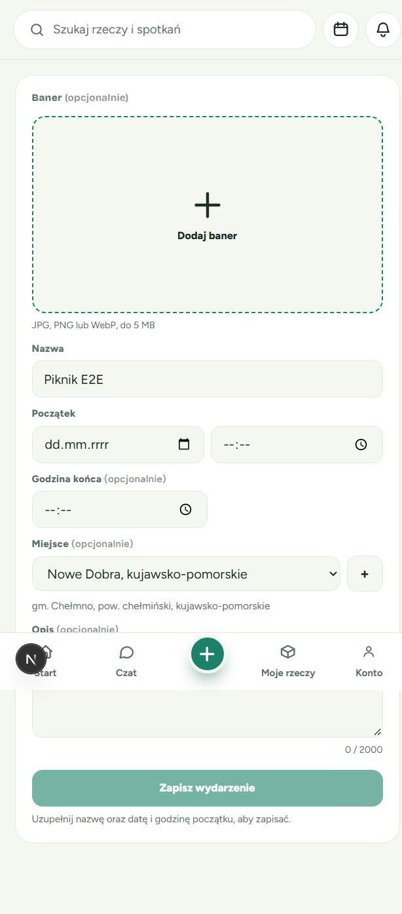

### Grupa

Przy tworzeniu lub edycji grupy możesz ustawić **„Stałe miejsce spotkań (opcjonalnie)”**.

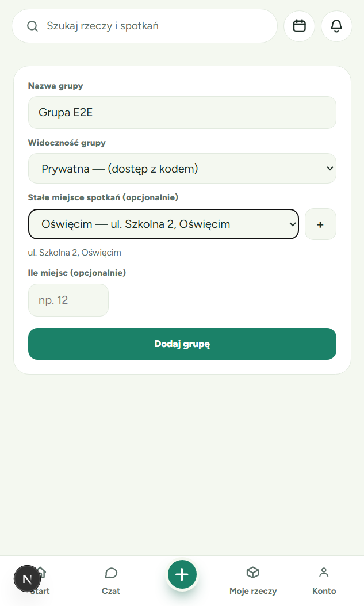

⚠️ Pamiętaj, że adres miejsca terminu lub wydarzenia **widzą wszyscy uczestnicy**. Do takich miejsc warto więc dodać adres, który chcesz pokazać publicznie.

---

## Najczęstsze pytania i problemy

**Nie mogę znaleźć swojej wsi.**
Wpisz kod pocztowy zamiast nazwy. Jeśli nazw jest bardzo dużo, wpisz więcej liter. Wyszukiwanie zaczyna działać od 2 znaków.

**Widzę kilka miejscowości o tej samej nazwie. Którą wybrać?**
Sprawdź gminę, powiat i województwo pod nazwą. Jeśli nie masz pewności, wpisz swój kod pocztowy.

**Wpisałem(-am) nazwę, ale pojawia się „Wybierz miejscowość z listy”.**
Kliknij jedną z podpowiedzi pod polem. Sam wpisany tekst nie wystarczy.

**Pole „Adres” jest szare i nie da się w nim pisać.**
Najpierw wybierz miejscowość. Pole adresu odblokuje się automatycznie.

**Nie mogę zapisać rzeczy, przyciski „Oddam” i „Zamienię” są nieaktywne.**
Upewnij się, że rzecz ma nazwę, kategorię i wybraną lokalizację.

**Dostałem(-am) rzecz i nie mogę jej wystawić.**
Otwórz jej edycję i ustaw lokalizację (zobacz [Zmiana lokalizacji rzeczy](#zmiana-lokalizacji-rzeczy)).

**Czy kupujący zobaczy mój adres?**
Nie. Przy rzeczy inni widzą tylko miejscowość. Adres zobaczą jedynie wtedy, gdy to samo miejsce ustawisz jako miejsce publicznego terminu lub wydarzenia.

**Kliknąłem(-am) „+”, a potem „Wstecz” w przeglądarce i nie widzę formularza.**
Otwórz formularz ponownie, np. „Dodaj rzecz”. Twoje dane i zdjęcia nadal tam będą. Żeby wrócić do formularza bezpośrednio, używaj przycisków „Zapisz” lub „Anuluj” na stronie nowego miejsca.

---

## Powiązane funkcje
- **Odbiór osobisty**: rezerwacja rzeczy z odbiorem u właściciela. Wymaga ustawionej lokalizacji rzeczy.
- **Terminy i wydarzenia**: spotkania, na których można przekazać rzeczy.
- **Konto → Moje miejsca**: wszystkie Twoje zapisane miejsca w jednym miejscu.
