# Wyszukiwarka i opis grupy — przewodnik

*Ostatnia aktualizacja: 13 listopada 2026*

## TL;DR
- Jedno pole „Szukaj rzeczy i spotkań” znajduje przedmioty, terminy, wydarzenia, grupy i organizacje. Wpisz co najmniej 2 znaki.
- Przełącz **Przedmioty / Spotkania**. Jeśli jesteś zalogowany, wybierz też **Moje grupy / Wszędzie**.
- Nie ma wyników? Kliknij „Dodaj do listy „szukam””. Możesz też przejść do drugiego trybu linią „… pasuje do …”.
- Organizator może dodać do grupy **opis** (do 500 znaków). Opis widać w wynikach wyszukiwania i na stronie terminów grupy.

## Open Questions / Risks
- Przycisk „Dodaj do listy „szukam”” otwiera formularz z wpisaną już nazwą. Zapisywanie listy „szukam” jest na razie wersją pokazową, więc poszukiwanie może się nie zapisać na stałe.
- Część zrzutów ekranu pochodzi z testów (konto testowe, dane „E2E …”). Nazwy i liczby wyników u Ciebie będą inne.

---

## Spis treści
1. [Wyszukiwarka](#1-wyszukiwarka)
   - [Jak wejść do wyszukiwarki](#jak-wejść-do-wyszukiwarki)
   - [Przedmioty czy Spotkania](#przedmioty-czy-spotkania)
   - [Moje grupy czy Wszędzie](#moje-grupy-czy-wszędzie)
   - [Filtry](#filtry)
   - [Co znaczy szara karta „Zarezerwowana…”](#co-znaczy-szara-karta-zarezerwowana)
   - [Linia „… pasuje do …”](#linia--pasuje-do-)
   - [Gdy nic nie znaleziono](#gdy-nic-nie-znaleziono)
   - [Gość czy zalogowany — czym się różni wyszukiwanie](#gość-czy-zalogowany--czym-się-różni-wyszukiwanie)
2. [Opis grupy](#2-opis-grupy)
3. [Najczęstsze pytania](#3-najczęstsze-pytania)

---

## 1. Wyszukiwarka

Wyszukiwarka pomaga znaleźć rzeczy, które ktoś oddaje albo chce zamienić, i spotkania, na które możesz przyjść. Wszystko szukasz z jednego miejsca.

### Jak wejść do wyszukiwarki

1. **Kliknij pole „Szukaj rzeczy i spotkań”** na górze ekranu. Jest widoczne na stronie głównej i w innych miejscach aplikacji.

   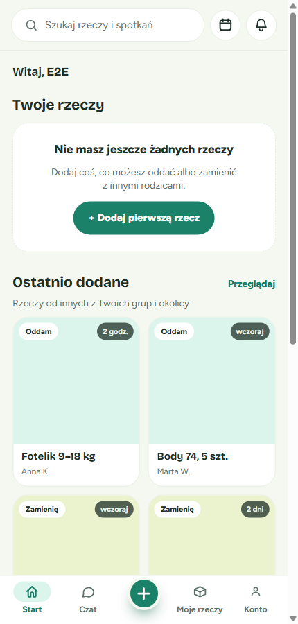

   💡 **Wskazówka**: do wyszukiwarki prowadzi też link „Przeglądaj” przy sekcji „Ostatnio dodane”.

2. **Wpisz, czego szukasz**, np. „wózek”, „kurtka 104”, „klocki” albo „joga”. Wyniki pojawiają się same, po chwili od wpisania.

   📝 **Ważne**: wpisz **co najmniej 2 znaki**. Po jednej literze zobaczysz tylko podpowiedź „Wpisz co najmniej 2 znaki, żeby zacząć szukać.”.

   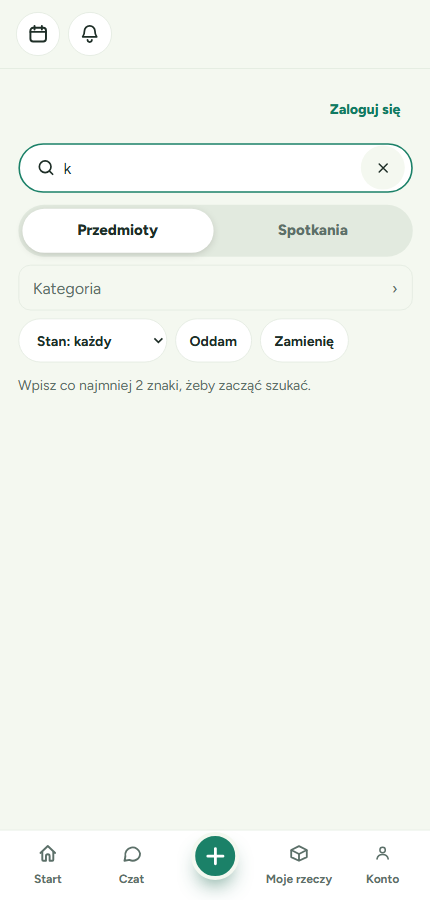

   💡 **Wskazówka**: polskie znaki nie są konieczne. Wyszukiwarka radzi sobie też z drobnymi literówkami i fragmentami słów.

3. **Aby wyczyścić pole**, kliknij ✕ po prawej stronie pola.

✅ **Co zobaczysz**: pod polem pojawi się podsumowanie, np. „68 przedmiotów dla „kar””, a pod nim lista wyników. Jeśli wyników jest dużo, kolejne wczytają się, gdy przewiniesz w dół, albo po kliknięciu „Pokaż więcej”.

💡 **Wskazówka**: wyniki zostają zapamiętane w adresie strony. Gdy otworzysz wynik i wrócisz przyciskiem „Wstecz”, zobaczysz tę samą listę.

### Przedmioty czy Spotkania

Pod polem wyszukiwania są dwie zakładki:

- **Przedmioty** — rzeczy, które inni oddają („Chcę oddać”) albo chcą zamienić („Chcę się zamienić”). Wyniki są w dwóch kolumnach, ze zdjęciem i stanem rzeczy.
- **Spotkania** — wszystko, na co możesz przyjść lub do czego dołączyć:
  - **Termin** — konkretne spotkanie grupy (data, godzina, miejsce),
  - **Wydarzenie** — jednorazowe wydarzenie organizowane przez kogoś,
  - **Grupa** — grupa, którą możesz poznać i odwiedzić,
  - **Organizacja** — np. pracownia, klub albo stowarzyszenie, które prowadzi grupy.

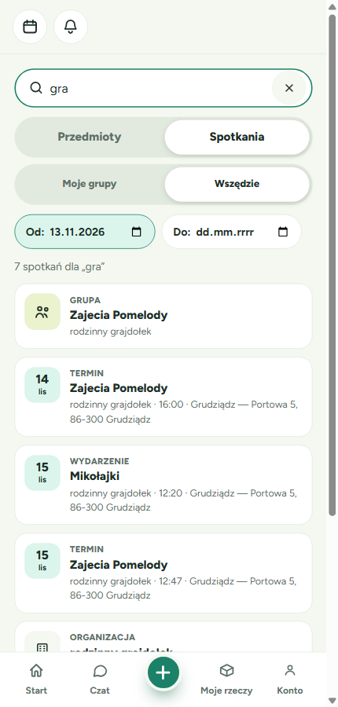

W zakładce Spotkania widzisz tylko **nadchodzące** spotkania. Najpierw są te o najbliższej dacie. Przy terminach grup, do których należysz, zobaczysz znaczek „moja grupa”.

💡 **Wskazówka**: przy zmianie zakładki wpisane słowo zostaje. Filtry wracają do ustawień domyślnych, bo każda zakładka ma własne filtry.

### Moje grupy czy Wszędzie

Gdy jesteś zalogowany, pod zakładkami zobaczysz drugi przełącznik:

- **Moje grupy** (ustawione na start) — pokazuje tylko to, co pochodzi z Twoich grup. „Twoje grupy” to grupy, w których **jesteś członkiem albo organizatorem**. Zobaczysz rzeczy osób, z którymi dzielisz grupę, oraz terminy i grupy, do których należysz.
- **Wszędzie** — pokazuje też publiczne rzeczy, terminy grup publicznych, wydarzenia i organizacje spoza Twoich grup.

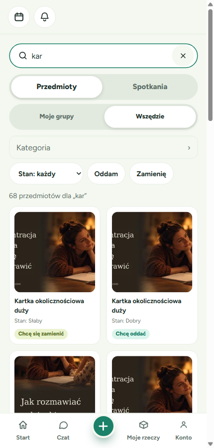

⚠️ **Dobrze wiedzieć**:
- Udział w pojedynczym terminie (zapisanie się na spotkanie) **nie** czyni Cię członkiem grupy.
- Członkostwo kogoś z Twojej rodziny w grupie nie dodaje tej grupy do „Moich grup”.
- Grupy usunięte przez organizatora nie liczą się już jako Twoje grupy.
- W zakresie „Moje grupy” wydarzenia i organizacje się nie pokazują. Zobaczysz je w zakresie „Wszędzie”.
- Twoich własnych rzeczy wyszukiwarka nie pokazuje. Znajdziesz je w zakładce „Moje rzeczy”.

### Filtry

#### Filtry w zakładce Przedmioty

- **Kategoria** — kliknij „Kategoria” i wybierz ją z listy (możesz też wpisać jej nazwę w okienku wyszukiwania kategorii). Wybór obejmuje też wszystkie mniejsze kategorie, np. „Dzieci” obejmuje ubranka, zabawki itd. Aby usunąć filtr, kliknij ✕ obok wybranej kategorii.

  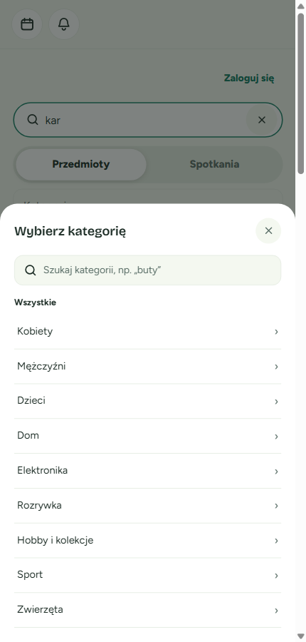

- **Stan** — rozwiń „Stan: każdy” i wybierz stan rzeczy, np. „Dobry”.
- **Oddam / Zamienię** — kliknij „Oddam”, żeby zobaczyć tylko rzeczy do oddania, albo „Zamienię”, żeby zobaczyć tylko rzeczy na wymianę. Ponowne kliknięcie wyłącza filtr. Włączony filtr jest podświetlony na zielono.

  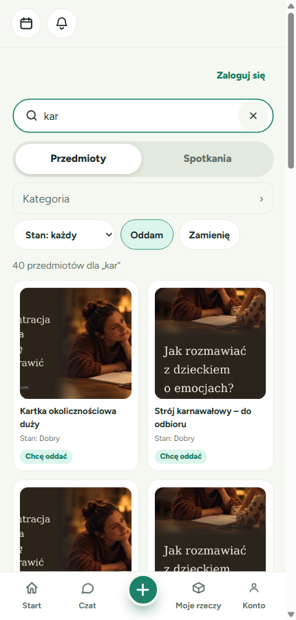

#### Filtry w zakładce Spotkania

- **Od** — od jakiego dnia szukać spotkań. Domyślnie od dziś. Wcześniejszych dat nie da się wybrać, bo przeszłe spotkania się nie pokazują.
- **Do** — do jakiego dnia (ten dzień też się liczy). Pole jest opcjonalne.

⚠️ Jeśli data „Do” jest wcześniejsza niż „Od”, pod polami pojawi się czerwony komunikat „Data „Do” nie może być wcześniejsza niż „Od”.”, a lista się nie pokaże. Popraw jedną z dat, a wyniki wrócą.

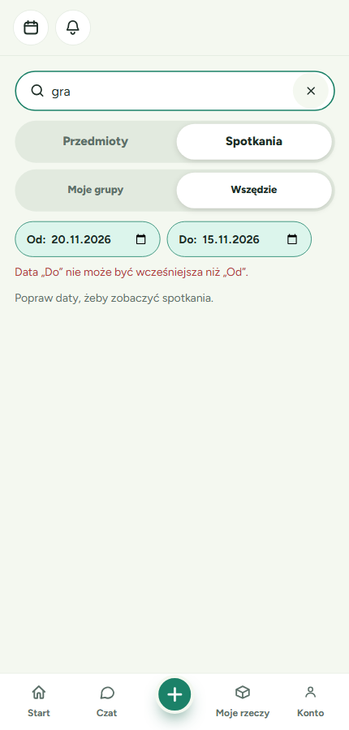

### Co znaczy szara karta „Zarezerwowana…”

Gdy ktoś już zarezerwował rzecz, jej karta jest **wyszarzona** i ma etykietę:

- **„Zarezerwowana do sob 14 lis”** — rzecz jest zarezerwowana do odbioru na konkretnym terminie lub wydarzeniu. Data mówi, kiedy jest umówiony odbiór.

  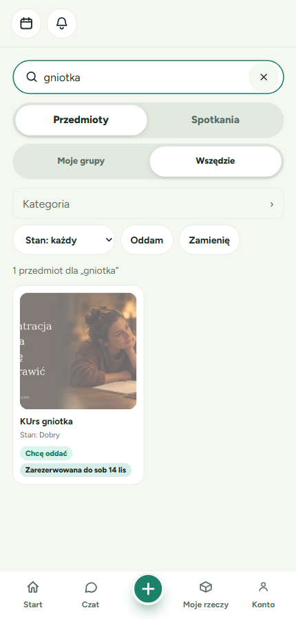

- **„Zarezerwowana”** (bez daty) — rzecz jest zarezerwowana do odbioru osobistego albo ktoś zaproponował za nią wymianę i właściciel jeszcze nie odpowiedział.

  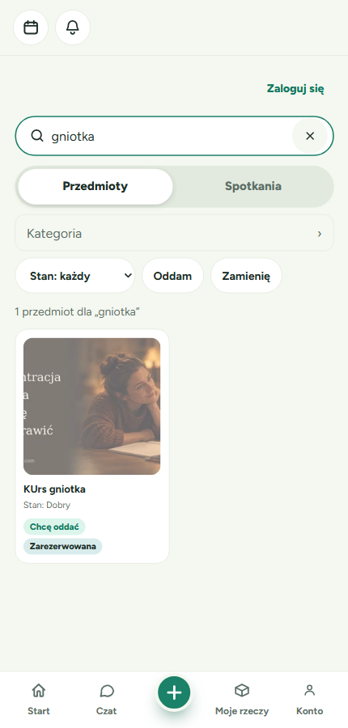

Zarezerwowane rzeczy są na liście **po** dostępnych. Pokazujemy je, bo rezerwacja może zostać odwołana. Możesz otworzyć taką rzecz i sprawdzić, co się z nią dzieje.

### Linia „… pasuje do …”

Pod wynikami (albo pod pustym wynikiem) jest linia, np. **„6 spotkań pasuje do „gra” →”**. Mówi ona, ile wyników ma druga zakładka dla tego samego słowa. Kliknij ją, żeby przejść do drugiej zakładki. Wpisane słowo zostanie.

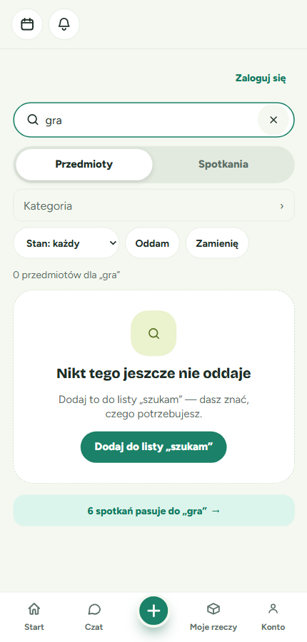

- Gdy w bieżącej zakładce nic nie ma, linia jest podświetlona, żeby łatwo ją było zauważyć.
- Gdy druga zakładka też nie ma wyników, linii nie ma.
- Liczba w linii nie uwzględnia filtrów, bo po przejściu do drugiej zakładki filtry się zerują.

### Gdy nic nie znaleziono

W zakładce **Przedmioty** zobaczysz kartę:
- „Nikt w Twoich grupach tego nie oddaje” (zakres Moje grupy) — możesz przełączyć się na „Wszędzie”,
- „Nikt tego jeszcze nie oddaje” (zakres Wszędzie lub gość).

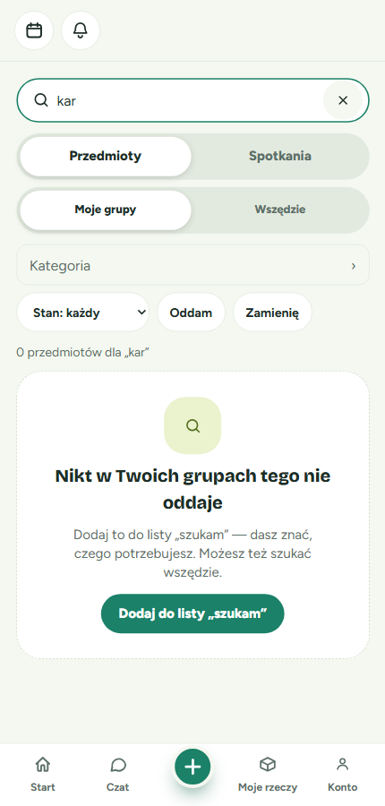

**Jak dodać rzecz do listy „szukam”**:

1. Kliknij **„Dodaj do listy „szukam””**.
2. Otworzy się formularz „Czego szukasz?” z **wpisanym już słowem** z wyszukiwarki. Możesz dopisać szczegóły, np. rozmiar, kolor albo stan.

   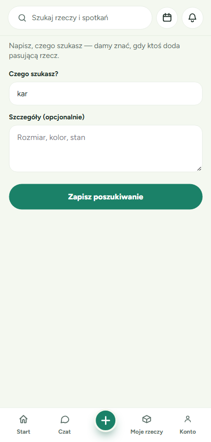

3. Kliknij **„Zapisz poszukiwanie”**.

W zakładce **Spotkania** zobaczysz „Nie znaleźliśmy spotkań” z podpowiedzią, żeby spróbować innego słowa albo zmienić daty.

### Gość czy zalogowany — czym się różni wyszukiwanie

| | Gość (bez logowania) | Zalogowany |
|---|---|---|
| Czy można szukać? | Tak | Tak |
| Przełącznik Moje grupy / Wszędzie | Nie ma, zawsze „Wszędzie” | Jest, na start „Moje grupy” |
| Przedmioty | Tylko publiczne | Publiczne oraz prywatne rzeczy osób z Twoich grup prywatnych |
| Terminy | Tylko grup publicznych | Też terminy Twoich grup prywatnych |
| Grupy | Tylko publiczne | Też Twoje grupy prywatne |
| Filtry (kategoria, stan, oddam/zamienię, daty) | Działają | Działają |

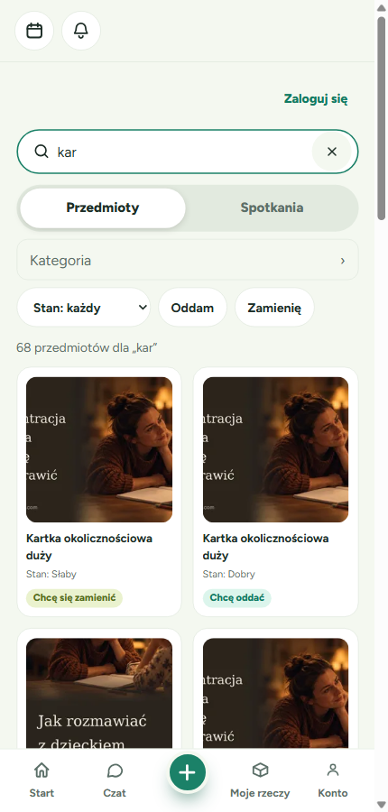

💡 **Wskazówka**: żeby zarezerwować rzecz albo zapisać się na spotkanie, musisz się zalogować. Kliknij „Zaloguj się” na górze ekranu.

---

## 2. Opis grupy

Opis pomaga innym zrozumieć, czym zajmuje się Twoja grupa, np. „Gramy w planszówki z dziećmi w każdy czwartek”. Dzięki opisowi grupę łatwiej też znaleźć, bo wyszukiwarka sprawdza również słowa z opisu.

**Kto może to zrobić**: organizator grupy.

### Jak dodać opis do nowej grupy

1. **Przejdź do listy grup**: kliknij **Konto** na dolnym pasku, a potem **Moje grupy**.

   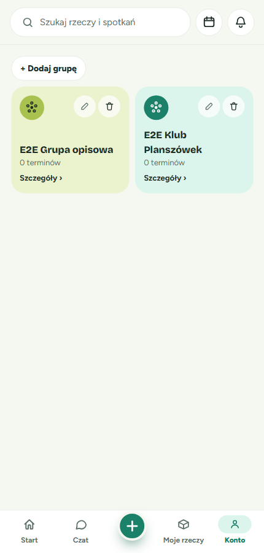

2. **Kliknij „+ Dodaj grupę”** (albo „+ Załóż grupę”, jeśli to Twoja pierwsza grupa).
3. **Wpisz nazwę grupy i opis** w polu **„Opis”** pod nazwą. Pod polem widać licznik znaków, np. „94 / 500”.

   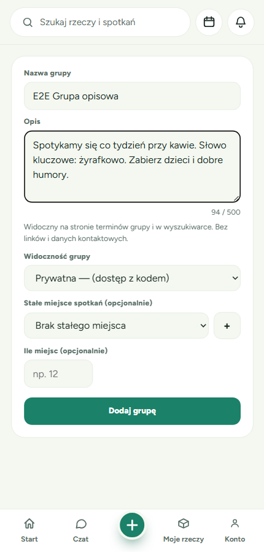

4. **Uzupełnij resztę pól** i kliknij **„Dodaj grupę”**.

📝 **Zasady dla opisu**:
- **Najwyżej 500 znaków**. Spacje na początku i końcu się nie liczą.
- **Bez linków i danych kontaktowych**: numerów telefonu, adresów e-mail i nazw komunikatorów. Do kontaktu służy czat w aplikacji.
- Treść musi być zgodna z zasadami społeczności.
- Opis jest opcjonalny. Grupa może go nie mieć.

### Jak zmienić albo usunąć opis

1. Na liście **Moje grupy** kliknij **ołówek** na karcie grupy.
2. W polu **„Opis”** zobaczysz obecny opis. Zmień go albo wyczyść pole, żeby usunąć opis.

   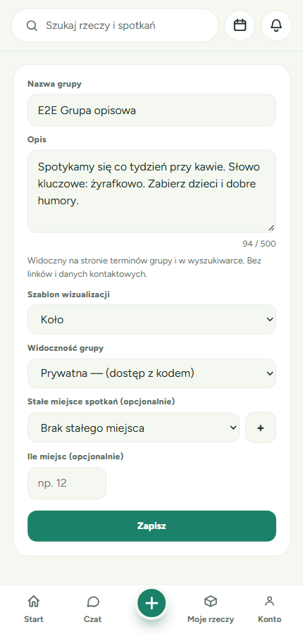

3. Kliknij **„Zapisz”**.

### Co się stanie, gdy opis nie spełnia zasad

- **Za długi opis** — licznik zrobi się czerwony (np. „520 / 500”), pojawi się komunikat „Opis może mieć najwyżej 500 znaków.”, a przycisk zapisu będzie nieaktywny, dopóki nie skrócisz tekstu.

  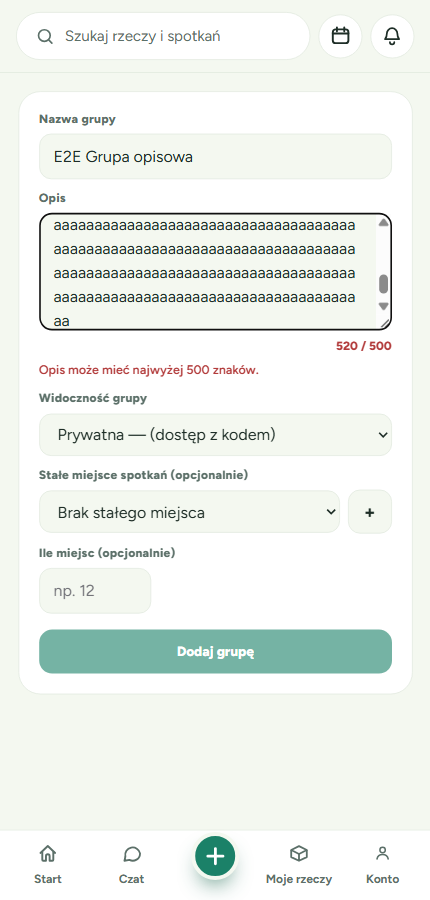

- **Dane kontaktowe w opisie** — po kliknięciu zapisu na górze formularza pojawi się czerwony komunikat, że nazwa i opis nie mogą zawierać danych kontaktowych. Usuń telefon, e-mail lub link i zapisz ponownie.

  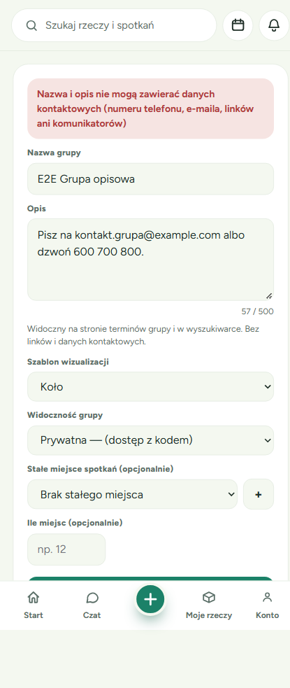

- **Treść niezgodna z zasadami** — zobaczysz komunikat „Opis grupy narusza zasady społeczności. Zmień go i spróbuj ponownie.”.

✅ W żadnym z tych przypadków nic się nie zapisuje. Twoja grupa zostaje taka, jaka była.

### Gdzie widać opis

- **Na stronie terminów grupy** — pełny opis jest pod nazwą grupy w nagłówku. Jeśli grupa nie ma opisu, nagłówek wygląda jak wcześniej.

  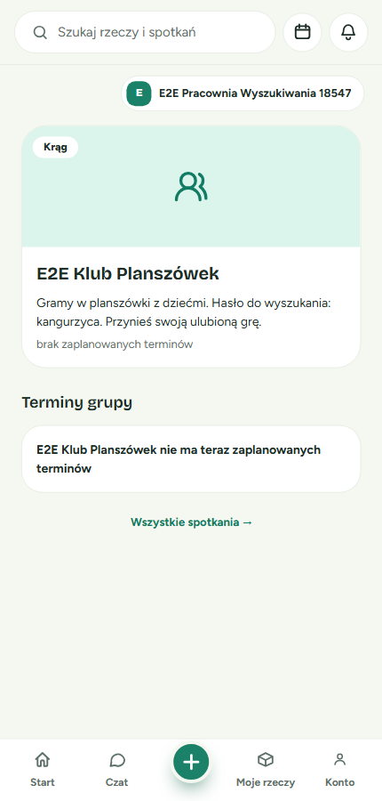

- **W wyszukiwarce** — na karcie grupy w zakładce Spotkania. Na karcie widać tylko pierwsze dwie linijki opisu. Grupę znajdziesz też po słowie, które jest tylko w opisie. Takie grupy są jednak na liście niżej niż grupy, które pasują nazwą.

  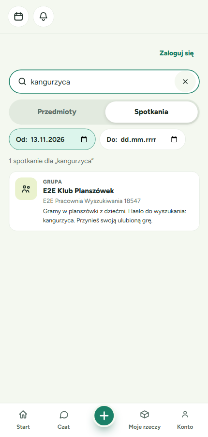

---

## 3. Najczęstsze pytania

**Dlaczego nie widzę czyjejś prywatnej rzeczy?**
Prywatne rzeczy widzą tylko osoby, które należą z właścicielem do tej samej **prywatnej** grupy (jako członek albo organizator). Prywatnej rzeczy nie zobaczysz, jeśli:
- nie jesteś zalogowany,
- należysz z właścicielem tylko do grupy publicznej,
- Wasza wspólna grupa została usunięta albo zmieniona z prywatnej na publiczną,
- jesteś tylko zapisany na pojedynczy termin grupy, ale nie jesteś jej członkiem.

Wyjątek: jeśli masz z właścicielem otwartą rezerwację tej rzeczy albo czekającą propozycję wymiany, rzecz zobaczysz nadal.

**Dlaczego nie widzę grupy, choć pasuje do mojego słowa?**
Grupa prowadzona przez osobę prywatną (nie przez organizację) i każda grupa prywatna pokazuje się w wynikach tylko wtedy, gdy ma **zaplanowany nadchodzący termin**. Karta prowadzi wtedy prosto do najbliższego spotkania („najbliższe spotkanie: … →”). Bez terminu nie byłoby dokąd przejść, więc takiej grupy nie pokazujemy. Grupy publiczne prowadzone przez organizację pokazują się zawsze. Prowadzą do strony z terminami grupy.

**Dlaczego nie widzę spotkania, które już trwa albo się odbyło?**
Wyszukiwarka pokazuje tylko nadchodzące spotkania. Wydarzenie, które już się zaczęło, znika z wyników.

**Widzę komunikat „Za dużo zapytań naraz. Odczekaj chwilę i spróbuj ponownie.” Co zrobić?**
Wyszukiwarka ogranicza liczbę zapytań wysyłanych w krótkim czasie z jednego miejsca. Odczekaj kilka sekund i wpisz słowo ponownie albo odśwież stronę. Zwykłe pisanie nie powinno wywoływać tego komunikatu, bo wyszukiwarka czeka, aż skończysz pisać.

**Dlaczego nie widzę swoich własnych rzeczy?**
Wyszukiwarka służy do szukania rzeczy innych osób. Swoje rzeczy znajdziesz w zakładce **„Moje rzeczy”** na dolnym pasku.

**Wpisałem jedną literę i nic się nie dzieje.**
Wpisz co najmniej 2 znaki.

---

## Powiązane funkcje
- **Moje rzeczy** — dodawanie i zarządzanie własnymi rzeczami.
- **Spotkania** (ikona kalendarza na górze) — Twoje nadchodzące spotkania.
- **Moje grupy** (Konto → Moje grupy) — zakładanie, edycja i usuwanie grup.
