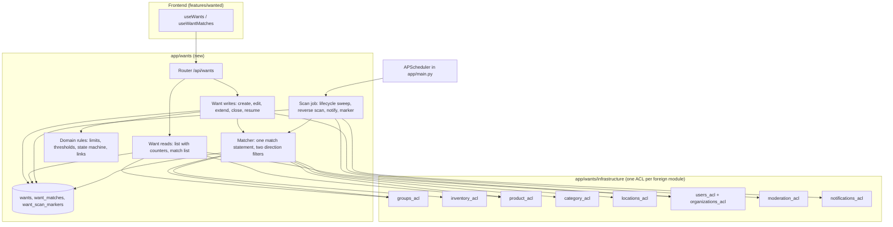
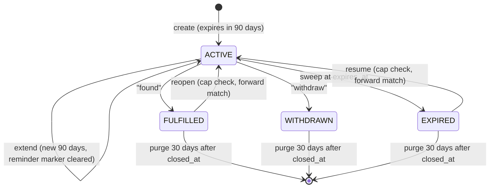

# High-Level Design: "Szukam" (wanted) mechanism

## TL;DR
- A new backend module `app/wants` (proposed name) owns three tables (`wants`, `want_matches`, `want_scan_markers`), the matcher, a scheduled scan and the `/api/wants` routes. It reaches every other module through its own ACL files and changes no listing write path.
- One SQL statement builder matches wants to items in both directions: once for a single want when it is created (matches shown at once, no notification), and every 15 minutes (proposed) for listings created since a time marker against all active wants.
- A match needs a text signal, passes the visibility rule, excludes own items and counts only items that can be taken now. Each (want, item) pair is stored once; the seeker gets at most one bell row per want per scan run, replaced while unread.
- Wants live 90 days, are closed by the seeker and are hard-deleted with their matches 30 days after closing. The exchange itself uses the existing take / propose flow.
- Known costs of the chosen approach: up to 15 minutes of delay, items that become takeable again are never matched, and delivery is in-app only.

## Key Decisions
- Private seeker alert in v1, anonymous owner signal as a designed second step — the first half has precedent and ready code (ADR-001, user).
- The want is the only standing-demand object; the name stays required — no second saved-search list (ADR-002, user).
- Name plus optional filters, a unique (want, item) match table, hard delete after retention — the pair table is the only deduplication the system has (ADR-003, user; columns proposed).
- New module `app/wants` with one ACL per foreign module, added to the boundary guard — the pattern the tests already enforce (ADR-004, user; name proposed).
- Periodic scan with a `created_at` marker on the listing row, 15-minute interval, 5-minute overlap — no change to the inventory or groups write paths (ADR-005, user; numbers proposed).
- One match statement for both directions — forward and reverse can never disagree about a pair (ADR-006, proposed).
- Text signal always required, category narrows and loosens, short words exact only — thresholds 0.70 / 0.60 are starting values to tune (ADR-007, user; numbers proposed).
- "Takeable" means AVAILABLE, no pending proposal and a live pickup place (ADR-008, user; definition proposed).
- Notifications written by the scan itself, the previous row replaced while unread through a pointer kept on the want (ADR-009, user; mechanism proposed).
- Lifecycle as a stored status with one sweep inside the scan job (ADR-010, user; mechanism proposed).
- Synchronous text checks and a database-count cap of 30 (ADR-011, user).
- Response through take / propose; the want is found by a lookup in the match table (ADR-012, user).
- Routes `/add/wanted`, `/wanted`, `/wanted/:id`; one hook; `/api/wants` for logged-in users only (ADR-013, user; API shape proposed).

## Open Questions / Risks
- Match quality on inflected Polish is unmeasured. The thresholds are guesses until the labelled sample is scored (section "Measurement plan").
- Scan cost is argued, not measured. The reverse direction has no text index; it relies on a small window of new listings and plain-column pre-filters.
- Items that become takeable after their listing time are missed: a released reservation, a PRIVATE item turned PUBLIC, a restored pickup place, an item edit. This is the accepted cost of the marker scan.
- In-app only: "Damy znać" reaches only users who come back. No e-mail or push exists.
- The bell shows the newest 50 rows. Up to 30 match rows per user (one per active want) can still push action prompts out of view.
- An image-only rollback breaks the bell while rows of the two new notification kinds exist; they must be deleted first (section "Migration and rollback").
- Two code facts are inferred from reading, not run: the group-sharing predicate with a column on both sides, and a generated `tsquery` column. Both are pre-implementation checks.
- All numbers marked "proposed" need the user's confirmation: module and table names, 15-minute interval, thresholds, the automatic extension, the reminder ignoring the per-want switch, hiding withdrawn wants.
- Legal review (Article 9 GDPR, Article 398 of the Polish Electronic Communications Law, DSA reporting) is still open and blocks the second step, not v1.

## Design Overview

A user who does not find an item today has no way to leave a standing request. The frontend already promises one ("Damy znać, gdy ktoś doda pasującą rzecz") in a mock at `/wanted` and `/add/hunting` that stores nothing. Seekers benefit first; owners benefit when the seeker takes or proposes a swap, through the notifications that exist.

The design is a **modular monolith extension**: a new bounded context, **`app/wants`**, beside the existing ones, with **one ACL per foreign module**. Matching is a **periodic set-based scan with a time marker**, modelled on `term_end_scan`, plus one **forward query at creation**. Every match is a row in a **unique (want, item) table**, which gives deduplication, the match list, the counter and the input for **grouped, replace-while-unread notifications**. The seeker completes the exchange through the **existing take / propose flow**; nothing is added to reservations.

**Key decisions:**
- Private want, seeker notified only; the owner signal is an extension point.
- One demand object: name required, category, offer mode, locality and radius optional, no condition.
- Scan every 15 minutes (proposed) over listings created since the marker; the scan run is the notification grouping window.
- One statement builder for both matching directions, with a constant statement count.
- Hard delete 30 days after closing; no `deleted_at` column.
- Logged-in-only API under `/api/wants`; no public route in v1.

### Who decided what
"User" means the Phase 4 decisions, which are binding. "Proposed" means a value or mechanism this design fills in because Phase 4 left it open; it must be confirmed before specification. Every proposal is listed again in section "Proposals to confirm".

### What was verified in code for this design
| Fact | Where | Result |
|---|---|---|
| The listing row has a creation time set once at insert | `src/backend/app/core/base_model.py:25-28,58-60`, `src/backend/app/groups/models.py:339-375` | Verified. `ItemListingPreference` is a `BaseEntity`; `created_at` is naive UTC, set at INSERT and never updated. |
| Re-listing creates a new row | `src/backend/app/groups/application/term_item_listings.py:167-195` | Verified. Clearing the mode deletes the row; listing again inserts a new one with a new `created_at`. A mode or visibility change updates the row and keeps `created_at`. |
| A marker by id is not possible | `src/backend/app/core/base_model.py:49-56` | Verified. Ids are `uuid4`, not ordered. The fallback after the time marker is 4.1C (outbox events), not an id marker. |
| A first listing needs a live place | `term_item_listings.py:176-177` | Verified. So nearly every listed item supports personal pickup. |
| The visibility predicate takes the viewer as a value | `src/backend/app/groups/infrastructure/visibility.py:41-59,91-108` | Verified. `group_ids_for` accepts a column (`membership.py:48-51`), so the two-column form is a signature widening, not new logic. Not run. |
| `parties_share_group` is not exported by the groups facade | `src/backend/app/groups/service.py` (grep) | Verified. `items_visible_to`, `owner_shares_group_with`, `with_pending_proposer`, `can_view_item` are exported. |
| New notification kinds need no migration | `src/backend/app/notifications/models.py:27-34,72-74` | Verified. Non-native `VARCHAR(30)`. `create_notification` returns nothing (`service.py:31-57`). |
| Pending actions react to two kinds only | `src/frontend/src/components/layout/pending/pendingActions.ts:55-77` | Verified. Any other kind yields no blocking sheet. |
| Query parameters survive the login redirect | `src/frontend/src/proxy.ts:46-48`, `src/frontend/src/auth/AuthGuard.tsx:32-40`, `src/frontend/src/utils/url.ts:16-24` | Verified by reading: both gates build `returnTo` from path plus query. Not tested; the registration path was not traced. |
| Scheduler and scan pattern | `src/backend/app/main.py:65-127`, `src/backend/app/groups/application/term_end_scan.py:1-19,48-56` | Verified. One `AsyncIOScheduler`, constant intervals, marker and writes in one commit. |

Everything else is taken from the findings files in `analysis/findings/` and cited as given there.

## Architecture

### System Context (C4 Level 1)

```
   +-----------------+                                  +------------------+
   |     Seeker      |                                  |    Item owner    |
   | (logged-in user)|                                  | (logged-in user) |
   +--------+--------+                                  +---------+--------+
            | HTTPS: saves a want, opens matches,                 | HTTPS: lists an item
            | takes or proposes a swap                            | (unchanged flow)
            v                                                     v
   +--------------------------------------------------------------------------+
   |                         aj platform (this system)                        |
   |  stores wants, matches them to listed items, writes in-app notifications |
   +--------------------------------------------------------------------------+
            ^                                                     |
            | HTTPS: empty search -> "Dodaj do listy szukam"      | in-app bell only
   +--------+--------+                                            v
   |      Guest      |                              (no e-mail, push or SMS channel:
   | (not logged in) |                               none exists; out of scope in v1)
   +-----------------+
```

- The seeker is the only person who reads a want or its matches.
- The owner is not told about a want in v1. The owner hears from the existing take / propose notifications.
- A guest can start from an empty search; the login gate carries the query and filters to the form.
- There is no external system. Text moderation runs inside the API process.

### Container Overview (C4 Level 2)

```
 +---------------------+   HTTPS    +-----------------+
 | Browser             +----------->| nginx :5174     |
 | Next.js client code |            +---+---------+---+
 | (features/wanted,   |                |         |
 |  bell, item page)   |        pages   |         |  /api/*
 +---------------------+                v         v
                          +----------------+   +--------------------------------------+
                          | web            |   | backend (FastAPI, one uvicorn process)|
                          | Next standalone|   |                                      |
                          | :3000          |   |  HTTP routers                        |
                          | routes /wanted,|   |   +-- /api/wants  (NEW, app/wants)   |
                          | /wanted/[id],  |   |   +-- existing routers               |
                          | /add/wanted    |   |                                      |
                          +----------------+   |  APScheduler (in process)            |
                                               |   +-- want scan, 15 min  (NEW)       |
                                               |   +-- term-end scan, media sweep     |
                                               |                                      |
                                               |  Text classifier (ONNX, in process)  |
                                               +------------------+-------------------+
                                                                  | SQL (asyncpg)
                                                                  v
                                               +--------------------------------------+
                                               | PostgreSQL 18                        |
                                               |  NEW: wants, want_matches,           |
                                               |       want_scan_markers              |
                                               |  READ: item_listing_preferences,     |
                                               |        inventory_items, products,    |
                                               |        categories, localities,       |
                                               |        locations, group tables       |
                                               |  WRITE: notifications (2 new kinds)  |
                                               +--------------------------------------+
```

| Container | Responsibility in this design |
|---|---|
| Browser / Next.js client | The want list, form and match list; counters; the closing prompt after a take. |
| web (Next standalone) | Serves the three panel routes; no server-side reads for wants (client-only panel). |
| backend API | `/api/wants` routes: validation, moderation, cap, forward match, reads. |
| backend scheduler job | Lifecycle sweep, reverse scan, notification writes, marker update, one commit. |
| PostgreSQL 18 | Stores wants and matches; runs the match statement with `fold_pl()`, `pg_trgm` and the existing `products.search_vector`. No new extension. |

### Component view of `app/wants` (Mermaid)

The caller asked for a component view of the new module. It shows logical components, not files.



## Key Components

| Component | Purpose | Responsibilities | Reuses or touches (existing code) | ACL it needs |
|---|---|---|---|---|
| Router `/api/wants` | HTTP surface for the seeker | Routes in section "API surface"; resolves the caller's party; maps errors to 400 / 404 / 409 / 503 | Registered in `src/backend/app/main.py:155-173`; new rows in `src/backend/app/core/authorization_matrix.py` | `users_acl` (profile by principal) |
| Want writes | Create and change a want | Validate lengths and filters; contact-info rule, then classifier; cap of 30 counted in the same transaction; set expiry; run the forward match | `ensure_no_contact_info` (`src/backend/app/moderation/rules.py:11-36`), `check_text` with two new `TextField` members (`src/backend/app/moderation/text_guard.py:23-71,89-120`) | `moderation_acl`, `category_acl` (category exists), `locations_acl` (locality exists) |
| Matcher | Decide which (want, item) pairs match | Build one statement with all predicates; take a direction filter; insert pairs with `ON CONFLICT DO NOTHING`; keep the 20 best per want | Same recipe as `src/backend/app/search/application/search.py:183-269,272-319`, as its own copy because `app.search` may not be imported (`src/backend/tests/test_module_boundaries.py:17,54-97`) | `groups_acl`, `inventory_acl`, `product_acl`, `category_acl`, `locations_acl` |
| Scan job | Periodic work in one transaction | Expire, remind, purge; reverse scan since the marker; write notifications; advance the marker; commit once | Pattern of `src/backend/app/groups/application/term_end_scan.py`; one more `add_job` in `src/backend/app/main.py:120-127` | `notifications_acl`, `users_acl`, `organizations_acl`, `product_acl` |
| Want reads | List and match list | The seeker's wants with `match_count` and `new_match_count`; the match list as item cards, filtered by current visibility and listing state | Card inputs as in `search.py:355-394` (organization batch, first approved photo batch); frontend `ItemCard` | `groups_acl`, `inventory_acl`, `product_acl`, `organizations_acl`, `users_acl` |
| Domain rules | Pure values and functions | Limits (3–80, 300, 30, 20, 90 / 7 / 30 days), thresholds, allowed state transitions, the item and want link builders | Link shape of `src/backend/app/groups/application/item_links.py:19-25`; a copy pinned by a parity test, as `tests/test_module_boundaries.py:100-111` does for search | none |
| Storage | Tables of the module | `wants`, `want_matches`, `want_scan_markers` | `BaseEntity` (`src/backend/app/core/base_model.py`), `fold_pl()` (migration 0087) | none |
| Frontend feature | The seeker's screens | List, form, match list, closing prompt, counters | Replaces `features/search/WantedView.tsx` and `features/add/HuntingCreateView.tsx`; reuses `CategoryTreePicker`, `LocalityCombobox`, `ItemCard`, `ModalSheet`, `ConfirmDeleteDialog` | — |

### ACL contents

Each file is the only place in `app/wants` that imports that module, and none imports `..schemas`, as in `search/infrastructure/*_acl.py`.

| ACL | Names it exposes | Change needed in the foreign module |
|---|---|---|
| `groups_acl` | `ItemListingPreference`, `ItemVisibility`, `items_visible_to`, `owner_shares_group_with`, `with_pending_proposer`, `VisibilityScope` | Widen the `viewer` / `other_party` parameter of `owner_shares_group_with` and `parties_share_group` to accept a column (`visibility.py:41-59`). No behaviour change for existing callers. |
| `inventory_acl` | `listed_items_with_product_select`, `InventoryItem`, `BalanceStatus`, the open-reservation read for "reserved by me" | None expected; names are already on `app.inventory.service`. |
| `product_acl` | `Product`, `first_approved_photo_by_product` | None. |
| `category_acl` | `Category` | None. |
| `locations_acl` | `Locality`, `Location` | None. |
| `users_acl`, `organizations_acl` | profile by principal, party to account user, own organization slug, `derive_party_slug` | None expected; verify the batch reads exist. |
| `moderation_acl` | `check_text`, `TextField`, `ensure_no_contact_info` | Add `WANT_NAME` and `WANT_NOTE` with their Polish messages. |
| `notifications_acl` | `create_notification`, the new replace-while-unread writer, `NotificationKind` | Add two kinds and one service function (section "Notification design"). |

## Data model

All tables use `BaseEntity`: a UUID `id` with `gen_random_uuid()` server default, `created_at` and `updated_at` as naive UTC, `updated_at` as the version column. Names follow `pk_`, `fk_<table>_<col>_<ref>`, `ix_`, `uq_`, `ck_`. All time columns below are naive UTC written with `datetime.utcnow()`: they are deadlines and audit marks, not wall-clock appointments, so the Europe/Warsaw domain clock is not involved. User-facing dates are formatted on the client; notification texts avoid dates ("za 7 dni").

### `wants`

| Column | Type | Null | Notes |
|---|---|---|---|
| `seeker_party_id` | UUID | no | FK `parties.id` (`fk_wants_seeker_party_id_parties`). Plain FK-id column, no `relationship()`. |
| `name` | VARCHAR(80) | no | 3–80 code points after trim. |
| `note` | VARCHAR(300) | yes | Not matched; shown to the seeker only. |
| `category_id` | UUID | yes | FK `categories.id` ON DELETE SET NULL. Any node, not only a leaf. |
| `offer_mode` | VARCHAR(20) | yes | `GIFT` or `SWAP`; null means both. Plain string, as `ItemListingPreference.mode`. |
| `locality_id` | VARCHAR(7) | yes | FK `localities.id` ON DELETE RESTRICT. |
| `radius_km` | SMALLINT | yes | 0–100, only with a locality. |
| `notifications_enabled` | BOOLEAN | no | Default true. The per-want switch. |
| `status` | VARCHAR(20) | no | String-backed enum: `ACTIVE`, `FULFILLED`, `WITHDRAWN`, `EXPIRED`. |
| `expires_at` | TIMESTAMP | no | Creation, extension or resumption time plus 90 days. |
| `closed_at` | TIMESTAMP | yes | Set when the want leaves `ACTIVE`; starts the 30-day retention. |
| `reminded_at` | TIMESTAMP | yes | Marker of the 7-day reminder; cleared on extension. |
| `name_folded` | TEXT, generated stored | no | `fold_pl(name)`. |
| `name_query` | TSQUERY, generated stored | no | `plainto_tsquery('simple', fold_pl(name))`: all words. |
| `short_words_query` | TSQUERY | yes | The words of up to 3 characters as an all-words query; null when there are none. Written by the application with the name. |
| `match_notification_id` | UUID | yes | Loose pointer (no FK) to the newest match notification of this want. |
| `match_notification_count` | INTEGER | no | Default 0. The count shown in that row. |

Constraints and indexes:
- `ck_wants_radius_requires_locality`: `radius_km IS NULL OR (locality_id IS NOT NULL AND radius_km BETWEEN 0 AND 100)`.
- `ck_wants_closed_at_matches_status`: `(status = 'ACTIVE') = (closed_at IS NULL)`.
- `ix_wants_seeker_party_id_status` on `(seeker_party_id, status)`: the list and the cap count.
- `ix_wants_active_expires_at` on `(expires_at)` where `status = 'ACTIVE'`: scan and sweep.
- `ix_wants_closed_at` on `(closed_at)` where `status <> 'ACTIVE'`: the purge.
- No text index on the want side. The reverse direction cannot use one (`<%` is indexable only with the long text in the column); see "Measurement plan".

### `want_matches`

| Column | Type | Null | Notes |
|---|---|---|---|
| `want_id` | UUID | no | FK `wants.id` ON DELETE CASCADE (`fk_want_matches_want_id_wants`); same module. |
| `item_id` | UUID | no | Loose pointer to an inventory item, no FK, as `ItemListingPreference.item_id`. |
| `source` | VARCHAR(10) | no | `FORWARD` (found when the want was created, edited or resumed) or `SCAN`. |
| `score` | REAL | no | The text score at match time; orders the top 20 and feeds threshold tuning. |
| `seen_at` | TIMESTAMP | yes | Null means new. `FORWARD` rows are born seen. |
| `opened_at` | TIMESTAMP | yes | First open of the item from the match list; measurement only. |

Constraints and indexes:
- `uq_want_matches_want_id_item_id`: the deduplication key and the list index.
- `ix_want_matches_item_id`: the lookup "which of my wants matched this item" and the later owner signal.

### `want_scan_markers`

One row per scan name (v1 has one, `listings`): `scan_name` VARCHAR(30) with `uq_want_scan_markers_scan_name`, and `scanned_through` TIMESTAMP (naive UTC). The scan creates the row on its first run, so no seed migration is needed. Because `updated_at` is the version column, two scheduler instances that race on the row make the second run fail and roll back as a whole.

### Hard delete, not soft delete

Closed wants are **hard-deleted** with their matches 30 days after `closed_at`. Reasons: the user's retention decision asks for deletion; a want is personal text with no ledger link, so nothing needs the row afterwards; nothing outside the module references it by FK. During the 30 days the `status` column is the soft state, so there is no `deleted_at` column and no partial unique index. Notification rows that point at a purged want keep their text; their link opens the not-found page of `/wanted/:id`, which links back to the list.

### Migration and rollback

- One schema revision (next free number, after 0098) creates the three tables with `SET LOCAL lock_timeout = '5s'`, because the foreign keys take locks on `parties`, `categories` and `localities`. No data revision.
- Downgrade drops `want_matches`, `want_scan_markers`, `wants` in that order. It is lossy (all wants are lost) and unguarded: no ledger row depends on a want.
- The downgrade, and any image-only rollback, must first delete `notifications` rows of the two new kinds. The kind column is a non-native enum, so old code fails to load a row whose kind it does not know (precedent: migration 0063 deleted rows of a removed kind). This belongs in the runbook in `architecture.md`.
- A downgrade-then-upgrade test per the migration standard, which also proves the generated `tsquery` column.

## Matching design

### One statement, two direction filters

Forward and reverse matching are the same statement with a different filter. This keeps the predicates in one place and guarantees that a pair matches the same way in both directions.

```sql
-- illustrative shape, not final SQL
INSERT INTO want_matches (want_id, item_id, score, source, seen_at)
SELECT want_id, item_id, score, :source, :seen_at
FROM (
  SELECT w.id AS want_id, l.item_id, <score> AS score,
         row_number() OVER (PARTITION BY w.id ORDER BY <score> DESC, l.created_at DESC) AS rn
  FROM wants w
  JOIN item_listing_preferences l ON l.owner_party_id <> w.seeker_party_id      -- own items excluded
  JOIN <listed items: live, balance AVAILABLE, no pending proposal> i ON i.item_id = l.item_id
  JOIN products p            ON p.id = i.product_id
  JOIN inventory_items ii    ON ii.id = l.item_id
  JOIN locations loc         ON loc.id = ii.location_id AND loc.deleted_at IS NULL   -- live place
  JOIN localities il         ON il.id = loc.locality_id
  LEFT JOIN localities wl    ON wl.id = w.locality_id
  WHERE w.status = 'ACTIVE' AND w.expires_at > :now
    AND <direction filter>
    AND ( l.visibility = 'PUBLIC'
          OR (l.visibility = 'PRIVATE' AND <owner and seeker share a live PRIVATE group>) )
    AND (w.offer_mode  IS NULL OR l.mode = w.offer_mode)
    AND (w.category_id IS NULL OR <p.category_id is w.category_id or a descendant>)
    AND (w.locality_id IS NULL OR il.id = w.locality_id
         OR <haversine(wl point, il point) <= w.radius_km>)
    AND ( p.search_vector @@ w.name_query
          OR ( word_similarity(w.name_folded, fold_pl(p.name))
                 >= CASE WHEN w.category_id IS NULL THEN :strict ELSE :loose END
               AND (w.short_words_query IS NULL OR p.search_vector @@ w.short_words_query) ) )
) ranked
WHERE rn <= 20
ON CONFLICT (want_id, item_id) DO NOTHING
RETURNING want_id, item_id;
```

| Direction | Filter | Source | `seen_at` | Notification |
|---|---|---|---|---|
| Forward (create, edit of a matching field, resume, reopen) | `w.id = :want_id` | `FORWARD` | now | none |
| Reverse (scan) | `l.created_at > :marker - overlap AND l.created_at <= :now` | `SCAN` | null | grouped, per want |

### Predicates

| Predicate | Rule | Source of the rule |
|---|---|---|
| Text | Always required. Either all words of the want are found by full text in the item's name or description, or the folded names are trigram-similar at or above the threshold. | User, 4.2A modified |
| Short words | Words of up to 3 characters never match by trigram. In the trigram branch each of them must be present as an exact token. | User |
| Threshold | Strict without a category, looser with one. Starting values 0.70 and 0.60 (0.60 is what search itself uses through `<%`). | User for the rule; numbers proposed |
| Category | If set, the item's leaf category must be the want's node or below it. It narrows (AND); it is never a match on its own. | User |
| Offer mode | If set, equals the listing mode. | User, 3.1B |
| Locality and radius | If set, the item's place is in the same locality or within the radius by haversine over locality points. Without a point on either side the rule falls back to "same locality" (21 of 54,440 localities). | User, 3.1B; findings |
| Visibility | PUBLIC, or PRIVATE with a live PRIVATE group shared by owner and seeker. PRIVATE inclusion is explicit, per the safe-by-default standard. | Standard `backend/models.md`; `visibility.py:91-108` |
| Takeability | Balance `AVAILABLE`, no pending swap proposal, and a live pickup place on the item. | User 4.3B; definition proposed (ADR-008) |
| Own items | The owner is not the seeker. | Fixed by evidence |
| Limit | The 20 best pairs per want per run, by score then newest listing. | User, area 7 |

Notes on the predicates:
- The category rule in a set-based statement needs "ancestors of the item's category", not "descendants of one node". A recursive closure over `categories` (about 2,300 nodes) computed once per statement gives it. Search's `_category_subtree` handles one node only and is private.
- The radius rule needs the radius and the origin as columns. Search's `_near` binds them as Python values (`search.py:183-196`), so the module holds its own column form of the same formula.
- The group-sharing rule needs a column on both sides (owner and seeker). See the ACL table.
- Condition is not a want field, by decision.

### The reverse scan, its marker and idempotency

1. The job reads the marker row. `scanned_through` is the start time of the last successful run.
2. The window is listings with `created_at` after `scanned_through` minus a 5-minute overlap, up to now. The overlap covers listings whose transaction committed after the previous scan read: `created_at` is assigned at INSERT, and the commit comes later.
3. The statement inserts new pairs. A pair already stored is skipped by the unique key, so the overlap, a retry or a second process never produces a second row or a second notification.
4. Notifications, the want updates and the new marker value are written in the same transaction and committed once, as in `term_end_scan`.
5. After downtime the window is simply longer. The cap of 20 per want bounds the result.
6. First run: no marker row means the window starts one interval back.

What the marker scan does not see, by design:
- An item whose reservation was released, or whose pending proposal was rejected.
- An item changed from PRIVATE to PUBLIC, or whose offer mode changed (the row is updated, not re-created).
- An item whose product name, description, category or place was edited.
- A seeker who joined a group that reveals PRIVATE items.
- A pair that fell outside the top 20 in its run.

These pairs appear only if the item is unlisted and listed again, or the seeker edits or resumes the want (which re-runs the forward query).

### Forward match at creation

Runs in the create request, after the want row is inserted, in the same transaction, under `SET LOCAL statement_timeout = '3s'` as search does. Its rows are stored as seen, so they are listed at once on `/wanted/:id` and raise no counter and no notification. A timeout fails the request with 503 and nothing is saved.

Editing the name, category, offer mode, locality or radius is treated as a new search (proposed): the want's match rows are deleted and the forward query runs again. Editing the note or the switch changes nothing else.

### Read-time checks

A stored pair can go stale. The match list therefore joins the pairs to the current listing state in the same read: the item must still be listed and visible to the seeker (`items_visible_to` with the seeker as the viewer, the forward form that exists). Items that are gone are left out; reserved items are shown as reserved, after available ones, with a "reserved by me" flag. The item page and take / propose already re-check with `can_view_item`, so a stale link is a 404, never a leak.

### Statement-count discipline

- Create: a fixed number of statements (cap count, category and locality checks, insert, forward match).
- Scan run: a fixed number whatever the number of wants, listings or matches (target: at most 16). Per-want work uses set statements or one multi-row write, never a loop of reads.
- List and match list: fixed, with batches for organizations and photos as in search.
- Each is pinned by a `count_queries` test with one and with several rows, per the backend testing standard.

## Notification design

### New kinds

| Kind | Recipient | When | Link |
|---|---|---|---|
| `WANT_MATCH_FOUND` | the seeker | a scan run stored at least one new pair for a want with the switch on | one match: the item page; two or more: `/wanted/:id` |
| `WANT_EXPIRING` | the seeker | 7 days before `expires_at`, once per period | `/wanted/:id` |

Both fit `VARCHAR(30)` and need no migration. The backend enum and the frontend `NotificationKind` union both grow by two.

### At most one row per want per run, replaced while unread

For each want with new pairs in a run:
- If `match_notification_id` points at a row that is still unread, that row is replaced in place: the count becomes the stored count plus the new pairs, the message and link are rebuilt, and its time moves to now so it sorts first.
- Otherwise a new row is written with the count of this run, and the pointer and count on the want are set.
- Count 1: the message names the item and links straight to it. Count 2 or more: the message gives the count and links to the want's match list.

Illustrative texts (final wording in specification), passed through `clock.fit_notification_message`:
- "Szukasz: «rowerek biegowy». Ktoś wystawił: «Rowerek biegowy Puky»."
- "Szukasz: «rowerek biegowy». 3 nowe pasujące rzeczy."

The scan writes these rows directly through `notifications_acl`, in its own transaction. The outbox is not used: the scan already runs outside any request, the outbox would add up to 60 seconds, and the replace rule needs the id of the written row. `app.notifications` gains one writer that replaces an unread row or creates a new one and returns its id; the wording stays with the producer, as on the existing synchronous path (`groups/infrastructure/notifications_bridge.py`).

### Staying out of pending actions

`derivePendingActions` builds blocking sheets from `SWAP_PROPOSED` and `TERM_CONFIRMATION_NEEDED` only. The new kinds are informational by default. A test row pins that they produce no pending action.

### The counter

- `new_match_count` of a want is the number of its pairs with `seen_at IS NULL`. The list endpoint returns it per want; the "Konto" row and the `/add` tile show the sum.
- Opening `/wanted/:id` calls `POST /api/wants/{id}/matches/seen`, which sets `seen_at` on the want's pairs. A POST is used because GET requests must stay free of side effects (security standard, cookie auth on GET).
- The counter and the bell row are independent: reading the bell does not reset the counter, and opening the list does not mark the bell row read.

### Known gap

There is no e-mail or push. A seeker who does not return never learns of a match. The bell keeps the newest 50 rows; one row per want limits the pressure but does not remove it.

## Lifecycle and retention



- Only `ACTIVE` wants with `expires_at` in the future are matched. A closed want drops out of the scan at once.
- Extending keeps the want and its matches. Resuming and reopening keep the stored matches, set a new 90-day period and run the forward query for what was listed meanwhile.
- The cap of 30 active wants applies to create, resume and reopen.
- Closing prompt: after the seeker takes an item or has an agreed swap for an item in a want's match list, the interface offers "Zamknij poszukiwanie" or "Szukam dalej". The want is found by a lookup in `want_matches`; reservations carry no origin field.
- Withdrawn wants are kept for the 30 days and hidden from the list (proposed): withdrawing is the seeker's delete.
- Automatic extension (optional in the user's decision, proposed as on): when the seeker opens the match list of a want in its last 30 days, the period is renewed. It is done in the same POST that resets the counter.

### The sweep

The sweep is the first part of the scan job, in the same transaction, a fixed number of statements:
1. Expire: `ACTIVE` wants with `expires_at` in the past become `EXPIRED`, `closed_at = expires_at`.
2. Remind: `ACTIVE` wants within 7 days of `expires_at` and with `reminded_at` null get a `WANT_EXPIRING` row and the marker. The reminder ignores the per-want switch (proposed), because the switch is about match alerts and a muted want should not vanish silently.
3. Purge: wants with `closed_at` older than 30 days are deleted; their matches cascade.

## API surface

All routes need a logged-in user. A want that is not the caller's is a 404, never a 403, so its existence is not revealed.

| Route | Purpose | Permission |
|---|---|---|
| `GET /api/wants` | The caller's wants (`ACTIVE`, `EXPIRED`, `FULFILLED`) with `match_count` and `new_match_count`. Optional `matched_item_id` returns only active wants that hold this item as a match (the closing prompt). | READ |
| `POST /api/wants` | Create; runs the forward match; returns the want. | EDIT |
| `GET /api/wants/{id}` | One want. | READ |
| `PATCH /api/wants/{id}` | Edit name, note, filters, switch. | EDIT |
| `POST /api/wants/{id}/extend` | New 90-day period. | EDIT |
| `POST /api/wants/{id}/close` | Body `outcome`: `FULFILLED` or `WITHDRAWN`. | EDIT |
| `POST /api/wants/{id}/resume` | `EXPIRED` or `FULFILLED` back to `ACTIVE`. | EDIT |
| `GET /api/wants/{id}/matches` | Item cards in the search result shape, with `is_new`, `reserved`, `reserved_by_me`. | READ |
| `POST /api/wants/{id}/matches/seen` | Reset the counter; automatic extension. | EDIT |
| `POST /api/wants/{id}/matches/{item_id}/opened` | Record the first open of a matched item (measurement). | EDIT |

- Authorization matrix: two rows, `GET ^/api/wants(/.*)?$` → READ and `POST|PATCH ^/api/wants(/.*)?$` → EDIT, enforced per route with `Depends(require_any(...))`. Proposed without the OAuth `mcp:*` scopes, as for conversations: a want list is private.
- Errors: validation 400 (not 422); contact details 400 with the existing message; classifier rejection 400; classifier outage 503; the cap and illegal transitions 409 with a Polish message; forward-match timeout 503.
- Cache headers: there is no public route, so `set_personalised_cache_headers` is not used. The routes behave like `/api/notifications`. If a wants read is ever served under `/api/public/`, the personalised-cache rule applies.
- No DELETE route: withdrawing is the delete.

## Frontend structure

| Piece | Design | Reuses or touches |
|---|---|---|
| Routes | `/wanted` (list), `/wanted/[id]` (match list, new), `/wanted/[id]/edit` (form), `/add/wanted` (form; renamed from `/add/hunting`). Thin client route files in the `(panel)` group. | `src/frontend/src/app/(site)/(panel)/wanted/`, `.../add/hunting/` (renamed); `routing/paths.ts` (`View`, `PROTECTED_PREFIXES`); route manifest tests |
| Feature folder | `src/features/wanted/`: list view, form view, match list view, closing prompt, and one `resolve…View()` per page in a `*ViewState.ts`, table-tested. | Moves `features/search/WantedView.tsx` and `features/add/HuntingCreateView.tsx`; removes `MOCK_WANTS` from `utils/mocks.ts` |
| API and hooks | `api/wants.ts`; `hooks/useWants.ts` as the one source for the list, the counts and the form's mutations (prefix key, stable empty fallback, `await invalidateQueries` on the prefix); `useWantMatches(id)` under the same prefix for one want's matches. | Pattern of `hooks/useNeededItems.ts:16-50`; data-fetching standard |
| Form | Name visible; category, offer mode, locality and radius under "Doprecyzuj", expanded and filled when the user arrives from search. Note field up to 300. Inline Polish errors, `aria-disabled` on the blocked submit. | `CategoryTreePicker` with `mode="any"`; `LocalityCombobox`; the radius chips and offer-mode chips extracted from `features/search/SearchFilters.tsx` into shared components |
| After save | Navigate with `replace` to `/wanted/:id`, where the existing matches are listed. | routing facade |
| Match list | Item cards; "new" marker; closing prompt when an item is reserved by the seeker; actions extend, found, withdraw; resume on an expired want. Opening the page calls the "seen" POST. | `components/shared/ItemCard.tsx`; `ConfirmDeleteDialog` for withdraw; `ModalSheet` for the prompt, registered with `useRegisterOpenSheet` |
| Entry points | `/add` tile to `/add/wanted` with the new-match count; "Konto" row to `/wanted` with real counts; empty-search prompt carrying `q`, category, offer mode, locality and radius. | `features/add/AddView.tsx:75-82`; `features/account/AccountView.tsx:42-46`; `features/search/SearchView.tsx:260-281` |
| Closing prompt after a take | After a successful take or proposal the item page asks `GET /api/wants?matched_item_id=`; if a want is returned it offers to close it. | `features/product/useItemTake.ts`, `TakeSuccessSheet.tsx` |
| Bell | No change in behaviour; the kind union grows by two. | `api/notifications.ts:3-15` |

The empty-search prompt drops the condition and scope filters: a want has neither.

## Data Flow

1. **Create.** Form → `POST /api/wants` → length and filter validation → contact-info rule → classifier → cap count → insert → forward match → commit → the client opens `/wanted/:id` and reads the matches.
2. **A new listing.** The owner lists an item through the unchanged flow; the listing row gets its `created_at`. Nothing else happens in that request.
3. **Scan run.** Sweep → read marker → reverse match insert → for wants with new pairs and the switch on: build the text, replace or create the bell row, update the pointer → write the marker → commit.
4. **The seeker returns.** The bell row, the tile and the "Konto" row show the news → the match list opens, the counter resets → the item page → take or propose (existing) → the owner is notified by the existing kinds → the closing prompt.
5. **End of life.** Reminder at 83 days → extension or expiry at 90 → purge 30 days after closing.

## Integration Points

| # | Existing part | Kind of contact | Change |
|---|---|---|---|
| 1 | `app/main.py` | wiring | Include the wants router; add the scan job to the scheduler. |
| 2 | `app/core/authorization_matrix.py` | permission rows | Two rows for `/api/wants`. |
| 3 | `app/groups` (visibility, listing rows, pending proposals) | read through `groups_acl` | Widen one parameter type; export what the ACL needs. No write path changes. |
| 4 | `app/inventory` (listed items, balance, item place, open reservations) | read through `inventory_acl` | None expected. |
| 5 | `app/product`, `app/category`, `app/locations` | read through ACLs | None. |
| 6 | `app/moderation` | call through `moderation_acl` | Two `TextField` members and messages. |
| 7 | `app/notifications` | write through `notifications_acl` | Two kinds; one replace-or-create writer. |
| 8 | `app/users`, `app/organizations` | read through ACLs | None expected (party resolution, slug for links). |
| 9 | `tests/test_module_boundaries.py` | guard | Add `wants` to the guarded modules; add the link parity test. |
| 10 | Frontend routing, add hub, account, search empty state, item take flow, notification types | UI | As in "Frontend structure". |
| 11 | `.maister/docs/project/architecture.md` | documentation | New module, tables, runbook entry for the rollback rule. |

`app/search`, the listing write paths (`register_item`, `set_item_listing_preference`), reservations, messaging and needed items are not changed.

## Design Decisions

| ADR | Decision | Decided by |
|---|---|---|
| [ADR-001](decision-log.md#adr-001-private-seeker-alert-first-owner-signal-second) | Private seeker alert first, owner signal second | User |
| [ADR-002](decision-log.md#adr-002-the-want-is-the-single-standing-demand-object) | The want is the single standing-demand object | User |
| [ADR-003](decision-log.md#adr-003-want-and-match-tables-hard-delete-after-retention) | Want and match tables; hard delete after retention | User; columns and hard delete proposed |
| [ADR-004](decision-log.md#adr-004-new-module-appwants-with-its-own-acls) | New module `app/wants` with its own ACLs | User; name and guard proposed |
| [ADR-005](decision-log.md#adr-005-periodic-scan-with-a-creation-time-marker) | Periodic scan with a creation-time marker | User; interval, overlap, marker table proposed |
| [ADR-006](decision-log.md#adr-006-one-match-statement-for-both-directions) | One match statement for both directions | Proposed |
| [ADR-007](decision-log.md#adr-007-text-matching-rules-and-starting-thresholds) | Text matching rules and starting thresholds | User; numbers proposed |
| [ADR-008](decision-log.md#adr-008-what-takeable-means-at-match-time) | What "takeable" means at match time | User; definition proposed |
| [ADR-009](decision-log.md#adr-009-grouped-notifications-replaced-while-unread) | Grouped notifications, replaced while unread | User; mechanism proposed |
| [ADR-010](decision-log.md#adr-010-lifecycle-as-a-stored-status-with-a-sweep-in-the-scan-job) | Lifecycle as a stored status with a sweep in the scan job | User; mechanism proposed |
| [ADR-011](decision-log.md#adr-011-synchronous-text-checks-and-database-count-limits) | Synchronous text checks and database-count limits | User |
| [ADR-012](decision-log.md#adr-012-response-through-take-and-propose-want-found-by-lookup) | Response through take and propose; want found by lookup | User |
| [ADR-013](decision-log.md#adr-013-entry-points-routes-and-a-logged-in-only-api) | Entry points, routes and a logged-in-only API | User; API shape proposed |

## Concrete Examples

**1. A want with existing matches.**
Given two public, available items named "Rowerek biegowy Puky" and "Rowerek biegowy drewniany" with live places, owned by other users,
when a logged-in user saves a want "rowerek biegowy" from the add tile,
then the response is 201, the user lands on `/wanted/:id` and sees both items, the counter is 0, and no notification is written.

**2. A new listing found by the scan.**
Given an active want "kurtka zimowa 110" with category "Kurtki dziecięce", the switch on and no unread match row,
when another user lists "Kurtka zimowa Reima 110" in a leaf under that category and the next scan runs,
then one `want_matches` row exists, the seeker has one `WANT_MATCH_FOUND` row naming the item and linking to its page, and `new_match_count` is 1.
When a second matching item is listed before the seeker reads the bell, then the same row now says "2 nowe pasujące rzeczy" and links to `/wanted/:id`, and there is still one row.

**3. Items that must not match.**
Given an active want "fotelik samochodowy",
when the scan sees (a) the seeker's own listed car seat, (b) a PRIVATE car seat of an owner who shares no private group with the seeker, (c) a car seat reserved by someone else, (d) "Fotel biurowy" listed in another category branch,
then no pair is stored for (a), (b) and (c); (d) is stored only if its name similarity reaches the strict threshold, which the labelled sample must show it does not.

**4. Short words.**
Given a want "TV LG 43",
when "Telewizor LG 43 cale" and "Telewizor Samsung 50" are listed,
then neither matches by trigram alone; the first matches only if "tv", "lg" and "43" are all present as exact tokens, so it does not match either ("tv" is missing). This is the stated cost of the exact-only rule for short words and a case for the labelled sample.

**5. Closing after a take.**
Given a want whose match list holds item X,
when the seeker reserves X on the item page,
then the page offers "Zamknij poszukiwanie" and "Szukam dalej"; choosing the first sets the want to `FULFILLED`, removes it from the scan and keeps it reopenable for 30 days.

**6. Cap.**
Given a user with 30 active wants,
when they create another or resume an expired one,
then the response is 409 with a Polish message and nothing is written.

## Pre-implementation checks

| # | Check | Status | If it fails |
|---|---|---|---|
| 1 | The listing row has a trustworthy creation time (named by the user). | Done by reading: `created_at` is set once at insert, re-listing creates a new row. Residual: the commit can come after the scan read, which the 5-minute overlap covers. Confirm with a test that lists an item inside a long transaction. | An id marker is impossible (`uuid4`). Fall back to 4.1C: outbox events at the two listing write points. |
| 2 | Search parameters survive a guest's login (named by the user). | Read in code: yes for the login redirect, in both the proxy and `AuthGuard`. Not tested; the registration tab path is untraced. Add a test with a multi-parameter URL. | Carry the parameters inside the return address explicitly, or keep them in session storage across the gate. |
| 3 | `owner_shares_group_with` compiles and filters correctly with a seeker column. | Inferred from `membership.py:48-51`. Not run. | Keep the matcher's PRIVATE branch as a per-want forward-only check and match only PUBLIC items in the scan, or move to 3.3C. |
| 4 | A generated stored `tsquery` column is accepted by PostgreSQL 18. | Expected (the functions are immutable). Not run. | Write the column from the application, as `short_words_query`. |
| 5 | The facades export every name the ACLs need; batch reads for slugs and party resolution exist. | Checked for groups names only. | Add thin exports; no design change. |
| 6 | `EXPLAIN (ANALYZE, BUFFERS)` of the match statement in both directions. | Not done. | See "Measurement plan". |

## Measurement plan

1. **Scan cost.** Seed a database with 5,000 and 20,000 listed items and 1,000 and 10,000 active wants, half of them with a category and a third with a locality. Run `EXPLAIN (ANALYZE, BUFFERS)` on the reverse statement for windows of 20 and 500 new listings, and on the forward statement for one want. Proposed budgets: forward under 300 ms, reverse under 2 s at the largest point. Check that the forward plan uses the product name trigram index and the full-text index, and whether `item_listing_preferences.created_at` needs an index. If the reverse budget fails: tighten plain-column pre-filters first, then lengthen the interval, then move to 4.1C.
2. **Labelled Polish sample.** At least 200 want / item-name pairs built from real product names, labelled match or no match by a person. Include inflection ("rowerek" / "rowerki"), diminutives, sizes and other short tokens ("110", "XL", "3 l"), brands and near-miss categories. Score precision and recall for thresholds 0.50–0.80, with and without a category, and with full text on the name only versus name and description. Proposed target: precision of at least 0.9 for a notification. The first tuning lever is restricting full text to the name.
3. **Production signals.** One log line per scan run (window, listings, active wants, pairs stored, notifications written, duration). `want_matches.score` and `source` per pair. Opens from `opened_at`; for single-match bell rows, the notification's read state. Takes from a periodic query that joins `want_matches` to reservations by item and reserver, made after the match time. Review the open rate and take rate per score band after the first weeks, before changing thresholds. Matches are purged with their want, so the query must run inside the retention period.

## Risks and stated costs

| Risk or cost | Effect | Mitigation or position |
|---|---|---|
| Scan delay | A seeker learns of a match up to 15 minutes late; a scarce item may be gone. | Accepted with 4.1D. The interval is one constant. |
| Missed re-availability | Released, edited or re-scoped items never match. | Accepted for v1. Seeker edit or resume re-runs the forward query. Revisit with data on releases. |
| In-app only | Non-returning users are not reached. | Accepted gap; e-mail needs consent, verification and legal review. |
| Polish inflection | Missed or false matches. | Strict start, measurement before tuning. |
| Bell pressure | Match rows can hide action prompts in the 50-row bell. | One row per want; the switch per want. A bell redesign is out of scope. |
| Unlocked cap | Two concurrent creates can pass 30 by one or two. | Accepted by the user's decision (no locks). |
| Shared product rows | Several owners' items share one name; a product rename changes what matches, silently. | Out of scope; noted with the unverified `PUT /api/products/{id}` observation. |
| Rollback | Old code cannot read the new notification kinds. | Runbook step: delete those rows first. |
| Single process | Scheduler jobs share the event loop with requests; a second uvicorn worker would run the scan twice. | Statement timeout on the scan; the marker's version column and the unique key make a double run harmless. |
| Classifier outage | Creating or editing a want returns 503. | As everywhere else in the system (user's decision). |

## Extension points (second step, not designed in detail)

| Step | Hook left by this design |
|---|---|
| 1B anonymous owner signal behind a switch | `want_matches` grouped by `item_id` (index exists) gives the count per item; a new kind and an account-level switch are added. Needs the legal check and a decision for PRIVATE items. |
| 8B "mam to" relay | A new route on the match pair; the seeker still completes through take / propose. |
| Aggregate demand in a group with 8D | Counts over `wants` joined to group members, without want text; a shortened item form pre-filled from the aggregate. |
| 7C rules | Period limits, a specificity check and a report entry point become mandatory before any want text is shown to another person. |
| Visible wants | A visibility column can be added to `wants` without reshaping it. |
| Search ranking rule (1) | A `search/infrastructure/wants_acl.py` can read the module later; the boundary guard then admits that one importer. |

## Out of Scope

- Released reservations, item edits and visibility changes as matching signals; lemmatisation; embeddings (user, area 4).
- E-mail, push, digests, a notification settings screen.
- The owner signal, the relay, group or public wants, want-anchored conversations (8C), abuse reporting.
- Condition and photos on a want.
- A separate saved-search feature; search relevance work.
- Automatic closing through a reservation origin field.
- Changes to needed items.
- The `PUT /api/products/{id}` ownership question, the stale outbox docstring and the stale `PLEDGE_ITEM_REGISTERED` member in the frontend union.
- Account deletion and data export for wants (to be covered where the account lifecycle is designed).
- File layout, function signatures, test lists and task breakdown: specification and planning are a later workflow.

## Proposals to confirm

| # | Proposal | Why this value |
|---|---|---|
| P1 | Module `app/wants`; tables `wants`, `want_matches`, `want_scan_markers`; API prefix `/api/wants`; frontend folder `features/wanted`. | "Want" is the term used through the research; the frontend path `/wanted` already exists and is a reserved slug. |
| P2 | Scan interval 15 minutes; overlap 5 minutes. | Delivery is in-app only, so minutes do not matter to most users; a longer run groups more; the media sweep already runs at 15 minutes. |
| P3 | Thresholds 0.70 without a category and 0.60 with one; full text over name and description. | 0.60 is what search uses; "strict" means above it. To be replaced by measured values. |
| P4 | Takeable = `AVAILABLE`, no pending proposal, live pickup place; shared terms and events are not checked. | Covers nearly all listed items at the cost of one join; the alternative needs attendance joins per pair. |
| P5 | Notification pointer and count kept on the want; rows written by the scan, not through the outbox. | No migration on the shared `notifications` table; the replace rule needs the row id. |
| P6 | Kind names `WANT_MATCH_FOUND` and `WANT_EXPIRING`. | Within 30 characters, in the style of the existing kinds. |
| P7 | The reminder is sent even when the per-want switch is off. | The switch is about match alerts; silent expiry was the reason to choose 6.1B. |
| P8 | Automatic extension on opening the match list in the last 30 days: on. | Named optional by the user; it costs one update in an existing POST. |
| P9 | Withdrawn wants are hidden from the list during retention. | Withdrawing is the seeker's delete; expired and fulfilled wants stay visible with resume / reopen. |
| P10 | Editing a matching field deletes the want's matches and re-runs the forward query. | An edit is a new search; old rows could no longer match. |
| P11 | `/api/wants` accepts the login token only, not the OAuth `mcp:*` scopes. | A want list is private, as conversations are. |
| P12 | No redirect from `/add/hunting` to `/add/wanted`. | The mock was labelled a demo; a redirect page under the panel layout is discouraged by the components standard. |
| P13 | `wants` joins the guarded modules in `tests/test_module_boundaries.py`. | Keeps the ACL discipline test-enforced from the first commit. |

## Success Criteria

1. A new want shows its existing matches in the same navigation, with no notification written.
2. A matching item listed after the want was created produces exactly one stored pair and at most one bell row per want per scan run, within one interval plus the run time.
3. Running the scan twice over the same window stores no second pair and writes no second notification.
4. No pair is ever stored for an own item, an invisible PRIVATE item or an item that cannot be taken at match time (test-pinned).
5. The number of SQL statements of create, scan, list and match list does not grow with the number of wants, listings or matches (test-pinned).
6. The reverse statement meets its budget at the measured data sizes, and the thresholds are set from the labelled sample before release.
7. Closed wants and their matches are gone 30 days after closing; an active want is never deleted.
8. The inventory and groups write paths, `app/search` and reservations have no functional change.
