# Lista „Szukam” — instrukcja dla użytkownika

*Ostatnia aktualizacja: 16 listopada 2026*

## TL;DR
- Zapisz, czego potrzebujesz, a damy znać w dzwonku, gdy ktoś wystawi pasującą rzecz. Twoją listę „Szukam” widzisz tylko Ty.
- Poszukiwanie dodasz z kafelka **„Szukam rzeczy”** (przycisk **+**), z wiersza **„Szukam”** w Koncie albo z pustego wyniku wyszukiwania (**„Dodaj do listy „Szukam””**).
- Na stronie poszukiwania widzisz pasujące rzeczy. Możesz tam wyłączyć powiadomienia, edytować, przedłużyć, zamknąć jako znalezione albo wycofać poszukiwanie.
- Poszukiwanie jest ważne 90 dni. Zamknięte możesz wznowić przez 30 dni. Aktywnych poszukiwań możesz mieć najwyżej 30.

---

## Spis treści
1. [Co to jest lista „Szukam”?](#co-to-jest-lista-szukam)
2. [Jak dodać poszukiwanie](#jak-dodać-poszukiwanie)
3. [Formularz „Szukam rzeczy” krok po kroku](#formularz-szukam-rzeczy-krok-po-kroku)
4. [Twoja lista „Szukam”](#twoja-lista-szukam)
5. [Strona poszukiwania i pasujące rzeczy](#strona-poszukiwania-i-pasujące-rzeczy)
6. [Edycja poszukiwania](#edycja-poszukiwania)
7. [Powiadomienia w dzwonku](#powiadomienia-w-dzwonku)
8. [Gdy weźmiesz pasującą rzecz — „Znalezione?”](#gdy-weźmiesz-pasującą-rzecz--znalezione)
9. [Jak długo ważne jest poszukiwanie](#jak-długo-ważne-jest-poszukiwanie)
10. [Limit 30 aktywnych poszukiwań](#limit-30-aktywnych-poszukiwań)
11. [Najczęstsze pytania](#najczęstsze-pytania)

> 📝 Zrzuty ekranu pochodzą z kont testowych (np. nazwy „E2E Owner …”). U Ciebie nazwy, liczby i rzeczy będą inne. Zdjęcia rzeczy na zrzutach są puste, bo testowe rzeczy nie mają zdjęć.

---

## Co to jest lista „Szukam”?

Lista „Szukam” to Twoja prywatna lista rzeczy, których potrzebujesz. Na przykład: „rowerek biegowy”, „kurtka zimowa 110” albo „fotelik samochodowy”.

- **Jest prywatna.** Widzisz ją tylko Ty. Nikt inny nie wie, czego szukasz — ani Twoje grupy, ani osoby wystawiające rzeczy.
- **Sama szuka za Ciebie.** Gdy ktoś wystawi rzecz, która pasuje do Twojego poszukiwania, dopisujemy ją do Twoich dopasowań.
- **Daje znać w dzwonku.** O nowych pasujących rzeczach powiadomimy Cię w aplikacji (ikona dzwonka u góry ekranu).

Rzecz, która Ci pasuje, bierzesz tak samo jak każdą inną: na jej stronie wybierasz odbiór osobisty, termin albo proponujesz zamianę.

---

## Jak dodać poszukiwanie

📝 **Co będzie Ci potrzebne**: konto w aplikacji. Lista „Szukam” działa tylko po zalogowaniu.

Poszukiwanie możesz dodać na trzy sposoby.

### Sposób 1: kafelek „Szukam rzeczy”

1. **Kliknij zielony przycisk „+”** na dolnym pasku.
2. **Wybierz kafelek „Szukam rzeczy”** („Damy znać, gdy ktoś doda pasującą”).

   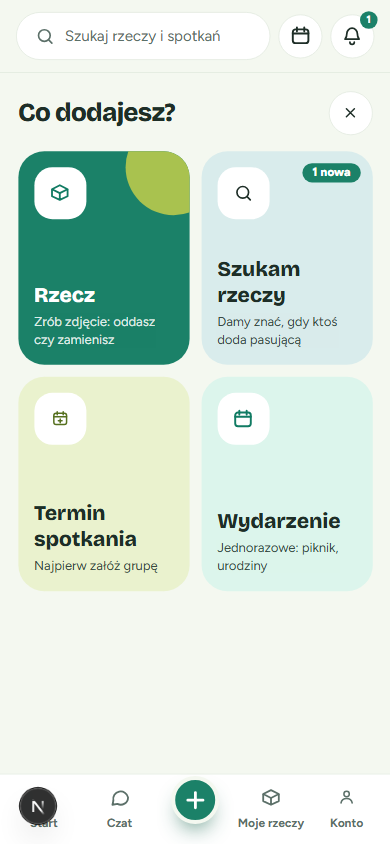

   💡 **Wskazówka**: znaczek w rogu kafelka (np. „1 nowa”) mówi, ile nowych pasujących rzeczy czeka na Ciebie na liście „Szukam”.

### Sposób 2: wiersz „Szukam” w Koncie

1. **Kliknij „Konto”** na dolnym pasku.
2. W części **„Rzeczy”** kliknij wiersz **„Szukam”**. Otworzy się Twoja lista. Tam kliknij **„+ Dodaj”**.

   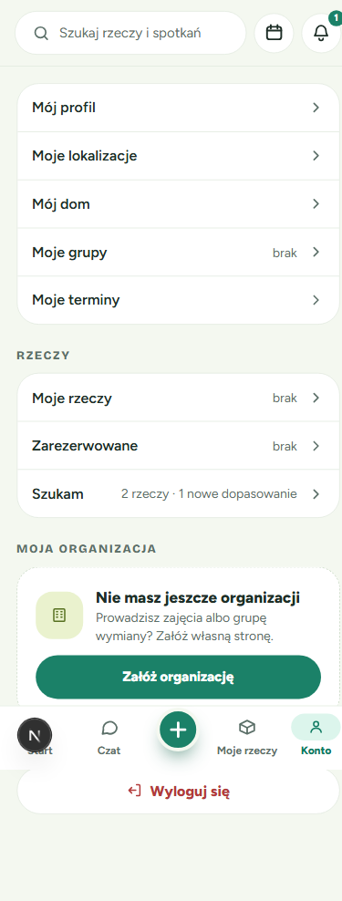

   ✅ **Co zobaczysz**: przy wierszu widać, ile masz aktywnych poszukiwań i ile jest nowych dopasowań (np. „2 rzeczy · 1 nowe dopasowanie”). Gdy nic nie szukasz, widać „brak”.

### Sposób 3: z wyszukiwarki, gdy nic nie znaleziono

Szukasz czegoś w wyszukiwarce i nikt tego jeszcze nie oddaje? Nie musisz wracać codziennie i sprawdzać.

1. **Pod pustym wynikiem kliknij „Dodaj do listy „Szukam””.**

   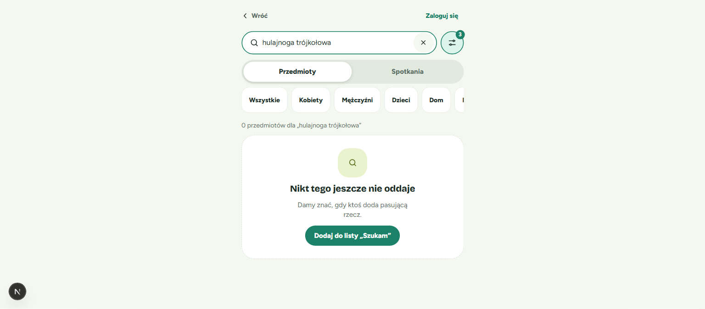

2. **Otworzy się formularz z wpisanym już tekstem.** Do formularza przenosimy też filtry z wyszukiwarki: **kategorię**, **rodzaj oferty** (Oddam / Zamienię) oraz **miejscowość z promieniem**. Nie przenosimy filtra stanu rzeczy ani wyboru „Moje grupy / Wszędzie”.

   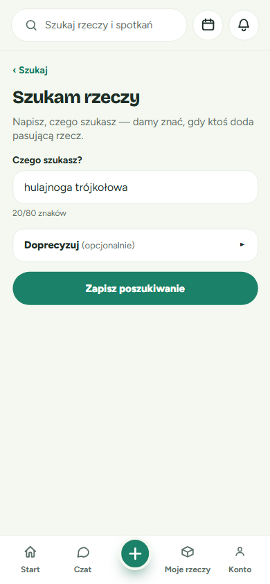

   💡 **Wskazówka**: link **„‹ Szukaj”** u góry zabiera Cię z powrotem do wyszukiwarki.

⚠️ **Jeśli nie jesteś zalogowany**: po kliknięciu przycisku najpierw się zaloguj albo załóż konto. Potem trafisz prosto do wypełnionego formularza — nic nie musisz wpisywać od nowa.

---

## Formularz „Szukam rzeczy” krok po kroku

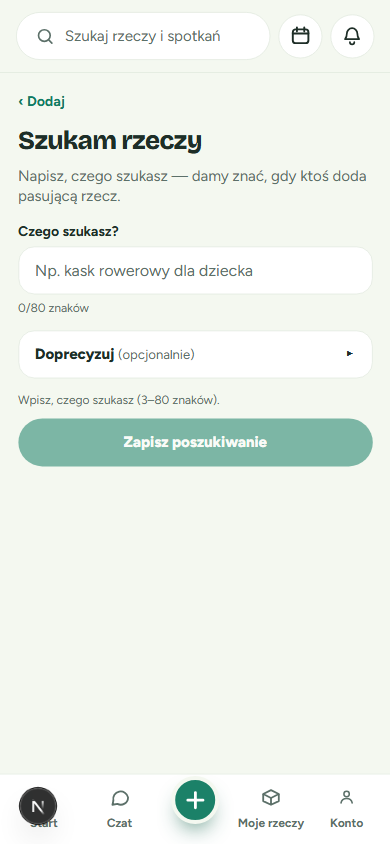

1. **Wpisz, czego szukasz** w polu **„Czego szukasz?”**, np. „rowerek biegowy”.
   - Nazwa musi mieć **od 3 do 80 znaków**. Licznik pod polem (np. „15/80 znaków”) pokazuje, ile już wpisałeś.
   - Dopóki pole jest puste, przycisk **„Zapisz poszukiwanie”** jest wyszarzony, a pod polem widać podpowiedź „Wpisz, czego szukasz (3–80 znaków).”

   💡 **Wskazówka**: pisz krótko i zwyczajnie, tak jak ludzie nazywają rzeczy w ogłoszeniach: „rowerek biegowy”, „kask rowerowy”, „kurtka zimowa 110”. Zbędne słowa, zwłaszcza krótkie (np. „dla”, „na”, „do”), mogą ukryć dobre dopasowania, bo też muszą się zgadzać.

2. **Jeśli chcesz, kliknij „Doprecyzuj (opcjonalnie)”.** Rozwinie się część z dodatkowymi polami. Wszystkie są nieobowiązkowe.

   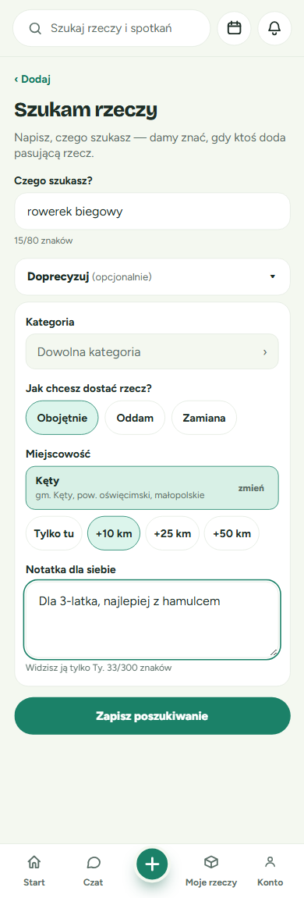

   - **Kategoria** — kliknij pole „Dowolna kategoria” i wybierz kategorię, np. „Rowery dziecięce”. Kategoria tylko **zawęża** wyniki: rzecz musi pasować także nazwą.
   - **Jak chcesz dostać rzecz?** — wybierz jedno:
     - **Obojętnie** (domyślnie) — pokażemy rzeczy do oddania i do zamiany,
     - **Oddam** — tylko rzeczy, które ktoś oddaje za darmo,
     - **Zamiana** — tylko rzeczy na wymianę.
   - **Miejscowość** — zacznij wpisywać nazwę albo kod pocztowy (np. „Kęty” albo „32-650”) i wybierz miejscowość z listy. Bez miejscowości szukamy w całej Polsce.
     Po wyborze miejscowości wybierz zasięg:
     - **Tylko tu** (domyślnie) — tylko rzeczy z tej miejscowości,
     - **+10 km**, **+25 km**, **+50 km** — także rzeczy z miejscowości w pobliżu.

     Aby zmienić miejscowość, kliknij **„zmień”**.
   - **Notatka dla siebie** — np. rozmiar, kolor albo do kiedy potrzebujesz. **Widzisz ją tylko Ty**, do 300 znaków. Notatka nie wpływa na wyszukiwanie dopasowań.

3. **Kliknij „Zapisz poszukiwanie”.**

   ✅ **Co zobaczysz**: od razu otworzy się strona poszukiwania z rzeczami, które **już teraz** do niego pasują. Za te rzeczy nie dostaniesz powiadomienia — widzisz je od razu. Powiadomienia dostaniesz o rzeczach wystawionych później.

   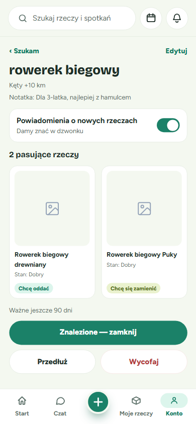

### Co, jeśli pojawi się komunikat?

| Komunikat | Co zrobić |
|---|---|
| „Nazwa musi mieć od 3 do 80 znaków.” | Skróć albo wydłuż nazwę. Przycisk zapisu działa dopiero przy poprawnej długości. |
| „Notatka może mieć najwyżej 300 znaków.” | Skróć notatkę. |
| „Nazwa i opis nie mogą zawierać danych kontaktowych (numeru telefonu, e-maila, linków ani komunikatorów)” | Usuń z nazwy lub notatki numer telefonu, e-mail albo link. |
| „Nazwa poszukiwania narusza zasady społeczności. Zmień ją i spróbuj ponownie.” | Zmień nazwę. To samo dotyczy notatki („Notatka narusza zasady społeczności…”). |
| „Masz już 30 aktywnych poszukiwań. Zamknij któreś, aby dodać nowe. Zobacz listę” | Zobacz [Limit 30 aktywnych poszukiwań](#limit-30-aktywnych-poszukiwań). |
| „Moderacja jest chwilowo niedostępna — spróbuj za chwilę.” albo „Szukanie dopasowań trwa zbyt długo. Spróbuj ponownie za chwilę.” | Odczekaj chwilę i kliknij zapis jeszcze raz. Nic nie zostało zapisane. |

Formularz po błędzie zostaje wypełniony — nie musisz nic wpisywać od nowa.

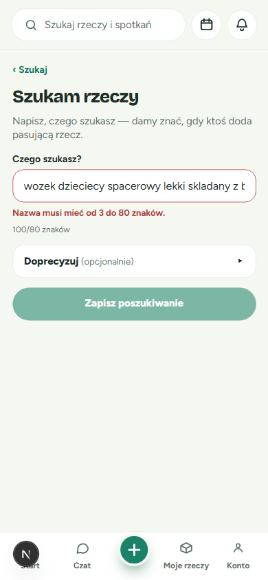

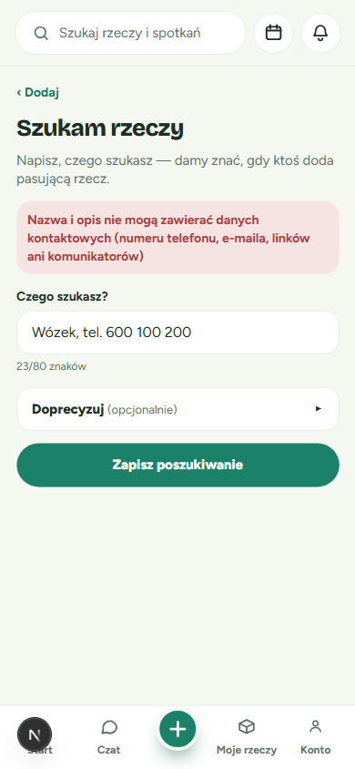

---

## Twoja lista „Szukam”

Listę otworzysz z **Konto → Szukam**. Na górze jest przycisk **„+ Dodaj”**.

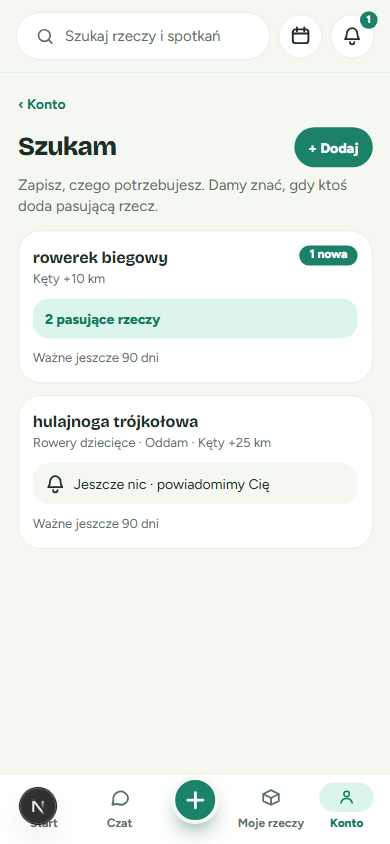

Każde **aktywne** poszukiwanie pokazuje:
- **nazwę** — kliknij ją, aby otworzyć stronę poszukiwania,
- **doprecyzowanie** w jednej linii, np. „Rowery dziecięce · Oddam · Kęty +25 km”. „Bez doprecyzowania” oznacza, że nie wybrano kategorii, sposobu ani miejscowości. Dopisek „powiadomienia wyłączone” mówi, że wyciszyłeś to poszukiwanie,
- znaczek **„1 nowa”** / **„N nowe”** — tyle pasujących rzeczy jeszcze nie oglądałeś,
- pasek **„N pasujących rzeczy”** — albo **„Jeszcze nic · powiadomimy Cię”**, gdy nic jeszcze nie pasuje,
- **„Ważne jeszcze N dni”**. Gdy zostało 7 dni lub mniej, obok pojawia się **„Przedłuż”**.

Na liście widać też poszukiwania **zamknięte**:
- **„Wygasło”** — minęło 90 dni. Przycisk **„Wznów”** uruchamia je znowu na 90 dni.
- **„Znalezione”** — sam oznaczyłeś je jako znalezione. Przycisk **„Szukam znowu”** przywraca je.

Przy zamkniętych poszukiwaniach widać „Zniknie z listy za N dni”.

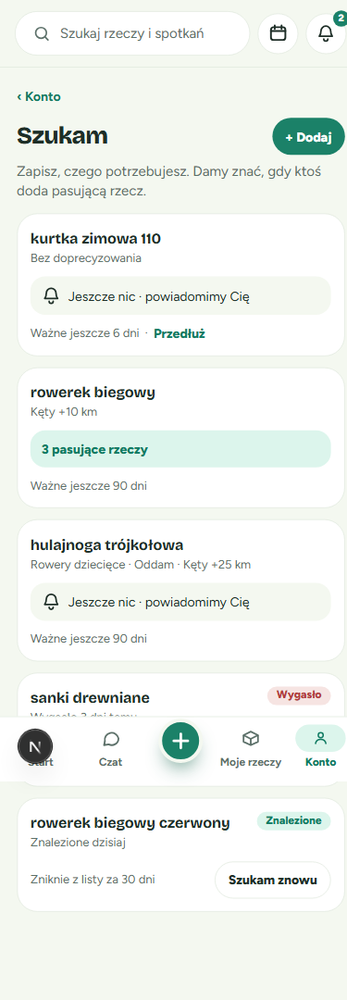

Gdy lista jest pusta, zobaczysz zachętę **„Czego potrzebujesz?”** i przycisk **„+ Dodaj poszukiwanie”**.

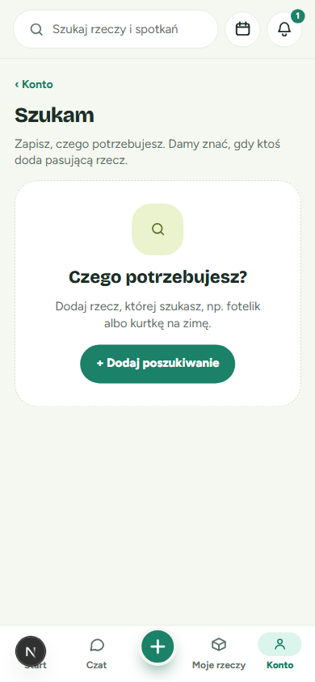

---

## Strona poszukiwania i pasujące rzeczy

Kliknij nazwę poszukiwania na liście. Zobaczysz:

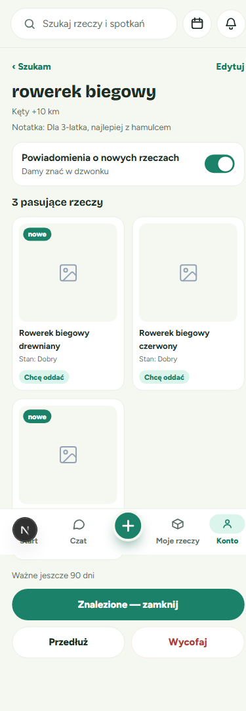

- **Nazwę** i **doprecyzowanie** (z pełną ścieżką kategorii, np. „Sport › Jazda na rowerze › Rowery dziecięce”).
- **„Notatka: …”** — jeśli ją dodałeś.
- Przełącznik **„Powiadomienia o nowych rzeczach”** — opis poniżej.
- **„N pasujących rzeczy”** i karty rzeczy. Kliknij kartę, aby otworzyć stronę rzeczy i ją wziąć.
  - Znaczek **„nowe”** oznacza rzecz, która pojawiła się od Twojej ostatniej wizyty. Po otwarciu strony licznik nowych na liście, kafelku i w Koncie się zeruje (znaczki „nowe” zostają widoczne do końca tej wizyty).
  - Rzeczy już zarezerwowane są na końcu i mają dopisek: **„Zarezerwowane przez Ciebie”**, **„Twoja propozycja”** (zaproponowałeś zamianę) albo **„Zarezerwowane”** (zarezerwował ktoś inny).
- **„Ważne jeszcze N dni”** i przyciski akcji.

### Powiadomienia o nowych rzeczach — włącz / wyłącz

Kliknij przełącznik, aby wyciszyć powiadomienia dla tego poszukiwania. Zmiana zapisuje się od razu.
- **„Damy znać w dzwonku”** — powiadomienia włączone (domyślnie).
- **„Wyłączone”** — nie dostaniesz powiadomień w dzwonku. Nowe pasujące rzeczy nadal będą się pojawiać na tej stronie i w licznikach.

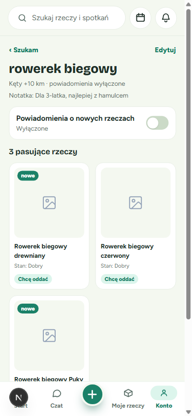

### Przyciski na dole strony

| Przycisk | Co robi |
|---|---|
| **„Znalezione — zamknij”** | Masz już tę rzecz. Poszukiwanie zostaje zamknięte jako znalezione i przestajemy szukać. Strona pokaże „Oznaczone jako znalezione…”. |
| **„Przedłuż”** | Przedłuża poszukiwanie — znowu będzie ważne 90 dni od dziś. Gdy zostało 7 dni lub mniej, ten przycisk jest główny i nazywa się **„Przedłuż o 90 dni”**. |
| **„Wycofaj”** | Już tego nie potrzebujesz. Poprosimy o potwierdzenie. |
| **„Edytuj”** (u góry po prawej) | Otwiera formularz edycji. |

### Gdy nic jeszcze nie pasuje

Zobaczysz **„Jeszcze nic nie pasuje”** i **„Damy znać, gdy ktoś doda pasującą rzecz.”** Nic nie musisz robić — szukamy dalej za Ciebie.

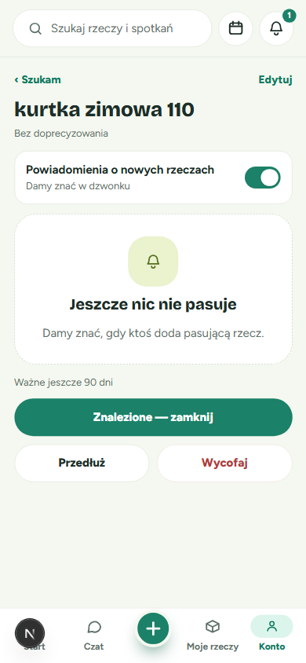

### Wycofanie poszukiwania

1. Kliknij **„Wycofaj”**.
2. Pojawi się pytanie **„Wycofać poszukiwanie?”** z wyjaśnieniem, że poszukiwanie zniknie z listy razem z dopasowaniami i nie damy już znać o nowych rzeczach.
3. Kliknij **„Wycofaj”**, aby potwierdzić, albo **„Anuluj”**, aby się wycofać.

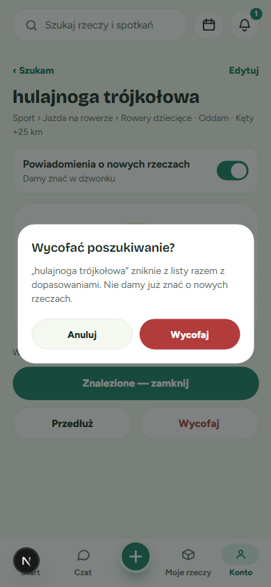

⚠️ **Uwaga**: wycofanego poszukiwania **nie da się przywrócić**. Jeśli po prostu masz już tę rzecz, wybierz raczej **„Znalezione — zamknij”** — takie poszukiwanie możesz jeszcze wznowić przez 30 dni.

### Poszukiwanie wygasłe lub znalezione

- **Wygasłe**: „To poszukiwanie wygasło N dni temu. Nie szukamy już nowych rzeczy. Zniknie z listy za M dni.” Kliknij **„Wznów na 90 dni”**, aby szukać dalej.
- **Znalezione**: „Oznaczone jako znalezione… Nie szukamy już nowych rzeczy. Zniknie z listy za M dni.” Kliknij **„Szukam znowu”**, jeśli jednak nadal potrzebujesz.

Wcześniej znalezione dopasowania zostają widoczne pod spodem.

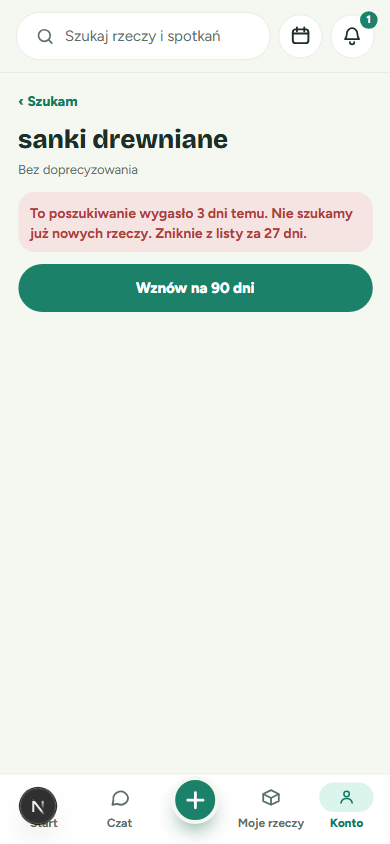

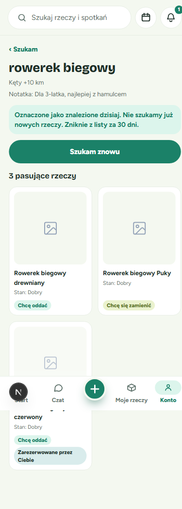

---

## Edycja poszukiwania

1. Na stronie poszukiwania kliknij **„Edytuj”**.
2. Zmień, co chcesz — formularz wygląda tak samo jak przy dodawaniu, a część „Doprecyzuj” jest od razu rozwinięta.
3. Kliknij **„Zapisz zmiany”** (albo **„Anuluj”**, aby wrócić bez zmian).

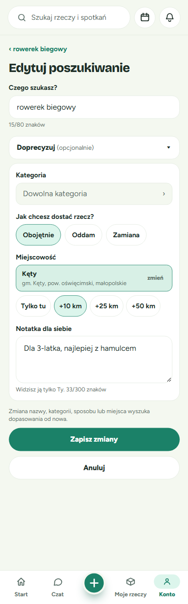

⚠️ **Ważne**: jak mówi podpowiedź nad przyciskiem, **„Zmiana nazwy, kategorii, sposobu lub miejsca wyszuka dopasowania od nowa.”** Dotychczasowa lista pasujących rzeczy zostanie wtedy zastąpiona nową. Zmiana samej notatki albo przełącznika powiadomień niczego nie resetuje.

📝 Edytować można tylko aktywne poszukiwanie. Wygasłe lub znalezione najpierw wznów.

---

## Powiadomienia w dzwonku

Gdy ktoś wystawi rzecz pasującą do Twojego poszukiwania, w dzwonku u góry ekranu pojawi się powiadomienie.

**Jedna nowa rzecz** — powiadomienie podaje jej nazwę, np. „Szukasz: «rowerek biegowy». Ktoś wystawił: «Rowerek biegowy drewniany».” Kliknięcie otwiera stronę tej rzeczy.

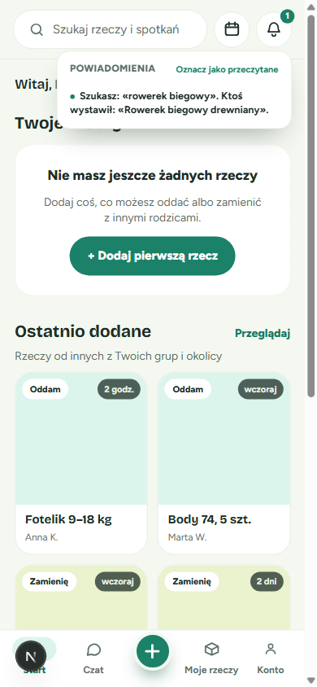

**Kilka nowych rzeczy** — dostajesz jedno zbiorcze powiadomienie z liczbą, np. „Szukasz: «rowerek biegowy». 2 nowe pasujące rzeczy.” (albo „5 nowych pasujących rzeczy”). Kliknięcie otwiera stronę poszukiwania.

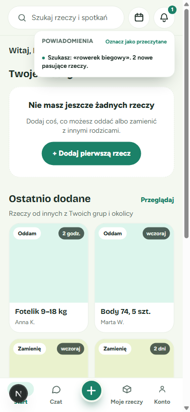

💡 Na jedno poszukiwanie masz najwyżej **jedno nieprzeczytane** powiadomienie. Jeśli go jeszcze nie przeczytałeś, a pojawią się kolejne rzeczy, zastąpimy je nowym z łączną liczbą. Dzięki temu dzwonek nie zapełni się.

**Przypomnienie o końcu ważności** — 7 dni przed wygaśnięciem dostaniesz: „Poszukiwanie «…» wygaśnie za 7 dni. Przedłuż je, jeśli nadal szukasz.” To przypomnienie przychodzi nawet wtedy, gdy wyłączyłeś powiadomienia o nowych rzeczach.

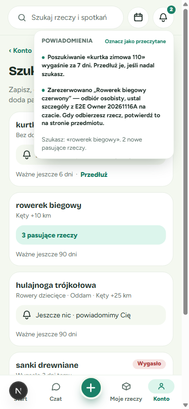

📝 Powiadomienia działają tylko w aplikacji — nie wysyłamy e-maili ani SMS-ów.

---

## Gdy weźmiesz pasującą rzecz — „Znalezione?”

Wziąłeś rzecz, która pasuje do Twojego poszukiwania? Zapytamy, czy możemy je zamknąć, żeby nie przysyłać Ci więcej powiadomień.

1. Na stronie pasującej rzeczy wybierz **„Odbiorę osobiście”** albo zarezerwuj ją na termin lub wydarzenie.

   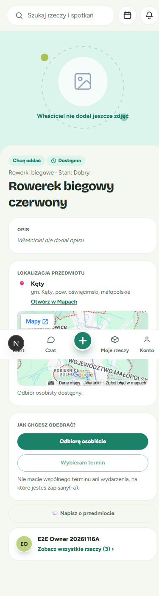

2. Po rezerwacji pojawi się okno **„Znalezione?”** z nazwą Twojego poszukiwania. (Jeśli rezerwowałeś na termin, okno pojawi się po zamknięciu potwierdzenia rezerwacji.)

   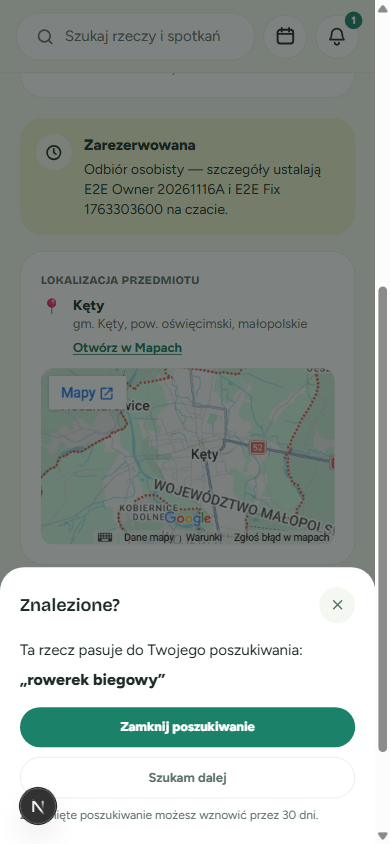

3. Wybierz:
   - **„Zamknij poszukiwanie”** — poszukiwanie trafi na listę jako „Znalezione”,
   - **„Szukam dalej”** (albo ✕) — nic się nie zmienia, nadal szukamy.

Jeśli rzecz pasuje do kilku Twoich poszukiwań, okno pokaże je wszystkie, a przycisk będzie się nazywał **„Zamknij oba poszukiwania”** (dla dwóch) albo **„Zamknij wszystkie poszukiwania”** (dla trzech i więcej).

💡 Zamknięte poszukiwanie możesz wznowić przez 30 dni — przyciskiem „Szukam znowu”.

📝 Okno nie pojawia się, gdy tylko **proponujesz zamianę** — wtedy rzecz nie jest jeszcze Twoja. Jeśli chcesz, zamknij poszukiwanie sam przyciskiem „Znalezione — zamknij”.

---

## Jak długo ważne jest poszukiwanie

- Każde poszukiwanie jest ważne **90 dni** od dodania (albo od przedłużenia czy wznowienia).
- **7 dni przed końcem** przypomnimy Ci o tym w dzwonku, a na liście pojawi się przycisk „Przedłuż”.
- **Przedłużenie automatyczne**: jeśli w ostatnich 30 dniach ważności otworzysz stronę poszukiwania, przedłużymy je automatycznie — znowu będzie ważne 90 dni. Kto zagląda, ten szuka.
- Po 90 dniach bez przedłużenia poszukiwanie **wygasa**. Nie szukamy już nowych rzeczy, ale możesz je **wznowić** przez **30 dni** („Wznów”).
- To samo dotyczy poszukiwań oznaczonych jako **znalezione** — przez 30 dni możesz kliknąć „Szukam znowu”.
- Po tych 30 dniach zamknięte poszukiwanie **znika z listy na zawsze**.
- **Wycofane** poszukiwanie znika od razu i nie da się go przywrócić.

---

## Limit 30 aktywnych poszukiwań

Możesz mieć jednocześnie najwyżej **30 aktywnych** poszukiwań. Wygasłe i znalezione się nie liczą.

Gdy spróbujesz dodać 31., zobaczysz komunikat **„Masz już 30 aktywnych poszukiwań. Zamknij któreś, aby dodać nowe.”** z linkiem **„Zobacz listę”**. Ten sam komunikat pojawi się przy próbie wznowienia poszukiwania, gdy masz już 30 aktywnych.

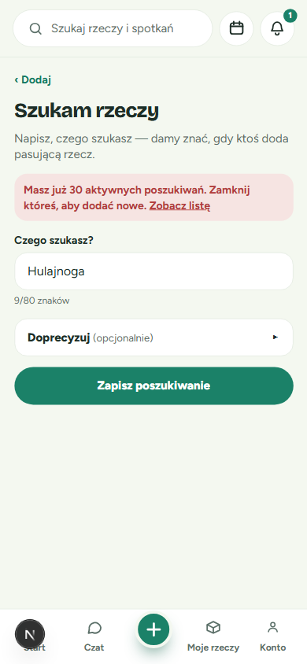

Co zrobić: otwórz listę i zamknij poszukiwania, których już nie potrzebujesz („Znalezione — zamknij” albo „Wycofaj”). Potem dodaj nowe.

---

## Najczęstsze pytania

**Dlaczego nie widzę rzeczy, która moim zdaniem pasuje?**
Pokazujemy tylko rzeczy, które:
- są **wystawione i dostępne do wzięcia** — nie pokazujemy rzeczy już zarezerwowanych przez kogoś, w trakcie przekazania ani takich, na które czeka propozycja zamiany,
- **nie są Twoje**,
- są **publiczne** — albo prywatne, ale tylko wtedy, gdy Ty i właściciel jesteście w tej samej prywatnej grupie,
- pasują **nazwą** (sama kategoria nie wystarczy) i mieszczą się w wybranym sposobie („Oddam” / „Zamiana”) oraz w miejscowości z zasięgiem.

Spróbuj prostszej nazwy (bez zbędnych słów), usuń kategorię albo zwiększ zasięg w „Edytuj”.

**Rzecz zniknęła z mojej listy dopasowań. Co się stało?**
Właściciel mógł ją wycofać, oddać komuś innemu albo zmienić jej widoczność. Pokazujemy tylko rzeczy, które nadal są wystawione i widoczne dla Ciebie.

**Kiedy dowiem się o nowej rzeczy?**
Nowo wystawione rzeczy sprawdzamy **mniej więcej co 15 minut**. Powiadomienie zobaczysz w dzwonku po odświeżeniu strony albo po ponownym otwarciu dzwonka.

**Przeczytałem powiadomienie, a na liście nadal widzę „1 nowa”. Dlaczego?**
Licznik „nowe” zeruje się dopiero, gdy otworzysz stronę poszukiwania. Przeczytanie powiadomienia w dzwonku go nie zmienia.

**Czy ktoś widzi, czego szukam?**
Nie. Lista „Szukam” i notatki są widoczne tylko dla Ciebie.

**Wyłączyłem powiadomienia. Czy nadal szukacie?**
Tak. Nowe pasujące rzeczy dalej pojawiają się na stronie poszukiwania i w licznikach — po prostu nie przysyłamy ich do dzwonka.

**Czy mogę przywrócić wycofane poszukiwanie?**
Nie. Dodaj je od nowa. Jeśli chcesz zachować możliwość powrotu, używaj „Znalezione — zamknij” zamiast „Wycofaj”.

---

## Powiązane funkcje
- **Wyszukiwarka** — szukanie rzeczy i spotkań; z pustego wyniku dodasz poszukiwanie. Zobacz instrukcję wyszukiwarki: `../../2026-11-12-global-search-group-description/documentation/user-guide.md`.
- **Odbiór osobisty, terminy i zamiany** — sposoby wzięcia rzeczy ze strony przedmiotu.
