# „Szukam” — jak znaleźć rzecz, której potrzebujesz

## TL;DR
- „Szukam” to Twoja lista rzeczy, których potrzebujesz. Wpisujesz nazwę, a my pokazujemy pasujące rzeczy i dajemy znać w dzwonku, gdy ktoś doda nową.
- Wyszukiwanie rozumie odmianę i zdrobnienia („kurtka zimowa” znajdzie „Kurtkę na zimę”) i pomija małe słowa, jak „na” czy „dla”.
- Nowa sekcja „Może Cię zainteresuje” pokazuje rzeczy, którym brakuje jednego słowa z Twojej nazwy. Te podpowiedzi nie wysyłają powiadomień.
- Zaraz po zapisaniu widzisz „Szukamy pasujących rzeczy…”. Jeśli to potrwa dłużej, pojawi się przycisk „Odśwież teraz”.
- Poszukiwanie jest ważne 90 dni. Możesz je przedłużyć, zamknąć jako znalezione albo wycofać.

## Key Decisions
- Instrukcja opisuje zachowanie widoczne dla użytkownika. Nie podajemy progów ani szczegółów technicznych dopasowania, bo przed wydaniem mogą się jeszcze zmienić.
- Zrzuty ekranu pochodzą z testów aplikacji na telefonie (szerokość 390 px) i z nowego, czystego konta testowego. Dane na zrzutach są przykładowe.

## Open Questions / Risks
- Przycisk „Oddam” w formularzu oznacza rzeczy, które ktoś **oddaje** za darmo. Z punktu widzenia osoby szukającej ta etykieta może być myląca. W instrukcji wyjaśniamy ją wprost.
- Rzadko, po krótkiej przerwie w działaniu wyszukiwania, możesz dostać powiadomienie o rzeczy, którą już widzisz na liście. Opisujemy to w sekcji „Rozwiązywanie problemów”.

*Ostatnia aktualizacja: 18 listopada 2026*

---

## Spis treści
1. [Czym jest „Szukam”?](#czym-jest-szukam)
2. [Dla kogo?](#dla-kogo)
3. [Jak zacząć](#jak-zacząć)
4. [Jak dodać poszukiwanie](#jak-dodać-poszukiwanie)
5. [Co widzisz po zapisaniu](#co-widzisz-po-zapisaniu)
6. [Pasujące rzeczy i „Może Cię zainteresuje”](#pasujące-rzeczy-i-może-cię-zainteresuje)
7. [Powiadomienia o nowych rzeczach](#powiadomienia-o-nowych-rzeczach)
8. [Twoja lista „Szukam”](#twoja-lista-szukam)
9. [Zmiana, przedłużenie, zamknięcie i wycofanie](#zmiana-przedłużenie-zamknięcie-i-wycofanie)
10. [Wskazówki: jak dobrze nazwać poszukiwanie](#wskazówki-jak-dobrze-nazwać-poszukiwanie)
11. [Rozwiązywanie problemów i częste pytania](#rozwiązywanie-problemów-i-częste-pytania)

---

## Czym jest „Szukam”?

Czasem rzeczy, której potrzebujesz, jeszcze nikt nie wystawił. Zamiast codziennie sprawdzać wyszukiwarkę, zapisz ją na liście „Szukam”.

My zrobimy resztę:
- od razu pokażemy rzeczy, które już pasują,
- będziemy pilnować nowych ogłoszeń,
- damy znać w dzwonku, gdy ktoś doda coś pasującego.

## Dla kogo?

Dla każdego, kto ma konto i czegoś szuka. Na przykład:
- rodzic szuka „kurtki na zimę” albo „rowerka biegowego” dla dziecka,
- kolekcjoner szuka konkretnego „traktora Bruder Claas”,
- ktoś chce „fotelik samochodowy”, ale tylko w swojej okolicy.

📝 **Potrzebujesz**: konta i zalogowania się. Bez logowania lista „Szukam” jest niedostępna.

---

## Jak zacząć

Do „Szukam” dojdziesz na trzy sposoby.

**1. Przez przycisk „+” na dole ekranu.** Wybierz kafelek **„Szukam rzeczy”**.

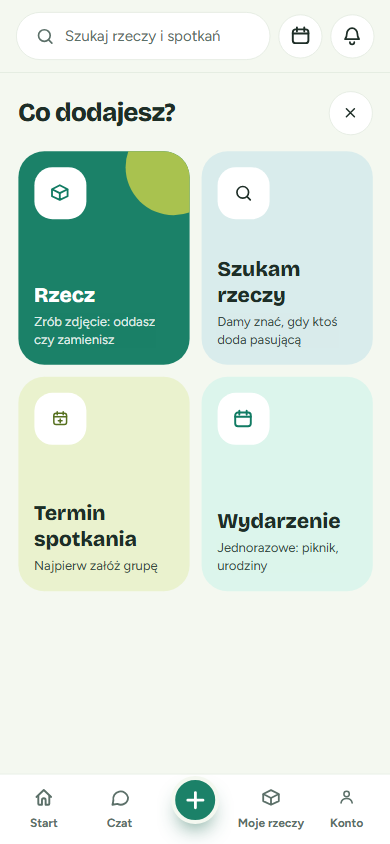

**2. Z zakładki „Konto”**: otwórz **„Szukam”**. Jeśli nie masz jeszcze poszukiwań, zobaczysz zachętę z przyciskiem **„+ Dodaj poszukiwanie”**.

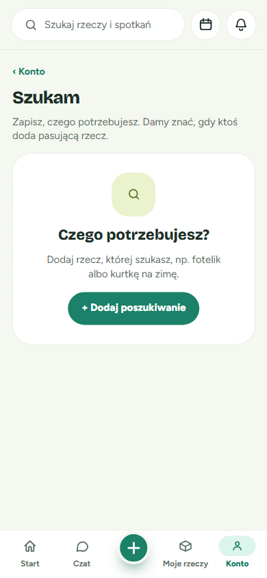

**3. Z wyszukiwarki.** Gdy wyszukiwarka nic nie znajdzie, kliknij **„Dodaj do listy „Szukam””**. Wpisana fraza od razu trafi do formularza.

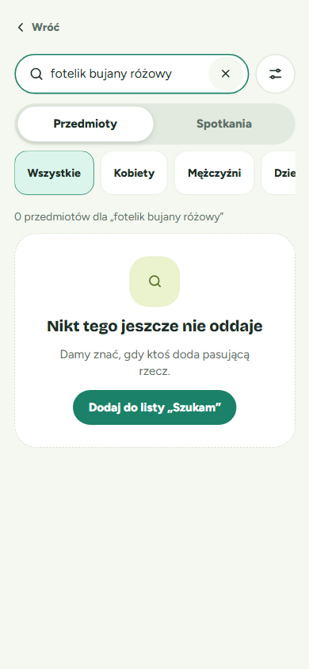

💡 **Wskazówka**: trzeci sposób jest najszybszy. Szukasz, nic nie ma, jednym kliknięciem prosisz nas o pilnowanie.

---

## Jak dodać poszukiwanie

Zapisz, czego potrzebujesz, a my zaczniemy szukać od razu.

**Kroki**:

1. **Wpisz, czego szukasz**

   W polu **„Czego szukasz?”** wpisz krótką nazwę rzeczy, np. „Kurtka na zimę”. Nazwa musi mieć od 3 do 80 znaków.

2. **(Opcjonalnie) Doprecyzuj**

   Kliknij **„Doprecyzuj”**, żeby zawęzić wyniki:
   - **Kategoria**: np. tylko odzież dziecięca. Domyślnie „Dowolna kategoria”.
   - **Jak chcesz dostać rzecz?**:
     - „Obojętnie”: wszystkie rzeczy,
     - „Oddam”: tylko rzeczy, które ktoś oddaje za darmo,
     - „Zamiana”: tylko rzeczy na wymianę.
   - **Miejscowość**: wpisz nazwę albo kod pocztowy, np. „Kęty” lub „32-650”. Puste pole oznacza całą Polskę.
   - **Notatka dla siebie**: np. rozmiar albo kolor. Widzisz ją tylko Ty i nie wpływa na wyszukiwanie.

   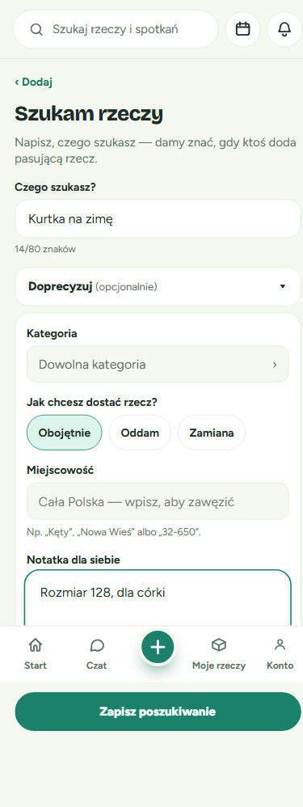

3. **Kliknij „Zapisz poszukiwanie”**

   ✅ **Co zobaczysz**: stronę Twojego poszukiwania. Wyniki zwykle pojawiają się w ciągu kilku sekund.

⚠️ **Nazwa z samych małych słów nie przejdzie.** Słowa takie jak „na”, „dla”, „i”, „z” pomijamy przy szukaniu. Jeśli wpiszesz tylko je, zobaczysz komunikat: *„Wpisz, czego szukasz — nazwa nie może składać się z samych spójników i przyimków.”* Dopisz nazwę rzeczy i zapisz ponownie.

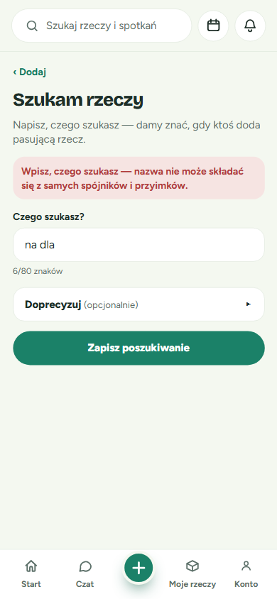

📝 **Limit**: możesz mieć naraz do 30 aktywnych poszukiwań.

---

## Co widzisz po zapisaniu

### „Szukamy pasujących rzeczy…”

Zaraz po zapisaniu (albo po zmianie nazwy) przeglądamy ogłoszenia. W tym czasie widzisz napis **„Szukamy pasujących rzeczy… To zwykle kilka sekund.”** i szare kafelki w miejscu wyników. Strona sama się odświeży, gdy wyniki będą gotowe. Nic nie musisz klikać.

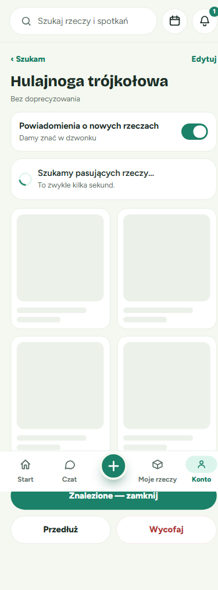

💡 Zwykle ten etap trwa ułamek sekundy, więc często go nawet nie zobaczysz.

### „Wyniki pojawią się wkrótce”

Jeśli szukanie potrwa dłużej niż minutę, zobaczysz kartę **„Wyniki pojawią się wkrótce”**. Nic złego się nie stało. Twoje poszukiwanie jest zapisane i nadal czeka na wyniki.

- Kliknij **„Odśwież teraz”**, żeby sprawdzić ponownie, albo
- zajrzyj tu za chwilę. O nowych rzeczach i tak damy znać w dzwonku.

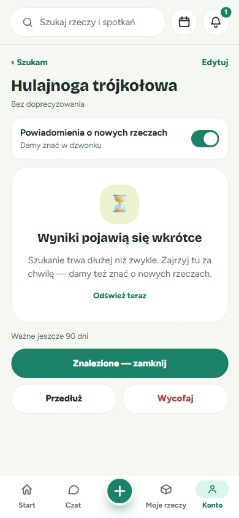

### Wyniki

Gdy szukanie się skończy, zobaczysz liczbę pasujących rzeczy, np. „1 pasująca rzecz”, i ich kafelki. Kliknij kafelek, żeby otworzyć stronę rzeczy i ją zarezerwować albo napisać do właściciela.

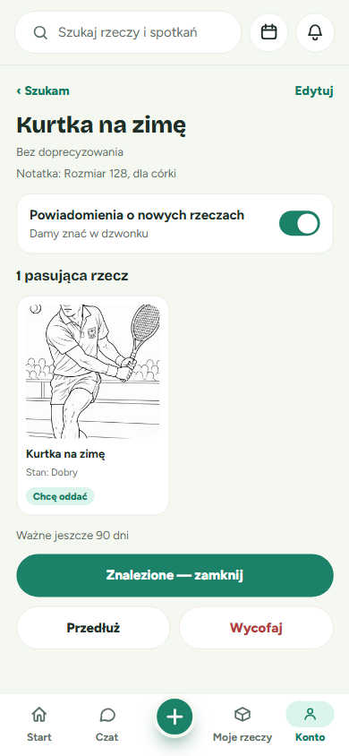

---

## Pasujące rzeczy i „Może Cię zainteresuje”

### Co uznajemy za pasującą rzecz?

Porównujemy **nazwę** Twojego poszukiwania z **nazwami** wystawionych rzeczy. Rzecz pasuje, gdy zawiera każde ważne słowo z Twojej nazwy. Przy tym:

- **Rozumiemy odmianę i zdrobnienia.** „kurtka zimowa” znajdzie „Kurtka na zimę”, a „rowerek biegowy” znajdzie „Rower biegowy dla dziecka”.
- **Pomijamy małe słowa.** „rower dla dziecka” i „rower dziecka” szukają tego samego.
- **Wybaczamy drobne literówki** w dłuższych słowach, np. „kurtka zimowq” nadal znajdzie „Kurtka zimowa”.
- **Krótkie słowa muszą się zgadzać dokładnie.** „lego” nie znajdzie „Legowiska dla psa”.

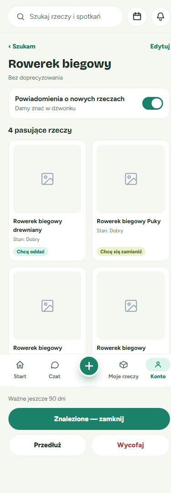

### Sekcja „💡 Może Cię zainteresuje”

Jeśli Twoja nazwa ma **co najmniej trzy ważne słowa**, pokażemy też rzeczy, którym **brakuje dokładnie jednego** z nich. Na kafelku zobaczysz, którego słowa brakuje, np. **brakuje: „Claas”**.

Przykład: szukasz „Traktor bruder Claas”. Nikt go nie wystawił, ale ktoś oddaje „Traktor bruder Deutz”. Może to też Ci się spodoba?

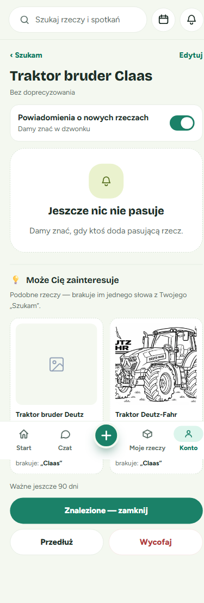

Dobrze wiedzieć:
- Podpowiedzi mają przerywaną ramkę, żeby odróżniały się od pasujących rzeczy.
- Pokazujemy najwyżej 10 podpowiedzi.
- **Podpowiedzi nie wysyłają powiadomień** i nie liczą się do liczby pasujących rzeczy na liście.
- Gdy podpowiedzi nie ma, sekcja się nie pojawia.

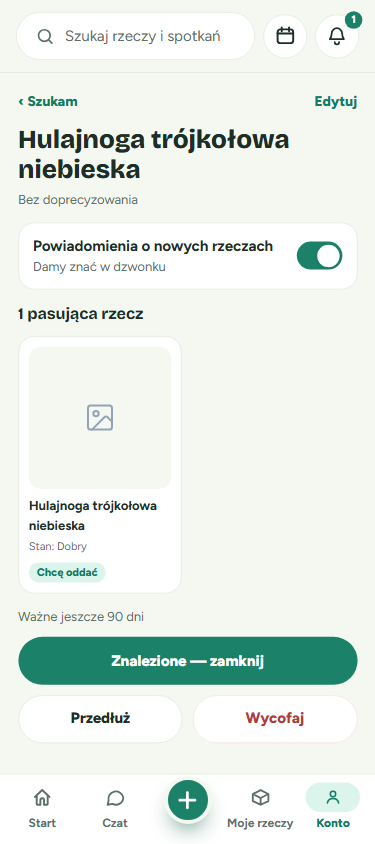

---

## Powiadomienia o nowych rzeczach

Po zapisaniu nadal pilnujemy nowych ogłoszeń. Gdy ktoś wystawi pasującą rzecz, **w ciągu około dwóch minut** zobaczysz liczbę na dzwonku u góry ekranu. Powiadomienie mówi, czego szukasz i co ktoś wystawił.

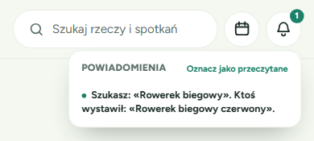

Na stronie poszukiwania nowa rzecz ma znaczek **„nowe”**.

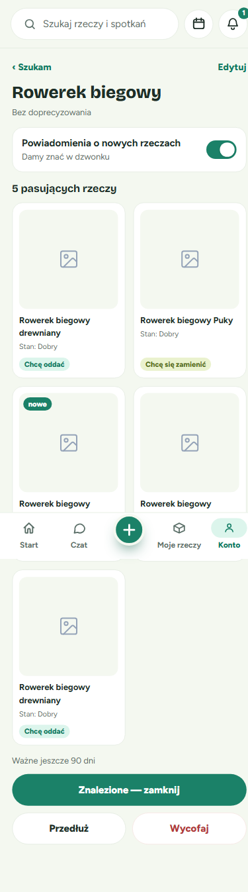

**Jak wyłączyć powiadomienia?** Na stronie poszukiwania przestaw przełącznik **„Powiadomienia o nowych rzeczach”**. Nadal będziemy zbierać pasujące rzeczy, tylko bez dzwonka.

💡 Rzeczy znalezione od razu po zapisaniu nie wysyłają powiadomień, bo i tak widzisz je na ekranie. Dzwonek dostajesz tylko za rzeczy dodane później.

---

## Twoja lista „Szukam”

Na liście widzisz wszystkie swoje poszukiwania. Każda karta pokazuje:
- **„Szukamy…”**: właśnie szukamy pasujących rzeczy,
- **„Jeszcze nic · powiadomimy Cię”**: na razie nic nie pasuje, ale pilnujemy,
- **„3 pasujące rzeczy”**: tyle rzeczy pasuje,
- **„1 nowa”**: tyle rzeczy pojawiło się od Twojej ostatniej wizyty,
- **„Ważne jeszcze 90 dni”**: ile dni zostało do wygaśnięcia.

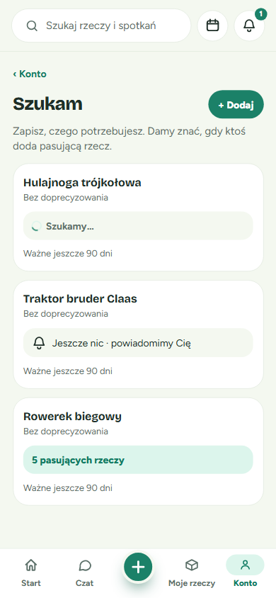

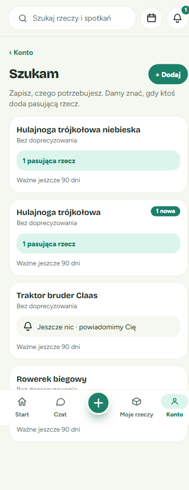

💡 Jeśli „Szukamy…” zostaje na karcie dłużej, otwórz to poszukiwanie albo wróć na listę za chwilę. Lista odświeży się sama.

---

## Zmiana, przedłużenie, zamknięcie i wycofanie

### Jak zmienić poszukiwanie

1. Na stronie poszukiwania kliknij **„Edytuj”** (prawy górny róg).
2. Zmień nazwę lub ustawienia w „Doprecyzuj”.
3. Zapisz.

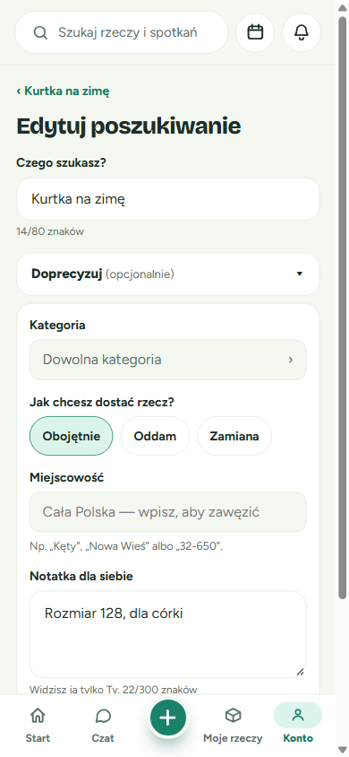

⚠️ Zmiana nazwy, kategorii, sposobu lub miejsca **wyszuka dopasowania od nowa**. Znów na chwilę zobaczysz „Szukamy pasujących rzeczy…”. Zmiana samej notatki niczego nie przelicza.

### Jak przedłużyć poszukiwanie

Poszukiwanie jest ważne **90 dni**. Kliknij **„Przedłuż”**, żeby znów mieć pełne 90 dni. Gdy zostanie niewiele dni, przycisk **„Przedłuż o 90 dni”** pojawi się na pierwszym miejscu.

💡 Gdy oglądasz pasujące rzeczy, przedłużamy poszukiwanie automatycznie.

### Gdy już znajdziesz: „Znalezione — zamknij”

Kliknij **„Znalezione — zamknij”**. Przestaniemy szukać nowych rzeczy, a poszukiwanie zniknie z listy po 30 dniach. Zmienisz zdanie? Kliknij **„Szukam znowu”**.

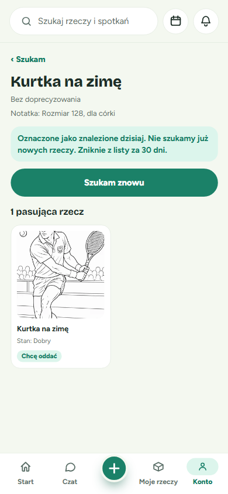

💡 Jeśli zarezerwujesz rzecz, która pasuje do Twojego poszukiwania, zapytamy, czy zamknąć je jako znalezione.

### Gdy już nie szukasz: „Wycofaj”

Kliknij **„Wycofaj”** i potwierdź. Poszukiwanie zniknie z listy razem z dopasowaniami i nie będziemy już wysyłać powiadomień.

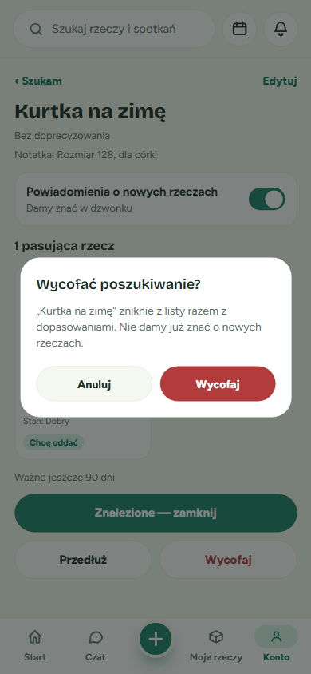

❌ Wycofania nie da się cofnąć. Jeśli rzecz po prostu się znalazła, wybierz raczej „Znalezione — zamknij”.

### Co się dzieje po 90 dniach?

Jeśli nie przedłużysz poszukiwania, ono **wygaśnie**. Na stronie zobaczysz informację i przycisk **„Wznów na 90 dni”**. Zakończone poszukiwania (znalezione albo wygasłe) możesz wznowić przez 30 dni. Potem znikają.

---

## Wskazówki: jak dobrze nazwać poszukiwanie

- ✅ **Pisz krótko i konkretnie**: „rowerek biegowy”, „kurtka zimowa”, „fotelik samochodowy”.
- ✅ **Używaj słów, których ludzie używają w nazwach ogłoszeń.** Szukamy tylko w nazwach rzeczy, nie w opisach.
- ✅ **Rozmiar i kolor wpisuj do notatki.** Każde dodatkowe słowo w nazwie musi się znaleźć w ogłoszeniu, więc „kurtka zimowa rozmiar 128 różowa” znajdzie znacznie mniej.
- ✅ **Szukasz konkretnego modelu? Podaj trzy słowa**, np. „Traktor bruder Claas”. Dostaniesz też podpowiedzi z innymi modelami w „Może Cię zainteresuje”.
- ✅ **Zawężaj przez „Doprecyzuj”**: kategorię, sposób albo miejscowość, zamiast dopisywać słowa do nazwy.
- ❌ Nie wpisuj samych słów typu „na”, „dla”, „z”. Takiej nazwy nie zapiszesz.

---

## Rozwiązywanie problemów i częste pytania

**Widzę „Wyniki pojawią się wkrótce” i nic się nie dzieje.**
Szukanie trwa dłużej niż zwykle. Kliknij „Odśwież teraz” albo zajrzyj za kilka minut. Poszukiwanie jest zapisane, a o nowych rzeczach damy znać w dzwonku.

**Na liście ciągle widzę „Szukamy…”.**
Otwórz to poszukiwanie albo odśwież stronę za chwilę. Lista po pewnym czasie przestaje sprawdzać sama, ale zaktualizuje się, gdy do niej wrócisz.

**Ktoś wystawił rzecz, a ja nie dostałem powiadomienia.**
Sprawdź, czy:
- przełącznik „Powiadomienia o nowych rzeczach” jest włączony,
- nazwa rzeczy zawiera wszystkie ważne słowa z Twojej nazwy (szukamy tylko w nazwach, nie w opisach),
- rzecz pasuje do ustawień z „Doprecyzuj” (kategoria, sposób, miejscowość),
- minęły około dwie minuty od wystawienia.

Pamiętaj też, że **podpowiedzi z „Może Cię zainteresuje” nie wysyłają powiadomień**.

**Ktoś zmienił nazwę rzeczy albo rzecz znów jest dostępna. Czy ją zobaczę?**
Tak. Sprawdzamy rzecz ponownie, gdy właściciel ją edytuje (np. zmieni nazwę) albo gdy znów jest dostępna, np. po odwołanej rezerwacji. Powiadomienie przyjdzie tak jak przy nowej rzeczy, w ciągu około 2 minut. Jeśli rzecz zmieniła tylko miejsce odbioru, wpisz jej nazwę w wyszukiwarkę albo zapisz ponownie swoje poszukiwanie.

**Dostałem powiadomienie o rzeczy, którą już widzę na liście.**
Zdarza się to rzadko, po krótkiej przerwie w działaniu wyszukiwania. Powiadomienie jest prawdziwe i prowadzi do właściwej rzeczy, możesz je po prostu odczytać.

**Czemu „lego” nie znajduje „Legowisko”?**
Krótkie słowa porównujemy dokładnie, żeby nie podsuwać rzeczy, które tylko zaczynają się tak samo.

**Czemu nie mogę dodać kolejnego poszukiwania?**
Możesz mieć najwyżej 30 aktywnych poszukiwań. Zamknij albo wycofaj te, których już nie potrzebujesz.

**Czy ktoś widzi moje poszukiwania?**
Nie. Lista „Szukam” i notatki są widoczne tylko dla Ciebie.

---

## Powiązane funkcje

- **Wyszukiwarka** (pole „Szukaj rzeczy i spotkań” u góry ekranu): szybkie, jednorazowe szukanie. Gdy nic nie znajdzie, jednym kliknięciem dodasz frazę do „Szukam”.
- **Powiadomienia** (dzwonek u góry ekranu): tutaj trafiają informacje o nowych pasujących rzeczach.
- **Strona rzeczy**: z kafelka pasującej rzeczy przejdziesz do rezerwacji lub rozmowy z właścicielem.
