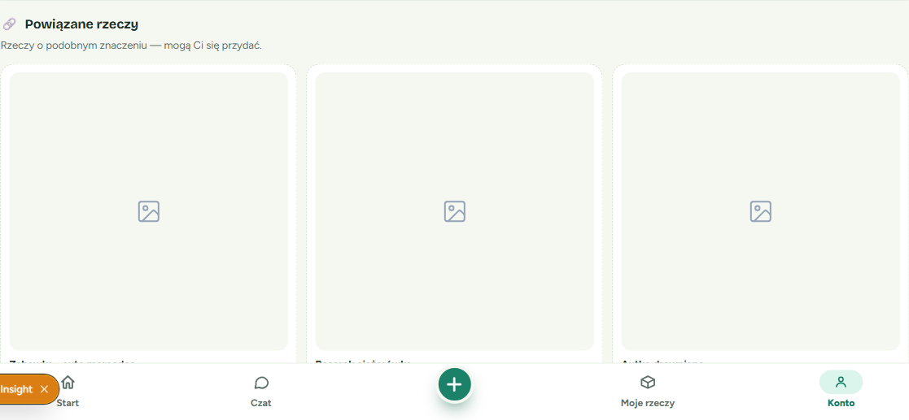
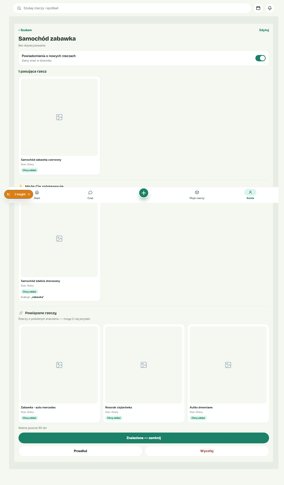
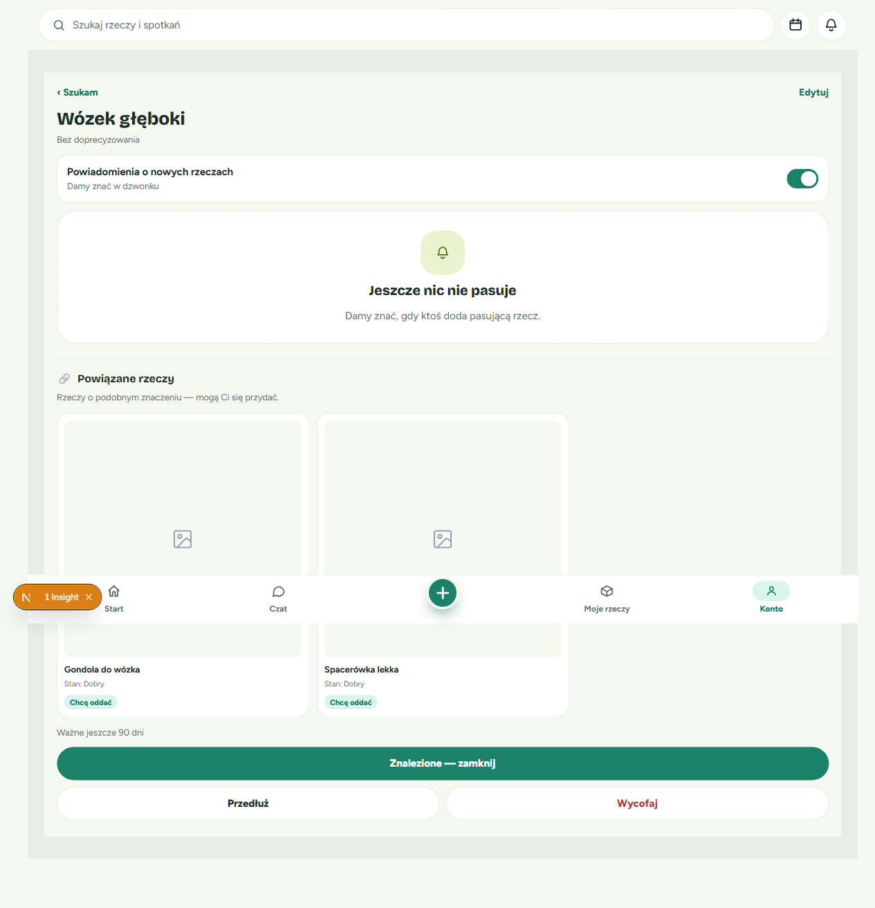
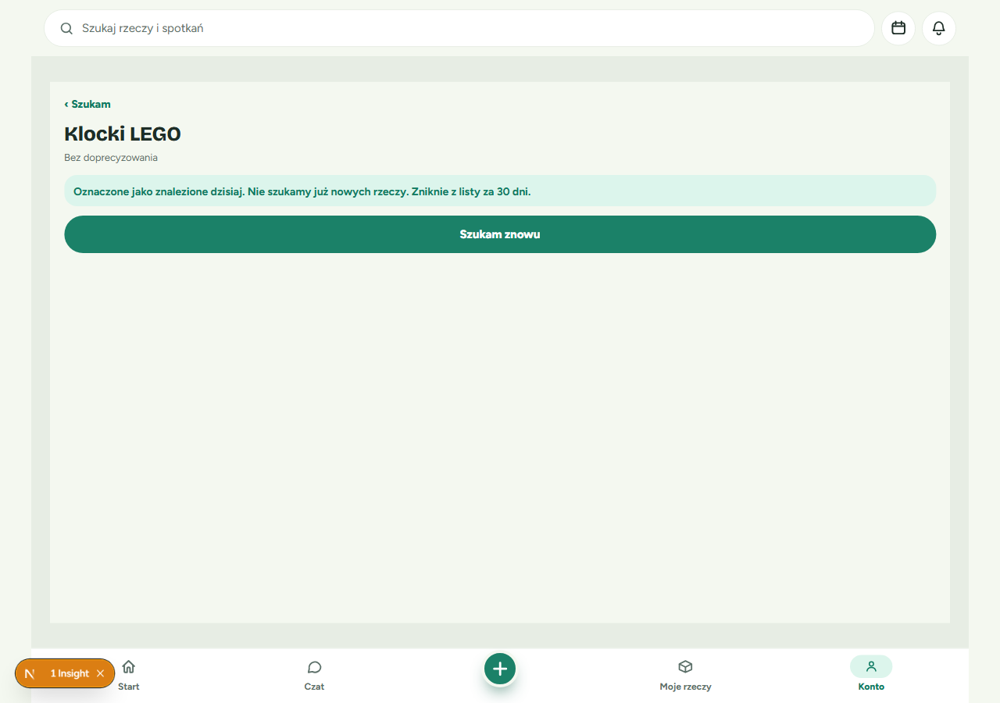
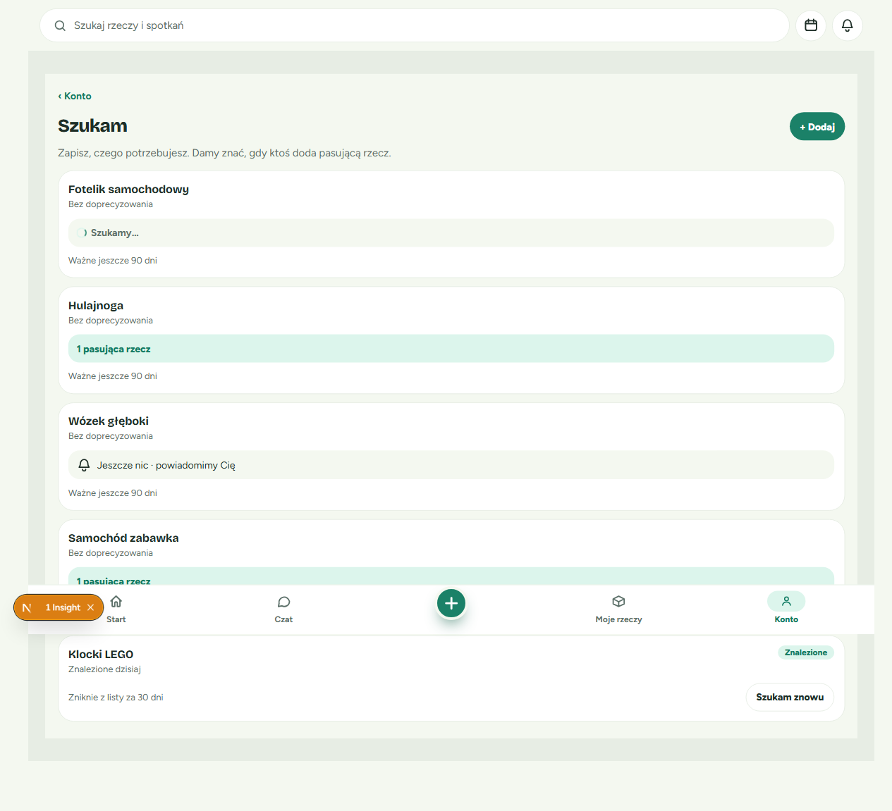

## TL;DR

- „Powiązane rzeczy” to rzeczy o podobnym znaczeniu, opisane innymi słowami niż Twoje poszukiwanie.
- Sekcja jest na stronie poszukiwania, pod „Może Cię zainteresuje”, tylko gdy poszukiwanie jest aktywne.
- To podpowiedzi, a nie dopasowania: nie ma za nie powiadomień i nie liczą się jako pasujące rzeczy.
- Kliknij kartę, żeby zobaczyć rzecz i zarezerwować ją lub zaproponować wymianę.

# Powiązane rzeczy w „Szukam”

*Ostatnia aktualizacja: 18 listopada 2026*

## Co pokazuje ta sekcja?

Ludzie opisują te same rzeczy różnymi słowami. Szukasz „Samochód zabawka”, a ktoś dodał „Zabawka - auto mercedes”. Słowa się różnią, ale chodzi o to samo.

Sekcja „Powiązane rzeczy” zbiera właśnie takie rzeczy: **o podobnym znaczeniu, opisane inaczej**. To podpowiedzi, które *mogą Ci się przydać*, a nie dokładne dopasowania.

💡 Karty powiązanych rzeczy mają **przerywaną ramkę**. Dzięki temu od razu odróżnisz je od pasujących rzeczy, które mają zwykłą, ciągłą ramkę.

## Gdzie ją znajdziesz?

Otwórz „Szukam” i wybierz swoje poszukiwanie. Na jego stronie zobaczysz po kolei:

1. pasujące rzeczy,
2. „Może Cię zainteresuje”,
3. **„Powiązane rzeczy”**,
4. przyciski „Znalezione — zamknij”, „Przedłuż” i „Wycofaj”.

Sekcja może się pojawić także wtedy, gdy nic jeszcze nie pasuje. Napis „Jeszcze nic nie pasuje” zostaje na swoim miejscu, a powiązane rzeczy są pod nim.

⚠️ Sekcja jest widoczna tylko przy **aktywnym** poszukiwaniu. Gdy je zamkniesz („Znalezione”, „Wycofaj”) albo minie jego ważność, powiązane rzeczy znikają.

## Jak z niej korzystać?

1. **Kliknij kartę**, żeby otworzyć stronę rzeczy.
2. Na stronie rzeczy **zarezerwuj ją albo zaproponuj wymianę**, tak jak zwykle.

✅ To wszystko. Nie trzeba niczego włączać.

## Czego ta sekcja nie robi?

- ❌ **Nie wysyła powiadomień.** Nie zobaczysz nic nowego w dzwonku.
- ❌ **Nie liczy się jako dopasowanie.** Na liście „Szukam” liczba „pasujących rzeczy” obejmuje tylko prawdziwe dopasowania.
- ✅ Jeśli powiązana rzecz zacznie później pasować do Twoich słów (np. właściciel zmieni jej opis), przejdzie do pasujących rzeczy i **wtedy** dostaniesz powiadomienie.

## Najczęstsze pytania

**Dlaczego widzę coś, co nie jest dokładnie tym, czego szukam?**
Bo to podpowiedzi. Pokazujemy rzeczy o podobnym znaczeniu, nawet jeśli różnią się od Twojego opisu. Jeśli coś nie pasuje, po prostu to pomiń.

**Dlaczego nie ma żadnych powiązanych rzeczy?**
Być może nikt jeszcze nie dodał niczego podobnego. Zajrzyj później. Sekcji nie ma też przy zamkniętym poszukiwaniu.

**Dlaczego nie dostaję powiadomień o powiązanych rzeczach?**
Żeby dzwonek informował tylko o rzeczach, które naprawdę pasują do Twojego poszukiwania. Powiązane rzeczy czekają spokojnie na stronie poszukiwania.
