## TL;DR
- Przewodnik dla użytkowników, organizatorów i administratorów po etapie 1 systemu punktów i reputacji.
- Punkty dostajesz za oddawanie rzeczy za darmo, wymiany, bonus „Szukam” i obecność na terminach; reputację tylko za oddawanie za darmo.
- Organizator wybiera punkty za obecność przy terminie, zaznacza obecnych i zatwierdza listę (albo lista zamyka się sama po 7 dniach).
- Administrator ustawia wszystkie progi w „Konfiguracja punktów” i klasę wielkości kategorii (Mała/Średnia/Duża → 20/40/60 pkt).
- Wydawanie punktów pojawi się w kolejnym etapie.

## Key Decisions
- Liczby w przewodniku to wartości domyślne (np. limit 40 pkt miesięcznie, min. 3 obecne osoby, 7 dni do auto-zamknięcia, 3 nagradzane przekazania na parę w 30 dni). Administrator może je zmienić, więc tekst mówi „domyślnie”.
- Zrzuty ekranu pochodzą z testów na kontach testowych (nazwy „E2E Pts …”, grupa „E2E Punkty Krąg”).
- Panel administratora ma angielskie etykiety menu (np. „Points”, „Categories”), tak jak w aplikacji; treść stron jest po polsku.

## Open Questions / Risks
- Na zrzutach listy obecności (stan otwarty i zamknięty) pasek wyszukiwania częściowo zasłania baner informacyjny. To efekt robienia zrzutu całej strony; w aplikacji pasek przesuwa się razem z ekranem.
- W panelu administratora pola formularza wyglądają jak zwykły tekst (bez ramki). To znany, ogólny wygląd panelu admina; pola działają normalnie, wystarczy w nie kliknąć.
- Brak zrzutu dla wymiany i bonusu „Szukam” w historii (nie było ich w testach). Opisano je słownie.

---

# Punkty i reputacja — przewodnik

*Ostatnia aktualizacja: 22 listopada 2026 · Etap 1*

## Spis treści

1. [Dla każdego: czym są punkty i reputacja](#1-dla-każdego-czym-są-punkty-i-reputacja)
2. [Dla organizatorów: punkty za obecność na terminach](#2-dla-organizatorów-punkty-za-obecność-na-terminach)
3. [Dla administratorów: konfiguracja punktów i klasy wielkości](#3-dla-administratorów-konfiguracja-punktów-i-klasy-wielkości)
4. [Rozwiązywanie problemów](#4-rozwiązywanie-problemów)

---

## 1. Dla każdego: czym są punkty i reputacja

### Co to jest?

**Punkty** to podziękowanie za to, że dzielisz się rzeczami i przychodzisz na spotkania. Zbierasz je automatycznie — nic nie musisz klikać.

**Reputacja** pokazuje, ile oddałeś(-aś) innym **za darmo**. Rośnie tylko wtedy, gdy oddajesz rzecz w prezencie.

📝 **Ważne**:
- Punktów i reputacji **nie widzi nikt poza Tobą**. Nie ma ich na Twoim profilu, przy rzeczach ani w wyszukiwarce.
- Punktów nie można nikomu przekazać.
- **Wydawanie punktów pojawi się w kolejnym etapie.** Będzie można je wymienić na nieliczne przedmioty oznaczone „za punkty”. Na razie tylko je zbierasz.

### Jak zdobywać punkty

| Co robisz | Ile dostajesz (domyślnie) | Reputacja |
|---|---|---|
| 🎁 **Oddajesz rzecz za darmo** | Tyle, ile jest warta rzecz: **20, 40 albo 60 pkt** | Tak, tyle samo co punktów |
| 🔄 **Wymieniasz się** z kimś | **10 pkt** dla każdej ze stron | Nie |
| 🔎 **Oddajesz rzecz, której ktoś szukał** (była na jego liście „Szukam”) | **10 pkt** bonusu, oprócz punktów za oddanie | Nie |
| 📍 **Przychodzisz na termin**, za który organizator daje punkty | Tyle, ile wybrał organizator (np. 10 albo 20 pkt) | Nie |

**Kiedy dostajesz punkty za oddanie lub wymianę?**
Dopiero gdy przekazanie zostanie potwierdzone („Potwierdzam przekazanie”). Sama rezerwacja jeszcze nic nie daje.

**Ile jest warta Twoja rzecz?**
To zależy od jej wielkości (mała, średnia, duża — wynika z kategorii) i stanu. Nowa, duża rzecz jest warta więcej niż mała w słabym stanie. Zawsze wychodzi jedna z trzech wartości: 20, 40 albo 60 pkt.

💡 **Przykład**: Oddajesz sukienkę w dobrym stanie. Sukienki są w kategorii średniej wielkości, więc dostajesz **40 pkt i 40 reputacji**.

**Bonus „Szukam”** dostajesz, gdy osoba, która bierze Twoją rzecz, miała ją na swojej liście „Szukam” w chwili rezerwacji. Bonus nie przepada, nawet jeśli potem zamknie swoje poszukiwanie.

**Punkty za obecność** dostajesz, gdy:
- organizator przypisał terminowi punkty,
- zaznaczył Cię jako obecną/obecnego,
- na terminie było co najmniej tyle osób, ile wymaga minimum (domyślnie 3).

### Kiedy punkty się NIE należą

Żeby punkty były uczciwe, kilka sytuacji ich nie daje. Samo przekazanie rzeczy działa wtedy normalnie.

- ❌ **Przekazania w rodzinie** — gdy obie osoby należą do tego samego domu („Mój dom”).
- ❌ **Zbyt częste przekazania tej samej osobie** — z jedną osobą nagradzane są domyślnie **3 przekazania w ciągu 30 dni**. Kolejne nie dają punktów, dopóki nie minie ten czas.
- ❌ **Ponad miesięczny limit za obecność** — za obecność na terminach możesz dostać domyślnie **do 40 pkt w miesiącu**. Gdy limit się wyczerpie, dostajesz tylko tyle, ile zostało.
- ❌ **Konta organizacji** — punkty zbierają tylko osoby, nie strony organizacji.
- ❌ **Organizator na własnym terminie** — nie dostaje punktów za obecność (więcej w części 2).

### Jak sprawdzić swoje punkty

**Krok 1. Otwórz „Konto”**

Kliknij **Konto** na dolnym pasku. Na samej górze, nad menu, są dwa kafelki: **punktów** i **reputacji** — od razu widać tam Twoje saldo i reputację.

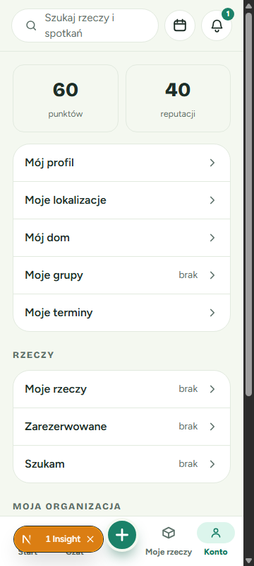

**Krok 2. Kliknij kafelki**

Otworzy się strona **Twoje punkty**. Na górze są dwa kafelki:
- **punktów** — ile masz łącznie,
- **reputacji** — ile oddałeś(-aś) za darmo.

Poniżej jest **Historia**: każda pozycja to jedno zdarzenie, za które dostałeś(-aś) punkty.

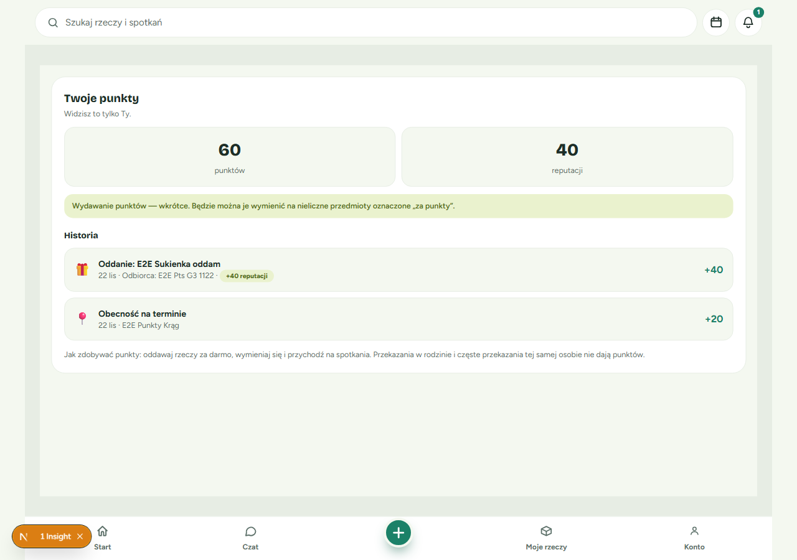

✅ **Co zobaczysz w historii**:

| Ikona | Tytuł | Pod spodem |
|---|---|---|
| 🎁 | „Oddanie: *nazwa rzeczy*” | data · Odbiorca: *imię* · „+40 reputacji” |
| 🔄 | „Wymiana: *rzecz A* ↔ *rzecz B*” | data · Druga strona: *imię* |
| 🔎 | „Bonus „Szukam”: *nazwa rzeczy*” | data · rzecz z listy odbiorcy |
| 📍 | „Obecność na terminie” | data · *nazwa grupy* |

Po prawej stronie widać, ile punktów przyniosło dane zdarzenie (np. **+40**).

💡 **Wskazówka**: Historia pokazuje najpierw najnowsze pozycje. Jeśli masz ich dużo, na dole pojawi się przycisk **Pokaż starsze**.

Na dole strony znajdziesz krótkie przypomnienie, jak zdobywać punkty.

**Jeszcze nie masz punktów?** Zobaczysz zera i komunikat „Nie masz jeszcze żadnych punktów.” To normalne — oddaj coś za darmo albo przyjdź na nagradzany termin.

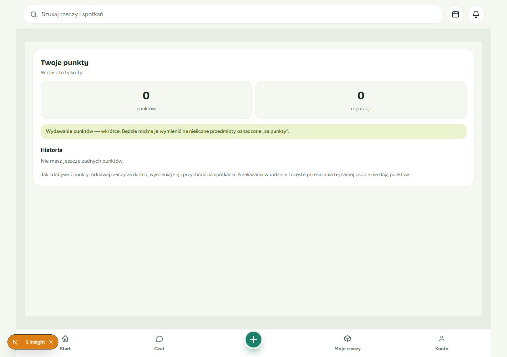

---

## 2. Dla organizatorów: punkty za obecność na terminach

Jako organizator grupy możesz nagradzać osoby, które naprawdę przyszły na spotkanie. Działa to w trzech krokach:

1. Przy terminie wybierasz, ile punktów daje obecność.
2. W trakcie lub po spotkaniu zaznaczasz, kto był.
3. Zatwierdzasz listę — wtedy obecni dostają punkty.

⚠️ **Organizatorzy nie dostają punktów za obecność na terminach swojej grupy** i nie liczą się do minimum obecnych. Możesz się zapisać i zaznaczyć jako obecny(-a), ale nic to nie zmieni.

### Krok 1. Wybierz punkty za obecność

Przy dodawaniu terminu (przycisk **+** → termin) znajdziesz pole **Punkty za obecność**. Wybierz jeden z dostępnych poziomów, np. **0**, **10** albo **20**.

- **0** oznacza termin bez punktów (to ustawienie domyślne).
- Pod przyciskami jest przypomnienie: każda obecna osoba dostanie tyle punktów, jeśli przyjdą co najmniej 3 osoby.

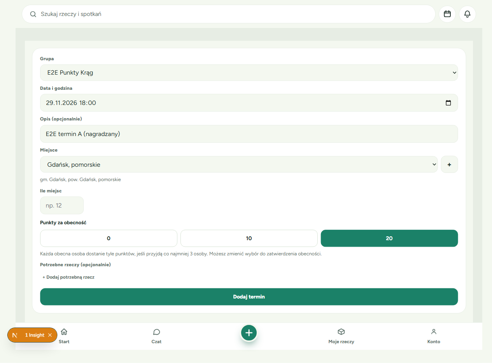

Wybór możesz zmienić w edycji terminu — aż do zatwierdzenia obecności.

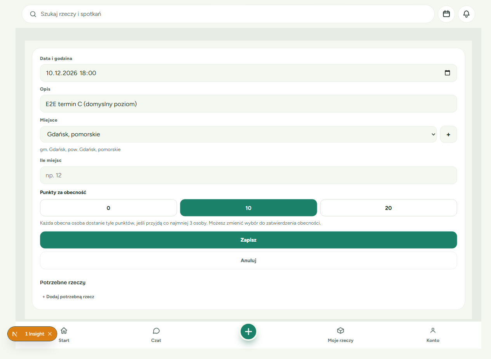

💡 **Wskazówka**: Dostępne poziomy ustala administrator. Jeśli nie widzisz wartości, której potrzebujesz, zapytaj administratora.

### Krok 2. Otwórz listę zapisanych

W **Moje terminy** przy swoim terminie kliknij podsumowanie zapisów (np. „4 zapisy · 0 dzieci ›”). Otworzy się strona **Zapisani na termin**.

Lista wygląda różnie w zależności od tego, czy termin już się zaczął.

**Przed rozpoczęciem terminu**

Na górze jest informacja, ile punktów daje termin i ile osób musi przyjść. Pola wyboru są jeszcze nieaktywne — obecność zaznaczysz od rozpoczęcia terminu.

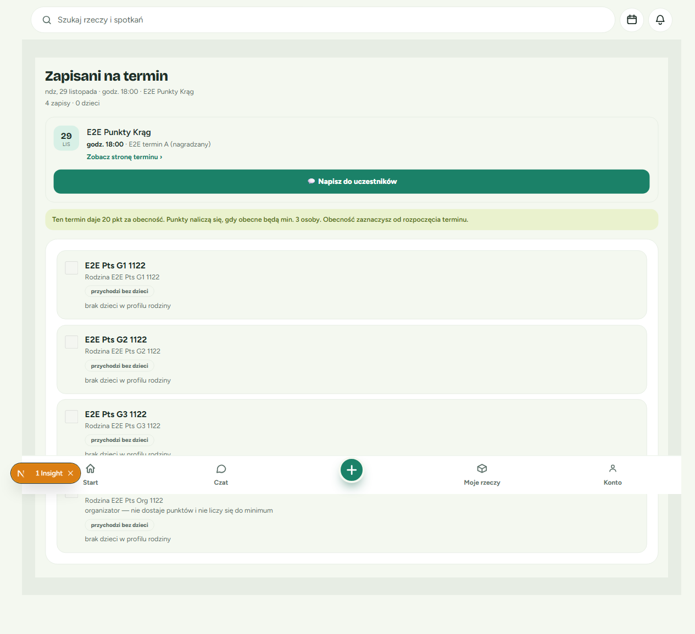

Przy Twoim nazwisku zobaczysz dopisek: „organizator — nie dostaje punktów i nie liczy się do minimum”.

**Po rozpoczęciu terminu (lista otwarta)**

Teraz możesz zaznaczać obecnych:

1. Zaznacz pole przy każdej osobie, która przyszła. Przy jej nazwisku pojawi się „obecny”.
2. Na górze zobaczysz licznik, np. **„Teraz: 1 z 3”** (organizator się nie liczy).
3. Pod listą jest przycisk **Zatwierdź obecność** i data automatycznego zamknięcia listy.

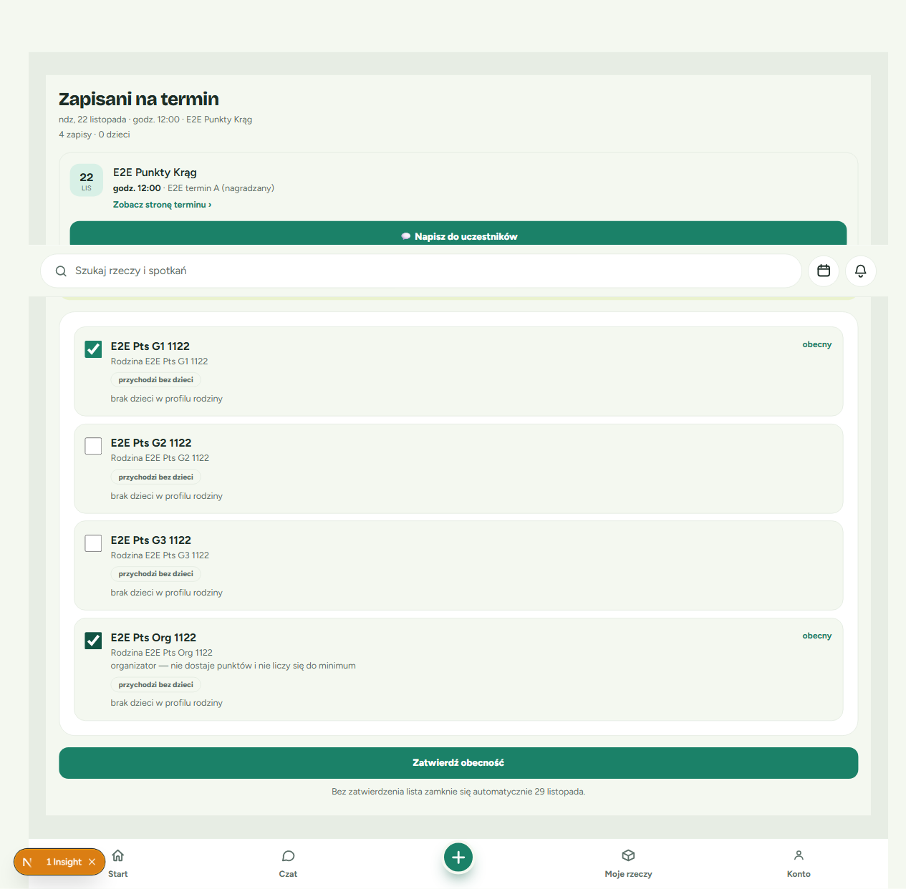

💡 **Wskazówka**: Pomyliłeś(-aś) się? Odznacz pole. Zmiany możesz wprowadzać do chwili zatwierdzenia.

### Krok 3. Zatwierdź obecność

Kliknij **Zatwierdź obecność**. Pojawi się okno z podsumowaniem.

Jeśli obecnych jest **za mało**, okno Cię ostrzeże, że punkty nie zostaną naliczone:

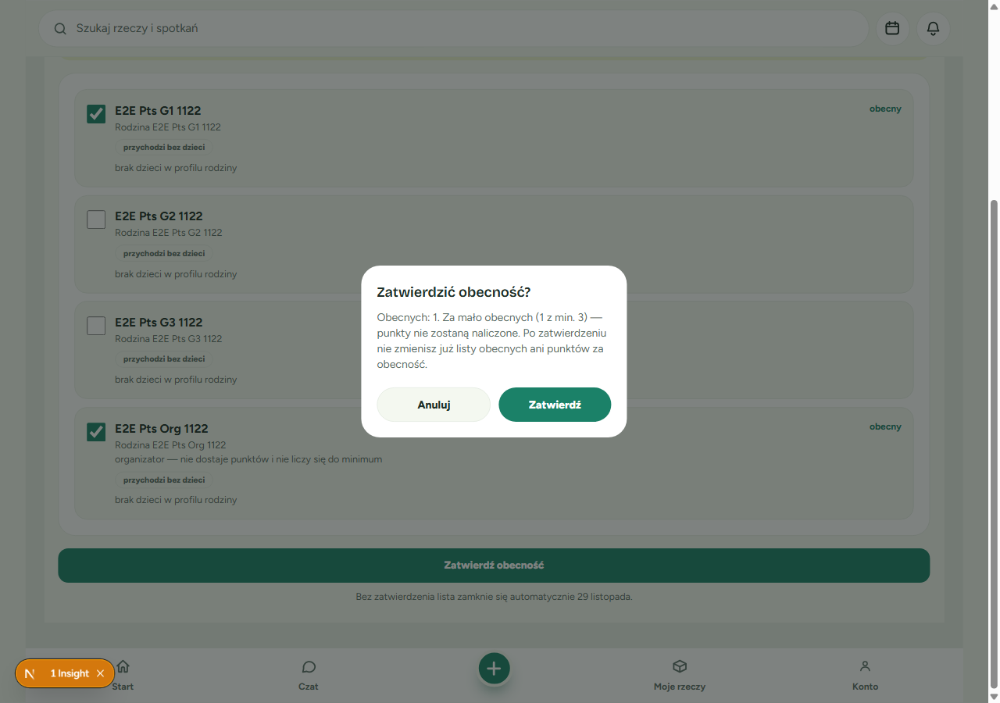

Jeśli minimum jest spełnione, zobaczysz tylko liczbę obecnych:

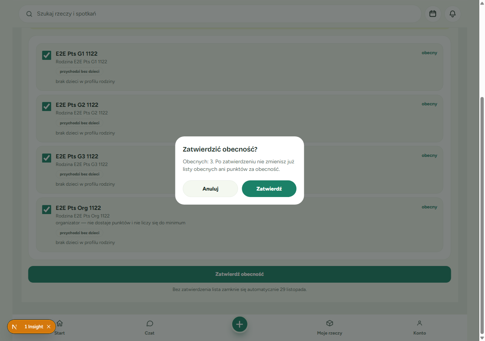

Kliknij **Zatwierdź**, żeby zamknąć listę, albo **Anuluj**, żeby jeszcze coś poprawić.

⚠️ **Uwaga**: Po zatwierdzeniu nie zmienisz już listy obecnych ani punktów za obecność.

✅ **Co zobaczysz po zatwierdzeniu**:

- Gdy minimum było spełnione: „Obecność zatwierdzona *[data]*. Obecnych: 3. Każda z tych osób otrzymała do 20 pkt (w granicach miesięcznego limitu).”

  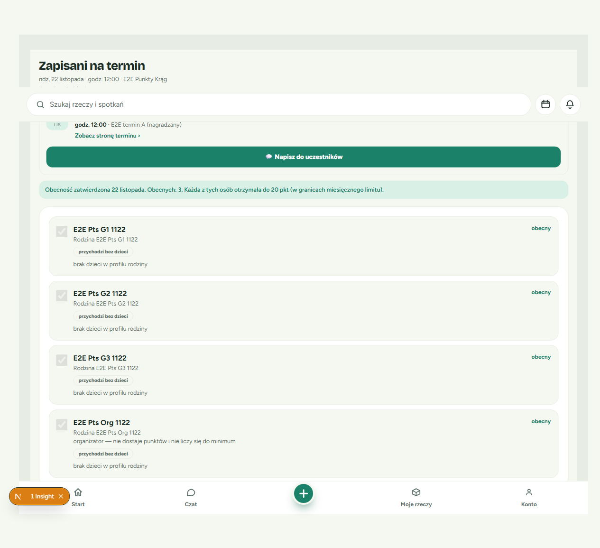

- Gdy obecnych było za mało: „Obecność zatwierdzona. Za mało obecnych osób (1 z min. 3), punkty nie zostały naliczone.”

  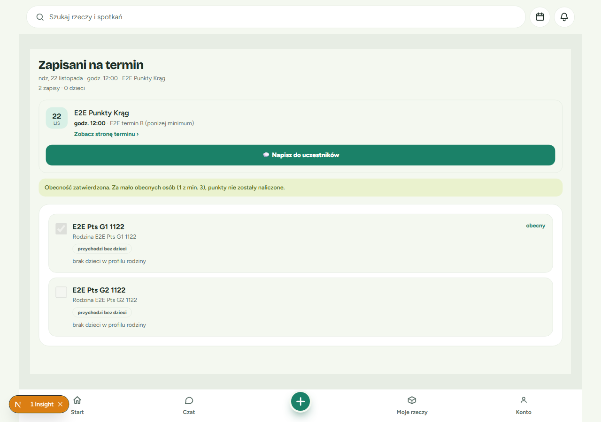

- Gdy termin miał 0 pkt: „Lista obecności zamknięta.”

Lista po zatwierdzeniu jest „zamrożona”: nawet jeśli ktoś później wypisze się z terminu, wynik się nie zmieni.

### A jeśli zapomnę zatwierdzić?

Nic się nie stanie. Lista **zamknie się sama** po kilku dniach od rozpoczęcia terminu (domyślnie po **7 dniach**). Datę widzisz pod przyciskiem: „Bez zatwierdzenia lista zamknie się automatycznie *[data]*.”

Przy automatycznym zamknięciu liczą się osoby zaznaczone do tej pory. Jeśli nikogo nie zaznaczysz, nikt nie dostanie punktów.

💡 **Dobra praktyka**: Zaznaczaj obecnych w trakcie spotkania, a na koniec od razu kliknij **Zatwierdź obecność**.

---

## 3. Dla administratorów: konfiguracja punktów i klasy wielkości

Ta część jest dla osób z dostępem do panelu administratora.

### Konfiguracja punktów

W panelu administratora wybierz w menu **Points**. Otworzy się strona **Konfiguracja punktów**.

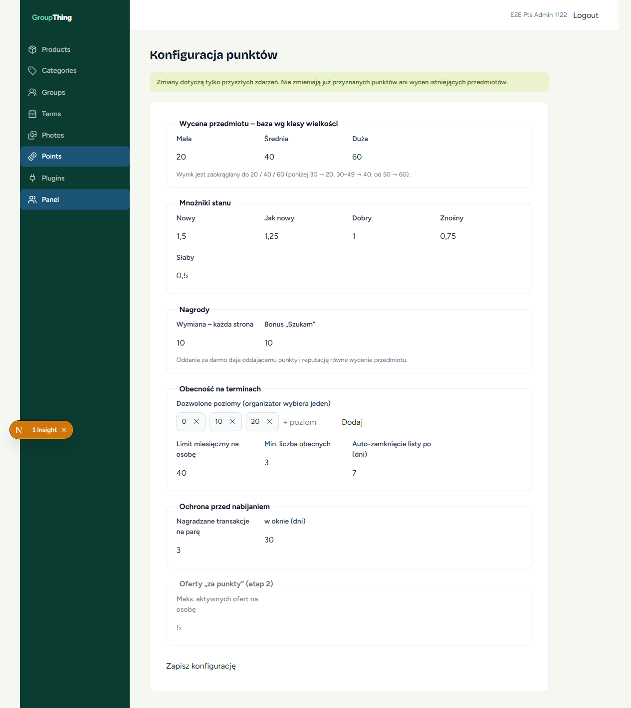

⚠️ **Zmiany dotyczą tylko przyszłych zdarzeń.** Nie zmieniają już przyznanych punktów ani wyceny rzeczy, które już są w systemie.

Strona ma kilka sekcji:

| Sekcja | Co ustawiasz | Domyślnie |
|---|---|---|
| **Wycena przedmiotu – baza wg klasy wielkości** | Bazowa wartość rzeczy małej, średniej i dużej | 20 / 40 / 60 |
| **Mnożniki stanu** | Jak stan rzeczy zmienia jej wartość: Nowy, Jak nowy, Dobry, Znośny, Słaby | 1,5 / 1,25 / 1 / 0,75 / 0,5 |
| **Nagrody** | Punkty za wymianę (dla każdej strony) i bonus „Szukam” | 10 / 10 |
| **Obecność na terminach** | Poziomy do wyboru dla organizatorów, limit miesięczny na osobę, minimalna liczba obecnych, po ilu dniach lista zamyka się sama | 0, 10, 20 / 40 / 3 / 7 |
| **Ochrona przed nabijaniem** | Ile nagradzanych przekazań na parę osób i w jakim okresie | 3 w 30 dni |
| **Oferty „za punkty” (etap 2)** | Przygotowanie na kolejny etap — na razie nie działa | 5 |

**Jak liczona jest wartość rzeczy?** Baza (z klasy wielkości) × mnożnik stanu, a wynik jest zaokrąglany do jednej z trzech wartości:
- poniżej 30 → **20 pkt**,
- od 30 do 49 → **40 pkt**,
- 50 i więcej → **60 pkt**.

💡 **Przykład**: rzecz średnia (40) w stanie „Znośny” (0,75) = 30 → **40 pkt**. Rzecz mała (20) w stanie „Nowy” (1,5) = 30 → **40 pkt**.

**Jak zapisać zmiany**

1. Kliknij w wartość, którą chcesz zmienić, i wpisz nową. Mnożniki możesz wpisywać z przecinkiem (np. 1,25).
2. Poziomy obecności dodajesz w polu „+ poziom” i przyciskiem **Dodaj**, a usuwasz krzyżykiem ✕. Można mieć od 1 do 5 różnych poziomów.
3. Kliknij **Zapisz konfigurację**. Zobaczysz komunikat „Zapisano konfigurację.”

Jeśli wpiszesz coś niedozwolonego, pod polem pojawi się czerwony komunikat, a przycisk zapisu będzie nieaktywny, dopóki tego nie poprawisz.

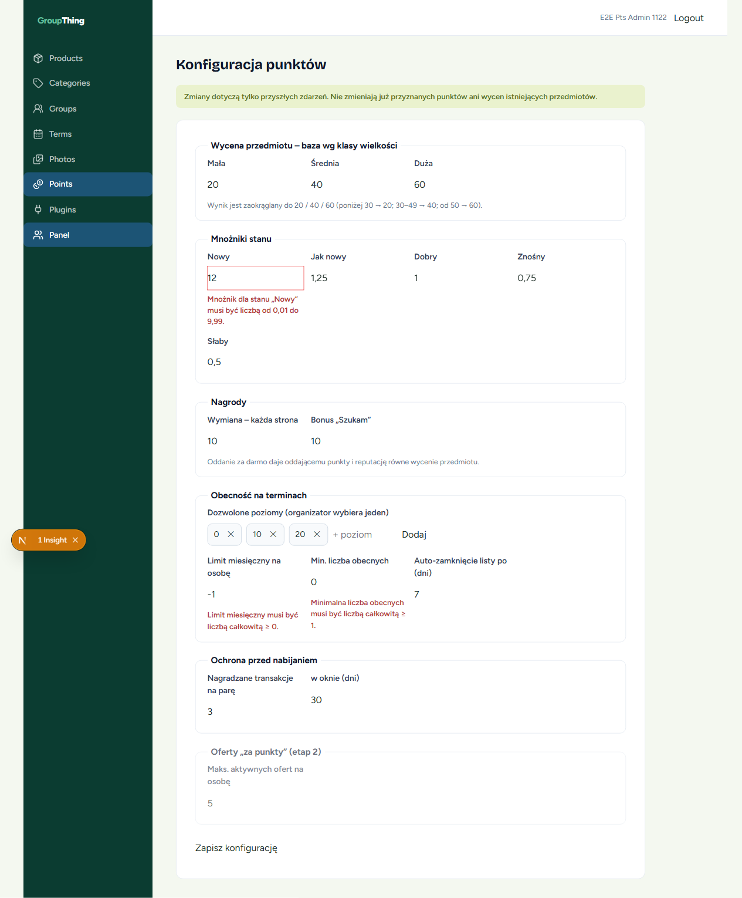

⚠️ **„Konfiguracja została zmieniona w międzyczasie. Odśwież stronę.”** — ktoś inny zapisał zmiany, gdy miałeś(-aś) otwartą stronę. Odśwież stronę, sprawdź nowe wartości i wprowadź swoje zmiany jeszcze raz.

### Klasy wielkości kategorii

Każda kategoria może mieć klasę wielkości: **Mała**, **Średnia** albo **Duża**. To od niej zależy baza wyceny rzeczy (20 / 40 / 60 pkt).

**Dziedziczenie**: kategoria bez ustawionej klasy bierze ją od kategorii nadrzędnej. Wystarczy więc ustawić klasę raz, wysoko w drzewie, a wszystkie podkategorie ją przejmą. Główne kategorie mają domyślnie klasę **Średnia**.

**Krok 1. Sprawdź klasy na liście kategorii**

W menu wybierz **Categories**. W kolumnie **Klasa wielkości** widać klasę każdej kategorii. Dopisek **„· dziedziczona”** oznacza, że kategoria bierze klasę od kategorii nadrzędnej.

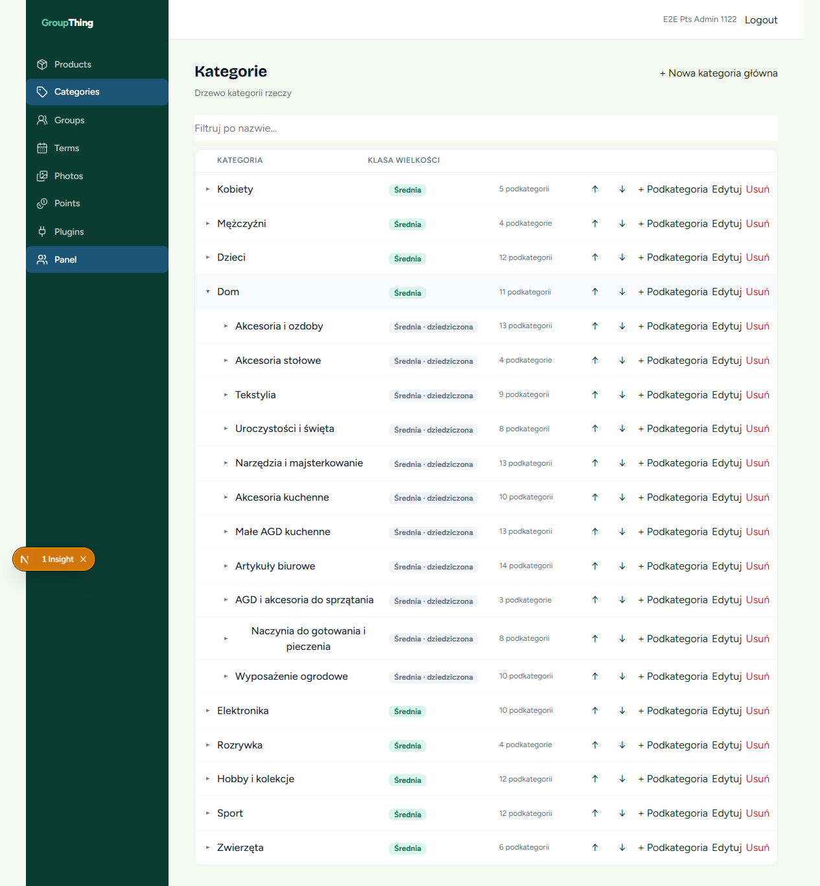

**Krok 2. Zmień klasę kategorii**

Otwórz edycję kategorii i wybierz wartość w polu **Klasa wielkości (wycena punktowa)**:
- „Dziedzicz z kategorii nadrzędnej (obecnie: …)” — kategoria przejmie klasę z góry (dla kategorii głównej: „Dziedzicz (domyślnie: Średnia)”),
- „Mała – baza 20 pkt”,
- „Średnia – baza 40 pkt”,
- „Duża – baza 60 pkt”.

Kliknij **Zapisz**.

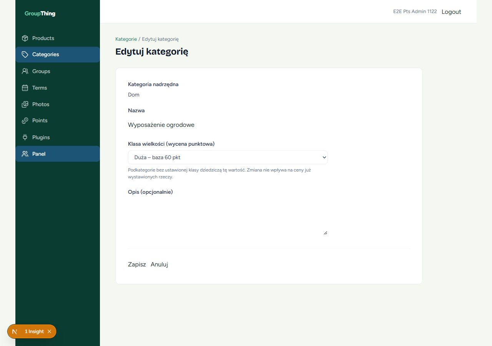

✅ **Co zobaczysz**: na liście kategoria ma nową klasę, a jej podkategorie bez własnej klasy pokazują ją z dopiskiem „· dziedziczona”.

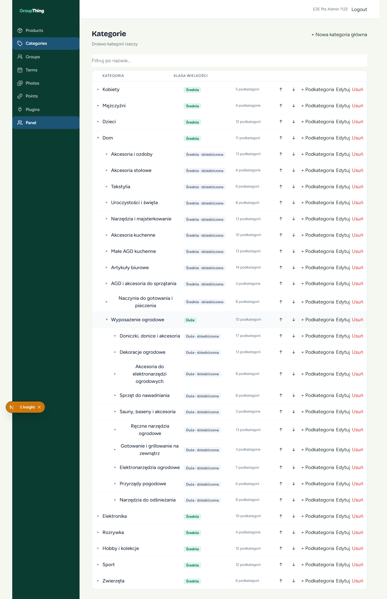

⚠️ **Uwaga**: Zmiana klasy nie zmienia wyceny rzeczy, które już zostały dodane. Dotyczy tylko nowych rzeczy oraz tych, którym właściciel zmieni stan albo produkt.

---

## 4. Rozwiązywanie problemów

**Oddałem(-am) rzecz, a nie dostałem(-am) punktów.**
- Czy odbiorca potwierdził przekazanie? Punkty pojawiają się dopiero po potwierdzeniu.
- Czy odbiorca należy do Twojego domu („Mój dom”)? Przekazania w rodzinie nie dają punktów.
- Czy to już kolejne przekazanie tej samej osobie w ostatnim miesiącu? Domyślnie nagradzane są 3 przekazania na parę w ciągu 30 dni.

**Byłem(-am) na terminie, ale nie mam punktów.**
- Organizator mógł jeszcze nie zatwierdzić listy. Lista zamyka się sama najpóźniej kilka dni po terminie.
- Termin mógł mieć 0 pkt albo przyszło za mało osób.
- Mogłeś(-aś) wyczerpać miesięczny limit punktów za obecność.
- Jeśli jesteś organizatorem tej grupy — organizatorzy nie dostają punktów za swoje terminy.

**Mam reputację mniejszą niż punkty.**
To normalne. Reputacja rośnie tylko za oddawanie za darmo, a punkty także za wymiany, bonus „Szukam” i obecność.

**Jako organizator nie mogę zaznaczyć obecności.**
- Termin jeszcze się nie zaczął — pola będą aktywne od jego rozpoczęcia.
- Lista została już zatwierdzona (ręcznie albo automatycznie) — wtedy nie da się jej zmienić.

**Nie mogę zmienić punktów za obecność w edycji terminu.**
Po zatwierdzeniu obecności poziom punktów jest zablokowany: „Obecność jest już zatwierdzona — nie można zmienić punktów za obecność.”

**Gdzie mogę wydać punkty?**
Jeszcze nigdzie. Wydawanie punktów na przedmioty oznaczone „za punkty” pojawi się w kolejnym etapie.
