# Płatne zajęcia — cena, link do płatności i „opłacone”

*Ostatnia aktualizacja: 24 listopada 2026*

## TL;DR
- **Organizator** wpisuje cenę (i opcjonalnie link do swojej strony płatności) w ustawieniach grupy. Każdy nowy termin dostaje je automatycznie, a w każdym terminie można je zmienić albo usunąć (puste pole ceny = zajęcia bezpłatne).
- **Uczestnik** widzi cenę jeszcze przed zapisaniem się. Po zapisie widzi przycisk „Zapłać” (gdy jest link) albo informację „Do zapłaty … (na miejscu)”.
- Aplikacja **nie pobiera pieniędzy**. Wpłata trafia na stronę płatności organizatora albo do jego rąk na miejscu, a organizator **ręcznie** zaznacza „opłacone” na liście zapisanych.
- Gdy ktoś zapłaci i się wypisze, organizator zobaczy „wypisany — do zwrotu”. Zwrot odbywa się poza aplikacją, a potem organizator odznacza „opłacone”.

## Key Decisions
- Przewodnik jest w dwóch częściach: dla **organizatora** i dla **uczestnika (rodzica)**. Na końcu są pytania i odpowiedzi.
- Zrzuty ekranu pochodzą głównie z testów aplikacji (konta i dane testowe, np. „E2E Guest…”, „E2E Płatny krąg”). Trzy brakujące ujęcia (przycisk „Zapłać”, „Do zapłaty … (na miejscu)” i zakładka „Organizujesz”) zrobiłem osobno na nowych kontach testowych. Zrzuty nie zawierają prawdziwych danych osobowych, adresów e-mail ani haseł.
- Wszystkie zrzuty są w widoku telefonu (szerokość 400 px).

## Open Questions / Risks
- Na części zrzutów z testów w lewym dolnym rogu widać pomarańczowy znaczek „1 Insight”. To narzędzie programisty, którego zwykły użytkownik nie zobaczy. Zakrywa ono częściowo przyciski „Start” i „Czat” w dolnym pasku.
- Na telefonie przycisk „Zapłać” (oraz „Do zapłaty” i „Opłacone”) bywa schowany pod dolnym paskiem nawigacji, dopóki nie przewinie się strony do samego końca. Przewodnik o tym wspomina. To znany drobny błąd, który ma zostać poprawiony.
- Link do płatności to dowolna strona `https://` wpisana przez organizatora. Aplikacja nie sprawdza, czyja to strona.

---

## Spis treści
1. [Co to jest?](#co-to-jest)
2. [Dla organizatora](#dla-organizatora)
   - [Ustaw cenę i link w grupie](#1-ustaw-domyślną-cenę-i-link-w-grupie)
   - [Nowe terminy dostają cenę automatycznie](#2-nowe-terminy-dostają-cenę-automatycznie)
   - [Zmień cenę jednego terminu lub ustaw go jako bezpłatny](#3-zmień-cenę-jednego-terminu-lub-ustaw-go-jako-bezpłatny)
   - [Zaznacz, kto zapłacił](#4-zaznacz-kto-zapłacił)
   - [Ktoś zapłacił i się wypisał — zwrot](#5-ktoś-zapłacił-i-się-wypisał--zwrot-pieniędzy)
3. [Dla uczestnika (rodzica)](#dla-uczestnika-rodzica)
   - [Sprawdź cenę przed zapisaniem](#1-sprawdź-cenę-przed-zapisaniem-się)
   - [Zapłać](#2-zapłać)
   - [Zobacz „Opłacone”](#3-zobacz-opłacone)
   - [„Moje zajęcia” — wszystko w jednym miejscu](#4-moje-zajęcia--wszystko-w-jednym-miejscu)
   - [Wypisz się](#5-wypisz-się-z-terminu)
   - [Zapisz się ponownie](#6-zapisz-się-ponownie)
4. [Pytania i odpowiedzi](#pytania-i-odpowiedzi)

---

## Co to jest?

Jeśli prowadzisz zajęcia, za które pobierasz opłatę (np. warsztaty plastyczne, zajęcia sportowe), możesz teraz:

- podać **cenę** zajęć, żeby rodzice wiedzieli z góry, ile zapłacą,
- dodać **link do swojej strony płatności** (np. zbiórki lub szybkiego przelewu), żeby można było zapłacić jednym kliknięciem,
- **zaznaczać, kto już zapłacił**, bezpośrednio na liście zapisanych.

⚠️ **Ważne:** aplikacja **nie przyjmuje i nie przekazuje pieniędzy**. Płatność odbywa się na stronie, którą podaje organizator, albo na miejscu (np. gotówką). Status „opłacone” ustawia **organizator ręcznie**, gdy sprawdzi, że wpłata dotarła.

**Kto z tego korzysta?**
- **Organizatorzy**, którzy chcą pobierać opłaty i mieć porządek w tym, kto zapłacił.
- **Rodzice i uczestnicy**, którzy chcą wiedzieć, ile kosztują zajęcia i jak zapłacić.

---

## Dla organizatora

### 1. Ustaw domyślną cenę i link w grupie

Cena i link zapisane w grupie to „ustawienia startowe”. Każdy nowy termin tej grupy dostanie je automatycznie, więc nie musisz ich wpisywać za każdym razem.

📝 **Czego potrzebujesz:**
- konta organizatora,
- (opcjonalnie) adresu swojej strony płatności, zaczynającego się od `https://`.

**Kroki:**

1. **Otwórz formularz grupy.**

   Przy tworzeniu nowej grupy użyj przycisku „Dodaj grupę”. Przy istniejącej grupie wejdź w „Moje grupy”, wybierz grupę i otwórz jej edycję.

2. **Wpisz cenę w polu „Cena domyślna (zł)”.**

   Wpisz kwotę w złotych, np. `25,50`. Możesz użyć przecinka. Jeśli zostawisz pole puste, zajęcia będą **bezpłatne**.

3. **(Opcjonalnie) Wklej link w polu „Link do płatności (opcjonalnie)”.**

   Link musi zaczynać się od `https://`. Jeśli go nie podasz, uczestnicy zobaczą, że płacą **na miejscu**.

   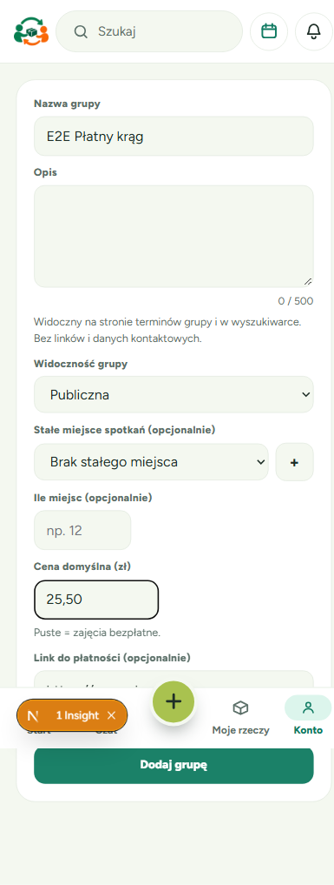

4. **Zapisz grupę** przyciskiem „Dodaj grupę” (lub przyciskiem zapisu w edycji).

✅ **Co powinno się stać:** grupa zapisuje się bez błędów, a gdy otworzysz ją ponownie, pola mają wpisane wartości.

**Gdy coś jest nie tak, formularz to podpowie** (przycisk zapisu jest wtedy nieaktywny):

| Komunikat | Co zrobić |
|---|---|
| „Podaj kwotę od 0,01 do 100 000 zł albo zostaw puste.” | Wpisz poprawną kwotę (bez `0`, najwyżej dwa miejsca po przecinku) albo wyczyść pole, jeśli zajęcia są darmowe. |
| „Link musi zaczynać się od https://” | Popraw początek adresu, np. `http://` na `https://`. |
| „Link wymaga ceny — wpisz cenę albo usuń link.” | Link do płatności ma sens tylko przy płatnych zajęciach: wpisz cenę albo usuń link. |
| „Link do płatności może mieć najwyżej 500 znaków.” | Użyj krótszego adresu. |

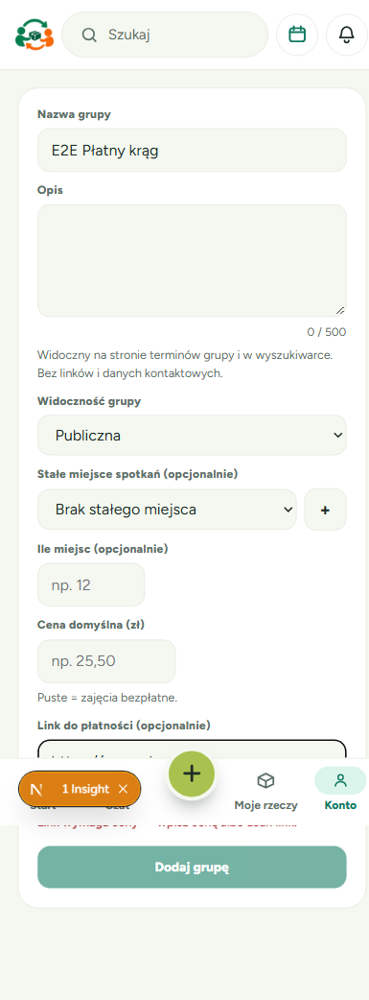

💡 **Wskazówka:** zmiana ceny w grupie dotyczy tylko terminów, które dodasz **później**. Terminy, które już istnieją, zachowują swoją cenę. Zmień je osobno (patrz punkt 3).

---

### 2. Nowe terminy dostają cenę automatycznie

Gdy dodajesz termin („Dodaj termin”), pola **„Cena (zł)”** i **„Link do płatności (opcjonalnie)”** są już wypełnione wartościami z grupy. Na górze formularza zobaczysz podpowiedź:

> „Cena i link podpowiedziane z ustawień kręgu — możesz je zmienić.”

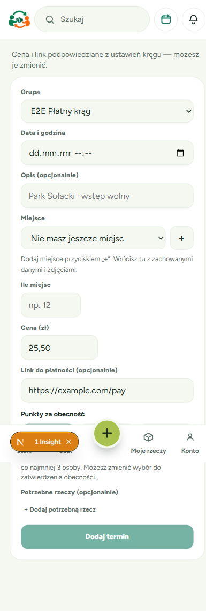

Możesz od razu:
- **zostawić** cenę i link bez zmian,
- **wpisać inną kwotę** (np. dłuższe zajęcia za 40 zł),
- **usunąć link**, jeśli tym razem płatność będzie na miejscu,
- **wyczyścić cenę i link**, jeśli termin ma być bezpłatny.

---

### 3. Zmień cenę jednego terminu lub ustaw go jako bezpłatny

Cenę i link każdego terminu możesz zmienić w dowolnej chwili. Dotyczy to tylko tego jednego terminu.

**Kroki:**

1. Wejdź w **„Moje zajęcia”** → zakładka **„Organizujesz”**.
2. Przy wybranym terminie kliknij **ikonę ołówka** („Edytuj termin”).

   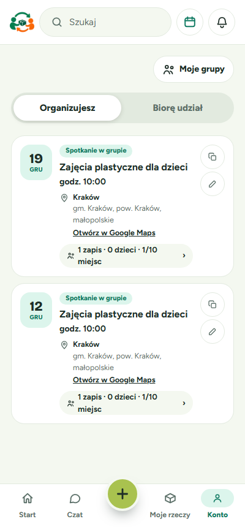

3. Zmień pole **„Cena (zł)”** i/lub **„Link do płatności”**, a potem zapisz.

**Jak zrobić termin bezpłatny:** wyczyść **oba** pola, cenę i link. Jeśli usuniesz tylko cenę, a link zostanie, zobaczysz komunikat „Link wymaga ceny — wpisz cenę albo usuń link.”:

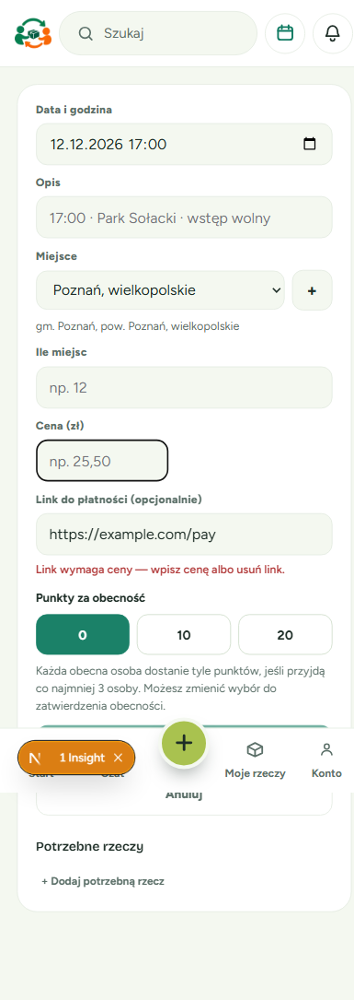

✅ **Co powinno się stać:** bezpłatny termin nie pokazuje nigdzie ceny. Na liście zapisanych nie ma przełącznika „opłacone” ani licznika „opłaceni”.

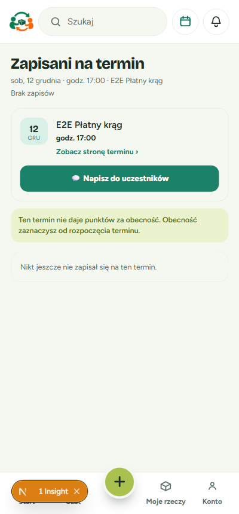

---

### 4. Zaznacz, kto zapłacił

Na liście zapisanych przy każdej osobie jest przełącznik **„opłacone”**. Możesz go włączyć **w dowolnym momencie**: przed zajęciami, w ich trakcie albo po nich.

**Kroki:**

1. Wejdź w **„Moje zajęcia”** → **„Organizujesz”**.
2. Na karcie terminu kliknij pasek z liczbą zapisów (np. „1 zapis · 0 dzieci · 1/10 miejsc”). Otworzy się lista **„Zapisani na termin”**.

   Pod tytułem zobaczysz datę, nazwę grupy i cenę (np. „· 25,50 zł”) oraz licznik, np. „1 zapis · 0 dzieci · **opłaceni: 0**”.

   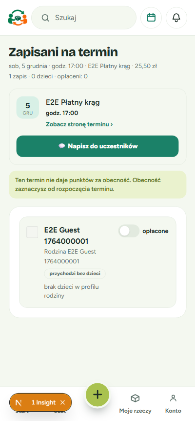

3. **Sprawdź, czy wpłata dotarła** (na Twojej stronie płatności, na koncie albo w gotówce).
4. **Włącz przełącznik „opłacone”** przy tej osobie.

   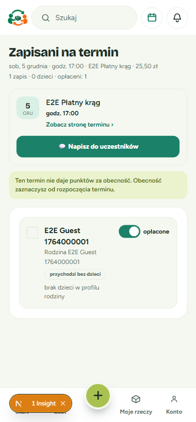

✅ **Co powinno się stać:** przełącznik zmienia kolor na zielony, a licznik pokazuje „opłaceni: 1”. Uczestnik od razu widzi u siebie „✓ Opłacone”.

💡 **Wskazówki:**
- Pomyliłeś się? Po prostu wyłącz przełącznik.
- Status „opłacone” widzi tylko organizator i sam uczestnik. Inni rodzice i osoby niezalogowane go nie widzą.
- Licznik „opłaceni” liczy osoby, które są aktualnie zapisane. Osoby, które się wypisały, nie są wliczane.

---

### 5. Ktoś zapłacił i się wypisał — zwrot pieniędzy

Jeśli osoba z zaznaczonym „opłacone” wypisze się z terminu, **nie znika z Twojej listy**. Dzięki temu nie zapomnisz o zwrocie. Zobaczysz przy niej:

- etykietę **„wypisany — do zwrotu”**,
- notatkę **„Wypisany po opłaceniu. Odznacz „opłacone” po zwrocie pieniędzy.”**,
- wyłączone pole obecności (osoba nie przyjdzie),
- wciąż aktywny przełącznik „opłacone”.

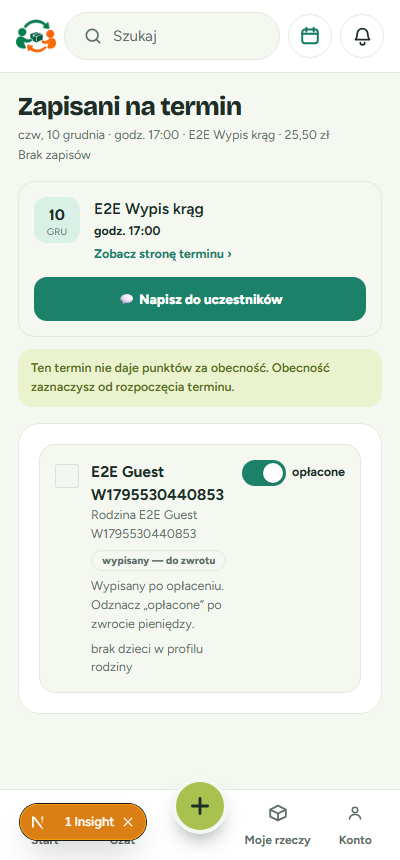

**Co zrobić:**

1. **Zwróć pieniądze poza aplikacją**, tak jak zwykle (przelew, gotówka, zwrot w serwisie płatności). Aplikacja tego nie robi za Ciebie.
2. Po zwrocie **wyłącz przełącznik „opłacone”** przy tej osobie. Wiersz zniknie z listy.

💡 **Wskazówka:** jeśli ta osoba zapisze się ponownie, zanim zwrócisz pieniądze, wróci na listę jako zwykły uczestnik z zachowanym „opłacone”. Zwrot nie będzie wtedy potrzebny.

---

## Dla uczestnika (rodzica)

### 1. Sprawdź cenę przed zapisaniem się

Na stronie terminu, przy dacie zajęć, zobaczysz **cenę** (np. „25,50 zł”) i informację, jak się płaci:

- **„Płatność online po zapisaniu się.”** — organizator podał link do płatności,
- **„płatność na miejscu”** — zapłacisz na zajęciach.

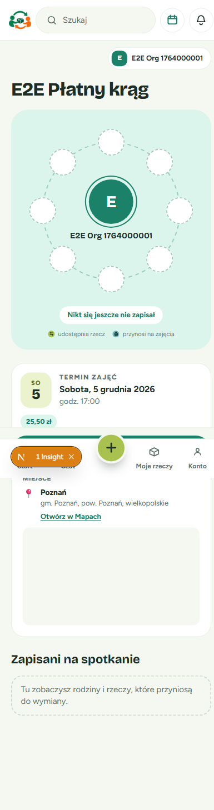

Gdy klikniesz **„＋ Zapisz się”**, okno zapisu jeszcze raz przypomni o koszcie, np.:

> „Koszt: 25,50 zł — zapłacisz po zapisaniu”

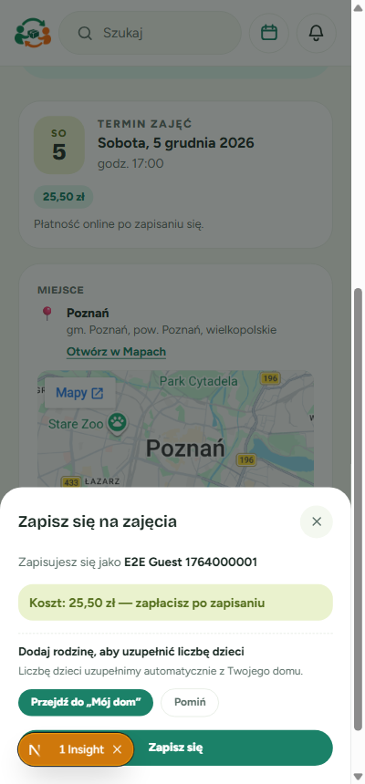

Kliknij **„Zapisz się”**, żeby potwierdzić.

💡 Jeśli przy terminie nie ma ceny, zajęcia są **bezpłatne**.

---

### 2. Zapłać

Po zapisaniu się, na dole strony terminu zobaczysz jedną z dwóch rzeczy.

**A. Przycisk „Zapłać 25,50 zł ↗”** — gdy organizator podał link do płatności.

Kliknij go. **Strona płatności organizatora otworzy się w nowej karcie**, a aplikacja zostanie otwarta w poprzedniej. Dokończ tam płatność.

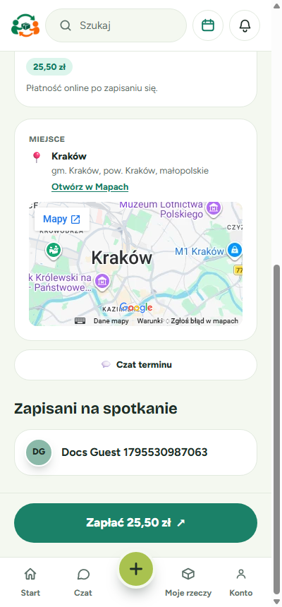

**B. Napis „Do zapłaty: 20,00 zł (na miejscu)”** — gdy nie ma linku. Zapłać organizatorowi na zajęciach.

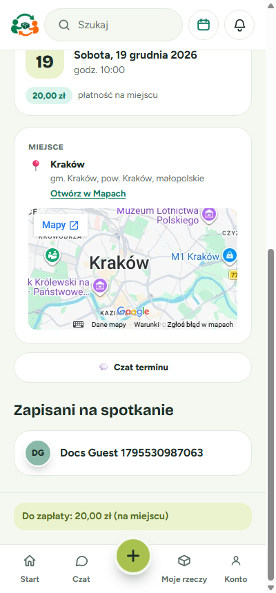

⚠️ **Nie widzisz przycisku?** Na telefonie może być schowany pod dolnym paskiem. **Przewiń stronę do samego końca.**

⚠️ **Strona płatności należy do organizatora, nie do aplikacji.** Jeśli masz wątpliwości co do linku, zapytaj organizatora, np. na „Czacie terminu”.

---

### 3. Zobacz „Opłacone”

Gdy organizator sprawdzi wpłatę i ją potwierdzi, zamiast przycisku „Zapłać” zobaczysz **„✓ Opłacone”**.

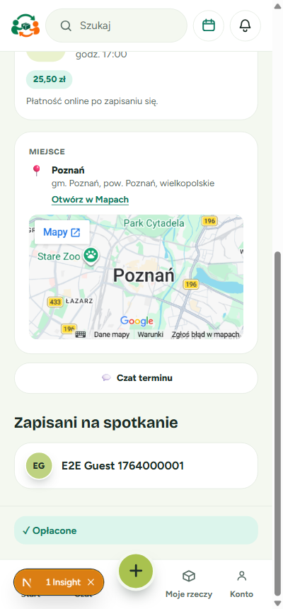

💡 Potwierdzenie **nie jest automatyczne**. Organizator zaznacza je ręcznie, więc może to chwilę potrwać (patrz [Pytania i odpowiedzi](#pytania-i-odpowiedzi)).

---

### 4. „Moje zajęcia” — wszystko w jednym miejscu

W **„Moje zajęcia”** → zakładka **„Biorę udział”** każda karta terminu pokazuje stan płatności:

- **„Do zapłaty 10,00 zł”** — jeszcze nie opłacone (albo organizator jeszcze nie potwierdził),
- **„✓ Opłacone”** — organizator potwierdził wpłatę.

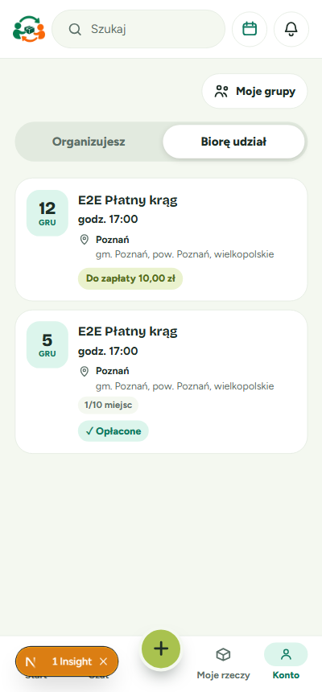

---

### 5. Wypisz się z terminu

Nie możesz przyjść? Wypisz się, żeby zwolnić miejsce.

**Kroki:**

1. Wejdź w **„Moje zajęcia”** → **„Biorę udział”**.
2. Przy wybranym terminie kliknij **„Wypisz się”**.

   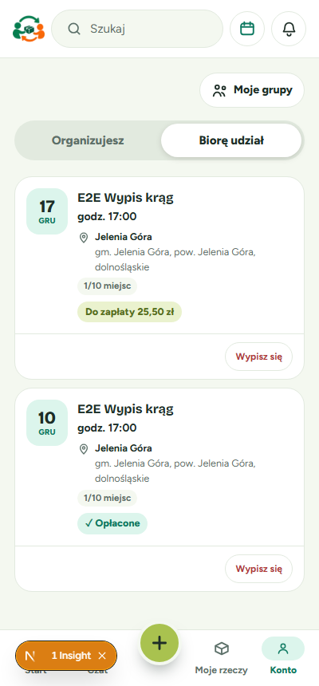

3. Pojawi się pytanie **„Wypisać się z terminu?”**. Jeśli termin był już opłacony, zobaczysz dodatkowo:

   > „Płatność jest oznaczona jako opłacona — zwrot ustalasz z organizatorem.”

   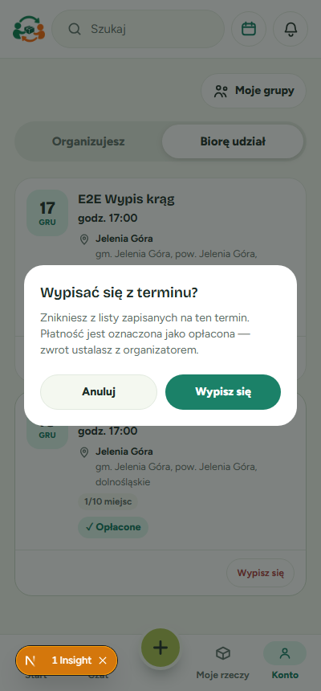

4. Kliknij **„Wypisz się”**, żeby potwierdzić, albo **„Anuluj”**, jeśli się rozmyśliłeś (nic się wtedy nie zmieni).

✅ **Co powinno się stać:** pojawi się komunikat „Wypisano z terminu”, a karta zniknie z listy.

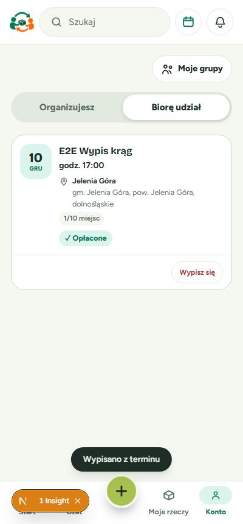

**Co z pieniędzmi?** Organizator zobaczy u siebie, że zapłaciłeś i się wypisałeś. **Zwrot ustalasz bezpośrednio z organizatorem**, bo aplikacja nie zwraca pieniędzy sama.

---

### 6. Zapisz się ponownie

Zmieniłeś zdanie? Wejdź na stronę terminu i kliknij **„＋ Zapisz się”**, tak jak za pierwszym razem.

Jeśli wcześniej zapłaciłeś (a organizator nie oddał jeszcze pieniędzy), **status „✓ Opłacone” zostaje**. Nie płacisz drugi raz.

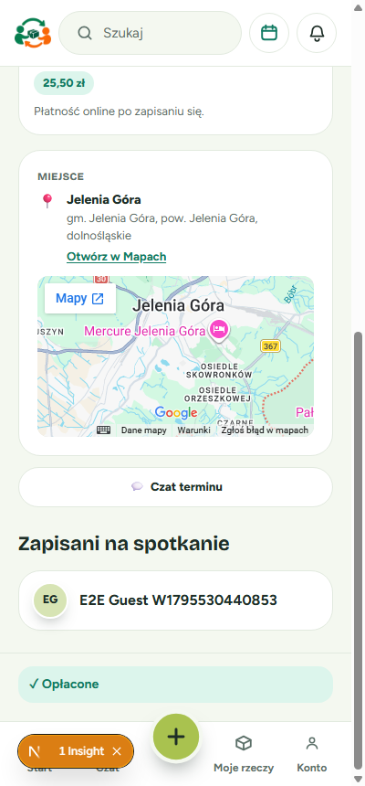

---

## Pytania i odpowiedzi

**Zapłaciłem, ale nadal widzę „Zapłać”. Co zrobić?**
To normalne. Aplikacja nie wie, że wpłata dotarła, bo płatność odbywa się na stronie organizatora. „✓ Opłacone” pojawi się, gdy **organizator ręcznie potwierdzi** wpłatę. Jeśli trwa to długo, napisz do organizatora na „Czacie terminu”. Nie płać drugi raz.

**Czy aplikacja pobiera moje pieniądze albo zapisuje dane karty?**
Nie. Przycisk „Zapłać” tylko otwiera stronę płatności podaną przez organizatora. Aplikacja nie obsługuje pieniędzy.

**Gdzie zobaczę, ile kosztują zajęcia?**
Na stronie terminu, przy dacie, jeszcze przed zapisaniem się. Przypomnienie pojawia się też w oknie zapisu.

**Nie widzę ceny przy terminie.**
Zajęcia są bezpłatne.

**Czy inni rodzice widzą, że zapłaciłem?**
Nie. Twój status płatności widzisz tylko Ty i organizator.

**Wypisałem się po zapłacie. Jak odzyskam pieniądze?**
Skontaktuj się z organizatorem. Zobaczy Cię na liście jako „wypisany — do zwrotu” i odda pieniądze poza aplikacją.

**(Organizator) Zmieniłem cenę w grupie, a stare terminy mają starą cenę.**
Tak ma być. Cena z grupy trafia tylko do **nowych** terminów. Istniejące terminy zmień przez „Edytuj termin”.

**(Organizator) Nie mogę zapisać formularza: „Link wymaga ceny”.**
Link do płatności można dodać tylko do płatnego terminu. Wpisz cenę albo usuń link.

**(Organizator) Czy mogę zaznaczyć „opłacone”, zanim zajęcia się zaczną? A po ich zakończeniu?**
Tak, w obu przypadkach. Przełącznik działa w dowolnym momencie, także gdy lista obecności jest już zamknięta, np. żeby odznaczyć „opłacone” po zwrocie.

**(Organizator) Przy liście nie ma przełącznika „opłacone”.**
Termin jest bezpłatny. Dodaj cenę przez „Edytuj termin”, a przełącznik się pojawi.
