# Logowanie i zakładanie konta przez Google

*Ostatnia aktualizacja: 26 listopada 2026*

## TL;DR

- Konto możesz założyć jednym kliknięciem: wybierz **„Zarejestruj się przez Google”** na karcie **„Załóż konto”** i wskaż swoje konto Google w okienku, które się otworzy. Nie musisz wymyślać hasła.
- Następnym razem użyj przycisku **„Zaloguj się przez Google”** na karcie **„Zaloguj się”**.
- Jeśli masz już konto założone emailem i hasłem, przycisk Google **nie połączy się** z tym kontem. Zobaczysz komunikat „Konto z tym adresem już istnieje — zaloguj się hasłem.” Zaloguj się wtedy emailem i hasłem, jak dotychczas.
- Konto założone przez Google **nie ma hasła**. Logujesz się do niego tylko przyciskiem Google.
- Gdy logowanie przez Google jest chwilowo niedostępne, przycisku może w ogóle nie być. Logowanie emailem działa zawsze.

## Key Decisions

- **Brak automatycznego łączenia kont.** Jeśli adres z Google jest już zapisany w aplikacji przy koncie z hasłem, aplikacja nie łączy tych kont. Dzięki temu nikt nie przejmie Twojego konta tylko dlatego, że ma konto Google z tym samym adresem. Opcja „Połącz z Google” jest planowana, ale jeszcze jej nie ma.
- **Konto Google nie ma hasła.** Nie da się do niego zalogować emailem i hasłem i nie da się ustawić hasła.
- **Nowe konto zaczyna jako gość**, tak samo jak przy zwykłej rejestracji. Imię bierzemy z Twojego konta Google. Jeśli się nie nadaje, tworzymy je z adresu email.
- **Logowanie odbywa się w okienku Google.** Po zalogowaniu wracasz na tę samą stronę, na której byłeś.

## Open Questions / Risks

- **Zrzuty ekranu z komunikatami o błędach pokazują przycisk testowy.** Na zrzutach z komunikatami (409, 403, 401, 503) przycisk ma napis z dopiskiem „[stub]”. To zastępczy przycisk z testów, bo podczas testów nie logowaliśmy się na prawdziwe konto Google. Prawdziwy przycisk ma logo Google i nie ma tego dopisku. Komunikaty i ich miejsce na ekranie są takie same jak w aplikacji. Zrzuty warto wymienić, gdy logowanie przez Google zadziała na serwerze testowym.
- **Na komputerze testowym (localhost) przycisk może wyglądać inaczej.** Adres testowej aplikacji nie jest jeszcze dodany w ustawieniach Google, więc Google pokazuje swój uproszczony przycisk zapasowy. Zrzuty z kart „Zaloguj się” i „Załóż konto” pokazują przycisk z logo Google, ale ostateczny przycisk może trochę różnić się wyglądem, na przykład zdjęciem profilowym lub imieniem.
- **Nie mamy zrzutów okienka Google.** Okienko wyboru konta należy do Google, a w testach nie logowaliśmy się na prawdziwe konto, więc opisujemy je tylko słownie.
- **Brak odzyskiwania konta Google.** Ktoś, kto straci dostęp do swojego konta Google, nie ma jeszcze innego sposobu, żeby wejść na konto w aplikacji (nie ma resetu hasła).
- **Wbudowane przeglądarki** (na przykład w Instagramie czy Messengerze) mogą blokować okienko Google. Tego jeszcze nie sprawdziliśmy. Instrukcja radzi otworzyć stronę w zwykłej przeglądarce.
- **Kilka kart naraz.** Jeśli przycisk Google jest otwarty w dwóch kartach przeglądarki jednocześnie, pierwsza próba może się nie udać. Drugie kliknięcie zwykle pomaga (opisane w rozwiązywaniu problemów).

---

## Spis treści

1. [Czym jest logowanie przez Google?](#czym-jest-logowanie-przez-google)
2. [Dla kogo to jest?](#dla-kogo-to-jest)
3. [Zanim zaczniesz](#zanim-zaczniesz)
4. [Jak założyć konto przez Google](#jak-założyć-konto-przez-google)
5. [Jak zalogować się przez Google następnym razem](#jak-zalogować-się-przez-google-następnym-razem)
6. [Google w okienku „Potrzebne konto”](#google-w-okienku-potrzebne-konto)
7. [Co oznaczają komunikaty](#co-oznaczają-komunikaty)
8. [Konto bez hasła — co warto wiedzieć](#konto-bez-hasła--co-warto-wiedzieć)
9. [Gdy przycisku Google nie ma](#gdy-przycisku-google-nie-ma)
10. [Rozwiązywanie problemów](#rozwiązywanie-problemów)
11. [Najczęstsze pytania](#najczęstsze-pytania)

---

## Czym jest logowanie przez Google?

To szybszy sposób na wejście do aplikacji. Zamiast wpisywać email i hasło, klikasz przycisk Google i wybierasz swoje konto Google. Aplikacja dostaje od Google potwierdzenie, kim jesteś, i od razu Cię loguje.

**Co zyskujesz:**

- nie musisz wymyślać ani pamiętać kolejnego hasła,
- konto zakładasz w kilka sekund,
- możesz zalogować się w trakcie przeglądania rzeczy, bez opuszczania strony.

## Dla kogo to jest?

- **Dla nowych osób**, które chcą szybko założyć konto, żeby zarezerwować rzecz, napisać wiadomość albo zapisać się na spotkanie.
- **Dla osób, które założyły konto przez Google**: w ten sposób logują się przy każdej wizycie.

⚠️ **Jeśli masz już konto założone emailem i hasłem**, dalej loguj się emailem i hasłem. Przycisk Google nie wpuści Cię na to konto (więcej w części [Co oznaczają komunikaty](#co-oznaczają-komunikaty)).

## Zanim zaczniesz

📝 **Czego potrzebujesz:**

- konta Google (na przykład adresu Gmail),
- **potwierdzonego** adresu email w Google (przy kontach Gmail jest potwierdzony od razu),
- przeglądarki, która pozwala otwierać okienka (pop-upy) dla tej strony.

💡 **Wskazówka:** jeśli otwierasz aplikację z linku w Instagramie, Messengerze albo innej aplikacji, okienko Google może się nie pojawić. Otwórz wtedy stronę w zwykłej przeglądarce (np. Chrome lub Safari).

---

## Jak założyć konto przez Google

Zrób to, jeśli jesteś tu pierwszy raz i nie masz jeszcze konta.

**Kroki:**

1. **Otwórz stronę logowania i wybierz kartę „Załóż konto”.**

   Na górze karty zobaczysz nagłówek „Dołącz do kręgu”, a pod nim przycisk **„Zarejestruj się przez Google”**. Pod spodem, za napisem „lub emailem”, jest zwykły formularz.

   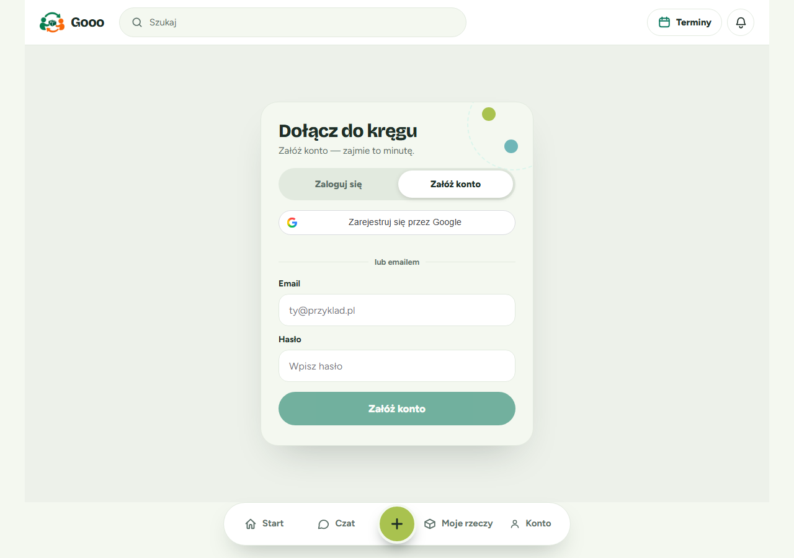

2. **Kliknij „Zarejestruj się przez Google”.**

   Otworzy się małe okienko Google. Wybierz w nim konto Google, którego chcesz użyć, albo zaloguj się do Google, jeśli trzeba.

   💡 **Wskazówka:** jeśli nic się nie otwiera, sprawdź, czy przeglądarka nie zablokowała okienka. Zwykle pokazuje wtedy ikonkę w pasku adresu.

3. **Gotowe — jesteś zalogowany.**

   Okienko Google się zamknie, a aplikacja przeniesie Cię dalej, zalogowanego na nowe konto.

   ✅ **Co powinieneś zobaczyć:** stronę, na którą chciałeś wejść, a w menu „Konto” swoje imię z Google.

**Co dalej:** Twoje nowe konto ma status gościa, tak samo jak po zwykłej rejestracji. Możesz od razu przeglądać rzeczy, rezerwować i pisać wiadomości.

---

## Jak zalogować się przez Google następnym razem

Zrób to, jeśli Twoje konto zostało założone przez Google.

**Kroki:**

1. **Otwórz stronę logowania (karta „Zaloguj się”).**

   To karta wybrana na starcie. Na górze zobaczysz przycisk **„Zaloguj się przez Google”**.

   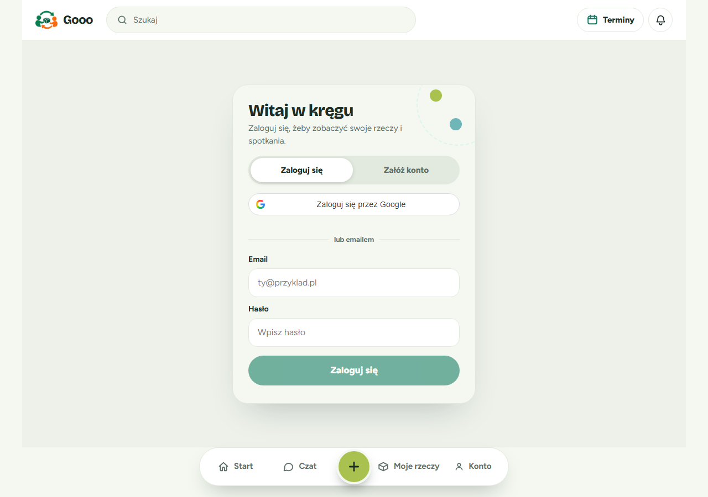

2. **Kliknij „Zaloguj się przez Google” i wybierz swoje konto Google.**

   Wybierz **to samo** konto Google, którego użyłeś przy zakładaniu konta.

3. **Gotowe.**

   ✅ **Co powinieneś zobaczyć:** wracasz na stronę, na którą chciałeś wejść, już zalogowany.

💡 **Wskazówka:** nie ma znaczenia, który przycisk klikniesz: „Zaloguj się przez Google” czy „Zarejestruj się przez Google”. Jeśli konto już istnieje, aplikacja po prostu Cię zaloguje. Jeśli nie istnieje, założy je.

---

## Google w okienku „Potrzebne konto”

Gdy bez logowania spróbujesz na przykład zarezerwować rzecz albo napisać wiadomość, od dołu ekranu wysunie się okienko **„Potrzebne konto”**. Przycisk Google jest też tam.

**Kroki:**

1. **Wybierz kartę.** „Zaloguj się”, jeśli masz już konto, albo „Załóż konto”, jeśli jesteś tu pierwszy raz.

   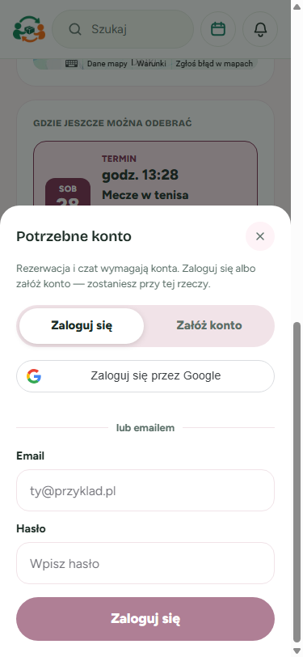

   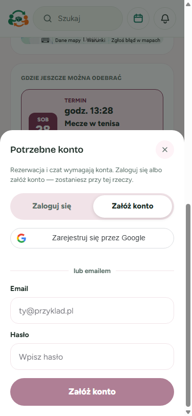

2. **Kliknij przycisk Google** i wybierz konto w okienku Google.

3. **Wracasz w to samo miejsce.**

   ✅ **Co powinieneś zobaczyć:** okienko „Potrzebne konto” się zamyka, a Ty zostajesz przy tej samej rzeczy. Możesz od razu dokończyć to, co zacząłeś.

---

## Co oznaczają komunikaty

Jeśli coś pójdzie nie tak, pod przyciskiem Google pojawi się czerwona ramka z komunikatem. Poniżej wyjaśniamy każdy z nich.

> ℹ️ Na zrzutach poniżej przycisk ma dopisek „[stub]”. To przycisk testowy. W aplikacji zobaczysz zwykły przycisk Google. Komunikaty wyglądają tak samo.

### „Konto z tym adresem już istnieje — zaloguj się hasłem.”

**Co to znaczy:** w aplikacji jest już konto z tym samym adresem email, założone emailem i hasłem. Ze względów bezpieczeństwa aplikacja **nie łączy** go automatycznie z Twoim kontem Google.

**Co zrobić:**

1. Kliknij podkreślony link **„Zaloguj się”** w komunikacie (widać go na karcie „Załóż konto”). Przeniesie Cię na kartę logowania.

   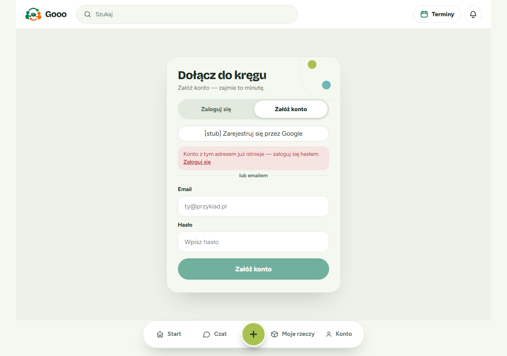

2. Zaloguj się **emailem i hasłem** w formularzu pod napisem „lub emailem”.

   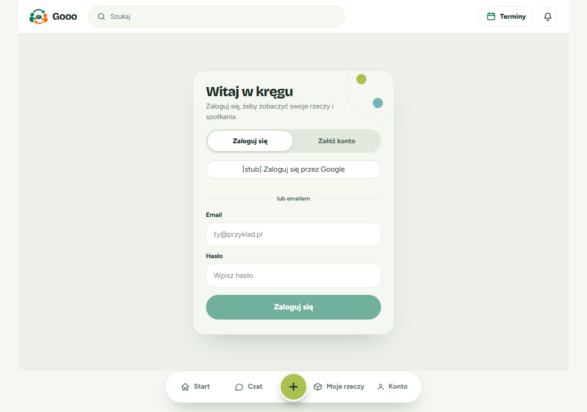

❌ **Nie zadziała:** ponowne klikanie przycisku Google. Konta z hasłem nie da się na razie połączyć z Google.

### „Ten adres w Google nie jest potwierdzony. Potwierdź go w Google albo załóż konto emailem.”

**Co to znaczy:** Google nie potwierdził, że adres email na tym koncie Google należy do Ciebie. Zdarza się to przy kontach Google założonych z adresem spoza Gmaila, którego nikt nie potwierdził.

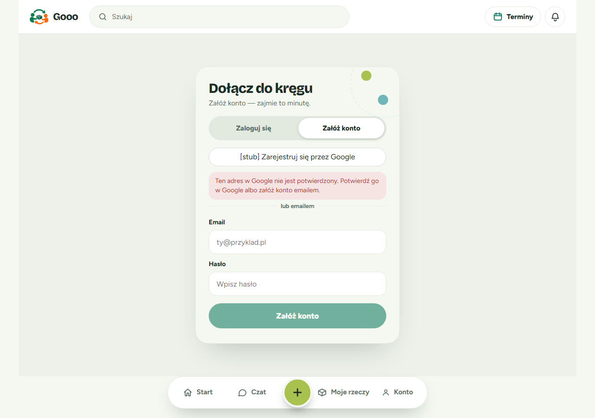

**Co zrobić (wybierz jedno):**

- potwierdź adres w ustawieniach konta Google (Google wyśle do Ciebie wiadomość z linkiem) i spróbuj ponownie, **albo**
- załóż konto zwykłym formularzem pod napisem „lub emailem”.

### „Nie udało się zalogować przez Google. Spróbuj ponownie.”

**Co to znaczy:** logowanie się nie powiodło, na przykład z powodu przerwy w internecie, zbyt długiego czekania w okienku Google albo przycisku otwartego jednocześnie w kilku kartach.

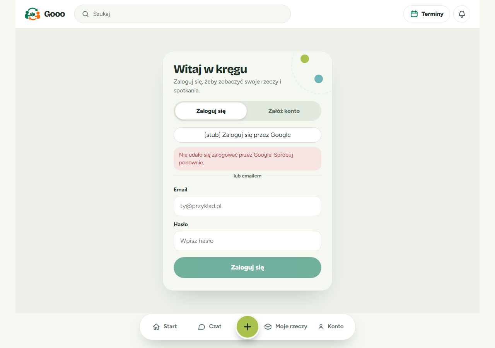

**Co zrobić:**

1. Kliknij przycisk Google **jeszcze raz**. Aplikacja sama przygotowuje się do kolejnej próby.
2. Jeśli masz otwartą aplikację w kilku kartach, zamknij pozostałe i spróbuj w jednej.
3. Jeśli to nie pomaga, odśwież stronę.

Czasem po takim błędzie przycisk Google znika i zostaje sam komunikat. Wtedy odśwież stronę albo zaloguj się emailem.

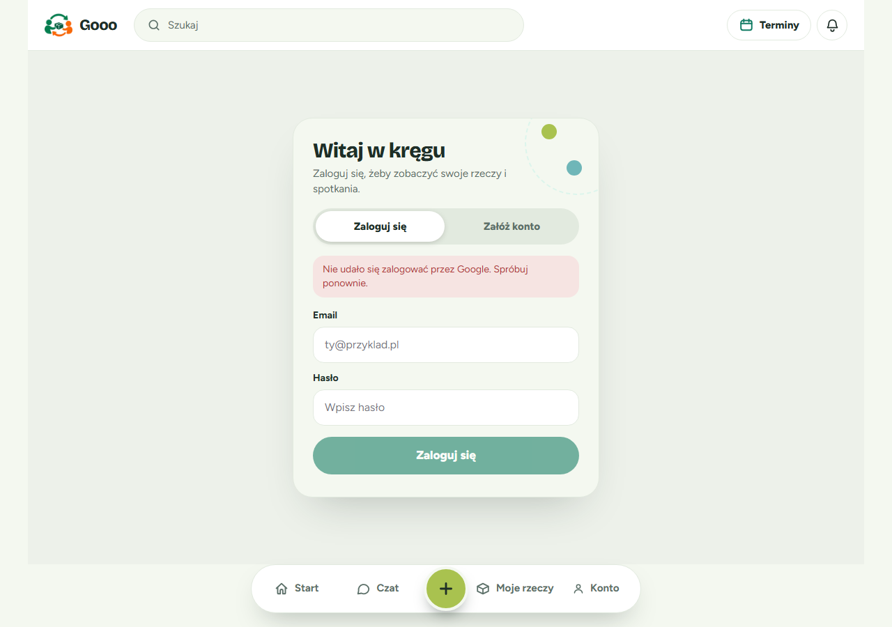

### „Logowanie przez Google jest chwilowo niedostępne. Zaloguj się emailem albo spróbuj później.”

**Co to znaczy:** aplikacja nie może teraz połączyć się z Google. Twoje konto jest bezpieczne, to tylko chwilowa przerwa.

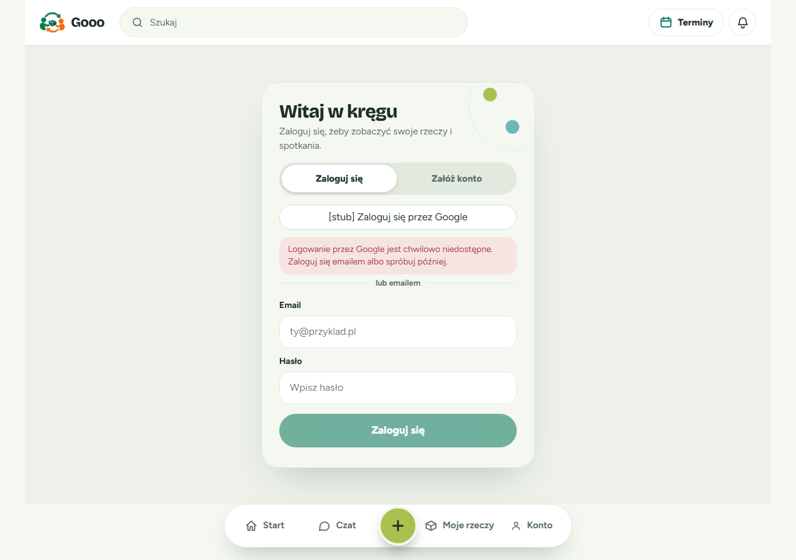

**Co zrobić:**

- jeśli masz konto z hasłem, zaloguj się emailem i hasłem,
- jeśli Twoje konto jest założone przez Google, spróbuj ponownie za kilka minut.

### Ściągawka

| Komunikat | Dlaczego | Co zrobić |
|---|---|---|
| Konto z tym adresem już istnieje — zaloguj się hasłem. | Masz już konto z hasłem na ten adres | Zaloguj się emailem i hasłem |
| Ten adres w Google nie jest potwierdzony… | Google nie potwierdził Twojego adresu | Potwierdź adres w Google albo załóż konto emailem |
| Nie udało się zalogować przez Google. Spróbuj ponownie. | Chwilowy problem z logowaniem | Kliknij jeszcze raz albo odśwież stronę |
| Logowanie przez Google jest chwilowo niedostępne… | Brak połączenia z Google | Zaloguj się emailem albo spróbuj później |

---

## Konto bez hasła — co warto wiedzieć

Konto założone przez Google **nie ma hasła**. Oznacza to, że:

- ⚠️ **logujesz się tylko przyciskiem Google.** Gdy wpiszesz swój email i dowolne hasło w zwykłym formularzu, zobaczysz błąd logowania,
- ⚠️ **nie ma resetu hasła** dla takiego konta, bo hasła po prostu nie ma,
- ⚠️ **na razie nie możesz dodać hasła** do takiego konta.

💡 **Dbaj o swoje konto Google.** Jeśli stracisz do niego dostęp, nie będziesz mógł też wejść na konto w aplikacji. Warto mieć w Google ustawiony zapasowy email lub numer telefonu.

---

## Gdy przycisku Google nie ma

Czasem na stronie logowania nie ma przycisku Google ani napisu „lub emailem”, a formularz email i hasło jest zaraz pod kartami. To znaczy, że logowanie przez Google jest w tej chwili wyłączone lub niedostępne.

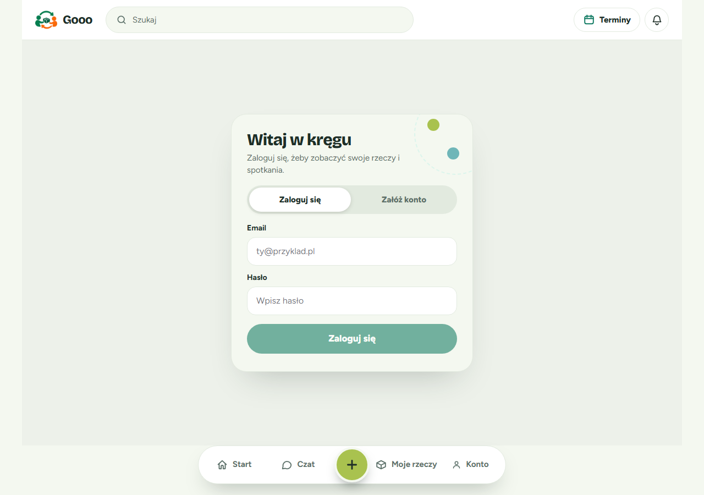

**Co zrobić:**

- jeśli masz konto z hasłem, zaloguj się emailem i hasłem,
- jeśli masz konto założone przez Google, spróbuj ponownie później. Możesz też odświeżyć stronę, bo przycisk mógł się po prostu nie wczytać, na przykład przy słabym internecie albo gdy blokada reklam zablokowała usługi Google.

💡 **Wskazówka:** zanim przycisk się pojawi, przez chwilę możesz widzieć szary, pusty pasek w jego miejscu. To normalne, przycisk właśnie się wczytuje.

---

## Rozwiązywanie problemów

**Klikam przycisk Google i nic się nie dzieje.**

- Sprawdź, czy przeglądarka nie zablokowała okienka (ikonka w pasku adresu) i zezwól na okienka dla tej strony.
- Jeśli jesteś w Instagramie, Messengerze lub innej aplikacji, otwórz stronę w zwykłej przeglądarce.

**Okienko Google zamknęło się, a ja dalej nie jestem zalogowany.**

- Jeśli zamknąłeś okienko przed wyborem konta, po prostu kliknij przycisk jeszcze raz.
- Jeśli widzisz czerwony komunikat, znajdź go w części [Co oznaczają komunikaty](#co-oznaczają-komunikaty).

**Po zalogowaniu przez Google widzę inne, puste konto.**

- Prawdopodobnie wybrałeś w okienku inne konto Google niż za pierwszym razem. Wyloguj się i zaloguj ponownie, wybierając właściwe konto Google.

**Mam konto z hasłem i chcę logować się przez Google.**

- Na razie to niemożliwe. Loguj się emailem i hasłem. Opcja „Połącz z Google” jest planowana.

**Przycisk Google był, ale zniknął.**

- Odśwież stronę. Jeśli dalej go nie ma, zobacz [Gdy przycisku Google nie ma](#gdy-przycisku-google-nie-ma).

---

## Najczęstsze pytania

**Czy aplikacja zna moje hasło do Google?**
Nie. Hasło wpisujesz tylko w okienku Google. Aplikacja dostaje od Google jedynie potwierdzenie, kim jesteś, Twój adres email i imię.

**Czy aplikacja coś publikuje na moim koncie Google?**
Nie. Służy ono tylko do logowania.

**Skąd aplikacja bierze moje imię?**
Z Twojego konta Google. Jeśli imię się nie nadaje, aplikacja tworzy je z adresu email.

**Czy mogę mieć dwa konta: jedno z hasłem i jedno przez Google, na ten sam adres?**
Nie. Jeden adres email to jedno konto. Jeśli adres jest już zajęty przez konto z hasłem, zobaczysz komunikat „Konto z tym adresem już istnieje — zaloguj się hasłem.”

---

## Powiązane

- Zwykłe logowanie i rejestracja emailem i hasłem: formularz pod napisem „lub emailem” na tej samej stronie.
- Okienko „Potrzebne konto”: pojawia się przy rezerwacji, czacie, odbiorze rzeczy, potrzebnych rzeczach i terminach prywatnych.
