# Oferty „Za punkty” — przewodnik

## TL;DR
- Punkty zdobywasz, gdy oddajesz rzeczy za darmo. Teraz możesz je też wydać na rzeczy wystawione „Za punkty”.
- Wystawiasz rzecz za punkty w zwykłym formularzu dodawania. Potrzebujesz własnego zdjęcia, a cenę wybierasz w zakresie podanym przez system. Jednocześnie możesz mieć najwyżej 5 takich ofert.
- Gdy rezerwujesz rzecz, jej cena zostaje **zablokowana** na Twoim koncie. Punkty przepadają dopiero wtedy, gdy potwierdzisz odbiór.
- Odbiór potwierdza tylko kupujący i wtedy punkty trafiają do sprzedającego. Gdy rezerwacja zostanie anulowana, zablokowane punkty wracają do kupującego.
- Na stronie „Twoje punkty” widzisz punkty dostępne, zablokowane i całą historię.

## Key Decisions
- Przewodnik jest napisany dla zwykłych użytkowników aplikacji. Ostatnia, krótka część jest dla administratorów.
- Liczby w przykładach (ceny 10–100 pkt, krok 10, limit 5 ofert) to ustawienia domyślne. Administrator może je zmienić, a wtedy aplikacja pokazuje nowe wartości.
- Zrzuty ekranu pochodzą z testów na lokalnym środowisku i pokazują konta testowe („E2E Pts2 …”). Pasek nawigacji na dole lub wyszukiwarka u góry czasem nachodzi na środek długiego zrzutu. Na telefonie te paski zawsze są na swoim miejscu.

## Open Questions / Risks
- Przycisk „Potwierdź odbiór” od razu rozlicza punkty i nie pyta „Czy na pewno?”. Przewodnik ostrzega przed tym w kroku 5. Jeśli później pojawi się okno potwierdzenia, ten fragment trzeba będzie poprawić.
- Rezerwacja na termin lub wydarzenie może czekać aż do dnia spotkania. Przez ten czas punkty kupującego są zablokowane i aplikacja nie zwalnia ich sama. Sprzedający może w każdej chwili anulować rezerwację.

*Ostatnia aktualizacja: 26 listopada 2026*

---

## Spis treści
1. [Czym jest „Za punkty”?](#1-czym-jest-za-punkty)
2. [Jak wystawić rzecz za punkty](#2-jak-wystawić-rzecz-za-punkty)
3. [Jak zmienić cenę lub stan rzeczy](#3-jak-zmienić-cenę-lub-stan-rzeczy)
4. [Jak wziąć rzecz za punkty](#4-jak-wziąć-rzecz-za-punkty)
5. [Odbiór i anulowanie](#5-odbiór-i-anulowanie)
6. [Strona „Twoje punkty”](#6-strona-twoje-punkty)
7. [Dla administratorów: ustawienia „Oferty za punkty”](#7-dla-administratorów-ustawienia-oferty-za-punkty)
8. [Najczęstsze problemy](#8-najczęstsze-problemy)

---

## 1. Czym jest „Za punkty”?

Za każdą rzecz oddaną za darmo dostajesz punkty. Do tej pory można je było tylko zbierać, a teraz możesz je **wydać**.

Każdą rzecz możesz zaoferować na jeden z trzech sposobów:

| Sposób | Co to znaczy |
|---|---|
| **Oddam** | Ktoś bierze rzecz za darmo, a Ty dostajesz punkty i reputację. |
| **Zamienię** | Wymieniasz się na inną rzecz. |
| **Za punkty** | Ktoś płaci Ci punktami, które sam wcześniej zdobył. |

Oferty za punkty łatwo rozpoznać po **pomarańczowej plakietce z ceną**, na przykład „60 pkt”.

💡 **Dobrze wiedzieć:** punkty nie są pieniędzmi i nie da się ich kupić. Zdobywa się je tylko oddając rzeczy, wymieniając się i przychodząc na spotkania.

---

## 2. Jak wystawić rzecz za punkty

Wystaw rzecz za punkty, jeśli jej już nie potrzebujesz, a chcesz coś za nią dostać. Za otrzymane punkty sam weźmiesz potem coś od innych.

📝 **Co będzie potrzebne:**
- konto w aplikacji (jesteś zalogowany)
- **co najmniej jedno własne zdjęcie rzeczy**
- zapisane miejsce odbioru (miejscowość)

**Kroki:**

1. **Otwórz formularz dodawania**

   Stuknij duży zielony **„+”** na dole ekranu, a potem kafelek **„Dodaj rzecz”**.

2. **Dodaj zdjęcie, nazwę, stan i kategorię**

   Wypełnij formularz tak jak zawsze. Od stanu i kategorii zależy, ile punktów zaproponuje system.

3. **Wybierz „Za punkty”**

   Pod pytaniem **„Jak chcesz ją przekazać?”** stuknij pomarańczowy przycisk **„Za punkty”**. Pojawi się pole **„Cena w punktach”**.

   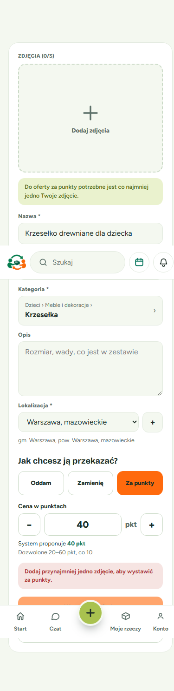

   Pod ceną zobaczysz dwie podpowiedzi:
   - **„System proponuje 40 pkt”** to uczciwa cena dla tej kategorii i tego stanu,
   - **„Dozwolone 20–60 pkt, co 10”** to zakres, w którym możesz ustawić cenę, i krok, o jaki zmienia się cena.

   ⚠️ **Bez zdjęcia nie wystawisz rzeczy.** Jeśli nie dodasz zdjęcia, zobaczysz komunikat „Dodaj przynajmniej jedno zdjęcie, aby wystawić za punkty.”, a przycisk wystawienia będzie nieaktywny. Kupujący chcą zobaczyć, co dostaną za swoje punkty.

4. **Ustaw cenę**

   Przyciskami **„–”** i **„+”** zmieniasz cenę o jeden krok, czyli tutaj o 10 pkt. Cenę możesz też wpisać ręcznie.

   Jeśli wpiszesz cenę spoza zakresu albo niepasującą do kroku (na przykład 55), zobaczysz czerwony komunikat:

   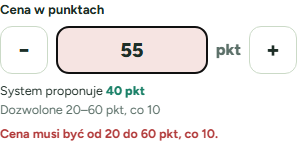

   💡 **Wskazówka:** gdy dojdziesz do najwyższej dozwolonej ceny, przycisk „+” robi się szary.

5. **Wystaw**

   Gdy zdjęcie jest dodane, a cena poprawna, przycisk zmienia napis na **„Wystaw za 60 pkt”**. Stuknij go.

   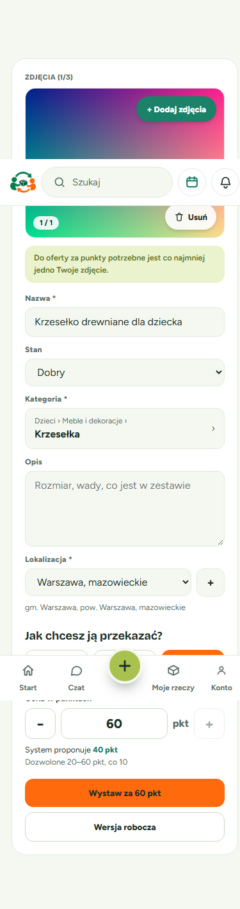

   Jeśli wolisz wystawić rzecz później, stuknij **„Wersja robocza”**.

   ✅ **Co powinieneś zobaczyć:** aplikacja otworzy stronę rzeczy z plakietką **„Za punkty”** i ceną.

   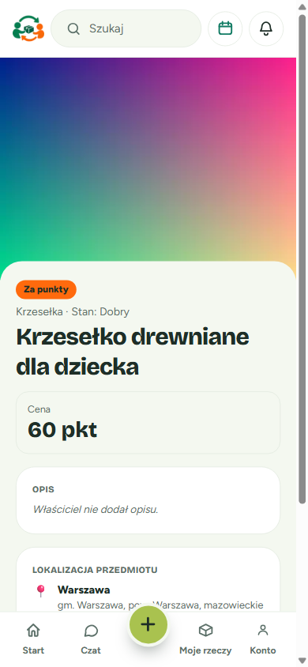

### Limit 5 ofert
Jednocześnie możesz mieć **najwyżej 5 rzeczy** wystawionych za punkty. Rzeczy zarezerwowane też się liczą. Gdy dojdziesz do limitu, zobaczysz komunikat „Masz już maksymalną liczbę ofert za punkty (5).” Miejsce zwolni się, gdy któraś rzecz zostanie odebrana albo zmienisz jej sposób przekazania.

### Co jeśli wystawienie się nie uda?
Komunikat pojawi się pod przyciskiem, a formularz zostanie otwarty. Popraw to, o co prosi aplikacja, i stuknij przycisk jeszcze raz. Rzecz nie zostanie dodana drugi raz. Jeśli wyjdziesz z formularza, rzecz poczeka jako wersja robocza w **„Moich rzeczach”**.

### Szybka zmiana w „Moich rzeczach”
Sposób przekazania możesz też zmienić w **„Moje rzeczy”** (dolny pasek). Przy każdej rzeczy są przyciski **Oddam / Zamienię / Za punkty**. Gdy wybierzesz „Za punkty”, aplikacja sama ustawi proponowaną cenę. Przy rzeczy zobaczysz dwie plakietki: proponowaną wartość (⭐ 60 pkt) i Twoją cenę (pomarańczowa, 90 pkt).

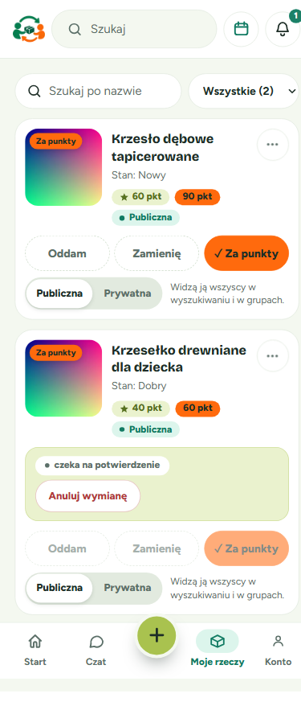

---

## 3. Jak zmienić cenę lub stan rzeczy

Cenę możesz zmienić w każdej chwili, także wtedy, gdy ktoś już zarezerwował rzecz.

**Kroki:**

1. Otwórz stronę rzeczy i wejdź w jej edycję. Możesz też wybrać „Edytuj” z menu **„…”** w „Moich rzeczach”.
2. W polu **„Cena w punktach”** ustaw nową cenę przyciskami „–” i „+”.
3. Stuknij **„Zapisz zmiany”**.

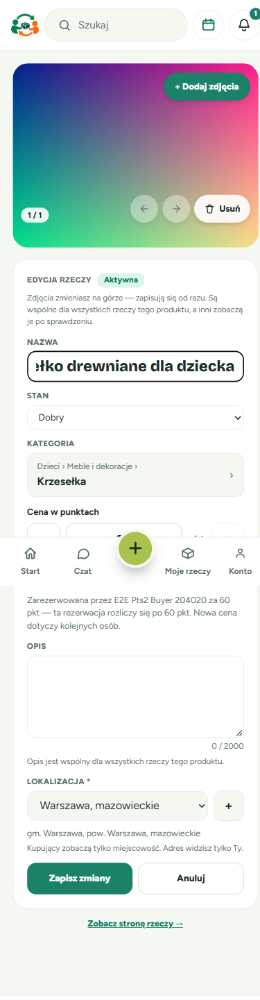

⚠️ **Rzecz jest już zarezerwowana?** Pod ceną zobaczysz na przykład: „Zarezerwowana przez … za 60 pkt — ta rezerwacja rozliczy się po 60 pkt. Nowa cena dotyczy kolejnych osób.” Osoba, która już zarezerwowała rzecz, zapłaci dokładnie tyle, ile było zablokowane w chwili rezerwacji.

### Zmiana stanu lub kategorii
Proponowana cena zależy od stanu i kategorii. Gdy je zmienisz, aplikacja od razu pokaże nową propozycję i nowy zakres, na przykład:
„Zmieniłeś stan — sugestia to teraz 60 pkt (dozwolone 30–90).”

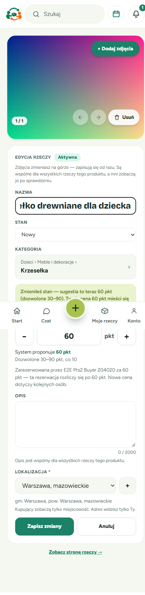

💡 **Wskazówka:** jeśli Twoja cena nie mieści się w nowym zakresie, po zapisaniu zostanie ustawiona na najbliższą dozwoloną wartość.

---

## 4. Jak wziąć rzecz za punkty

### Gdzie znaleźć oferty
Pomarańczowa plakietka z ceną jest widoczna na kartach rzeczy, na przykład w wyszukiwarce:

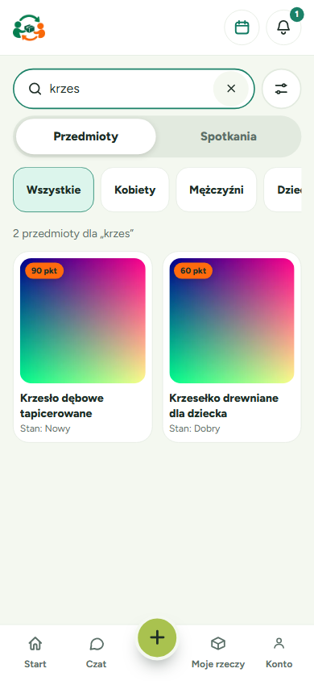

Jeśli chcesz widzieć tylko oferty za punkty, w wyszukiwarce otwórz **filtry** (ikona obok pola wyszukiwania). W sekcji **„Rodzaj oferty”** wybierz **„Za punkty”**, a potem stuknij **„Pokaż wyniki”**.

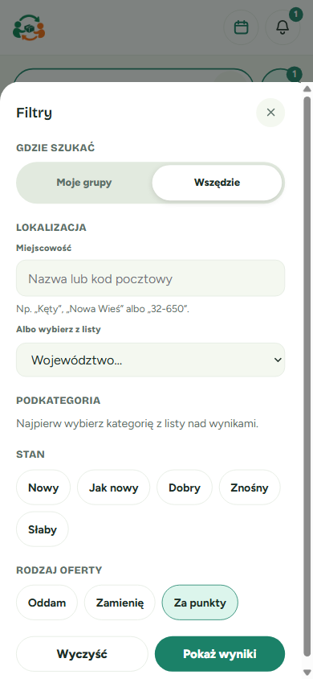

### Rezerwacja
1. **Otwórz stronę rzeczy**

   Pod nazwą rzeczy zobaczysz jej **cenę**, na przykład „Cena 60 pkt”.

2. **Stuknij „Biorę za 60 pkt”**

   Przycisk znajdziesz w sekcji „Jak chcesz odebrać?”. Jeśli rzecz można odebrać w kilku miejscach (osobiście, na spotkaniu albo na wydarzeniu), najpierw wybierz miejsce odbioru.

   💡 Jeśli nie jesteś zalogowany, aplikacja najpierw poprosi Cię o zalogowanie albo założenie konta.

3. **Sprawdź okno „Biorę za punkty”**

   W oknie zobaczysz:
   - **Cena**, czyli ile kosztuje rzecz,
   - **Dostępne saldo**, czyli ile masz wolnych punktów,
   - **Po rezerwacji**, czyli ile wolnych punktów Ci zostanie.

   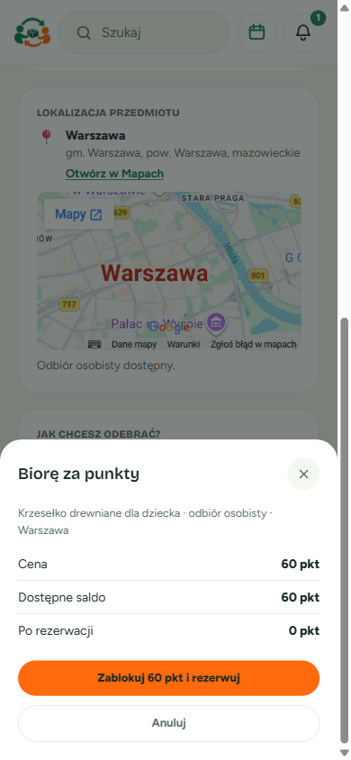

4. **Stuknij „Zablokuj 60 pkt i rezerwuj”**

   ✅ **Co powinieneś zobaczyć:** rzecz ma status **„Zarezerwowana · przez Ciebie”**, a na stronie pojawia się przycisk **„Potwierdź odbiór”**. Szczegóły spotkania ustalicie ze sprzedającym na czacie.

   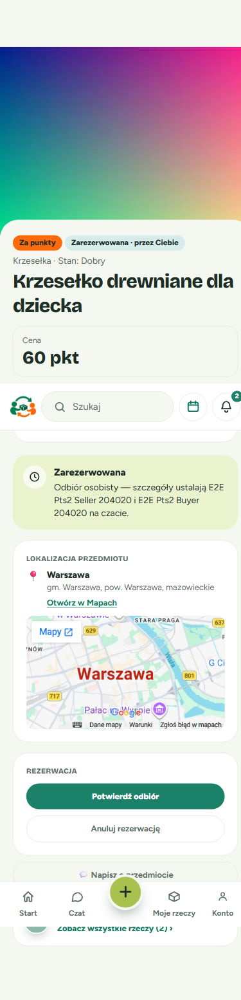

### Za mało punktów?
Gdy masz mniej punktów, niż kosztuje rzecz, przycisk w oknie jest szary. Pod nim zobaczysz, ile punktów brakuje, na przykład **„Brakuje Ci 30 pkt.”**

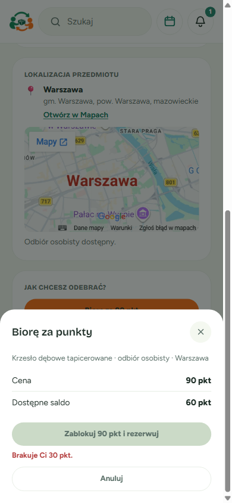

### Co znaczy „zablokowane”?
Po rezerwacji Twoje punkty **nie znikają**. Są **odłożone na bok**, jak kaucja.

- 🔒 Nie możesz ich wydać na nic innego, dopóki rezerwacja trwa.
- ✅ Gdy potwierdzisz odbiór, zablokowane punkty trafią do sprzedającego.
- ↩️ Gdy rezerwacja zostanie anulowana, punkty wrócą na Twoje saldo.

Zarezerwowane rzeczy z liczbą zablokowanych punktów zobaczysz w zakładce **„Konto”**, w pozycji **„Zarezerwowane”**:

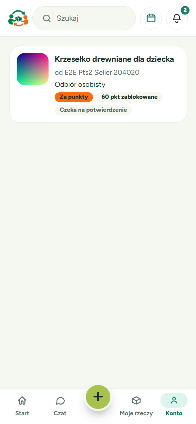

---

## 5. Odbiór i anulowanie

### Potwierdzenie odbioru (robi to tylko kupujący)
Gdy odbierzesz rzecz, otwórz jej stronę i stuknij **„Potwierdź odbiór”**.

⚠️ **Potwierdź odbiór dopiero wtedy, gdy masz rzecz w rękach.** Aplikacja nie zapyta „Czy na pewno?”, a punkty od razu przejdą do sprzedającego. Tego nie da się cofnąć.

✅ **Co się dzieje:**
- zablokowane punkty kupującego zostają wydane,
- sprzedający dostaje tyle samo punktów,
- rzecz trafia do „Moich rzeczy” kupującego jako jego własna. Nie jest wystawiona, więc możesz ją później oddać dalej.

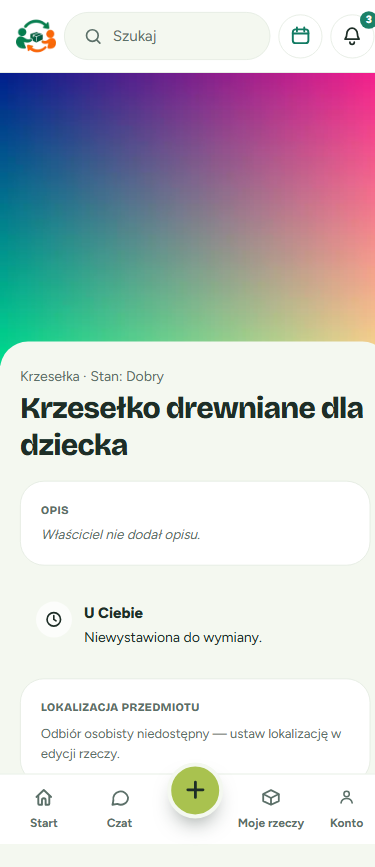

### Co widzi sprzedający
Sprzedający widzi, kto zarezerwował rzecz i ile punktów jest zablokowanych. **Sprzedający nie potwierdza odbioru.** Robi to kupujący, bo to on wie, czy dostał rzecz.

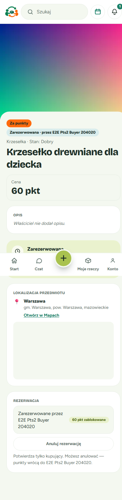

### Anulowanie rezerwacji
Rezerwację może anulować **każda ze stron**: kupujący albo sprzedający, na przykład gdy kupujący nie przyszedł.

1. Na stronie rzeczy stuknij **„Anuluj rezerwację”**.
2. Potwierdź, stukając **„Tak, anuluj”**.

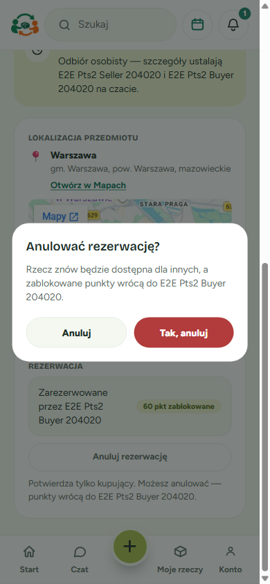

✅ **Co się dzieje:** rzecz znów jest dostępna dla innych, a **zablokowane punkty wracają do kupującego**.

---

## 6. Strona „Twoje punkty”

Swoje punkty sprawdzisz w zakładce **„Konto”**. Stuknij kafelek z saldem albo reputacją. Tę stronę widzisz tylko Ty.

Na górze są trzy liczby:

| Kafelek | Co oznacza |
|---|---|
| **dostępne** | punkty, które możesz teraz wydać |
| **zablokowane** | punkty odłożone na trwające rezerwacje |
| **reputacja** | suma punktów za rzeczy oddane za darmo (nie zmienia się przy zakupach) |

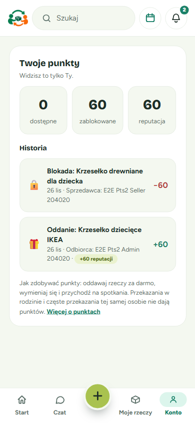

### Wpisy w historii

| Wpis | Kiedy się pojawia | Co zobaczysz |
|---|---|---|
| 🔒 **Blokada: …** | gdy zarezerwujesz rzecz za punkty | −60 (punkty idą do „zablokowanych”) |
| 🔓 **Zwolnienie blokady: …** | gdy rezerwacja zostanie anulowana | +60 (punkty wracają) |
| 🛒 **Zakup: …** | gdy potwierdzisz odbiór kupionej rzeczy | „zablokowane 60 → wydane” |
| 🛒 **Sprzedaż: …** | gdy kupujący potwierdzi odbiór Twojej rzeczy | +60 |
| 🎁 **Oddanie: …** | gdy oddasz rzecz za darmo | +60 i „+60 reputacji” |

Pod każdym wpisem jest data i druga osoba („Sprzedawca: …” albo „Kupujący: …”).

**Po anulowaniu rezerwacji** zobaczysz w historii blokadę i jej zwolnienie, a punkty znów będą dostępne:

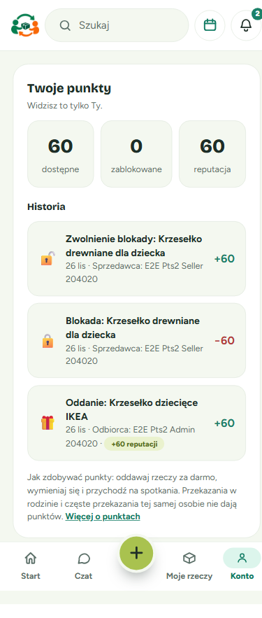

**Kupujący po odbiorze** zobaczy wpis „Zakup” z dopiskiem „zablokowane 60 → wydane”:

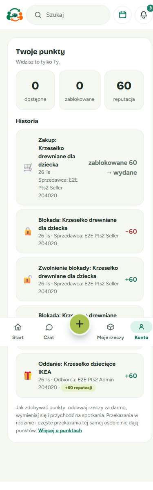

**Sprzedający po odbiorze** zobaczy wpis „Sprzedaż” i nowe dostępne punkty:

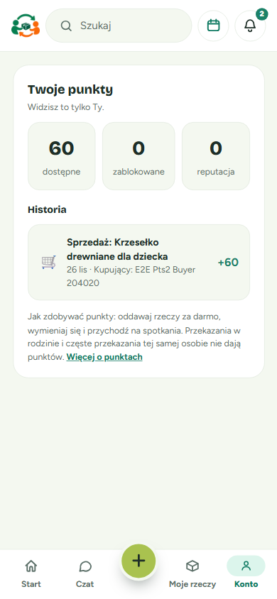

---

## 7. Dla administratorów: ustawienia „Oferty za punkty”

Ta część jest tylko dla administratorów. W panelu admina wejdź w **„Points”**, a potem przewiń do sekcji **„Oferty „za punkty””**.

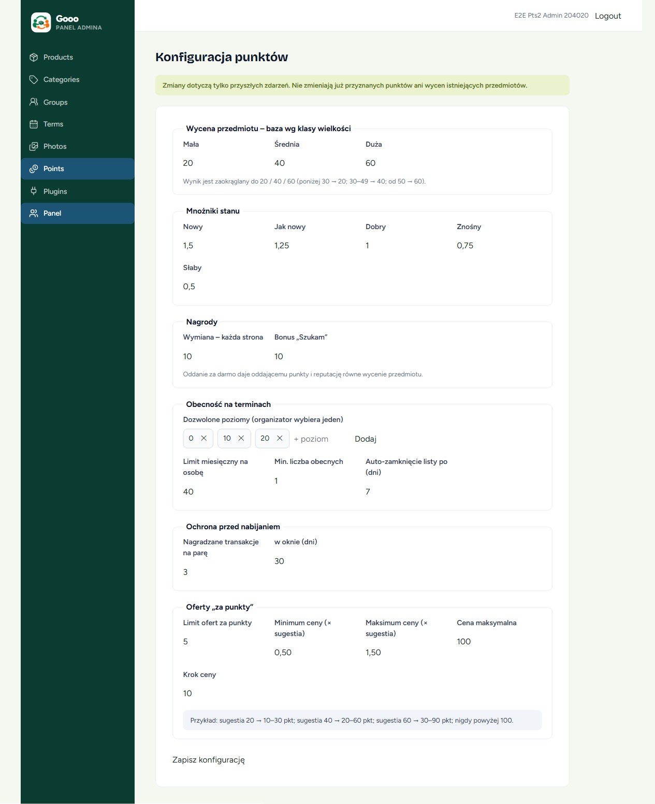

| Pole | Co ustawia | Domyślnie | Dozwolone |
|---|---|---|---|
| **Limit ofert za punkty** | ile ofert za punkty może mieć jedna osoba naraz | 5 | — |
| **Minimum ceny (× sugestia)** | najniższa cena jako ułamek propozycji systemu | 0,50 | 0,01–1,00 |
| **Maksimum ceny (× sugestia)** | najwyższa cena jako wielokrotność propozycji | 1,50 | 1,00–3,00 |
| **Cena maksymalna** | sztywny górny limit ceny | 100 | 1–1000 |
| **Krok ceny** | o ile zmienia się cena (przyciski „–”/„+”) | 10 | 1–100 |

Pod polami jest **przykład na żywo**, który od razu pokazuje efekt zmian. Przy ustawieniach domyślnych wygląda tak: „sugestia 20 → 10–30 pkt; sugestia 40 → 20–60 pkt; sugestia 60 → 30–90 pkt; nigdy powyżej 100”.

Po zmianach stuknij **„Zapisz konfigurację”**.

⚠️ **Ważne:**
- **Cena maksymalna** musi być wielokrotnością **kroku ceny**, na przykład 100 przy kroku 10. Inaczej zobaczysz komunikat o błędzie.
- Zmiany dotyczą tylko przyszłych ofert i rezerwacji. Zmniejszenie limitu ofert nie usuwa ofert, które już są wystawione, a trwające rezerwacje rozliczą się po zablokowanej cenie.
- Jeśli ktoś inny zapisał ustawienia w tym samym czasie, odśwież stronę i wprowadź zmiany jeszcze raz.

---

## 8. Najczęstsze problemy

| Problem | Co zrobić |
|---|---|
| Przycisk „Wystaw za … pkt” jest nieaktywny | Dodaj własne zdjęcie i sprawdź, czy cena mieści się w zakresie i pasuje do kroku. |
| „Tej rzeczy nie można wystawić za punkty — brak wyceny.” | Sprawdź, czy rzecz ma wybraną kategorię i stan. |
| „Masz już maksymalną liczbę ofert za punkty (5).” | Poczekaj, aż ktoś odbierze którąś rzecz, albo zmień jedną z ofert na „Oddam” lub „Zamienię”. |
| „Cena zmieniła się — odśwież.” | Sprzedający właśnie zmienił cenę. Stuknij „Odśwież” i sprawdź nową cenę. |
| „Za mało punktów — ktoś był szybszy albo masz inne blokady.” | Część Twoich punktów jest zablokowana na innych rezerwacjach. Sprawdź stronę „Twoje punkty”. |
| „Nie można kupować za punkty od członka własnej rodziny.” | Rzeczy w rodzinie przekazuj jako „Oddam”. Punkty nie krążą w rodzinie. |
| „Limit nagród dla tej pary został wyczerpany — spróbuj za kilka dni.” | W krótkim czasie zrobiłeś już kilka transakcji z tą samą osobą. Spróbuj za kilka dni. |
| „Ta transakcja została już rozstrzygnięta” | Druga strona zdążyła już potwierdzić odbiór albo anulować rezerwację. Odśwież stronę. |
| Nie widzę przycisku „Potwierdź” jako sprzedający | Tak ma być: odbiór potwierdza tylko kupujący. Ty możesz anulować rezerwację. |

---

### Powiązane
- **Jak zdobywać punkty:** strona „Więcej o punktach” (link pod historią na „Twoich punktach”)
- **Moje rzeczy:** zmiana sposobu przekazania i lista ofert
- **Zarezerwowane:** rzeczy, które bierzesz
