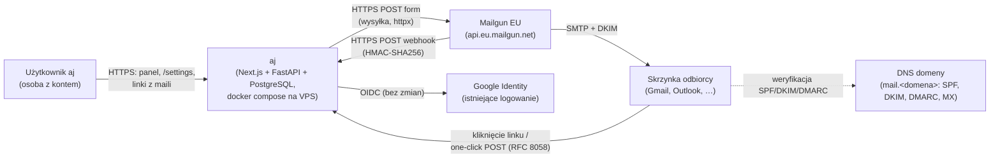
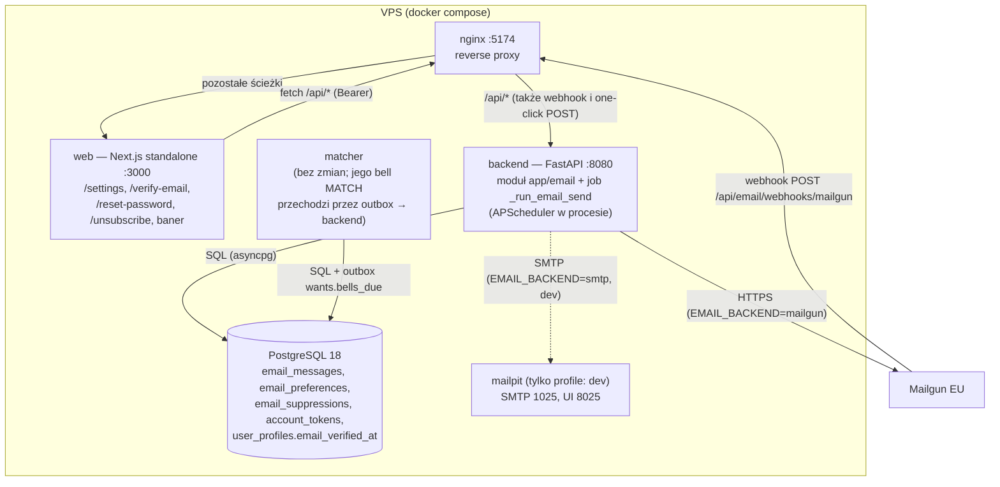
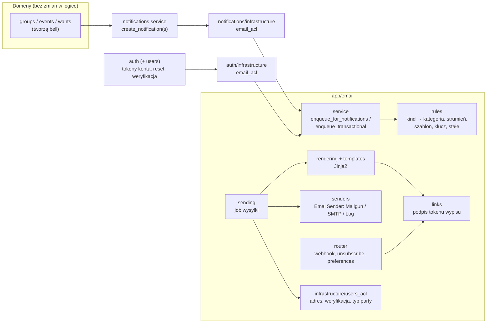
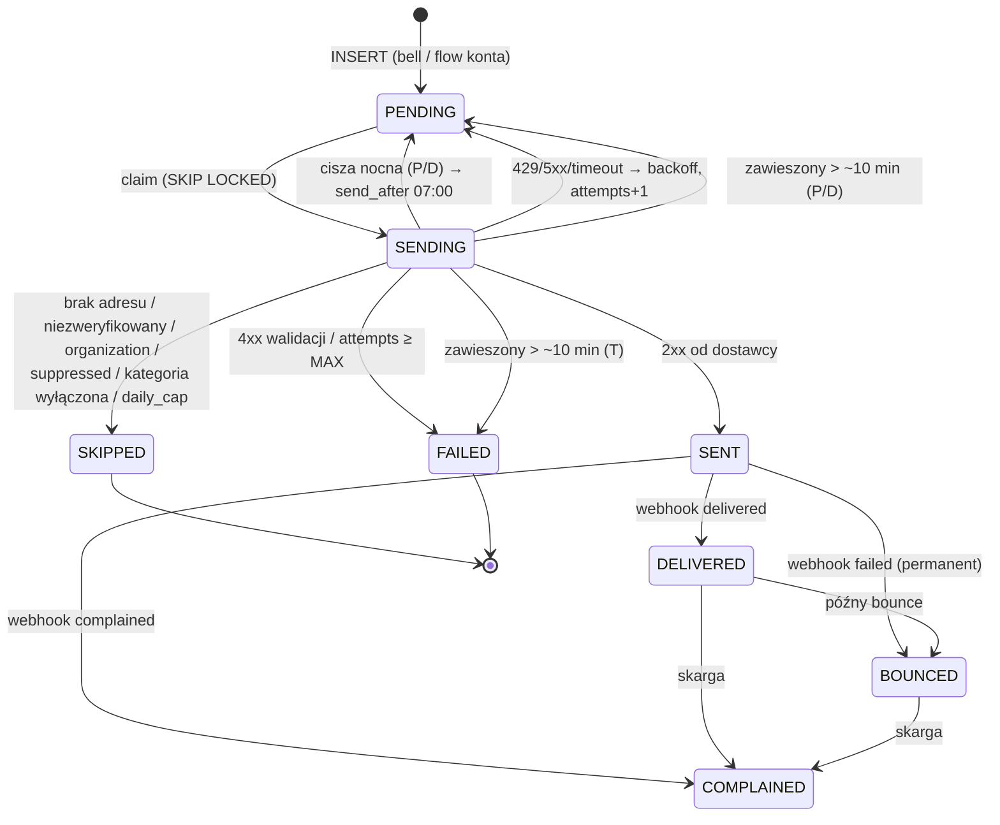
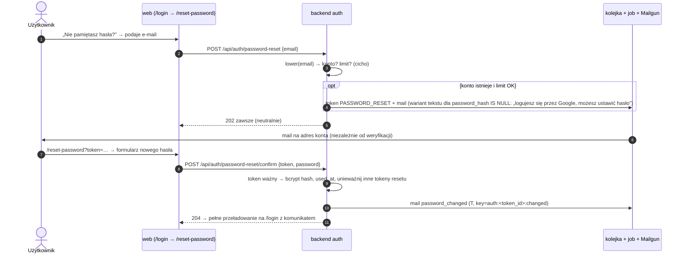
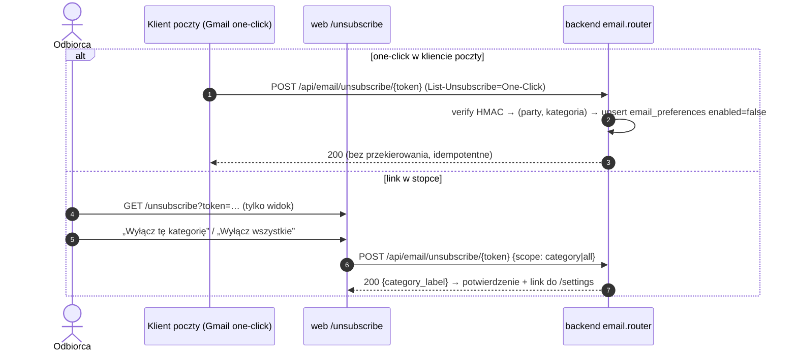
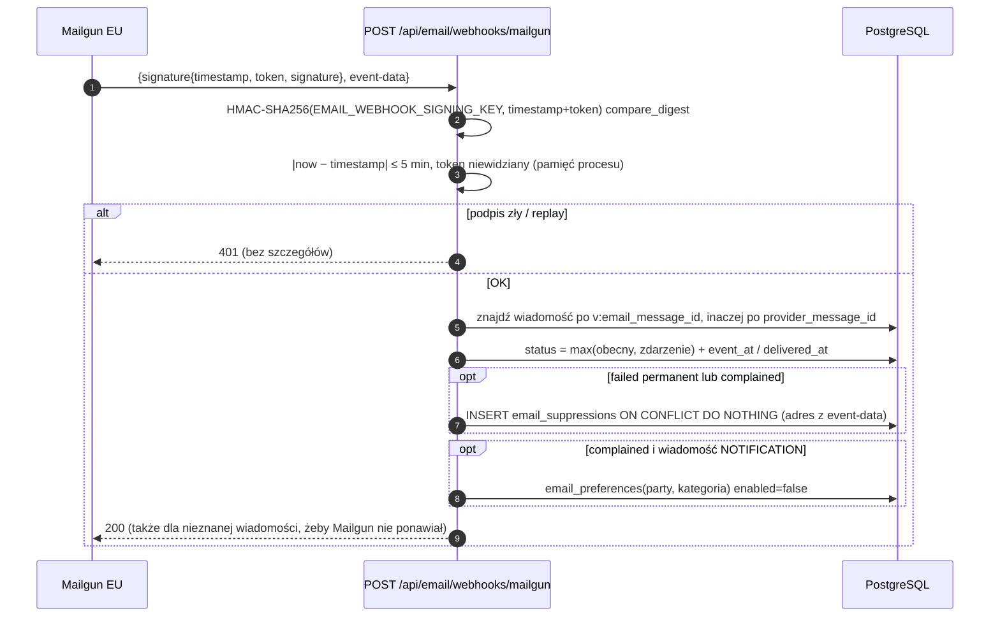

# High-Level Design: moduł wysyłki e-maili `app/email`

## TL;DR
- Nowy moduł **`app/email`** w istniejącym kontenerze backendu, z kolejką **`email_messages`** zapisywaną w **tej samej transakcji co bell** (hook w `notifications.service.create_notification(s)`) albo flow konta (weryfikacja, reset). Wysyła ją job **`_run_email_send`** co ~1 min: `SKIP LOCKED`, późne wiązanie odbiorcy, preferencji i suppression, backoff.
- Dostawca **Mailgun EU** (`api.eu.mailgun.net`) przez `httpx` za portem `EmailSender`. Dev używa SMTP do Mailpit, testy `FakeEmailSender`.
- Zgoda działa jako **opt-out per kategoria**, domyślnie włączone **po weryfikacji adresu**. Wypis spełnia **RFC 8058**. Dochodzi **pełny webhook** (`delivered`/`failed`/`complained`) z HMAC, który zasila `email_suppressions` i statusy dostarczenia.
- MVP obejmuje 3 maile konta (weryfikacja, reset, hasło zmienione) i 7 rodzajów bell. Wdrożenie w 3 etapach: najpierw same transakcyjne (warm-up), potem powiadomienia, potem nowe bell.

## Key Decisions
- Mailgun EU przez `httpx` bez SDK, za portem `EmailSender` — wiadomości, logi i suppression zostają w regionie EU, a zmiana dostawcy to jeden adapter (ADR-002).
- Hook w `notifications.service` + jeden `INSERT … ON CONFLICT DO NOTHING` do `email_messages` w transakcji domeny — jedyny punkt, przez który przechodzi każdy bell, a sam wiersz kolejki jest transactional outboxem. Bez trzeciego przeskoku przez `outbox_entries` (ADR-003).
- Job z późnym wiązaniem, backoffem i polityką „zawieszonego SENDING” (P/D wracają do PENDING, T idą do FAILED) — dispatcher outboxa nie ma backoffu i powtarza wszystkie handlery (ADR-004).
- Opt-out per kategoria, domyślnie włączone po weryfikacji. „Szukam” można przełączyć na opt-in jedną stałą. Wypis jednym kliknięciem przez podpisany token — mail serwisowy nie jest informacją handlową z art. 398 PKE (ADR-005).
- `user_profiles.email_verified_at`, backfill z tożsamości Google, losowe hashowane tokeny w `account_tokens`, baner zamiast masowej kampanii (ADR-006).
- Odbiorca bez własnego zweryfikowanego adresu dostaje SKIPPED z `skip_reason`. Konto tylko-Google może ustawić pierwsze hasło linkiem resetu, a API zawsze odpowiada neutralnym 202 (ADR-007).
- Jinja2 w repo z jednym generycznym szablonem powiadomienia renderowanym ze snapshotu bell — bez ACL-i do domen na potrzeby treści (ADR-008).
- Wysyłka natychmiastowa, MATCH dławiony kluczem dziennym per want, cisza nocna 22–07 dla P/D, `EMAIL_DAILY_CAP` na warm-up, bez digestów (ADR-009).
- Pełny webhook Mailgun (8A, wybór użytkownika zamiast rekomendowanego 8B) ze statusami DELIVERED/BOUNCED/COMPLAINED (ADR-010).
- Handover ADR-009 (2026-10-13): kierunek potwierdzony, punkt wpięcia, dedupe i model zgody zmienione, uwaga o pollerze moderacji nieaktualna (ADR-001).

## Open Questions / Risks
- DPA Mailgun/Sinch i lista podprocesorów nie zostały przeczytane. Mailgun Technologies to spółka z USA (teoretyczny CLOUD Act). Trzeba to sprawdzić przed etapem 1.
- Domyślne włączenie kategorii, zwłaszcza „Szukam” (szara strefa prawna), wymaga opinii prawnej. Przejście na opt-in to zmiana jednej stałej.
- Okno duplikatu na Mailgun (crash między 2xx a commitem): dla P/D możliwy podwójny mail, dla T FAILED.
- Darmowy limit Mailgun to 100 dziennie. Przy `EMAIL_DAILY_CAP` nadmiarowe P/D dostają SKIPPED (`daily_cap`), więc wzrost wymaga planu Basic. Pełny webhook nie zużywa limitu wysyłki, ale zwiększa ruch przychodzący.
- Rzeczy należące do Organization nie dostaną maili (SKIPPED `organization`). Lukę mierzymy przez `skip_reason`, reguła powstanie w osobnym zadaniu.
- Polityka prywatności (D14) jest warunkiem etapu 2. Musi wskazać Mailgun jako procesora i retencję logu wysyłek.
- Throttling MATCH wymaga przekazania `want_id` do kolejki. Nowe pole `topic_id` w `NotificationEntry` (tylko w pamięci, nie w tabeli `notifications`) trzeba potwierdzić w specyfikacji.
- Ochrona przed replay webhooka (okno czasu + pamięć tokenów w procesie) zakłada jedną instancję backendu. Druga instancja wymagałaby tabeli tokenów.
- Każdy zapis zmieniający `user_profiles.email` (dziś bez flow zmiany adresu, ale z możliwą ścieżką przez rodziny/opiekunów) musi czyścić `email_verified_at`. Specyfikacja musi to prześledzić.
- Reset hasła nie unieważnia wydanych JWT (zaakceptowane ryzyko „brak revocation”, bez zmian).

---

## 1. Design Overview

**Kontekst biznesowy.** aj ma dziś tylko powiadomienia w aplikacji. Ludzie przegapiają przejęcia rzeczy, propozycje wymian i prośby o potwierdzenie po terminie, więc wymiany się nie domykają, a punkty nie są przyznawane. Nie istnieje też żaden flow konta oparty na mailu: nie ma weryfikacji adresu ani resetu hasła, a konta tylko-Google nie mają odzyskiwania. Zyskują uczestnicy wymian (mniej niedoszłych odbiorów) i każdy właściciel konta.

**Wybrane podejście.** Mail to **drugi kanał istniejących bell**, a nie nowe zdarzenia domenowe. `notifications.service` (jedyny wspólny punkt 13 rodzajów bell) jednym zapytaniem wstawia wiersz do **`email_messages`** w transakcji domeny. Kolejka sama jest **transactional outboxem**. Osobny **job wysyłki** wiąże adresata późno (adres, weryfikacja, suppression, preferencje), renderuje **Jinja2** i wysyła przez **port `EmailSender`** z adapterem **Mailgun EU**. Webhook dostawcy domyka pętlę: statusy dostarczenia i **suppression**. Styl architektury: **moduł w modularnym monolicie** (mikrokernel aj), integracja przez **ACL-e** i **kolejkę w bazie**. Nie powstaje nowy kontener w produkcji.

**Kluczowe decyzje:**
- Hook w `notifications.service` zamiast handlera outboxa: pokrywa 13/13 rodzajów bez zmian w domenach.
- Własna kolejka z backoffem, `send_after` i kluczem idempotencji: cisza nocna, throttling i retry bez dublowania bell.
- Opt-out per kategoria po weryfikacji adresu: kanał dociera do ludzi zgodnie z PKE/RODO (interpretacja badania).
- Weryfikacja i reset na losowych, hashowanych, jednorazowych tokenach: dają się unieważnić, w przeciwieństwie do JWT.
- Mailgun EU za portem: rezydencja danych w UE, wymiana dostawcy to jeden adapter.
- Pełny webhook: własny log dostarczenia, bo Mailgun trzyma logi tylko 1–5 dni.

---

## 2. Architektura

### 2.1 System Context (C4 Level 1)



ASCII (dla czytników bez Mermaid):
```
 [Użytkownik] --HTTPS--> [ aj ] --HTTPS form--> [Mailgun EU] --SMTP/DKIM--> [Skrzynka]
      ^                   ^  ^                       |                        |
      |                   |  +------webhook HMAC-----+                        |
      +---- link w mailu / one-click POST (RFC 8058) -------------------------+
                                       [DNS mail.<domena>] <-- weryfikacja SPF/DKIM/DMARC
```

- **Użytkownik** dostaje maile i wraca do aj przez linki (`/verify-email`, `/reset-password`, `/unsubscribe`, `link_path` bell).
- **Mailgun EU** przyjmuje wiadomości przez HTTP API i wysyła webhooki o zdarzeniach `delivered`, `failed` (permanent) i `complained`.
- **DNS** to konfiguracja operatora (subdomena `mail.<domena>`), bez kodu.
- **Google** bez zmian. Weryfikacja Google daje jedynie backfill `email_verified_at`.

### 2.2 Container Overview (C4 Level 2)



| Kontener | Zmiana | Odpowiedzialność w tym projekcie |
|---|---|---|
| `backend` | nowy moduł, nowy job, nowe endpointy | Kolejkowanie, wysyłka, webhook, wypis, preferencje, tokeny konta |
| `web` | 3 nowe strony publiczne, 1 strona panelu, baner, link „Nie pamiętasz hasła?” | Powierzchnie z maili i ustawienia |
| PostgreSQL | 4 nowe tabele + 1 kolumna | Kolejka (log wysyłek), preferencje, suppression, tokeny |
| nginx | bez zmian w konfiguracji (`/api/*` → backend). Sprawdzić, że POST nie jest przekierowywany | Przepuszcza webhook i one-click POST |
| `matcher` | bez zmian | Jego bell MATCH trafia do kolejki przez handler `wants.bells_due` → `create_notifications` |
| `mailpit` | nowy, tylko `profiles: ["dev"]`, przypięta wersja obrazu | Podgląd maili w dev |

Nie ma nowego kontenera produkcyjnego. Wysyłka działa w procesie backendu, tak jak `_run_attendance_close` i reconcile embeddings.

### 2.3 Widok modułów w kontenerze `backend` (granice, bez szczegółów klas)



**Reguła granic:** `app.email` importują tylko `app/main.py` (lifespan, router, job) i dwa ACL-e konsumentów (`notifications/infrastructure/email_acl`, `auth/infrastructure/email_acl`). `app/email` czyta inne konteksty wyłącznie przez własne `infrastructure/*_acl.py`. Moduł trafia do `MODULES` w teście granic modułów i do testu strażnika zegara domeny.

---

## 3. Kluczowe komponenty

| Komponent | Cel | Odpowiedzialności | Kluczowe interfejsy | Zależności |
|---|---|---|---|---|
| **Kolejkowanie** (`email.service`) | Jedyne API zapisu dla innych modułów | • `enqueue_for_notifications(db, entries)`: filtr rodzajów przez `rules`, jeden wielowierszowy `INSERT … ON CONFLICT (idempotency_key) DO NOTHING`, bez odczytów<br/>• `enqueue_transactional(db, template, party_id, context, key)` dla maili konta<br/>• no-op przy `EMAIL_ENABLED=false` | Wywoływane z ACL-i w transakcji wywołującego, bez commitu | `rules`, sesja DB |
| **Reguły** (`email.rules`) | Jedno miejsce decyzji „co, kiedy, jak” | • mapa `NotificationKind → (kategoria, strumień, szablon, temat, CTA)`, tylko 7 rodzajów MVP<br/>• budowa klucza (`notification:<id>`, `want_match:<want>:<dzień Warsaw>`, `auth:<token_id>`)<br/>• stałe: domyślne kategorie (`WANTS_DEFAULT_ENABLED`), backoff, `MAX_ATTEMPTS`, cisza nocna, próg SENDING | Czyste funkcje i stałe | `clock` |
| **Job wysyłki** (`email.sending`) | Dostarczenie z kolejki | • odzysk zawieszonych SENDING<br/>• claim `PENDING AND send_after <= now` z `FOR UPDATE SKIP LOCKED` (batch 50) → SENDING<br/>• późne wiązanie: adres, weryfikacja, typ party, suppression, preferencje, limit dzienny → SKIPPED<br/>• cisza nocna → przesunięcie `send_after`<br/>• render, `EmailSender.send()` bez trzymania blokad, zapis wyniku, jedna linia logu na przebieg | `run_send_batch()` wołane przez `_run_email_send` w `main.py` | `users_acl`, `rendering`, `senders`, `clock` |
| **Renderowanie** (`email.rendering` + szablony) | Polskie treści HTML + tekst | • Jinja2 `select_autoescape(("html","html.j2"))`, `StrictUndefined`<br/>• pary `*.html.j2`/`*.txt.j2`, wspólny `base.html.j2` z inline CSS<br/>• szablony MVP: `verify_email`, `password_reset`, `password_changed`, `notification` (generyczny)<br/>• daty przez `clock.format_term_when`/`format_term_day` | `render(template, context) → (subject, html, text)` | `links`, `APP_PUBLIC_BASE_URL` |
| **Nadawcy** (`email.senders`) | Odcięcie dostawcy | • Protocol `EmailSender.send(message) → SendResult(provider_message_id) / błąd sklasyfikowany (permanent / retryable)`<br/>• `MailgunSender` (`httpx`, form POST, timeout, `v:email_message_id`, tracking wyłączony)<br/>• `SmtpSender` (dev, Mailpit), `LogSender` (bez treści i adresów)<br/>• `set_sender()`/`get_sender()` w lifespanie | Port + `set_sender()` | `httpx`, config |
| **Linki podpisane** (`email.links`) | Token wypisu bez stanu | • HMAC-SHA256 kluczem `EMAIL_LINK_SIGNING_SECRET` nad `party_id` + kategorią (lub `ALL`) + wersją formatu<br/>• bez wygasania, porównanie `compare_digest` | `sign_unsubscribe()`, `verify_unsubscribe()` | config |
| **Router e-mail** (`email.router`) | Wejścia HTTP modułu | • `POST /api/email/webhooks/mailgun` (PUBLIC + HMAC)<br/>• `POST /api/email/unsubscribe/{token}` (PUBLIC, RFC 8058 i strona)<br/>• `GET`/`PUT /api/email/preferences` (zalogowany) | FastAPI router w `main.py` | `links`, tabele modułu, `users_acl` |
| **ACL użytkowników** (`email/infrastructure/users_acl`) | Odczyt adresata jednym zapytaniem | • batch `party_id → (typ party, email, email_verified_at, display_name)`<br/>• brak konta lub adresu = `None` | `get_recipients_by_party_ids()` | `users`, `party` (tylko odczyt) |
| **Tokeny konta** (`auth`) | Weryfikacja i reset | • tabela `account_tokens` (hash SHA-256, cel, `expires_at`, `used_at`, snapshot adresu)<br/>• żądanie z limitem w DB, neutralne 202<br/>• potwierdzenie: weryfikacja → `email_verified_at`; reset → nowe hasło + mail „hasło zmienione” | Endpointy `/api/auth/password-reset*`, `/api/auth/email-verification*` | `auth/infrastructure/email_acl` |
| **ACL-e konsumentów** | Wąskie wejście do `app.email` | • `notifications/infrastructure/email_acl` (przekazuje `(notification_id, party_id, kind, message, link_path, topic_id)`)<br/>• `auth/infrastructure/email_acl` (maile konta) | jedna funkcja każdy | `app.email.service` |

---

## 4. Model danych

Wszystkie tabele na `BaseEntity` (UUID `id`, `created_at`, `updated_at` jako `version_id_col`). Znaczniki są naiwnym UTC, enumy przechowywane jako string, nazwy `pk_`/`fk_`/`ix_`/`uq_`/`ck_` jawne.

### 4.1 `email_messages` — kolejka i log wysyłek (moduł `email`)
| Kolumna | Typ | Uwagi |
|---|---|---|
| `idempotency_key` | `String(200)` NOT NULL | `uq_email_messages_idempotency_key` |
| `party_id` | UUID NOT NULL | FK `parties` (adresat jako party, adres wiązany późno) |
| `stream` | `TRANSACTIONAL` \| `NOTIFICATION` | Decyduje o nagłówkach wypisu, suppression i ciszy nocnej. Strumień „D” (digest) dojdzie z pierwszym digestem |
| `category` | string, NULL dla `TRANSACTIONAL` | `ck_email_messages_category_stream` |
| `template` | `String(50)` | np. `notification`, `verify_email` |
| `notification_id`, `notification_kind` | UUID / string, NULL | Luźny wskaźnik, bez FK (bell może zostać zwinięty lub usunięty) |
| `payload` | JSONB | Snapshot: `message`, `link_path`, `kind` dla bell; `token` (surowy) dla T, **zerowany** przy SENT/FAILED/SKIPPED |
| `status` | patrz 4.6 | `ix_email_messages_pending_send_after` (częściowy, `WHERE status='PENDING'`) |
| `skip_reason` | string NULL | `no_address`, `unverified`, `organization`, `suppressed`, `category_disabled`, `daily_cap`. `ck`: ustawiony ⇔ `SKIPPED` |
| `attempts` | int, default 0 | |
| `send_after` | timestamp NOT NULL | Domyślnie `utcnow()`. Przesuwany przez backoff i ciszę nocną |
| `claimed_at`, `sent_at`, `delivered_at`, `event_at` | timestamp NULL | `event_at` = czas ostatniego zdarzenia webhooka |
| `provider_message_id` | `String(255)` NULL | `ix_email_messages_provider_message_id`, znormalizowany (bez `<>`) |
| `last_error` | `String(200)` NULL | Kod lub klasa błędu, **bez adresu i treści** |

Adres odbiorcy **nie jest zapisywany** (minimalizacja danych). Diagnoza idzie przez `party_id`, a suppression przez adres z webhooka.

### 4.2 `email_preferences` (moduł `email`)
`party_id` FK `parties`, `category` (`ALL` \| `RESERVATIONS` \| `MEETINGS` \| `WANTS` \| `MESSAGES` \| `ORGANIZER_DIGESTS`), `enabled` bool, `uq_email_preferences_party_id_category`. **Brak wiersza oznacza domyślną wartość kategorii z `rules`.** Kategoria jest efektywnie włączona, gdy wiersz `ALL` nie ma `enabled=false` i jej własny wiersz (lub domyślna wartość) ma `enabled=true`. Transakcyjne nie mają wiersza i nie da się ich wyłączyć.

| Kategoria (UI) | Wartość | Rodzaje MVP | Domyślnie po weryfikacji | Widoczna w `/settings` w MVP |
|---|---|---|---|---|
| Rezerwacje i wymiany | `RESERVATIONS` | B1 `TERM_ITEM_LISTING_TAKEN`, B3 `SWAP_PROPOSED`, B4 `SWAP_ACCEPTED`, B5 `SWAP_REJECTED`, B6 `TERM_CONFIRMATION_NEEDED`, B8 `RESERVATION_CANCELLED` | włączona | tak |
| Szukam | `WANTS` | B9 `WANT_MATCH_FOUND` (+ per-want `notifications_enabled`) | włączona (**jedna stała** `WANTS_DEFAULT_ENABLED`) | tak |
| Spotkania i wydarzenia | `MEETINGS` | — (C2/C3 w etapie 3) | włączona | od pierwszego rodzaju |
| Wiadomości | `MESSAGES` | — (C6 później) | do decyzji | od pierwszego rodzaju |
| Podsumowania organizatora | `ORGANIZER_DIGESTS` | — (digesty później) | **wyłączona** | od pierwszego rodzaju |
| Transakcyjne | — | A1–A3 | zawsze | jako zablokowany wiersz informacyjny |

Katalog kategorii jest ustalony teraz, żeby nie migrować preferencji później. `/settings` pokazuje jednak tylko kategorie, do których mapuje się co najmniej jeden aktywny rodzaj (minimal-implementation: bez przełączników, które nic nie robią).

### 4.3 `email_suppressions` (moduł `email`)
`address_normalized` `String(320)` (`lower(trim)`, `uq_`), `reason` `BOUNCE` \| `COMPLAINT`, `source_message_id` UUID NULL (luźny). Blokuje P/D. T próbujemy wysłać (żądanie użytkownika, odzyskanie konta). Suppression przetrwa purge logu. Usuwanie konta i hashowanie adresu to osobny temat (poza zakresem).

### 4.4 `account_tokens` (moduł `auth`)
`user_id` FK `users` ON DELETE CASCADE, `purpose` `VERIFY_EMAIL` \| `PASSWORD_RESET`, `token_hash` `String(64)` (SHA-256 hex surowego tokenu ≥ 32 bajty z `secrets`, `uq_`), `email` (snapshot adresu w chwili wydania, do porównania przy potwierdzeniu), `expires_at` (reset ~1 h, weryfikacja ~48 h; stałe), `used_at` NULL, `ix_account_tokens_user_id_purpose_created_at` (limit żądań). Wydanie nowego tokenu danego celu unieważnia poprzednie niewykorzystane (`used_at` = teraz).

### 4.5 `user_profiles.email_verified_at` (moduł `users`)
Nullable, naiwny UTC. **Backfill:** profile z tożsamością Google `email_verified=true`, gdzie `lower(identity.email) = lower(profile.email)`. Ustawiany przez potwierdzenie weryfikacji, a dla nowych kont Google przy `bootstrap_person_account`. **Każdy zapis zmieniający `email` czyści `email_verified_at`.**

### 4.6 Cykl życia `email_messages.status`



**Pierwszeństwo statusów webhooka:** `COMPLAINED > BOUNCED > DELIVERED > SENT`. Zdarzenie nigdy nie obniża statusu, bo webhooki mogą przyjść w dowolnej kolejności i powtórzone. Dzięki temu każde zdarzenie jest idempotentne.

---

## 5. Przepływy danych (sekwencje)

### 5.1 Bell → kolejka → wysyłka

```mermaid
sequenceDiagram
    autonumber
    participant D as Domena (np. groups take/propose)
    participant N as notifications.service
    participant A as notifications email_acl
    participant Q as email.service (kolejka)
    participant DB as PostgreSQL
    participant J as _run_email_send (co ~1 min)
    participant U as email users_acl
    participant S as EmailSender (Mailgun EU)

    D->>N: create_notification(s)(party, kind, message, link_path[, topic_id])
    N->>DB: INSERT notifications
    N->>A: enqueue(entries z id bell)
    A->>Q: enqueue_for_notifications
    Q->>Q: rules: czy kind idzie mailem? klucz, kategoria
    Q->>DB: INSERT email_messages … ON CONFLICT (idempotency_key) DO NOTHING
    D->>DB: COMMIT (bell + mail atomowo)
    J->>DB: odzysk SENDING > ~10 min; claim PENDING ≤ now FOR UPDATE SKIP LOCKED → SENDING; COMMIT
    J->>U: adresaci batch (typ party, email, verified)
    J->>DB: suppression, preferencje, liczba wysłanych dziś (po jednym zapytaniu)
    alt nie kwalifikuje się
        J->>DB: SKIPPED + skip_reason
    else cisza nocna (P)
        J->>DB: PENDING, send_after = 07:00 Warsaw
    else wysyłka
        J->>J: render Jinja2 (subject, html, text, List-Unsubscribe)
        J->>S: send() (bez blokad DB, timeout)
        S-->>J: 2xx id / błąd
        J->>DB: SENT + provider_message_id | PENDING + backoff | FAILED
    end
```

### 5.2 Weryfikacja adresu

```mermaid
sequenceDiagram
    autonumber
    actor P as Użytkownik
    participant W as web (/register, baner, /verify-email)
    participant B as backend auth
    participant Q as email kolejka
    participant J as job + Mailgun

    P->>W: rejestracja hasłem / „Wyślij link” w banerze lub /settings
    W->>B: POST /api/auth/register  |  POST /api/auth/email-verification (Bearer)
    B->>B: limit w DB (≤1/60 s, ≤5/h); nowy token, hash w account_tokens
    B->>Q: enqueue_transactional(verify_email, key=auth:<token_id>, token)
    B-->>W: 201 / 202
    J->>P: mail z linkiem APP_PUBLIC_BASE_URL/verify-email?token=…
    P->>W: GET /verify-email?token=… (bez efektów ubocznych)
    P->>W: klik „Potwierdź adres”
    W->>B: POST /api/auth/email-verification/confirm {token}
    B->>B: hash → token ważny, nieużyty, email == snapshot → email_verified_at = now, used_at, usuń BOUNCE z suppression
    B-->>W: 204 → stan „Adres potwierdzony”, invalidacja profilu
```

### 5.3 Reset hasła (także pierwsze hasło konta tylko-Google)



### 5.4 Wypis (stopka i one-click RFC 8058)



### 5.5 Webhook Mailgun



---

## 6. Punkty integracji

| # | Punkt | Kierunek | Kontrakt | Uwagi |
|---|---|---|---|---|
| I1 | `notifications.service.create_notification` / `create_notifications` → `notifications/infrastructure/email_acl` | wewn. synchr. | Po zapisie bell jedna lista wpisów. **Dokładnie jedno dodatkowe zapytanie**, bez odczytów | `create_notification` musi znać `id` bella przed flushem (nadany jawnie jak w `create_notifications`). Test liczby zapytań |
| I2 | `wants` → `notifications_acl.NotificationEntry.topic_id` | wewn. | `topic_id = want.id` dla `WANT_MATCH_FOUND`. Tylko w pamięci | Klucz `want_match:<want>:<dzień Warsaw>` |
| I3 | `auth` (+ rejestracja w `users`) → `auth/infrastructure/email_acl` | wewn. synchr. | `enqueue_transactional(template, party_id, context, key)` | Miejsce wywołania przy rejestracji ustala specyfikacja (unikając cyklu importów users ↔ auth) |
| I4 | `email/infrastructure/users_acl` | wewn. odczyt | batch `party_id → recipient` | Jedno zapytanie na batch |
| I5 | Mailgun Messages API | wychodzący HTTPS | `POST {EMAIL_PROVIDER_API_URL}/messages` (form: `from`, `to`, `subject`, `text`, `html`, `h:Reply-To`, `h:List-Unsubscribe`, `h:List-Unsubscribe-Post`, `h:List-Id`, `h:Auto-Submitted`, `o:tag`, `o:tracking=no`, `v:email_message_id`), Basic auth `api:<klucz>` | Timeout ~10 s, klasyfikacja błędów w adapterze |
| I6 | Mailgun webhooks | przychodzący HTTPS | `POST /api/email/webhooks/mailgun`, zdarzenia `delivered`, `failed` (tylko `severity=permanent`), `complained` | Konfiguracja w panelu domeny EU |
| I7 | Klient poczty (RFC 8058) | przychodzący HTTPS | `POST /api/email/unsubscribe/{token}`, `application/x-www-form-urlencoded` lub `multipart/form-data` | DKIM obejmuje oba nagłówki |
| I8 | Frontend → API | HTTPS | `GET`/`PUT /api/email/preferences`, endpointy `/api/auth/password-reset*`, `/api/auth/email-verification*`, `GET /api/people/me` z `email_verified` | TanStack Query hooki w `src/hooks/` |
| I9 | Lifespan + APScheduler | wewn. | `set_sender()` wg `EMAIL_BACKEND`. Job `_run_email_send` tylko przy `EMAIL_ENABLED=true` (`coalesce`, `max_instances=1`) | Linia startowa z `EMAIL_ENABLED=…, EMAIL_BACKEND=…` |
| I10 | DNS (operator) | konfiguracja | SPF, DKIM 2048, MX, DMARC `none → quarantine → reject` na `mail.<domena>` | Raport §10 |

### 6.1 Nowe wiersze `AUTHORIZATION_MATRIX` (dopisane po wierszu 73, first-match-wins)
| Wiersz | Metoda | Ścieżka | Reguła | Uzasadnienie |
|---|---|---|---|---|
| 74 | POST | `^/api/auth/password-reset$` | PUBLIC | Flow auth (precedens 72/73). Neutralne 202 |
| 75 | POST | `^/api/auth/password-reset/confirm$` | PUBLIC | Token w body |
| 76 | POST | `^/api/auth/email-verification/confirm$` | PUBLIC | Token w body, działa bez sesji |
| 77 | POST | `^/api/auth/email-verification$` | zalogowany (`READ`/`EDIT` loginu, bez `mcp:*`) | Ponowne wysłanie własnej weryfikacji |
| 78 | POST | `^/api/email/unsubscribe/[^/]+$` | PUBLIC | RFC 8058: bez cookies i auth, podpis w ścieżce |
| 79 | POST | `^/api/email/webhooks/mailgun$` | PUBLIC | Uwierzytelnienie HMAC w handlerze, nie w JWT |
| 80 | GET, PUT | `^/api/email/preferences$` | zalogowany (`READ` dla GET, `EDIT` dla PUT, bez `mcp:*`) | Jak wants (66–67) |

Wiersze 74–79 to kolejne publiczne POST poza `/api/public/`. Komentarz w macierzy ma je uzasadnić tak jak wiersze 72/73 (flow auth i wejście od dostawcy). Test macierzy dostaje nowe przypadki. Strony `/verify-email`, `/reset-password` i `/unsubscribe` w Next nie potrzebują wierszy (to nie `/api`).

### 6.2 Konfiguracja (tylko nazwy; wartości wyłącznie w `.env`)
`EMAIL_ENABLED` (default false), `EMAIL_BACKEND` (`mailgun` \| `smtp` \| `log`), `EMAIL_PROVIDER_API_URL` (dla Mailgun EU z domeną w ścieżce), `EMAIL_PROVIDER_API_KEY`, `EMAIL_FROM_ADDRESS`, `EMAIL_FROM_NAME`, `EMAIL_REPLY_TO_ADDRESS`, `EMAIL_LINK_SIGNING_SECRET`, `EMAIL_WEBHOOK_SIGNING_KEY`, `EMAIL_DAILY_CAP`, `EMAIL_SMTP_HOST`, `EMAIL_SMTP_PORT` (tylko dev), `APP_PUBLIC_BASE_URL`.

Każda nazwa trafia do `config.py` (z `email_configured`, walidatorem pustego placeholdera i fail-fast w lifespanie, gdy `EMAIL_ENABLED=true` a `mailgun` nie ma klucza, nadawcy, sekretów lub bazowego URL), do `.env.example` (puste placeholdery) i do `docker-compose.yml` (`backend.environment`). Przy `EMAIL_ENABLED=false` endpointy żądania resetu i weryfikacji zwracają 503 z polskim komunikatem, a kolejkowanie jest no-opem (bez zaległości, która wystrzeliłaby po włączeniu). **Nigdy nie logować ani nie wypisywać wartości. W raportach, promptach i testach używać tylko nazw.**

---

## Decyzje projektowe (podsumowanie)

Pełne zapisy w formacie MADR: [decision-log.md](decision-log.md).

| ADR | Decyzja | Obszar | Odejście od rekomendacji eksploracji |
|---|---|---|---|
| [ADR-001](decision-log.md#adr-001-relacja-do-handover-adr-009-potwierdzenia-zmiany-zastąpienia) | Relacja do handover ADR-009: potwierdzone, zmienione, zastąpione | baza | — |
| [ADR-002](decision-log.md#adr-002-mailgun-eu-przez-httpx-za-portem-emailsender) | Mailgun EU przez `httpx` za portem `EmailSender` | D1 | — |
| [ADR-003](decision-log.md#adr-003-hook-w-notificationsservice-i-kolejka-email_messages-w-transakcji-domeny) | Hook w `notifications.service` + `email_messages` w transakcji domeny | D2 | — |
| [ADR-004](decision-log.md#adr-004-job-wysyłki-z-późnym-wiązaniem-backoffem-i-polityką-zawieszonego-sending) | Job z późnym wiązaniem, backoffem, polityką SENDING | D2 | — |
| [ADR-005](decision-log.md#adr-005-opt-out-per-kategoria-domyślnie-włączone-po-weryfikacji-wypis-rfc-8058) | Opt-out per kategoria, RFC 8058 | D3 | — |
| [ADR-006](decision-log.md#adr-006-weryfikacja-adresu-tokeny-konta-i-wdrożenie-dla-istniejących-kont) | `email_verified_at`, backfill Google, `account_tokens`, baner | D4 | — |
| [ADR-007](decision-log.md#adr-007-odbiorca-bez-zweryfikowanego-adresu--skipped-reset-konta-tylko-google-ustawia-hasło) | SKIPPED + `skip_reason`, reset Google = ustaw hasło | D5 | — |
| [ADR-008](decision-log.md#adr-008-szablony-jinja2-w-repo-z-generycznym-szablonem-powiadomienia) | Jinja2 w repo, generyczny szablon `notification` | D6 | — |
| [ADR-009](decision-log.md#adr-009-wysyłka-natychmiastowa-z-kluczem-dziennym-match-ciszą-nocną-i-limitem-dziennym) | Natychmiast, klucz dzienny MATCH, cisza nocna, limit dzienny | D7 | — |
| [ADR-010](decision-log.md#adr-010-pełny-webhook-mailgun-ze-statusami-dostarczenia-i-suppression) | Pełny webhook Mailgun (8A) | D8 | **tak**: 8A zamiast 8B (wybór użytkownika) |

---

## 7. Powierzchnie frontendu

| Powierzchnia | Layout / dostęp | Zawartość | Standardy |
|---|---|---|---|
| `/settings` | `(panel)`, dopisane do `PROTECTED_PREFIXES` (`settings` już zarezerwowane) | Adres, stan weryfikacji i przycisk „Wyślij link weryfikacyjny”, informacja o suppression („Twój adres odrzucał wiadomości”), przełącznik „Wszystkie powiadomienia e-mail”, przełączniki kategorii `role="switch"` (wzór `WantNotificationToggle`), zablokowany wiersz „Transakcyjne” | Hook `useEmailPreferences` w `src/hooks/` (query + `update`, invalidacja prefiksu), polskie komunikaty błędów |
| Wiersz „Powiadomienia e-mail” w `AccountView` | panel | Link do `/settings` w sekcji „Ustawienia” | — |
| Baner weryfikacji | panel: Start (`/home`) i `/settings` | „Potwierdź adres, żeby dostawać powiadomienia” + przycisk. Widoczny, gdy profil ma `email` i nie ma `email_verified` | `role="status"`, przycisk `aria-disabled` w trakcie |
| `/verify-email?token=` | `(public)`, **bez** `AuthGuard` i `PROTECTED_PREFIXES` | GET pokazuje przycisk „Potwierdź adres”, POST daje stan sukcesu lub błędu (wygasły, użyty) z akcją „Wyślij nowy link” (dla zalogowanych) | `resolveVerifyEmailView()` w `*ViewState.ts`, testy `it.each` |
| `/reset-password` | `(public)`, bez guardów | Bez tokenu: formularz e-mail i zawsze ten sam komunikat „Jeśli konto istnieje, wysłaliśmy link”. Z tokenem: nowe hasło ×2 → POST → pełne przeładowanie na `/login` z komunikatem | `resolveResetPasswordView()`, walidacja hasła jak w rejestracji, pełne przeładowanie po zmianie sesji (`documentNavigation`) |
| Link „Nie pamiętasz hasła?” | `LoginForm` | → `/reset-password` | — |
| `/unsubscribe?token=` | `(public)`, bez guardów | Dwa przyciski („Wyłącz tę kategorię” / „Wyłącz wszystkie powiadomienia e-mail”), potwierdzenie, link do `/settings` | GET bez efektów ubocznych |
| Reserved slugs | `routing/reservedSlugs.ts` **i** `organizations/slugs.py` w jednej zmianie | `verify-email`, `reset-password`, `unsubscribe` | Test parytetu |

Jednorazowe POST-y tokenów (`confirm`) to `useMutation` w hookach `src/hooks/`. Wyjątku imperatywnego jak `getGoogleNonce` nie potrzeba: wywołania nie rotują cookie i nie są cache'owane.

---

## 8. Strategia testów

**Backend (pytest + testcontainers, `db_session`, `client`):**
- `FakeEmailSender` w `tests/` zapisuje `(to, subject, text, html, headers)` i można go zaprogramować na błąd permanent lub retryable. Wpinany przez `set_sender()` w fixture (jak `FakeStorage`).
- Kolejkowanie: bell rodzaju MVP tworzy jeden PENDING. Rodzaj spoza MVP nie tworzy nic. Duplikat klucza nie tworzy drugiego wiersza. Trzy MATCH jednego wanta tego samego dnia (Warsaw, `freeze_local_now`) dają jeden wiersz. `create_notification(s)` wykonuje dokładnie jedno dodatkowe zapytanie (`count_queries`). `EMAIL_ENABLED=false` nie wstawia nic.
- Job: SKIPPED dla każdego `skip_reason`. Cisza nocna przesuwa na 07:00 dla P, ale nie dla T. 5xx daje backoff, a po `MAX_ATTEMPTS` FAILED z jedną linią ERROR `email message … FAILED after …`. 4xx daje FAILED bez retry. Zawieszony SENDING: P wraca do PENDING, T idzie do FAILED. `payload.token` jest zerowany. Liczba zapytań na batch nie rośnie z liczbą wierszy. W logach nie ma adresów ani tokenów (`caplog`).
- Webhook: poprawny HMAC aktualizuje status. Zły podpis, stary timestamp albo powtórzony token dają 401. Zdarzenia poza kolejnością nie obniżają statusu. `failed` permanent i `complained` tworzą suppression, a `complained` wyłącza też kategorię. Nieznana wiadomość dostaje 200.
- Wypis: one-click POST bez auth jest idempotentny, zwraca 200 bez przekierowania, a zły podpis daje 400/404. Scope `all` działa.
- Flow konta: reset zawsze zwraca 202 (konto istnieje, nie istnieje, tylko-Google, limit). Token wygasły lub użyty jest odrzucany. Reset konta tylko-Google ustawia hasło. Potwierdzenie weryfikacji z innym adresem niż snapshot jest odrzucane. Backfill Google działa w migracji.
- Rendering: `StrictUndefined` łapie brak zmiennej. Autoescape działa dla nazw rzeczy z `<script>`. Polskie znaki i daty Warsaw są poprawne. Nagłówki List-Unsubscribe są tylko na P.
- Granice i strażnicy: `email` w `MODULES` testu granic, `app/email` w teście zegara domeny, nowe wiersze w teście macierzy, test downgrade-then-upgrade migracji.
- Adapter Mailgun: `httpx.MockTransport` (pola formularza, Basic auth, klasyfikacja 2xx/4xx/429/5xx/timeout). Bez prawdziwej sieci.

**Frontend (Vitest + Testing Library):** tablicowe testy `resolveResetPasswordView`/`resolveVerifyEmailView`, strony `/unsubscribe`, `/reset-password` i `/verify-email` przez `renderWithRoute`, przełączniki `/settings` (aria, stany), baner, reserved slugs, przypadek `ssrSafety` dla nowych stron publicznych, typowane fabryki fixture bez rzutowań.

**Ręcznie i przed startem:** Mailpit (`EMAIL_BACKEND=smtp`): struktura, HTML i tekst, nagłówki. Test seed (mail-tester, Gmail, Outlook): `spf=pass dkim=pass dmarc=pass`, one-click widoczny w Gmailu.

---

## 9. Migracje i runbook

| Rewizja | Zawartość | Downgrade |
|---|---|---|
| `0109_email_tables` | `email_messages`, `email_preferences`, `email_suppressions`, `account_tokens` z indeksami i CHECK-ami | Drop w odwrotnej kolejności. **Stratny** (log wysyłek, preferencje, suppression, tokeny) |
| `0110_email_verified_at` | nullable `user_profiles.email_verified_at` (osobna rewizja: kolumna addytywna) | Drop kolumny. Stratny (stan weryfikacji) |
| `0111_backfill_google_verified` | Rewizja danych: `UPDATE user_profiles … FROM user_identities WHERE email_verified AND lower(...) = lower(...)` | No-op lub wyzerowanie (kolumna i tak znika w 0110) |

Rewizje nie biorą długich blokad na dużych tabelach (nowe tabele, kolumna nullable). Backfill dotyczy liczby kont Google. W razie potrzeby `SET LOCAL lock_timeout = '5s'`.

**Runbook (skrót):**
1. `pg_dump` przed wdrożeniem. Nie ma rollbacku samego obrazu za 0109 (stary obraz nie wystartuje na nieznanej rewizji, tak jak przy 0108). Cofnięcie = `downgrade 0108` z nowego obrazu (bez guardu, stratny) albo przywrócenie dumpu.
2. DNS przed `EMAIL_ENABLED=true`: domena **utworzona w regionie EU** w Mailgun, SPF, DKIM 2048, MX, DMARC `p=none` (≥48 h po pass SPF/DKIM), webhooki `delivered`/`failed`/`complained` na `https://<app>/api/email/webhooks/mailgun`, klucz podpisu webhooków skopiowany do `.env` (nigdy do repo, raportów ani logów; sprawdzenie obecności tylko testem „set/missing”).
3. Wdrożenie z `EMAIL_ENABLED=false` → health check → przełączenie flagi i `up -d backend`. Przy błędzie konfiguracji (fail-fast) flaga wraca na false. Backend nie ma polityki restartu.
4. Weryfikacja: linia startowa `EMAIL_ENABLED=True`, linia joba `email send: claimed=… sent=… skipped=… retried=… failed=…`, `grep "FAILED after"`, test seed, statusy DELIVERED z webhooka.
5. DMARC: `p=none` przez ≥1 tydzień, potem `quarantine` (`pct`/`t=y`), potem `reject` przy czystych raportach.
6. Przy zmianie `architecture.md`: usunąć „In-app notifications only”, dopisać moduł, macierz 74–80, runbook 0109–0111 i nowy ADR zastępujący handover ADR-009 w części wpięcia i zgody.

---

## 10. Etapy wdrożenia

| Etap | Zakres | Warunek wejścia | Warunek wyjścia |
|---|---|---|---|
| **0 — decyzje** | Przeczytanie DPA Mailgun, polityka prywatności (D14) i link przy rejestracji, opinia o domyślnym włączeniu „Szukam”, domena nadawcza | — | Polityka opublikowana (wymagana przed etapem 2) |
| **1 — maile konta** | `app/email` (kolejka, job, port, Mailgun + SMTP dev + log + fake), DNS, **pełny webhook + suppression**, `account_tokens`, `email_verified_at` + backfill, A1–A3, `/verify-email`, `/reset-password`, link w `LoginForm`, baner. Tylko strumień T. `EMAIL_DAILY_CAP` ≈ 100 | DNS pass, DPA zaakceptowane | ≥1 tydzień bez skarg, bounce < 2%, seed pass |
| **2 — powiadomienia** | `email_preferences`, `/settings`, `/unsubscribe` + RFC 8058, hook w `notifications.service`, rodzaje Rezerwacji (B1, B3–B6, B8) w 1. tygodniu, potem „Szukam” (B9) | Etap 1 stabilny, polityka prywatności | Spam rate < 0.1% (Postmaster), wolumen w limicie planu |
| **3 — nowe bell** | `TRANSACTION_CANCELLED` (C1), `TERM_RESCHEDULED` (C2), ew. C3. Zasada „najpierw bell”: nowy `NotificationKind` + wpis w `rules`, kategoria „Spotkania i wydarzenia” pojawia się w `/settings` | Etap 2 stabilny | — |

Włączanie rodzajów odbywa się wpisem w mapie `rules` (wdrożenie), bez nowej flagi runtime.

---

## 11. Concrete Examples (Specification by Example)

**Przykład 1 — propozycja wymiany w nocy.**
*Given* Ania ma zweryfikowany adres i domyślne preferencje, *when* o 23:10 (Warsaw) Bartek proponuje wymianę na jej rzecz, *then* w tej samej transakcji powstaje bell `SWAP_PROPOSED` i wiersz `email_messages` PENDING (`notification:<id>`, kategoria `RESERVATIONS`). Job o 23:11 przesuwa `send_after` na 07:00, a o ~07:01 Ania dostaje jeden mail z CTA do `link_path` i z nagłówkami List-Unsubscribe.

**Przykład 2 — seria dopasowań MATCH.**
*Given* Celina ma aktywny want „rower 20 cali” z włączonymi powiadomieniami, *when* matcher trzy razy w ciągu dnia znajduje nowe ogłoszenia (bell jest zwijany i zastępowany sumą), *then* powstaje dokładnie jeden wiersz `want_match:<want>:<dzień>` i Celina dostaje jeden mail dziennie. Pozostałe INSERT-y kończą się na `ON CONFLICT DO NOTHING`.

**Przykład 3 — reset dla konta tylko-Google.**
*Given* Darek założył konto przez Google (`password_hash IS NULL`), *when* wpisuje swój adres w „Nie pamiętasz hasła?”, *then* API zwraca 202 (tak samo jak dla nieistniejącego adresu), a Darek dostaje mail „Logujesz się przez Google. Możesz też ustawić hasło”. Po ustawieniu hasła przychodzi „Hasło zostało zmienione”, a logowanie hasłem działa.

**Przykład 4 — skarga na spam.**
*Given* Ewa dostała mail o przejęciu rzeczy (SENT, potem DELIVERED), *when* oznacza go jako spam i Mailgun wysyła `complained` z poprawnym HMAC, *then* wiadomość ma status COMPLAINED, adres Ewy trafia do `email_suppressions` (`COMPLAINT`), a jej kategoria `RESERVATIONS` jest wyłączona. Kolejne P dla Ewy kończą się SKIPPED `suppressed`. Bell działa bez zmian.

**Przykład 5 — organizacja jako właściciel.**
*Given* rzecz należy do Organization, *when* ktoś ją bierze (`TERM_ITEM_LISTING_TAKEN` do party organizacji), *then* wiersz kolejki kończy się SKIPPED `organization`. Liczba takich wierszy jest miarą luki przed decyzją 5B/5C.

---

## 12. Out of Scope

- Pomysły odłożone: wieczorne przypomnienia przed terminem lub wydarzeniem (C4), mail o wiadomości czatu (C6, wymaga okna koalescencji 7C), digest organizatora (B11, B12, C8, C11, C12), digest MATCH (7D), zmiana adresu e-mail (A7), auto-linking kont Google po weryfikacji, zaproszenie opiekuna z ustawieniem hasła (A8), maile moderacji (C15) i płatności (C9), `mailto:` w List-Unsubscribe i poczta przychodząca, podgląd szablonów i log wysyłek w panelu admina, wersje językowe, usuwanie konta z obsługą `email_suppressions` (hash).
- Reguła odbiorcy dla Organization (liderzy lub założyciel) i routing dzieci do opiekuna `is_primary_contact`: po pomiarze `skip_reason`.
- `WANT_EXPIRING`, `NEEDED_ITEM_REMOVED`, `PLEDGE_*` mailem (później). `ITEM_RESERVED_FOR_PICKUP` i `TERM_ALREADY_RESOLVED` nigdy (własna akcja).
- Purge `email_messages` po ~90 dniach (stretch, wymagany przed dużym wolumenem), purge `outbox_entries` i guard `run_forever` (sąsiedni problem outboxa).
- Marketing, newslettery, SUGGESTION/SIMILAR mailem, SMS, push.
- Twarda bramka weryfikacji przy logowaniu i masowa kampania weryfikacyjna.
- Rate limiting HTTP poza limitem tokenów w DB (D12).
- Szczegóły do ustalenia w specyfikacji: dokładne miejsce wywołania przy rejestracji (cykl importów users ↔ auth), nazwa i kształt `topic_id`, wartości backoffu i `MAX_ATTEMPTS`, czas życia tokenów, treści szablonów.

---

## 13. Success Criteria

1. **Atomowość i koszt hooka:** bell i jego wiersz kolejki zapisują się w jednej transakcji. `create_notification(s)` wykonuje dokładnie jedno dodatkowe zapytanie (test), a awaria dostawcy nie zmienia zapisu bell.
2. **Czas dostarczenia:** poza ciszą nocną mail P lub T jest przekazany dostawcy w ≤ 2 min od commitu (interwał joba + batch). T nigdy nie jest opóźniany ciszą nocną.
3. **Brak niechcianych maili:** 0 wiadomości P/D do adresu niezweryfikowanego, wyłączonej kategorii albo adresu w suppression (testy + `skip_reason`). Wypis działa od następnego przebiegu joba, czyli ≤ 2 min, znacznie poniżej 48 h Gmaila.
4. **Reputacja:** spam rate < 0.1% w Postmaster Tools, twarde bounce < 2%, seed test `spf=pass dkim=pass dmarc=pass`, a DMARC dochodzi do `p=reject` w ciągu ~4 tygodni od startu.
5. **Prywatność logów:** żaden log, `last_error` ani raport nie zawiera adresu, tokenu ani treści maila (test `caplog`). Surowe tokeny znikają z `payload` po stanie końcowym.
6. **Odzyskiwanie konta:** każde konto z adresem (także tylko-Google) może ustawić hasło przez reset, a API resetu nie zdradza istnienia konta (zawsze 202).
