# Maile z Gooo — przewodnik dla użytkownika

*Ostatnia aktualizacja: 28.11.2026*

## TL;DR

- Gooo wysyła maile w dwóch rodzajach: **maile o koncie** (potwierdzenie adresu, ustawienie nowego hasła, informacja o zmianie hasła) — te przychodzą zawsze — oraz **powiadomienia** (rezerwacje i wymiany, „Szukam”), które możesz włączać i wyłączać.
- Powiadomienia e-mail zaczynają przychodzić dopiero po **potwierdzeniu adresu** — linkiem z maila albo przyciskiem „Wyślij link” na stronie Start.
- Zapomniane hasło ustawisz od nowa przez **„Nie pamiętasz hasła?”** na stronie logowania. Tak samo osoba logująca się przez Google może ustawić swoje pierwsze hasło.
- Ustawienia maili są w **Konto → Powiadomienia e-mail**. Z każdego powiadomienia możesz też wypisać się jednym kliknięciem.
- W nocy (22:00–07:00) powiadomienia czekają do rana. Maile o koncie wychodzą od razu.

## Key Decisions

- Przewodnik opisuje tylko to, co widzi zwykły użytkownik. Konfiguracja serwera i dostawcy poczty jest pominięta.
- Zrzuty ekranu pochodzą z kont testowych (`e2e+…@example.test`). Fragmenty linków z maili, które działają jak klucz (`token=…`), są ukryte.
- Zrzuty stanów „Wstrzymane” (maile nie dochodziły / oznaczone jako spam) zrobiono na symulowanych danych. Adres pomocy na zrzucie (`pomoc@example.test`) to przykład — w prawdziwej aplikacji zobaczysz właściwy adres.
- Mail ustawienia nowego hasła odtworzono z prawdziwej wiadomości testowej z ukrytym linkiem. Pozostałe zrzuty pochodzą z testów aplikacji.

## Open Questions / Risks

- W aplikacji widoczne są dziś dwie kategorie powiadomień: „Rezerwacje i wymiany” oraz „Szukam”. Gdy dojdą kolejne (np. spotkania, wiadomości), przewodnik trzeba będzie uzupełnić.
- Nie ma zrzutu maila z wersją dla kont Google („Logujesz się przez Google…”) — tekst jest opisany słownie.
- Gdy adres zostanie oznaczony jako „spam”, użytkownik nie może sam wznowić maili — musi napisać do pomocy. Warto upewnić się, że adres pomocy jest aktualny.
- Jeśli wysyłka maili jest chwilowo wyłączona, strona „Nie pamiętasz hasła?” pokazuje komunikat „Wysyłka maili jest chwilowo niedostępna. Spróbuj później.” — przewodnik wspomina o tym tylko w sekcji pytań.

---

## Spis treści

1. [Jakie maile wysyła Gooo?](#jakie-maile-wysyła-gooo)
2. [Potwierdzenie adresu e-mail](#1-potwierdzenie-adresu-e-mail)
3. [Nie pamiętasz hasła?](#2-nie-pamiętasz-hasła)
4. [Ustawienia powiadomień e-mail](#3-ustawienia-powiadomień-e-mail)
5. [Wypisanie się z maili](#4-wypisanie-się-z-maili)
6. [Najczęstsze pytania](#5-najczęstsze-pytania)

---

## Jakie maile wysyła Gooo?

Gooo może wysyłać Ci maile, żebyś nie przegapił(a) niczego ważnego — nawet gdy nie masz otwartej aplikacji.

Są dwa rodzaje maili:

| Rodzaj | Co to jest | Czy można wyłączyć? |
|---|---|---|
| **Maile o koncie** | Potwierdzenie adresu, link do ustawienia nowego hasła, informacja „Hasło zostało zmienione” | Nie — przychodzą zawsze, bo dotyczą bezpieczeństwa Twojego konta |
| **Powiadomienia** | „Rezerwacje i wymiany” (np. ktoś wziął Twoją rzecz, ktoś proponuje wymianę) oraz „Szukam” (pojawiła się rzecz, której szukasz) | Tak — w ustawieniach albo jednym kliknięciem z maila |

💡 **Dobrze wiedzieć**: powiadomienia w aplikacji (dzwonek u góry ekranu) działają zawsze, niezależnie od ustawień maili.

---

## 1. Potwierdzenie adresu e-mail

Potwierdzenie adresu to sprawdzenie, czy adres e-mail podany przy zakładaniu konta naprawdę należy do Ciebie. **Dopóki adres nie jest potwierdzony, nie wysyłamy Ci powiadomień e-mail.**

### Mail po założeniu konta

Zaraz po założeniu konta dostaniesz maila **„Potwierdź swój adres e-mail”**.

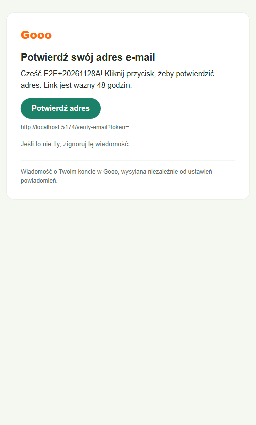

**Kroki**:

1. **Otwórz maila od Gooo** i kliknij zielony przycisk **„Potwierdź adres”**.

   Link jest ważny przez **48 godzin**.

2. **Kliknij „Potwierdź adres” na stronie, która się otworzy.**

   Strona pokazuje adres, który potwierdzasz. Samo otwarcie linku jeszcze niczego nie zmienia — potrzebne jest kliknięcie przycisku.

   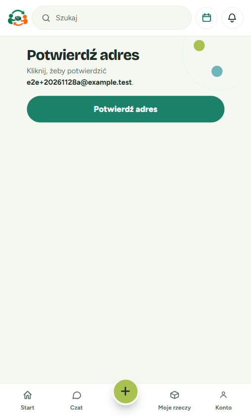

3. **Gotowe!**

   ✅ **Co powinieneś zobaczyć**: napis „Adres potwierdzony”. Przycisk „Ustawienia powiadomień” prowadzi prosto do ustawień maili.

   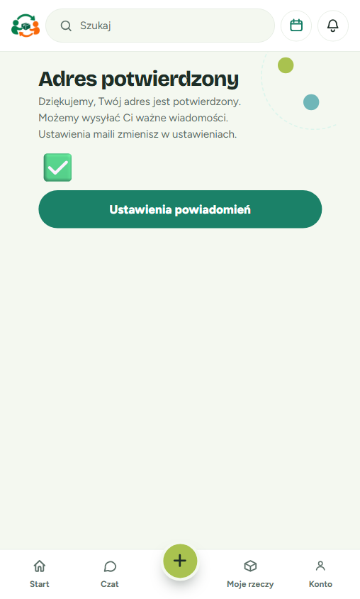

💡 **Wskazówka**: jeśli nie zakładałeś(-aś) konta w Gooo, po prostu zignoruj takiego maila.

### Baner na stronie Start

Dopóki adres nie jest potwierdzony, na stronie **Start** (pod powitaniem) widzisz zieloną ramkę **„Potwierdź swój adres e-mail”**.

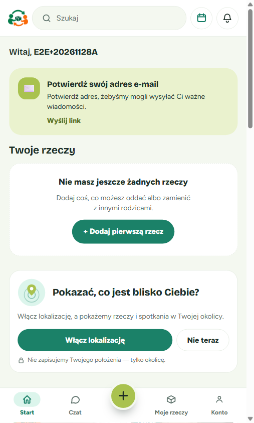

Jeśli nie możesz znaleźć pierwszego maila, kliknij **„Wyślij link”**. Ramka zmieni się na **„Sprawdź skrzynkę”** i pokaże adres, na który wysłaliśmy nowy link.

✅ Po potwierdzeniu adresu ramka znika ze strony Start.

### Ponowne wysłanie linku

Nowy link możesz wysłać:

- z ramki na stronie **Start** („Wyślij link” / „Wyślij ponownie”),
- z **Konto → Powiadomienia e-mail** (przycisk „Wyślij link weryfikacyjny” — więcej w [sekcji 3](#3-ustawienia-powiadomień-e-mail)).

⚠️ **Ważne**: działa zawsze tylko **najnowszy** link. Jeśli wysłałeś(-aś) kilka, użyj tego z ostatniego maila.

💡 **Wskazówka**: po wysłaniu linku przycisk przez chwilę odlicza sekundy („Wyślij ponownie za 49 s”). Tak chronimy Twoją skrzynkę przed zalewem maili. Kolejny link wyślesz po minucie.

### „Link nieważny” — co to znaczy?

Jeśli po kliknięciu linku widzisz **„Link nieważny”**, to znaczy, że:

- minęło więcej niż **48 godzin** od wysłania maila, **albo**
- link został **już użyty** (adres jest wtedy zwykle już potwierdzony), **albo**
- w międzyczasie wysłano **nowszy** link.

**Co zrobić?**

- Jeśli jesteś zalogowany(-a), kliknij **„Wyślij nowy link”** i użyj linku z nowego maila.

  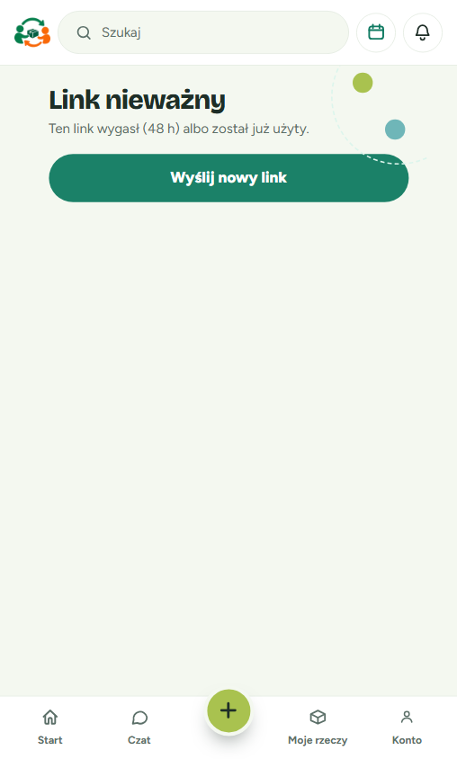

- Jeśli nie jesteś zalogowany(-a), kliknij **„Zaloguj się”** — po zalogowaniu trafisz do ustawień maili, gdzie wyślesz nowy link.

  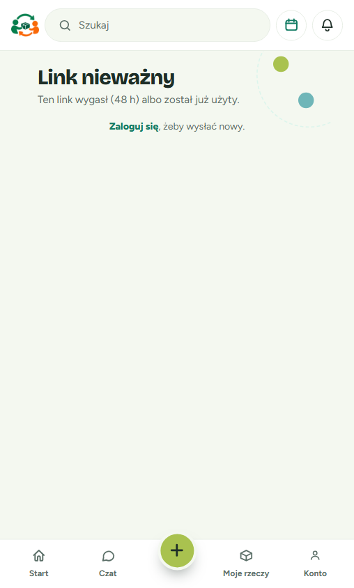

---

## 2. Nie pamiętasz hasła?

Jeśli nie pamiętasz hasła, możesz w kilka minut ustawić nowe — przez link wysłany na Twój adres e-mail.

📝 **Co będzie potrzebne**: dostęp do skrzynki e-mail, której używasz w Gooo.

### Krok po kroku

1. **Na stronie logowania kliknij „Nie pamiętasz hasła?”**

   Link znajdziesz pod polem „Hasło”. Jest też w okienku logowania, które pojawia się w różnych miejscach aplikacji.

   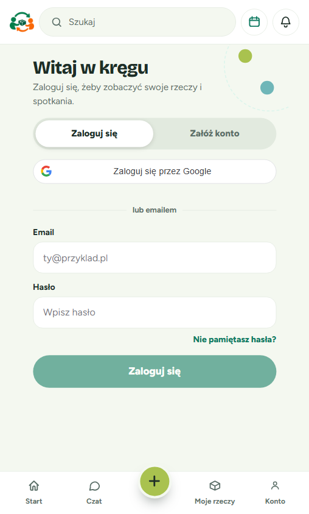

2. **Wpisz adres e-mail swojego konta i kliknij „Wyślij link”.**

   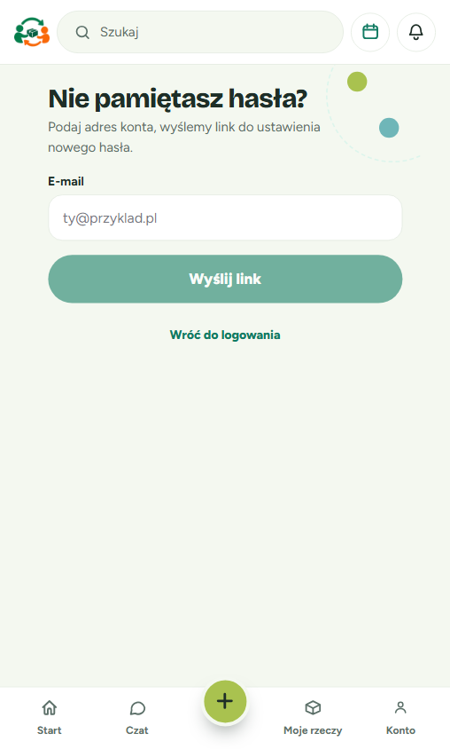

3. **Sprawdź skrzynkę.**

   Zobaczysz komunikat „Sprawdź skrzynkę”. Dla bezpieczeństwa nie zdradzamy, czy konto z tym adresem istnieje — dlatego napis brzmi „Jeśli konto z adresem … istnieje, wysłaliśmy na nie link”.

   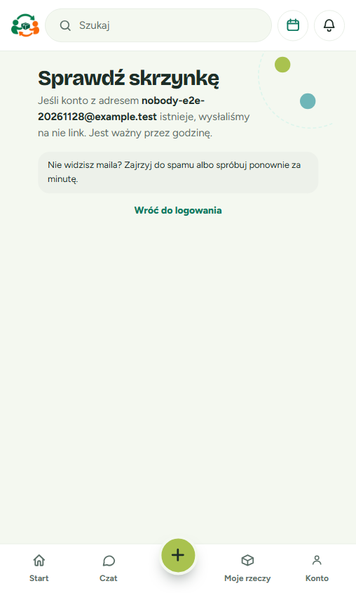

   💡 **Wskazówka**: nie widzisz maila? Zajrzyj do folderu spam albo spróbuj ponownie za minutę.

4. **Otwórz maila „Ustaw nowe hasło” i kliknij „Ustaw hasło”.**

   ⚠️ **Ważne**: ten link jest ważny tylko **godzinę** i działa **jeden raz**.

   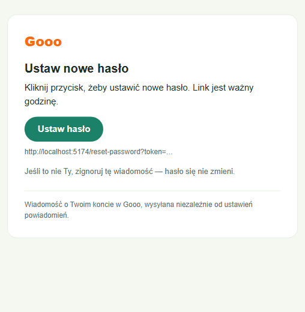

5. **Wpisz nowe hasło dwa razy i kliknij „Zapisz hasło”.**

   Strona pokazuje, dla jakiego konta zmieniasz hasło („Dla konta …”). Jeśli oba wpisy się różnią, zobaczysz czerwony napis „Hasła nie są takie same.” i przycisk nie zadziała, dopóki ich nie poprawisz.

   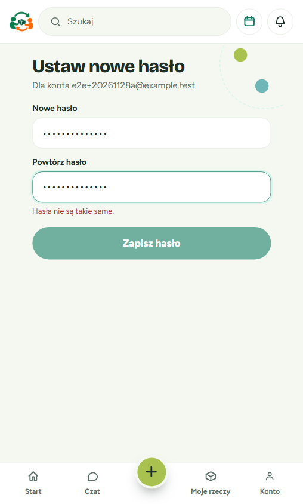

6. **Gotowe!**

   ✅ **Co powinieneś zobaczyć**: „Hasło zmienione”. Kliknij **„Przejdź do logowania”** i zaloguj się nowym hasłem.

   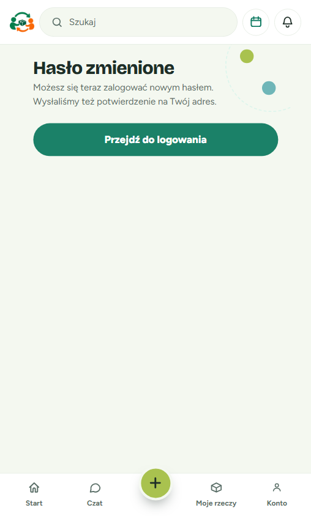

   Jeśli w tej przeglądarce byłeś(-aś) zalogowany(-a), zostaniesz wylogowany(-a) — wystarczy zalogować się nowym hasłem.

### Mail „Hasło zostało zmienione”

Po każdej zmianie hasła wysyłamy krótkie potwierdzenie z datą i godziną zmiany.

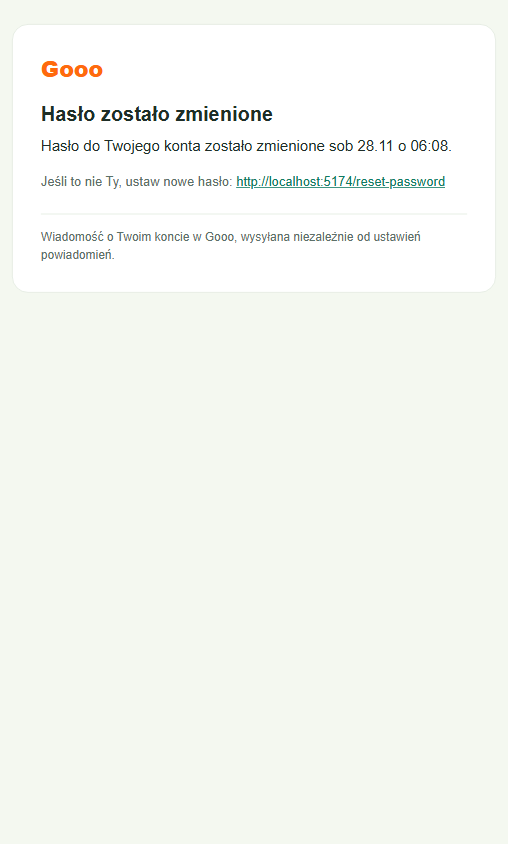

⚠️ **Jeśli to nie Ty zmieniłeś(-aś) hasło**, od razu kliknij link w tym mailu i ustaw nowe hasło.

### „Link wygasł”

Jeśli po kliknięciu linku widzisz **„Link wygasł”**, minęła godzina albo link został już użyty. Kliknij **„Wyślij nowy link”** i zacznij od kroku 2.

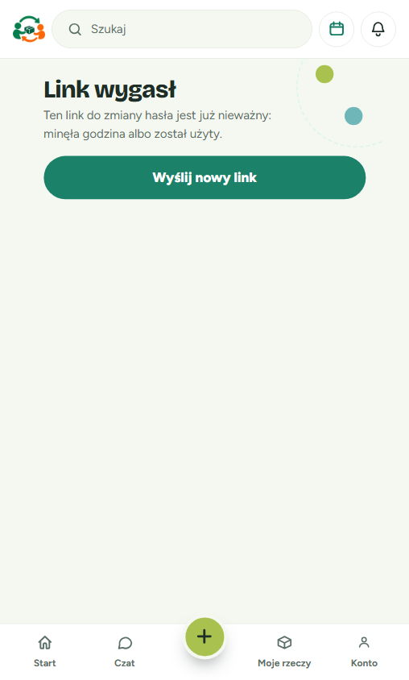

### Logujesz się przez Google? Możesz ustawić hasło

Jeśli konto zakładałeś(-aś) przyciskiem „Zaloguj się przez Google”, nie masz jeszcze hasła. Możesz je ustawić dokładnie tak samo — przez **„Nie pamiętasz hasła?”** (jeśli jesteś zalogowany(-a), najpierw się wyloguj).

W mailu zobaczysz dodatkowe zdanie: *„Logujesz się przez Google. Możesz też ustawić hasło i logować się nim.”*

Po ustawieniu hasła możesz logować się **na oba sposoby**: przez Google albo adresem e-mail i hasłem.

---

## 3. Ustawienia powiadomień e-mail

Tutaj decydujesz, o czym chcesz dostawać maile.

### Jak tam trafić

1. Kliknij **„Konto”** na dolnym pasku.
2. Przewiń do sekcji **„Ustawienia”** i kliknij **„Powiadomienia e-mail”**.

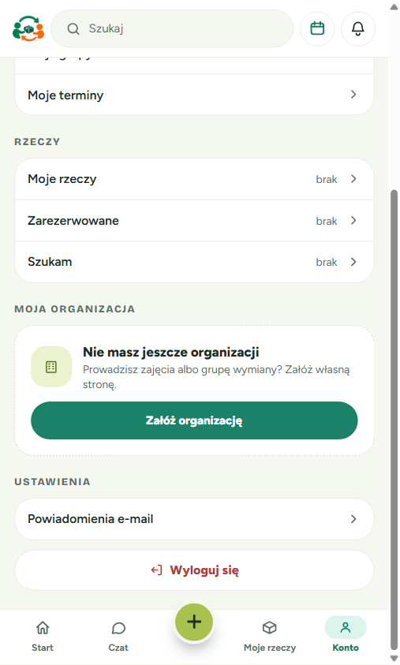

### Co widzisz na stronie

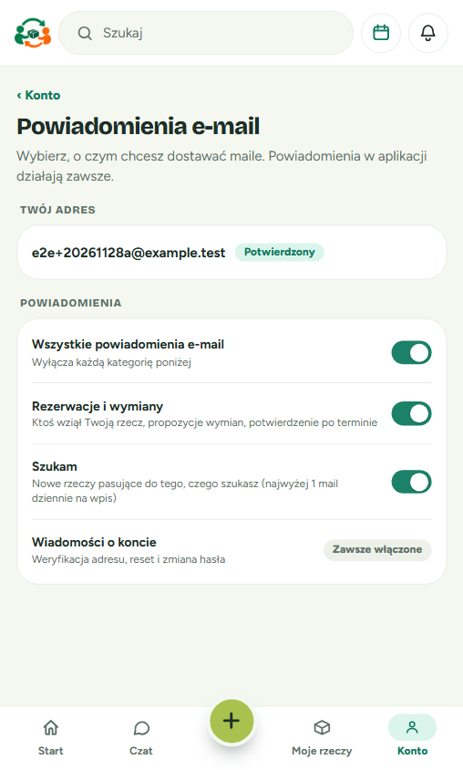

**Twój adres** — adres, na który wysyłamy maile, i jego stan:

- **Potwierdzony** — wszystko w porządku, maile przychodzą.
- **Niepotwierdzony** — trzeba potwierdzić adres (patrz niżej).
- **Wstrzymane** — przestaliśmy wysyłać maile na ten adres (patrz [Najczęstsze pytania](#5-najczęstsze-pytania)).

**Powiadomienia** — przełączniki:

| Przełącznik | Co oznacza |
|---|---|
| **Wszystkie powiadomienia e-mail** | Główny wyłącznik. Gdy go wyłączysz, nie dostaniesz żadnego powiadomienia e-mail. |
| **Rezerwacje i wymiany** | Ktoś wziął Twoją rzecz, ktoś proponuje wymianę, Twoja propozycja została przyjęta lub odrzucona, rezerwacja została anulowana, prośba o potwierdzenie przekazania po terminie. |
| **Szukam** | Pojawiła się rzecz pasująca do tego, czego szukasz — najwyżej **1 mail dziennie** na każdy wpis „Szukam”. |
| **Wiadomości o koncie** | Weryfikacja adresu, reset i zmiana hasła — **zawsze włączone**, nie da się ich wyłączyć. |

### Jak włączyć lub wyłączyć kategorię

1. **Kliknij przełącznik** przy wybranej kategorii.
2. Zmiana zapisuje się **od razu** — nie trzeba nic zatwierdzać.

✅ **Co powinieneś zobaczyć**: przełącznik zmienia kolor (zielony = włączone, szary = wyłączone).

Gdy wyłączysz **„Wszystkie powiadomienia e-mail”**, przełączniki kategorii także robią się szare i nie da się ich zmieniać. Twoje wcześniejsze wybory zostają zapamiętane — po ponownym włączeniu „Wszystkich” wrócą.

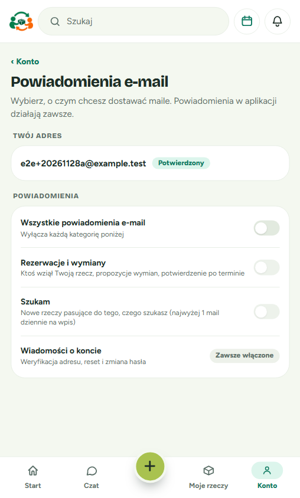

⚠️ Jeśli zmiana się nie zapisze (np. brak internetu), przełącznik wróci na miejsce i pojawi się napis „Nie udało się zapisać zmiany. Spróbuj ponownie.”

### Dlaczego przełączniki są wyblakłe i nie działają?

Jeśli Twój adres jest **„Niepotwierdzony”**, przełączniki są wyblakłe i nie da się ich zmienić. Dopóki adres nie jest potwierdzony, i tak niczego nie wysyłamy — dlatego najpierw trzeba go potwierdzić.

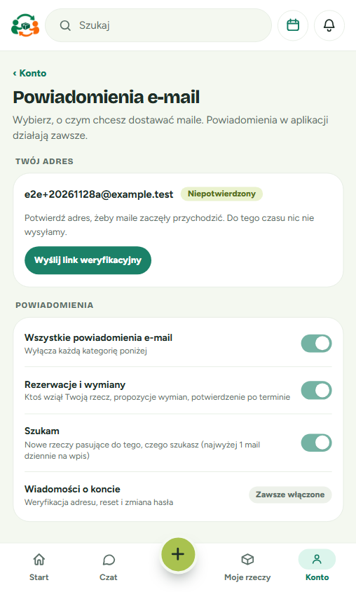

**Co zrobić:**

1. Kliknij **„Wyślij link weryfikacyjny”**.
2. Pojawi się napis „Wysłaliśmy link na … Sprawdź skrzynkę (także spam).”

   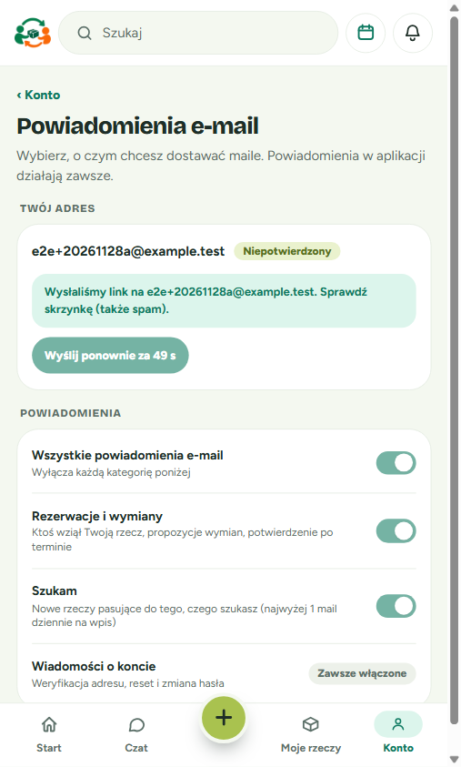

3. Kliknij link w mailu i potwierdź adres (jak w [sekcji 1](#1-potwierdzenie-adresu-e-mail)).
4. Wróć do ustawień — stan zmieni się na **„Potwierdzony”**, a przełączniki zaczną działać.

---

## 4. Wypisanie się z maili

Każde powiadomienie e-mail ma na dole link, który pozwala szybko wyłączyć daną kategorię — bez logowania.

### Krok po kroku

1. **Na dole maila kliknij „Wypisz się z tej kategorii”.**

   Stopka maila mówi też, dlaczego go dostajesz (np. „bo masz włączone powiadomienia »Rezerwacje i wymiany«”).

   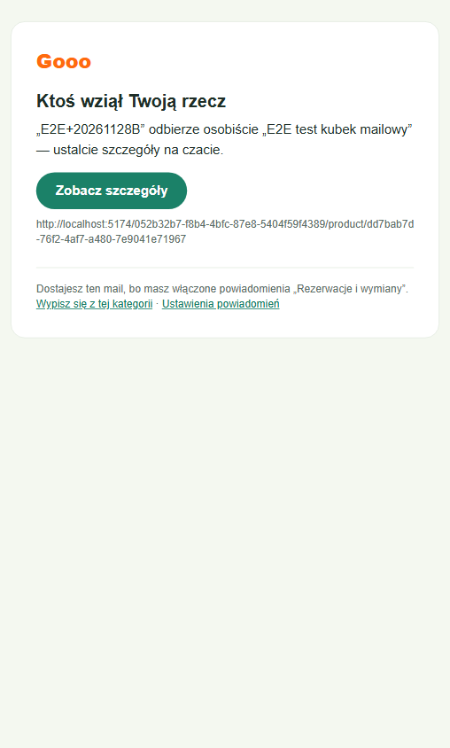

2. **Wybierz, co chcesz wyłączyć.**

   - **„Wyłącz tę kategorię”** — przestaną przychodzić maile tylko z tej kategorii (np. „Rezerwacje i wymiany”).
   - **„Wyłącz wszystkie powiadomienia e-mail”** — przestaną przychodzić wszystkie powiadomienia.

   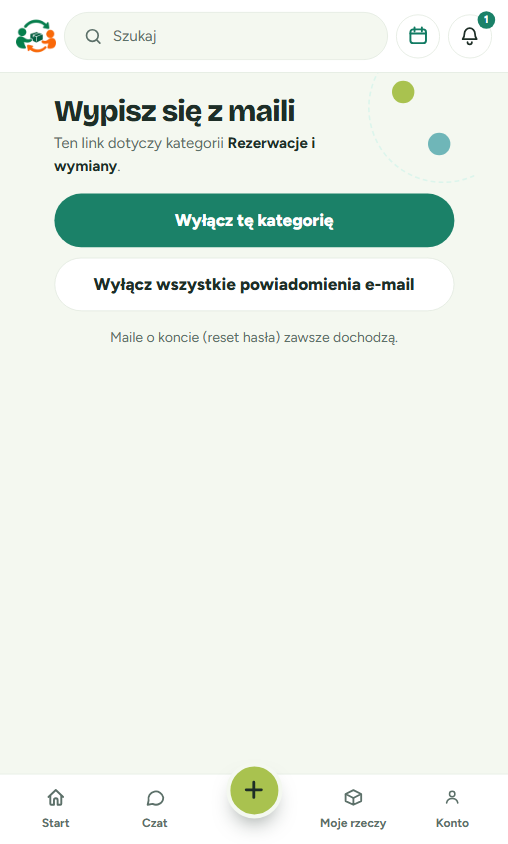

   💡 Samo otwarcie linku niczego nie wyłącza — decydujesz dopiero przyciskiem.

3. **Gotowe!**

   ✅ **Co powinieneś zobaczyć**: „Gotowe — Nie wyślemy już maili z kategorii …”. Powiadomienia w aplikacji (dzwonek) działają bez zmian.

   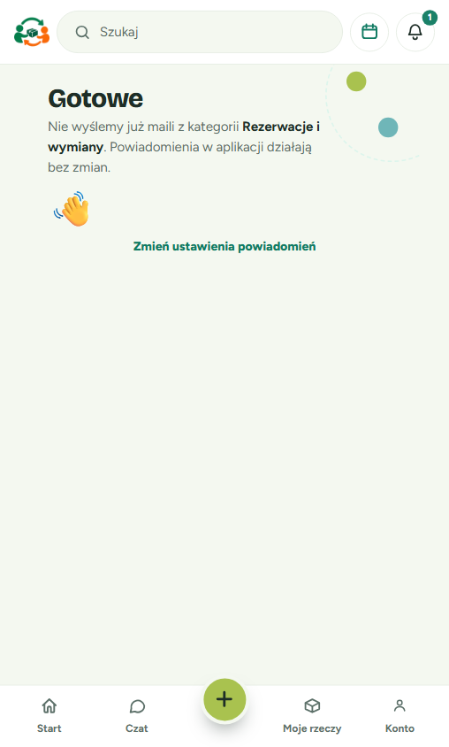

ℹ️ Maile o koncie (np. reset hasła) dochodzą zawsze, nawet po wypisaniu się ze wszystkiego.

### Jak włączyć maile z powrotem

1. Kliknij **„Zmień ustawienia powiadomień”** na stronie „Gotowe” albo wejdź w **Konto → Powiadomienia e-mail**.
2. Włącz przełącznik wyłączonej kategorii (albo „Wszystkie powiadomienia e-mail”, jeśli wyłączyłeś(-aś) wszystko).

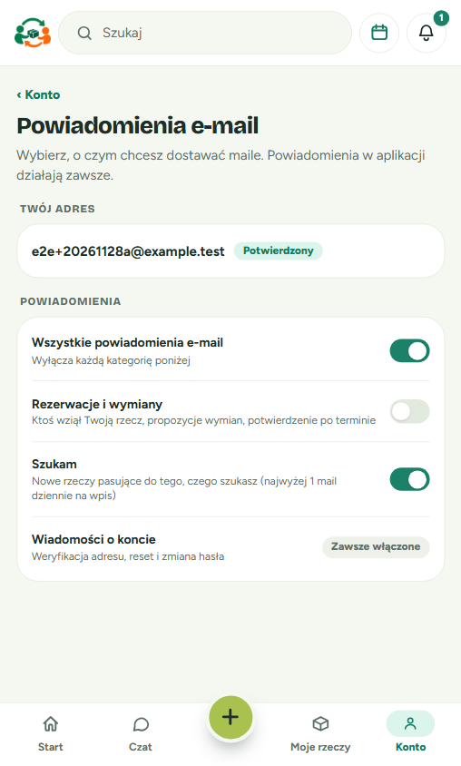

### „Nieprawidłowy link”

Jeśli zamiast wyboru widzisz „Nieprawidłowy link”, link mógł zostać przycięty lub skopiowany z błędem. Kliknij **„Przejdź do ustawień”** i zmień ustawienia po zalogowaniu.

---

## 5. Najczęstsze pytania

### Dlaczego powiadomienie przyszło dopiero rano?

Między **22:00 a 07:00** nie wysyłamy powiadomień, żeby nie budzić Cię w nocy. Powiadomienia z nocy czekają i wychodzą rano, po 7:00.

**Wyjątek**: maile o koncie — potwierdzenie adresu, link do nowego hasła, „Hasło zostało zmienione” — wychodzą **od razu**, o każdej porze.

💡 Powiadomienie w aplikacji (dzwonek) pojawia się od razu, także w nocy. Jeśli powiadomienie e-mail czekało zbyt długo (ok. doby), może już nie zostać wysłane — ale w aplikacji zawsze je znajdziesz.

### Nie dostałem(-am) maila. Co sprawdzić?

1. **Folder spam / „Oferty” / „Społeczności”** — maile czasem tam trafiają. Jeśli znajdziesz tam maila od Gooo, oznacz go jako „To nie spam”.
2. **Czy adres jest potwierdzony?** Wejdź w **Konto → Powiadomienia e-mail**. Bez potwierdzonego adresu powiadomienia nie przychodzą (maile o koncie przychodzą).
3. **Czy kategoria jest włączona?** Sprawdź przełączniki w tych samych ustawieniach.
4. **Czy adres się zgadza?** Na stronie ustawień widzisz adres, na który wysyłamy maile. Literówka w adresie = maile nie dojdą.
5. **Czy przy adresie widać „Wstrzymane”?** Zobacz następne pytania.
6. **Przy „Nie pamiętasz hasła?”** — sprawdź, czy wpisany adres to na pewno adres Twojego konta, i odczekaj minutę przed ponowną próbą.

Jeśli zobaczysz komunikat „Wysyłka maili jest chwilowo niedostępna. Spróbuj później.”, problem leży po naszej stronie — spróbuj ponownie za jakiś czas.

### Przy adresie jest „Wstrzymane” i napis „Maile na ten adres nie dochodziły”

To znaczy, że Twoja skrzynka odrzucała nasze maile (np. była pełna, adres został usunięty albo ma literówkę). Żeby nie wysyłać maili w próżnię, przestaliśmy je wysyłać.

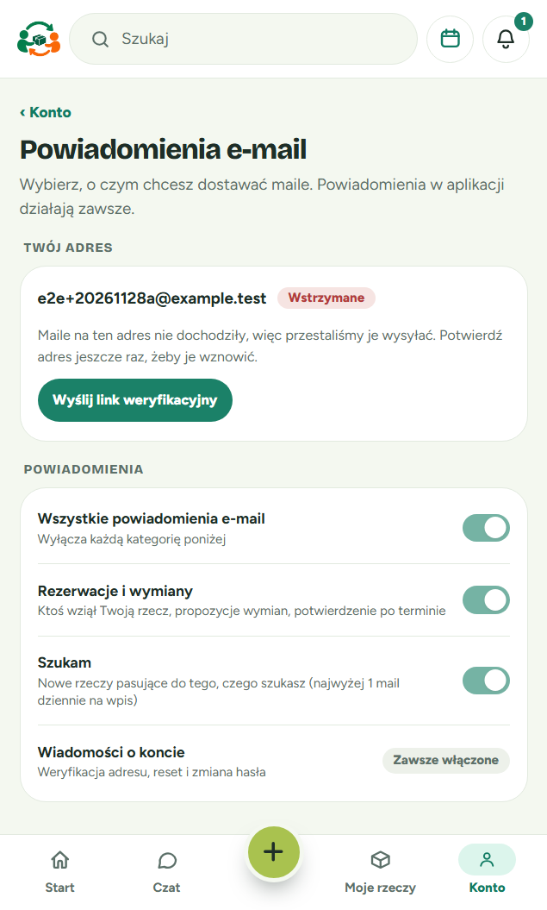

**Co zrobić:** upewnij się, że skrzynka działa, kliknij **„Wyślij link weryfikacyjny”** i potwierdź adres jeszcze raz. Po potwierdzeniu wznowimy wysyłkę.

### Przy adresie jest „Wstrzymane” i napis o spamie

To znaczy, że ktoś w Twojej skrzynce oznaczył maila od Gooo jako spam. Szanujemy to i przestaliśmy wysyłać powiadomienia.

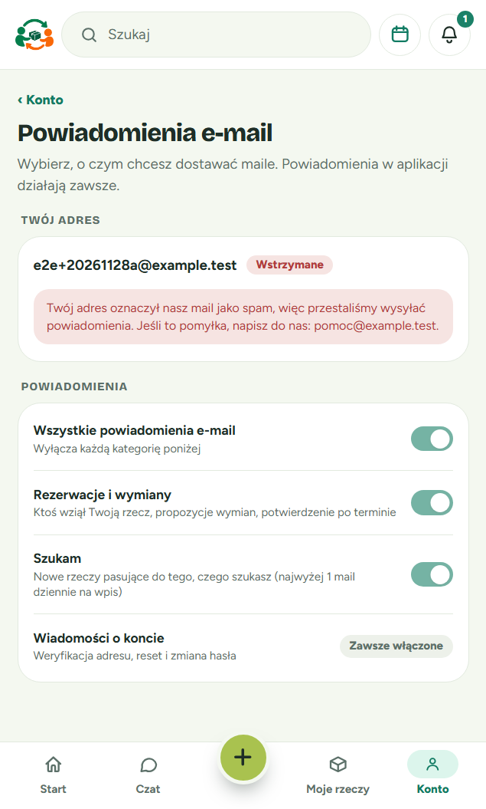

**Co zrobić:** jeśli to była pomyłka, napisz do nas na adres podany w komunikacie — sam(a) nie możesz tego cofnąć. Maile o koncie (np. reset hasła) nadal działają.

### Czy mogę wyłączyć maile o koncie?

Nie. Maile o potwierdzeniu adresu i zmianie hasła dotyczą bezpieczeństwa Twojego konta, dlatego przychodzą zawsze. Wysyłamy je tylko wtedy, gdy coś się dzieje z Twoim kontem.

### Dostaję dużo maili „Szukam”. Czy to normalne?

Dla każdego wpisu „Szukam” wysyłamy **najwyżej jeden mail dziennie**, nawet jeśli pasujących rzeczy pojawiło się więcej. Jeśli nadal to za dużo, wyłącz kategorię „Szukam” w ustawieniach — nowe dopasowania i tak zobaczysz w aplikacji.

---

## Powiązane

- **Konto → Powiadomienia e-mail** — wszystkie ustawienia maili w jednym miejscu.
- **Dzwonek** u góry ekranu — powiadomienia w aplikacji, które działają zawsze.
- **Szukam** — wpisy, dla których dostajesz maile o pasujących rzeczach.
