# Wyróżnione rzeczy — przewodnik

*Ostatnia aktualizacja: 28 listopada 2026*

## Spis treści

1. [Czym są wyróżnione rzeczy?](#czym-są-wyróżnione-rzeczy)
2. [Dla kogo jest ta funkcja?](#dla-kogo-jest-ta-funkcja)
3. [Zanim zaczniesz](#zanim-zaczniesz)
4. [Jak wyróżnić rzecz](#jak-wyróżnić-rzecz)
5. [Jak zdjąć wyróżnienie](#jak-zdjąć-wyróżnienie)
6. [Komunikaty: limit i wyłączone wyróżnianie](#komunikaty-limit-i-wyłączone-wyróżnianie)
7. [Gdzie inni widzą wyróżnione rzeczy](#gdzie-inni-widzą-wyróżnione-rzeczy)
8. [Kiedy wyróżnienie znika samo](#kiedy-wyróżnienie-znika-samo)
9. [Dla administratora: ustawianie limitu](#dla-administratora-ustawianie-limitu)
10. [Wskazówki](#wskazówki)
11. [Rozwiązywanie problemów](#rozwiązywanie-problemów)

---

## Czym są wyróżnione rzeczy?

Wyróżnienie to sposób, żeby **pokazać innym swoje najciekawsze rzeczy na samym początku**.

Wyróżniona rzecz:

- dostaje ciemną plakietkę **„⭐ Wyróżnione”**,
- pojawia się **przed innymi rzeczami** na stronie terminu, wydarzenia, na Twoim profilu i na liście Twoich rzeczy.

Dzięki temu osoby, które przeglądają Twoje rzeczy, od razu zauważą te, na których najbardziej Ci zależy — na przykład rower, który chcesz szybko oddać.

## Dla kogo jest ta funkcja?

- **Dla każdej osoby, która wystawia rzeczy** — możesz wyróżnić kilka swoich rzeczy.
- **Dla odwiedzających** — wyróżnione rzeczy łatwiej zauważyć.
- **Dla administratora** — decyduje, ile rzeczy jedna osoba może wyróżnić naraz (albo wyłącza wyróżnianie).

## Zanim zaczniesz

📝 **Co jest potrzebne:**

- Musisz być zalogowany.
- Rzecz musi być **wystawiona**, czyli mieć wybrany sposób przekazania: „Oddam”, „Zamienię” albo „Za punkty”. Szkicu (rzeczy bez wybranego sposobu) nie da się wyróżnić.
- Możesz wyróżnić tylko kilka rzeczy naraz. Ile dokładnie — ustala administrator (zwykle są to **3 rzeczy**).

---

## Jak wyróżnić rzecz

Wyróżnij rzecz, gdy chcesz, żeby inni zobaczyli ją jako pierwszą.

**Kroki:**

1. **Otwórz „Moje rzeczy”**

   Kliknij **„Moje rzeczy”** na dolnym pasku. Zobaczysz wszystkie swoje rzeczy.

   Przy każdej wystawionej rzeczy, obok przełącznika „Publiczna / Prywatna”, jest przycisk **„⭐ Wyróżnij”**. Przy szkicach go nie ma.

   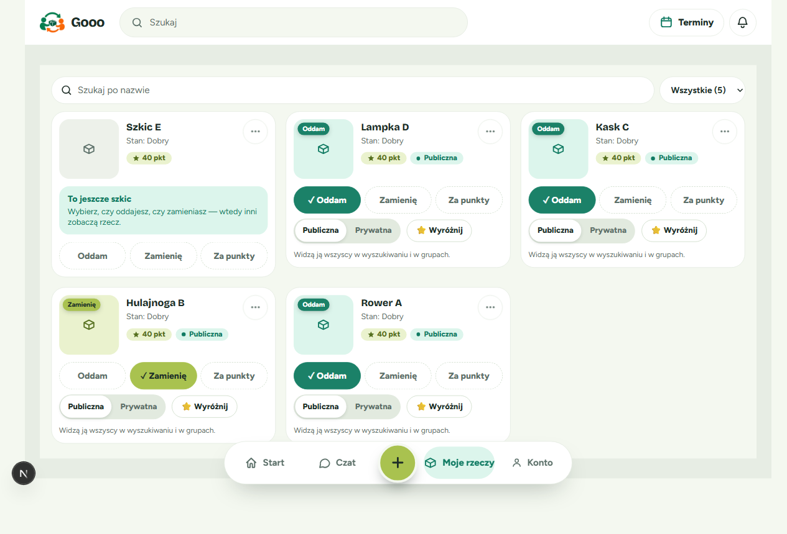

2. **Kliknij „⭐ Wyróżnij” przy wybranej rzeczy**

   Przycisk zmieni kolor na ciemny i napis na **„⭐ Wyróżnione”**. Na karcie rzeczy pojawi się też plakietka „⭐ Wyróżnione”.

   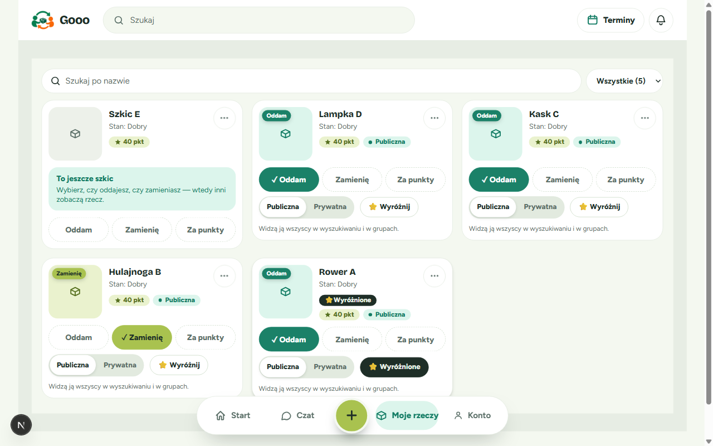

   ✅ **Co powinieneś zobaczyć:** ciemny przycisk „⭐ Wyróżnione” i plakietkę na karcie tej rzeczy.

   💡 **Wskazówka:** kolejność rzeczy na liście „Moje rzeczy” się nie zmienia. Wyróżnione rzeczy idą na początek tylko na stronach, które oglądają inni (opisanych niżej).

**Co dalej:** sprawdź, jak Twoją rzecz widzą inni — zobacz [Gdzie inni widzą wyróżnione rzeczy](#gdzie-inni-widzą-wyróżnione-rzeczy).

## Jak zdjąć wyróżnienie

Chcesz wyróżnić inną rzecz albo ta już nie jest ważna? Zdejmij wyróżnienie.

1. Otwórz **„Moje rzeczy”**.
2. Kliknij ciemny przycisk **„⭐ Wyróżnione”** przy tej rzeczy.
3. Przycisk wróci do jasnego „⭐ Wyróżnij”, a plakietka zniknie.

✅ Zdjęcie wyróżnienia **zawsze się udaje** — nawet wtedy, gdy wyróżnianie jest wyłączone.

## Komunikaty: limit i wyłączone wyróżnianie

Czasem kliknięcie „⭐ Wyróżnij” nic nie zmienia, a na dole ekranu pojawia się krótki komunikat. Oto, co on oznacza.

### „Możesz wyróżnić maksymalnie … rzeczy.”

Masz już wyróżnioną największą dozwoloną liczbę rzeczy. Liczba w komunikacie to Twój limit (np. „Możesz wyróżnić maksymalnie 3 rzeczy.” albo „… 1 rzecz.”).

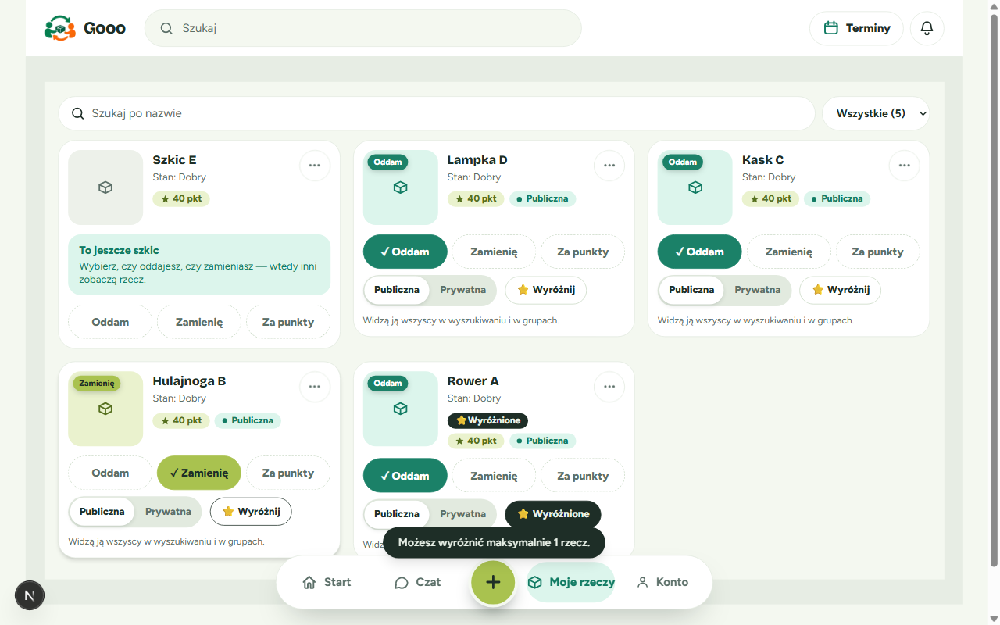

**Co zrobić:** zdejmij wyróżnienie z jednej rzeczy, a potem wyróżnij tę, na której Ci zależy.

### „Wyróżnianie rzeczy jest teraz wyłączone.”

Administrator chwilowo wyłączył wyróżnianie. Nowej rzeczy nie da się teraz wyróżnić.

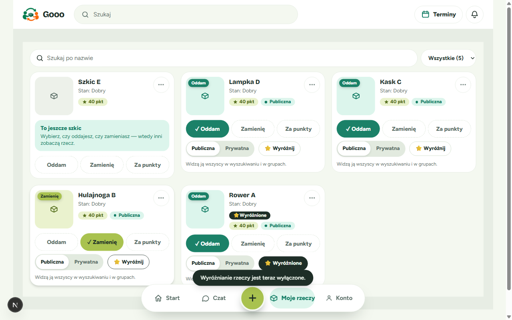

**Co zrobić:** spróbuj później. Rzeczy wyróżnione wcześniej zostają wyróżnione, a wyróżnienie możesz w każdej chwili zdjąć.

---

## Gdzie inni widzą wyróżnione rzeczy

Wyróżnione rzeczy widzi **każdy** — także osoby niezalogowane. Mają plakietkę „⭐ Wyróżnione” i są **na początku listy**. Jeśli wyróżnisz kilka rzeczy, pierwsza będzie ta wyróżniona najpóźniej.

### Strona Twoich rzeczy

Na stronie ze wszystkimi Twoimi rzeczami wyróżnione są pierwsze — w zakładce „Wszystkie” i w każdej innej („Chcę oddać”, „Chcę się zamienić”, „Za punkty”).

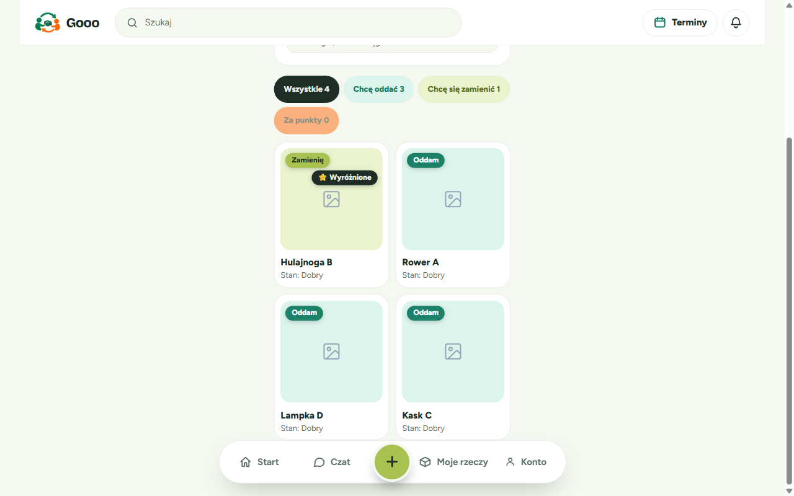

Na telefonie wygląda to tak samo. Plakietka „⭐ Wyróżnione” jest pod plakietką sposobu przekazania („Oddam”, „Zamienię”), więc obie są dobrze widoczne.

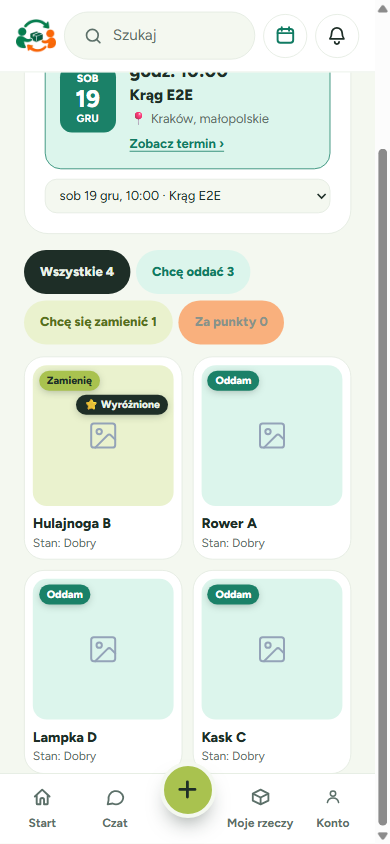

### Twój profil

W sekcji „Rzeczy użytkownika” na Twoim profilu wyróżnione rzeczy też są pierwsze. Tak samo jest na stronie organizacji.

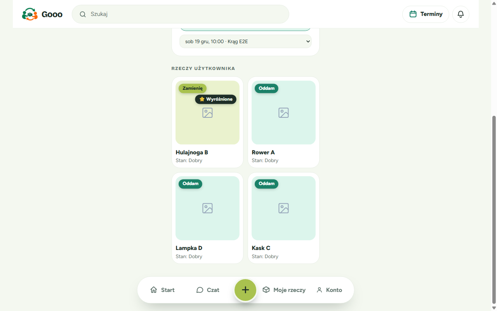

### Strona rzeczy

Na stronie samej rzeczy plakietka „⭐ Wyróżnione” stoi przed informacją o sposobie przekazania (np. „Chcę oddać”).

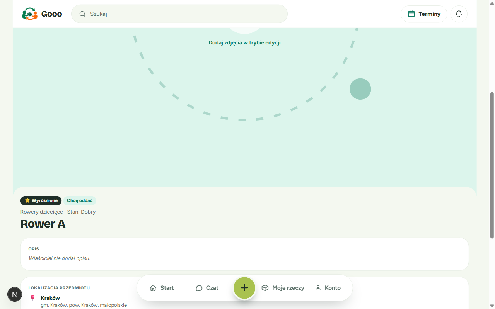

### Strony terminów i wydarzeń

Na stronie terminu („Zapisani na spotkanie”) i wydarzenia („Zapisani na wydarzenie”) przy każdej osobie widać tylko **3 jej rzeczy**. Wyróżnione rzeczy zajmują te miejsca w pierwszej kolejności — nawet jeśli zostały wystawione dawno temu.

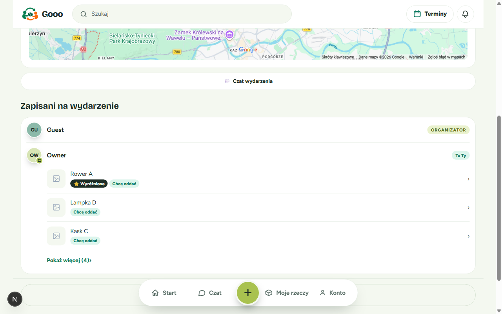

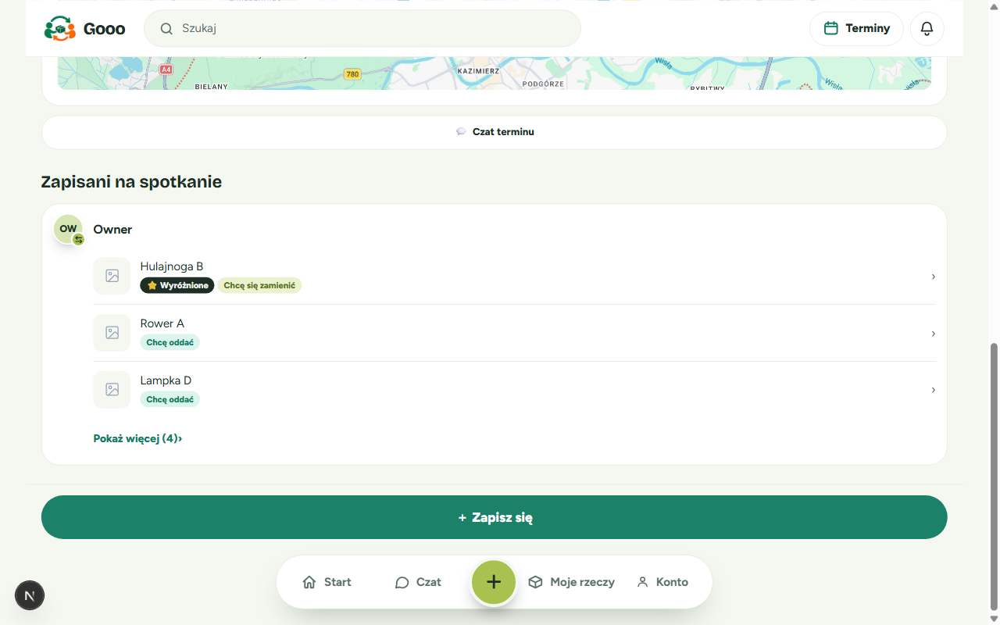

💡 **Wskazówka:** jeśli wyróżnisz więcej niż 3 rzeczy, na terminie i wydarzeniu zobaczą się tylko 3 wyróżnione najpóźniej. Pozostałe są pod linkiem „Pokaż więcej”.

### Gdzie wyróżnienia nie ma

W **wyszukiwarce** wyróżnienie niczego nie zmienia — nie ma tam plakietki, a kolejność wyników jest taka sama jak zawsze. Plakietki nie ma też w kartach w „Szukam”.

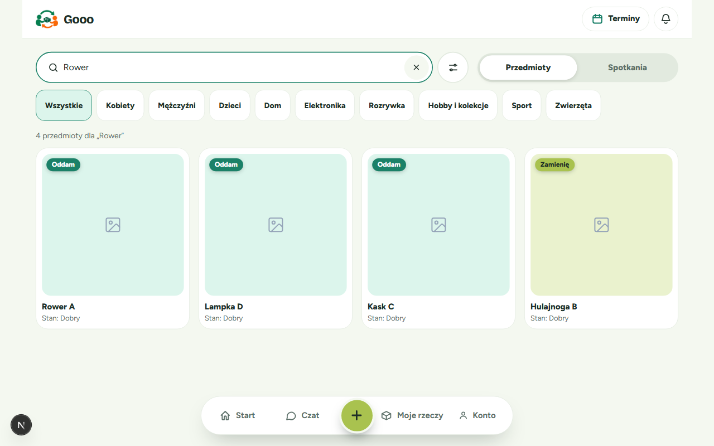

---

## Kiedy wyróżnienie znika samo

Wyróżnienie jest związane z wystawieniem rzeczy. Znika samo, gdy:

- **zdejmiesz rzecz z wystawienia** — w „Moje rzeczy” klikniesz ponownie zaznaczony sposób (np. „✓ Oddam”),
- **przekażesz rzecz** komuś (oddanie, zamiana lub sprzedaż za punkty zostanie potwierdzona).

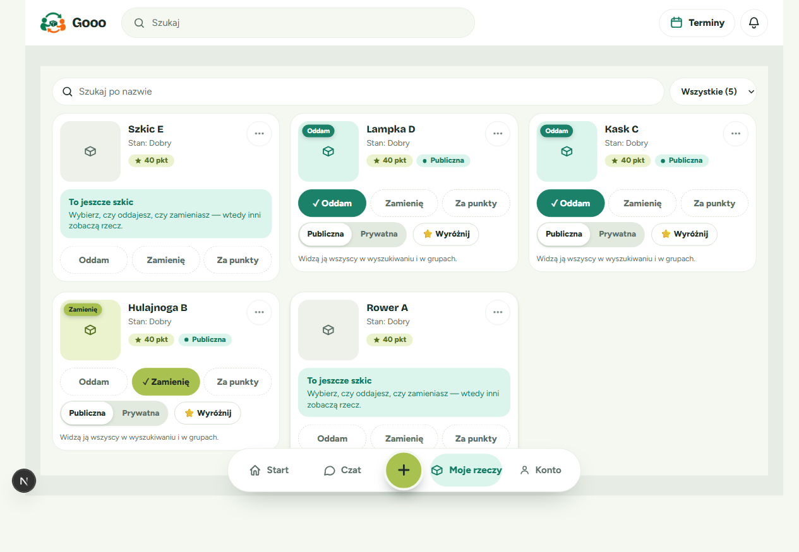

⚠️ **Ważne:** gdy wystawisz tę rzecz ponownie, **nie będzie już wyróżniona**. Jeśli chcesz, kliknij znowu „⭐ Wyróżnij”.

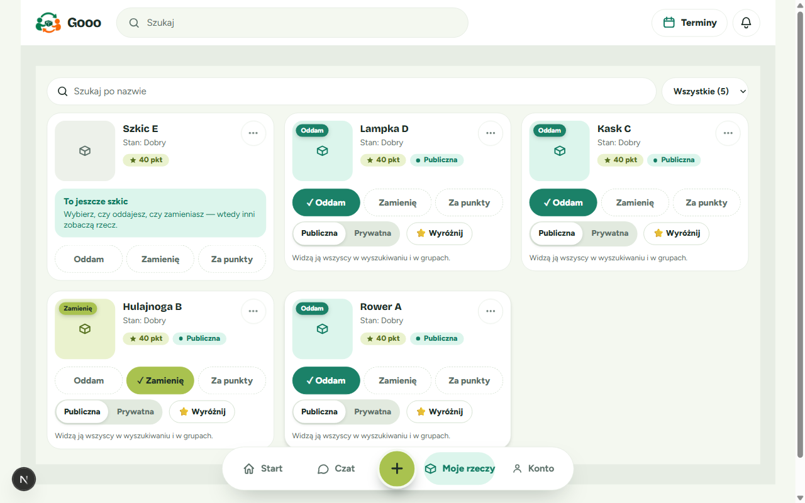

Wyróżnienie **zostaje**, gdy zmienisz tylko sposób przekazania (np. z „Oddam” na „Zamienię”) albo widoczność („Publiczna” / „Prywatna”). Rzeczy prywatne też liczą się do limitu.

---

## Dla administratora: ustawianie limitu

Administrator decyduje, ile rzeczy jedna osoba może wyróżnić naraz.

📝 **Co jest potrzebne:** konto z uprawnieniami administratora.

**Kroki:**

1. **Otwórz panel administratora i kliknij „Settings”**

   Pozycja „Settings” jest w menu po lewej, zaraz pod „Points”. Otworzy się strona **„Ustawienia”** z sekcją **„Wyróżnione rzeczy”**.

   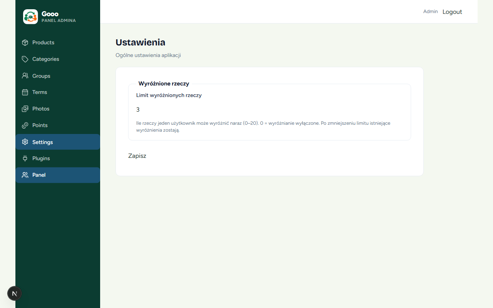

2. **Wpisz nowy limit w polu „Limit wyróżnionych rzeczy”**

   Dozwolone są liczby całkowite **od 0 do 20**. Domyślnie jest **3**.

   - **0** wyłącza wyróżnianie — nikt nie wyróżni nowej rzeczy.
   - Jeśli wpiszesz liczbę spoza zakresu, pod polem pojawi się czerwony komunikat, a przycisk „Zapisz” będzie nieaktywny.

   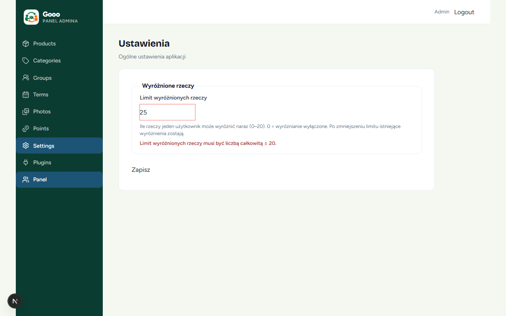

3. **Kliknij „Zapisz”**

   ✅ **Co powinieneś zobaczyć:** komunikat **„Zapisano ustawienia.”**. Nowy limit działa od razu.

   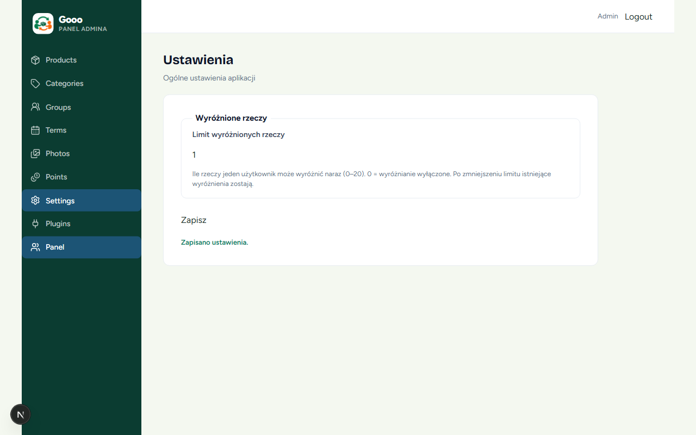

**Dobrze wiedzieć:**

- Po **zmniejszeniu** limitu wcześniejsze wyróżnienia **zostają**. Użytkownicy nie wyróżnią nowych rzeczy, dopóki nie zejdą poniżej nowego limitu.
- Użytkownicy nie widzą limitu na żadnej stronie. Dowiadują się o nim dopiero z komunikatu, gdy go osiągną.

---

## Wskazówki

- 💡 Wyróżniaj rzeczy, które chcesz przekazać najszybciej — będą widoczne jako pierwsze na terminach, na które się zapisujesz.
- 💡 Przed terminem lub wydarzeniem sprawdź, które rzeczy są wyróżnione. Tylko 3 rzeczy każdej osoby są widoczne od razu.
- 💡 Gdy osiągniesz limit, nie musisz czekać — zdejmij jedno wyróżnienie i wybierz inną rzecz.

## Rozwiązywanie problemów

**Nie widzę przycisku „⭐ Wyróżnij” przy mojej rzeczy.**
To szkic. Najpierw wybierz sposób przekazania („Oddam”, „Zamienię” albo „Za punkty”), a przycisk się pojawi.

**Kliknąłem „⭐ Wyróżnij” i nic się nie stało, tylko pojawił się komunikat.**
Masz już wyróżnioną największą dozwoloną liczbę rzeczy albo wyróżnianie jest wyłączone. Zobacz [Komunikaty](#komunikaty-limit-i-wyłączone-wyróżnianie).

**Moja rzecz była wyróżniona, a teraz nie jest.**
Rzecz była zdjęta z wystawienia albo przekazana. Po ponownym wystawieniu wyróżnij ją jeszcze raz.

**Wyróżniłem rzecz, ale znajomy nie widzi jej na początku listy.**
Niezalogowane osoby mogą zobaczyć zmianę z opóźnieniem do około minuty. Poproś o odświeżenie strony po chwili. W wyszukiwarce kolejność się nie zmienia — tak ma być.

**(Administrator) Przy zapisie widzę „Ustawienia zostały zmienione w międzyczasie. Odśwież stronę.”**
Ktoś inny zmienił ustawienia, gdy miałeś otwartą stronę. Odśwież stronę, sprawdź aktualną wartość i zapisz jeszcze raz.

**(Administrator) Przycisk „Zapisz” jest nieaktywny.**
Wpisana wartość nie jest liczbą całkowitą od 0 do 20. Popraw ją zgodnie z komunikatem pod polem.

## Powiązane funkcje

- **Moje rzeczy** — wystawianie rzeczy, wybór „Oddam / Zamienię / Za punkty” i widoczności.
- **Terminy i wydarzenia** — zapisywanie się na spotkania, na których pokazujesz swoje rzeczy.
- **Punkty** — wystawianie rzeczy „Za punkty” (takie rzeczy też można wyróżnić).
